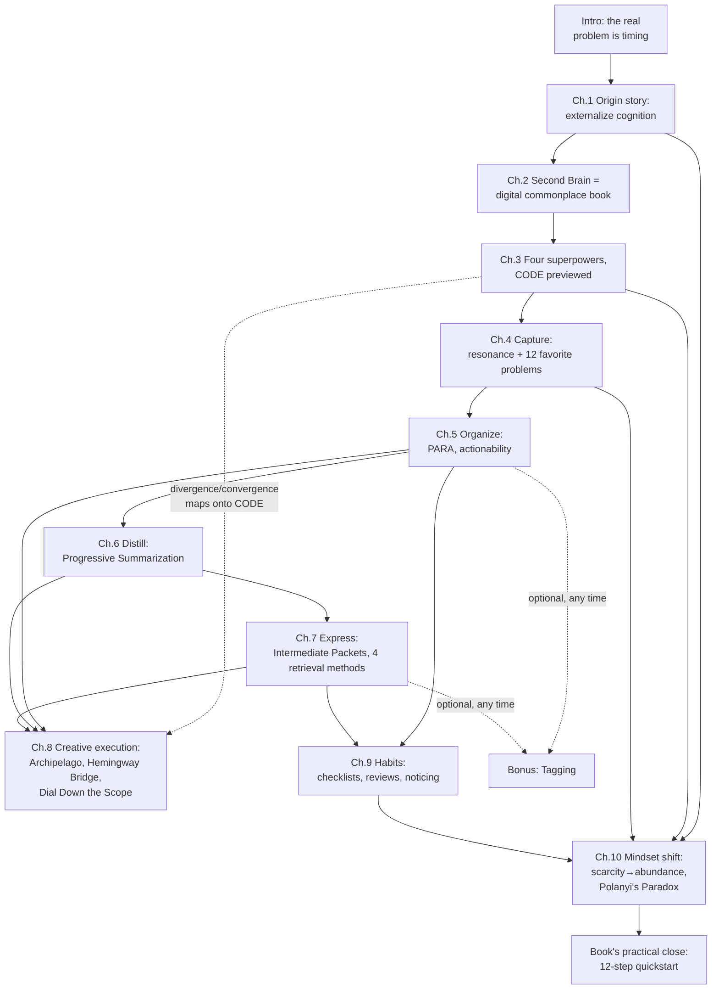

# Building a Second Brain — Map of Content

Map of Content for *Building a Second Brain: A Proven Method to Organize Your Digital Life and Unlock Your Creative Potential* by Tiago Forte (2022). All chapter notes, worked examples, and vault structure built while working through the book — each note is written to be exhaustive enough that you never need to re-read the actual chapter to recall it.

## Chapters

0. [[Introduction - The Promise of a Second Brain]] — the real problem is mistimed information, not lack of it; "send knowledge through time to your future self."
1. [[Chapter 1 - Where It All Started]] — Forte's chronic-illness origin story; notes as externalized cognition; human capital.
2. [[Chapter 2 - What Is a Second Brain]] — the "digital commonplace book" definition; notes as knowledge building blocks.
3. [[Chapter 3 - How a Second Brain Works]] — the four superpowers; choosing a notes app; previews the CODE method.
4. [[Chapter 4 - Capture - Keep What Resonates]] — Twelve Favorite Problems; four capture criteria; intuitive resonance over checklists.
5. [[Chapter 5 - Organize - Save for Actionability]] — PARA (Projects/Areas/Resources/Archives); organize by actionability, not subject.
6. [[Chapter 6 - Distill - Find the Essence]] — Progressive Summarization's four layers (soil/oil/gold/gems); discoverability.
7. [[Chapter 7 - Express - Show Your Work]] — Intermediate Packets; four retrieval methods (search/browse/tags/serendipity); creativity as remix.
8. [[Chapter 8 - The Art of Creative Execution]] — divergence/convergence; Archipelago of Ideas, Hemingway Bridge, Dial Down the Scope.
9. [[Chapter 9 - The Essential Habits of Digital Organizers]] — mise en place; Project Kickoff/Completion Checklists; Weekly/Monthly Reviews; Noticing Habits.
10. [[Chapter 10 - The Path of Self-Expression]] — scarcity→abundance, obligation→service, consuming→creating; Polanyi's Paradox; 12-step quickstart (book's effective conclusion).
11. [[Bonus Chapter - How to Create a Tagging System That Works]] — tags describe context/role, not content; not essential, add only once volume justifies it.

## How the chapters actually build on each other



## Vault structure actually built

```
Claude Notes/
  Books - Index.md                              ← top-level catalog of all books
  Books/
    Building a Second Brain/
      Introduction - The Promise of a Second Brain.md
      Chapter 1 - Where It All Started.md
      Chapter 2 - What Is a Second Brain.md
      Chapter 3 - How a Second Brain Works.md
      Chapter 4 - Capture - Keep What Resonates.md
      Chapter 5 - Organize - Save for Actionability.md
      Chapter 6 - Distill - Find the Essence.md
      Chapter 7 - Express - Show Your Work.md
      Chapter 8 - The Art of Creative Execution.md
      Chapter 9 - The Essential Habits of Digital Organizers.md
      Chapter 10 - The Path of Self-Expression.md
      Bonus Chapter - How to Create a Tagging System That Works.md
      Building a Second Brain - MOC.md             ← this file
      Examples/
        Example - Capture Note (Highlight).md        ← Ch.4 worked example
        Example - Progressive Summarization (4 Layers).md  ← Ch.6 worked example

03-Resources/Obsidian and PKM/
  Favorite Problems.md                           ← Ch.4 worked example (real, editable list)

(Vault root — already existed from the prior "Obsidian Second Brain" book, confirmed
 as this book's own PARA/review system rather than duplicated):
00-Inbox/, 01-Projects/, 02-Areas/, 03-Resources/, 04-Archive/   ← Ch.5 (PARA)
05-Templates/Weekly Review Template.md, Monthly Review Template.md  ← Ch.9
```

## Every open decision flagged across the chapter notes
- **Ch.1**: Consider a running "decision log" for Gloss Local build choices, mirroring Forte's medical-records journaling.
- **Ch.4**: Keep expanding the live Favorite Problems list as real interests surface.
- **Ch.5**: None outstanding — existing vault PARA structure already resolved this chapter's main question.
- **Ch.6**: Whether existing chapter notes in this vault should ever get a formal "Layer 4" executive summary, or whether this MOC already serves that role (this MOC *is* effectively that layer, at the book level).
- **Ch.7**: Whether this vault needs a lightweight tagging convention yet (answered in the Bonus Chapter note: not yet — no demonstrated cross-cutting need).
- **Ch.8**: Whether a "Hemingway Bridge" note template belongs in `05-Templates/` — worth adding if the habit sticks after a few real uses.
- **Ch.9**: Whether to extend the vault's existing (reflection-focused) Weekly Review template with Forte's specific inbox-clearing mechanics, or keep it as-is — a deliberate choice, left open.
- **Bonus**: If you obtain the actual bonus-chapter PDF yourself, that note should be revisited and upgraded from secondhand summary to primary-source coverage.

## The recurring theme across the research
The single most consistent thread surfaced by community research across almost every chapter is a **retrieval/reuse dependency**: nearly every technique in this book (Capture's resonance filter, PARA's actionability sort, Progressive Summarization's layers, Intermediate Packets, the four retrieval methods, even the Weekly Review's deferred processing) only delivers its promised value *if* the underlying material stays genuinely findable later — and the book's most common real-world failure mode (the "collector's fallacy," the "r/PKMS graveyard," over-highlighting) is consistently what happens when capture/input volume outpaces that retrieval guarantee. Chapter 9's closing principle — "a perfect system you don't use isn't perfect" — is the book's own best answer to this tension, even though it arrives only after ten chapters of fairly exacting system-building.

## Related
- [[Books - Index]]
- Gloss Local project: [[Project Overview]]
