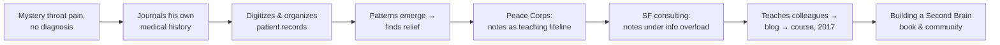

# Chapter 1 — Where It All Started

> [!cite] Book reference
> *Building a Second Brain: A Proven Method to Organize Your Digital Life and Unlock Your Creative Potential* — Tiago Forte. Part One: "The Foundation," Chapter 1: "Where It All Started." Source: user's uploaded PDF.

> [!summary] One-line takeaway
> Forte's whole system was born out of necessity, not theory — a chronic illness forced him to externalize his thinking onto paper and screen, and he later generalized that survival habit into a system for turning any captured information into a compounding personal asset.

## Why this chapter matters
This is the origin story, not the method — it sets up *why* the rest of the book exists before it tells you *how*. Everything that follows (Part Two's CODE method, Part Three's creative habits) is Forte's attempt to turn what was originally an improvised coping mechanism into a repeatable, teachable system. Understanding the "why" here matters because it reframes the book's goal: this isn't productivity-for-its-own-sake, it's building an external support system that doesn't depend on your own memory or willpower.

## Direct quotes from the book
> [!quote] Epigraph
> "Your mind is for having ideas, not holding them." — David Allen, author of *Getting Things Done*

> [!quote] On what the notes actually did for him
> "My notes were as important in finding relief as any medicine or procedure. They gave me the chance to step back from the details of my condition and see my situation from a different perspective."

> [!quote] The moment the "Second Brain" idea crystallized
> "I began to see my as-yet-unnamed Second Brain not just as a notetaking tool but as a loyal confidant and thought partner. When I was forgetful, it always remembered. When I lost my way, it reminded me where we were going. When I felt stuck and at a loss for ideas, it suggested possibilities and pathways."

> [!quote] On human capital (the business case for notes)[^1]
> "the knowledge and the knowhow embodied in humans—their education, their experience, their wisdom, their skills, their relationships, their common sense, their intuition."

> [!quote] On what the book is actually about
> "This book isn't about perfectly optimizing some kind of idealized life... It is about optimizing a system outside yourself, a system not subject to your limitations and constraints, leaving you happily unoptimized and free to roam, to wonder, to wander toward whatever makes you feel alive here and now in each moment."

## The chapter in full (so you never need to re-read it)

### The health crisis
During his junior year of college, Forte began feeling a small pain in the back of his throat for no apparent reason. His doctor found no trace of illness, and over the next few months it got worse — he began seeing more specialized doctors, all of whom concluded "there's nothing wrong with you." The pain kept worsening until he had trouble speaking, swallowing, or even laughing. He ran every diagnostic test and scan available, with no answers. As months turned into years, he started taking a powerful anti-seizure medication that temporarily relieved the pain but came with severe side effects: a numbing sensation throughout his body and severe short-term memory loss — entire trips, books, and experiences with loved ones were wiped from his memory as if they'd never happened. He describes himself at the time as "a twenty-four-year-old with the mind of an eighty-year-old." As his ability to speak freely deteriorated, his discouragement turned to despair — friendships, dating, travel, and finding a career all felt like they were slipping away.

### A personal turning point — discovering the power of writing things down
Sitting in yet another doctor's office, Forte had an epiphany: he was at a crossroads, and could either take responsibility for his own health and treatment, or keep shuttling between doctors indefinitely. He took out his journal and, for the first time, wrote the history of his condition in his own words — which treatments had helped and which hadn't, what he wanted and didn't want, what he was willing to sacrifice. As the story took shape on the page, he knew what to do: he asked the receptionist for his complete patient record. It amounted to hundreds of pages. Knowing he'd never track that on paper, he scanned every page on his family's home computer, turning them into digital records he could search, rearrange, annotate, and share. He became "the project manager of his own condition" — taking detailed notes on everything his doctors told him, trying every suggestion, and generating questions for his next appointment.

With everything in one place, patterns began to emerge. With his doctors' help, he discovered a class of afflictions called "functional voice disorders" — problems with any of the more than fifty pairs of muscles required to properly swallow. He realized the medication was masking his symptoms and, in the process, making it harder to hear what his body was telling him. What he had wasn't an illness curable with a pill — it was a functional condition requiring changes in how he took care of his body. He researched how breathing, nutrition, vocal habits, and even childhood experiences can be manifested in the nervous system, and began to understand the mind-body connection. He devised an experiment: simple lifestyle changes (better diet, regular meditation) combined with voice exercises from a voice therapist.[^2] To his shock, it worked almost immediately — the pain didn't disappear, but became far more manageable.

Looking back, he says his notes were as important in finding relief as any medicine or procedure — a practical medium for turning new information into practical solutions, for both the outer world of medicine and the inner world of sensations. He became "obsessed with the potential of technology to channel the information all around me," realizing that digital notes weren't limited to short handwritten scribbles — they could take any form (images, links, files of any size) and be molded and directed to any purpose.

He started using digital notetaking elsewhere in life too. In college, he turned stacks of disheveled notebooks into an elegant, searchable collection of lessons, mastering the practice of writing down only the most important points and reviewing them on demand. He'd always been a mediocre, average-grade student — teachers had sent him home with notes about his short attention span and wandering mind. He graduated with a nearly straight-A GPA and university honors.

He graduated into one of the worst job markets in a generation (the aftermath of the 2008 financial crisis). With few US opportunities, he joined the Peace Corps and was assigned to a small school in the eastern Ukrainian countryside, teaching English to students aged eight to eighteen for two years. His notetaking system became his lifeline again: he saved lesson examples from textbooks, websites, and USB drives passed around by other teachers, mixing English phrases into word games for his younger students, and teaching the older students the basics of personal productivity — keeping a schedule, taking notes in class, setting goals. Years later he still receives messages of gratitude from former students who used those skills to get into universities and succeed in their first jobs.

Back in the US, he landed a job as an analyst at a small consulting firm in San Francisco. Moving from rural Ukraine to Silicon Valley's pace, he was overwhelmed by the constant barrage of inputs — hundreds of emails a day, dozens of messages an hour. He knew one trick: write things down. He took notes during meetings, on calls, and while researching — facts for client slides, insights from social media to share on company channels, feedback from senior colleagues so he'd actually absorb it. Every new project got a dedicated place on his computer to sort information and decide on a plan of action. As the information tide receded, he gained confidence in his ability to find exactly what he needed, becoming "the go-to person in the office" for finding a file, a fact, or exactly what a client had said three weeks earlier.

### Another shift — discovering the power of sharing
His collection of notes had always been for personal use, but working on consulting projects for major organizations, he began to see it could be a business asset too. He learned from a published report that the value of US physical capital (land, machinery, buildings) is about $10 trillion — dwarfed by the total value of human capital, estimated at five to ten times larger, defined as "the knowledge and the knowhow embodied in humans—their education, their experience, their wisdom, their skills, their relationships, their common sense, their intuition."[^1] That raised the question: was his personal collection of notes itself a knowledge asset that could grow and compound over time? He began to see his as-yet-unnamed Second Brain not just as a notetaking tool but as a loyal confidant and thought partner.

Colleagues asked him to teach them his organizing methods. He found that virtually all of them already used productivity tools (paper notepads, smartphone apps) but rarely in a systematic, intentional way — they moved information around haphazardly, reacting to the moment, never quite trusting they'd find it again. Every new productivity app promised a breakthrough but became just another thing to manage. Casual lunchtime chats turned into a book club, then a workshop, then a paid public class. Teaching more people, he realized he'd discovered something special: his experience managing a chronic condition had taught him a way of getting organized that solved problems and produced results *now*, applicable holistically across any project or goal — not just one-off tasks. And once he had that information at hand, he could easily and generously share it to serve the people around him.

### The origins of the Second Brain system
He began calling his system his "Second Brain" and started a blog to share his ideas. They resonated with a far wider audience than expected — his work was featured in Harvard Business Review, The Atlantic, Fast Company, and Inc., among others. An article about using digital notetaking to enhance creativity went viral in the productivity community, and he was invited to speak and teach workshops at companies like Genentech, Toyota, and the Inter-American Development Bank. In early 2017, he created an online course called "Building a Second Brain" to teach the system at scale.[^3] In the years since, the program has produced thousands of graduates from more than a hundred countries, creating the community in which the lessons in this book were honed and refined.

He previews the book's structure: the next couple of chapters show how building a Second Brain fits a long legacy of thinkers who strove to remember and achieve more, plus the basic principles and tools needed to get started. Part Two, "The Method," introduces the four CODE steps for building a Second Brain so you can capture and share ideas with intention. Part Three, "The Shift," offers ways to use a Second Brain to enhance productivity, accomplish goals, and thrive in work and life.

### Closing reflection
Forte shares his story because he wants readers to know this book isn't about perfectly optimizing an idealized life — everyone experiences pain, makes mistakes, and struggles. Treating his thoughts as treasures worth keeping was the pivotal element in everything he's overcome and achieved. He notes that although readers may find this book under "self-improvement," in a deeper sense it is the opposite: it's about optimizing a system *outside* yourself, not subject to your own limitations and constraints — leaving you "happily unoptimized and free to roam, to wonder, to wander toward whatever makes you feel alive here and now in each moment."

## Core concepts (quick-scan version)

| Stage of Forte's story | What he did | What it taught him |
|---|---|---|
| Undiagnosed chronic throat pain, college | Journaled his own medical history and symptoms by hand, then started digitizing it | Writing things down turns a confusing, emotional situation into something you can analyze and act on |
| Diagnosis search | Scanned hundreds of pages of patient records, made them searchable/annotatable | Patterns only become visible once scattered information is in one place |
| Peace Corps (Ukraine, 2 yrs) | Collected and reused lesson materials from scattered sources (textbooks, websites, USB drives) | A notetaking habit works under resource-scarcity, not just in comfortable conditions |
| SF consulting job | Took notes on everything — meetings, calls, research, feedback — organized per-project | Note-taking under information overload is what made him reliably useful ("the person who remembers") |
| Teaching colleagues | Noticed most people use productivity tools but not *systematically* | The gap isn't tools, it's a system — this is the thesis of the whole book |
| Blog → course (2017) → book | Generalized his personal system into "Building a Second Brain" | A personal survival habit, documented and taught, becomes a method others can adopt |

The chapter plants the book's central reframe early: a "Second Brain" isn't a notetaking app, it's a *thought partner* that remembers for you, redirects you, and offers possibilities — language that matters again once the book reaches Chapter 7 ("Express") and the creative-execution chapters.

## First-principles breakdown

**The claim, stripped of branding:** externalizing information you'd otherwise have to hold in your head (onto paper, then onto a searchable digital system) measurably improves your ability to notice patterns, recall facts under pressure, and act on what you know — independent of what you call the system or how you brand it.

**What has to actually be true for that to hold:**
1. *Working memory is small and lossy.* Human short-term memory reliably holds only a handful of items, and recall degrades further under stress, illness, or simple time decay. Forte's own anti-seizure medication side effect (memory loss) is an extreme, literal illustration of this, not just a plot point — it's the chapter accidentally demonstrating its own premise.
2. *Pattern-finding needs data points to compare, not a single memory to consult.* He couldn't find the "functional voice disorder" pattern by recalling symptoms from memory — he needed many dated, comparable records sitting next to each other. This is a search/comparison problem, and search/comparison problems get easier, not harder, as the dataset grows — but only if the data is structured enough to compare.
3. *Externalized information only has value if it's retrievable at the moment you need it.* A pile of unindexed scanned pages is not inherently better than memory — it's better only once it's searchable. This is the load-bearing, easy-to-skip condition in the whole chapter: capture alone (writing it down) isn't the mechanism, *capture + retrievability* is. This is exactly where the "collector's fallacy" critique below bites — people replicate the "write it down" half of Forte's story without building the retrieval half, and get a pile of notes that behaves no better than memory did.
4. *Compounding only happens if the asset is reused, not just stored.* The "human capital" framing (notes as an asset worth 5-10x physical capital) only holds if the knowledge actually gets applied repeatedly — an asset that's recorded once and never touched again doesn't compound, it just occupies disk space.

**What's empirical vs. anecdotal:** the memory-constraint mechanism (point 1) is well-established cognitive science, not specific to Forte. The specific health outcome (pain became "far more manageable") and the GPA jump (average student → near-straight-A) are a single person's self-reported, uncontrolled case — compelling as illustration, but not evidence that notetaking *caused* either outcome in isolation from effort, timing, or other factors he doesn't fully control for (new voice therapy exercises, diet changes, and meditation all changed simultaneously, so there's no way to isolate notetaking's individual contribution from the story alone).

**Rebuilt in plain terms, independent of "Second Brain" branding:** the mechanism this chapter actually demonstrates is *memory externalization only pays off when the external store is searchable and gets reused* — not "writing things down helps," which is close to a truism. That reframing is useful later: it predicts that any part of the book's system that makes capture easier without also making retrieval/reuse easier (addressed starting in Chapter 5, "Organize," and Chapter 6, "Distill") is solving the less important half of the problem.

## Visual representation

## Worked example — built directly in your vault
Nothing structural to build yet — this chapter is the motivating story, not a method. The actual systems (PARA folders, the CODE capture workflow, progressive summarization) start getting built for real starting with [[Chapter 2 - What Is a Second Brain]] and especially the Organize/Capture chapters later in Part Two. Flagging this explicitly rather than forcing a placeholder artifact.

## What the book doesn't tell you — community perspective (2024–2026)
- **"Guru" and marketing skepticism.** Several reviewers note that Forte has built a business (a paid course, speaking engagements, this book) around the "Second Brain" framing, and that some of the book's language ("arpeggio of ideas," "Hemingway Bridge") reads like recycled blog terminology rather than settled theory — worth keeping in mind as you read the more aphoristic sections later ([Medium — Productivity Core](https://medium.com/@productivitycore/some-critical-points-on-building-a-second-brain-f86122ec8b4f)).
- **Collector's fallacy.** A recurring critique across blogs is that Forte's system makes *capturing* so frictionless that it can turn into hoarding — people accumulate notes faster than they ever revisit or use them, which somewhat contradicts the "compounding asset" framing in this chapter ([Curtis McHale](https://curtismchale.ca/2022/07/30/building-a-second-brain-gives-you-permission-to-fall-into-collectors-fallacy/)).
- **"Audience of one" problem.** A more structural critique: Forte designed his system entirely around his own future-self recall ("how do I make what I'm consuming now discoverable for my future self?"). That works well solo, but notes built this way often lose their meaning when shared with someone else — a real limitation if you intend your Second Brain to be a team or public resource rather than a personal one ([Bookey chapter summary](https://www.bookey.app/book/building-a-second-brain)).
- I did not find credible sources disputing the factual accuracy of the voice-disorder origin story itself — coverage of it is largely descriptive or promotional, not skeptical of the story's truth. Forte has retold the same story consistently in his own blog and talks (see Footnotes below), which is some corroboration, though it's still a self-reported account.

## Deeper commentary — how this applies to your setup specifically
The core insight of this chapter — that writing things down externalizes cognition and turns scattered information into something searchable, annotatable, and reusable — is close to the literal thesis of [[Project Overview|Gloss Local]], the local-first reading app you're building: select a line in a book, get a cited answer in the margin, with everything running on Ollama/SQLite on your own machine instead of a paid service. Forte's "human capital" argument (notes as a compounding knowledge asset) is effectively the same bet you're making with Gloss Local, just pointed at reading instead of general note-taking: a local, owned, searchable record of what you've read and thought, rather than information passing through you and evaporating.

One useful tension to sit with as you keep reading: the "audience of one" critique above is *exactly* the design space Gloss Local lives in too — it's explicitly a single-user, local tool (no Clerk, optional basic auth), so Forte's personal-recall-first approach is actually a reasonable model to borrow from directly, not a limitation to design around, unless you ever plan to make annotations shareable across devices or people.

## Practical / actionable takeaways
- [ ] Notice that this chapter's "lesson" isn't a technique yet — don't try to extract a system from Chapter 1. Treat it as motivation; the actionable method starts in Chapter 2 onward.
- [ ] If you want to eat your own dog food, consider keeping a short captured log of your own build decisions on Gloss Local (what you tried, what worked, what you reversed) — the same move Forte made with his medical records, just applied to a software project instead of a health condition.
- [ ] Keep the "collector's fallacy" critique in mind as you read Part Two — when the book tells you to capture more, ask whether that advice is given alongside a real plan to revisit/use what you capture (it should show up starting in Chapter 6, "Distill").

## Questions / things to decide for your own vault
- Do you want a running "decision log" for Gloss Local in `01-Projects/`, separate from these book notes? Not urgent — just flagging it as a place this chapter's idea could turn into something concrete for you specifically.

## Video
- [The Story Behind Building a Second Brain | Google Talk — Tiago Forte (YouTube)](https://www.youtube.com/watch?v=Y86GOtc1KNo) — Forte telling this exact chronic-pain-to-Second-Brain origin story himself, plus how he decides what to capture and how he preserves the context of his notes. Published via his own site, [Forte Labs](https://fortelabs.com/blog/the-story-behind-building-a-second-brain-google-talk/), so this is a primary source, not a third-party summary.

## Sources (external, beyond the book)
- [Some critical points on Building a Second Brain — Productivity Core (Medium)](https://medium.com/@productivitycore/some-critical-points-on-building-a-second-brain-f86122ec8b4f)
- [Building a Second Brain Gives You Permission to Fall Into Collector's Fallacy — Curtis McHale](https://curtismchale.ca/2022/07/30/building-a-second-brain-gives-you-permission-to-fall-into-collectors-fallacy/)
- [Building A Second Brain Chapter Summary — Bookey](https://www.bookey.app/book/building-a-second-brain)
- [The Story Behind Building a Second Brain — Forte Labs (blog retelling, in Forte's own words)](https://fortelabs.com/blog/the-story-behind-basb/)

## Footnotes
Book's own endnotes for this chapter, verified against the book's "Notes" section (p. 219), plus added context:

[^1]: Erik Brynjolfsson and Andrew McAfee, *The Second Machine Age: Work, Progress, and Prosperity in a Time of Brilliant Technologies* (New York: W. W. Norton & Company, 2014), Kindle location 1990 of 5689. This is the book's actual endnote 1 for Chapter 1 — the source of the "human capital" figures and the quoted definition of human capital.
[^2]: The book's own footnote I here credits Forte's involvement with the **Quantified Self** community — a network of local meetup groups where people share how they track health, productivity, mood, or behavior to learn more about themselves. See [quantifiedself.com](https://quantifiedself.com/).
[^3]: The book's own footnote II points readers to [buildingasecondbrain.com/course](https://www.buildingasecondbrain.com/foundation) for the course referenced in this chapter (the course page has since been folded into "The Foundation" program on Forte Labs' site — linked here as the current live URL).

## Claude's pick — what I'd flag as most important
- The reframe that a Second Brain is a "thought partner," not a filing cabinet — that distinction is the thread that ties the whole book together, and it's easy to lose once you get into folder structures and tagging systems later.
- The human-capital argument is the strongest, least gimmicky part of this chapter — it's a real, cited economic case (Brynjolfsson & McAfee, not just a Forte aphorism) for treating your own notes as an asset.
- Read the "collector's fallacy" critique now, before Part Two, so you go into the Capture chapter with a healthy skepticism about "capture everything" advice rather than adopting it uncritically.

## Related
- Previous: [[Introduction - The Promise of a Second Brain]]
- Next: [[Chapter 2 - What Is a Second Brain]]
- MOC: [[Building a Second Brain - MOC]]
