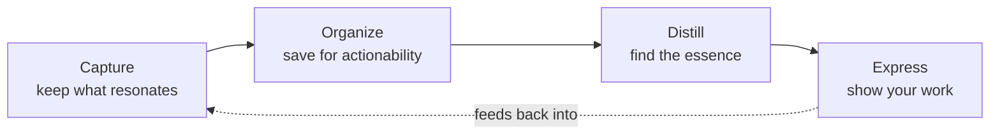

# Chapter 3 — How a Second Brain Works

> [!cite] Book reference
> *Building a Second Brain* — Tiago Forte. Part One: "The Foundation," Chapter 3: "How a Second Brain Works." Source: user's uploaded PDF.

> [!summary] One-line takeaway
> A Second Brain does four specific jobs for you (makes ideas concrete, reveals associations, incubates ideas over time, sharpens your perspective), and the whole system runs on one four-step cycle — Capture, Organize, Distill, Express (CODE) — that this chapter previews before Part Two teaches each step in depth.

## Why this chapter matters
This is the last chapter of Part One — the hinge between "why/what" (Introduction, Ch.1, Ch.2) and "how" (Part Two). It converts the abstract "Second Brain" concept into four concrete, testable capabilities, names the single tool you need to start (a notes app), introduces the three-stage maturity model (Remembering → Connecting → Creating) via real anonymized examples, and previews CODE — the backbone of the entire rest of the book.

## Direct quotes from the book
> [!quote] Epigraph
> "It is in the power of remembering that the self's ultimate freedom consists. I am free because I remember." — Abhinavagupta, tenth-century Kashmiri philosopher and mystic

> [!quote] On writer's block
> "It's not that I'm blocked. It's that I don't have enough research to write with power and knowledge about that topic. It always means, not that I can't find the right words, [but rather] that I don't have the ammunition." — Sebastian Junger[^1]

> [!quote] On distilling for your future self
> "Every time you take a note, ask yourself, 'How can I make this as useful as possible for my future self?'... Think of yourself not just as a taker of notes, but as a giver of notes."

> [!quote] On the point of all this
> "Information becomes knowledge—personal, embodied, verified—only when we put it to use. You gain confidence in what you know only when you know that it works. Until you do, it's just a theory."

## The chapter in full (so you never need to re-read it)

### The four superpowers of a Second Brain
Forte frames a Second Brain as a "personal assistant" you'd hold accountable to a job description, then names four specific capabilities it should deliver:

**1. Make ideas concrete.** Before you can work with an idea, you have to get it out of your head and into a form you can look at. He tells the lesser-known side of Watson and Crick's 1953 DNA discovery: they built physical cardboard cutout models of molecules (borrowing the technique from Linus Pauling) and physically rearranged them on their desks until a shape fit every known constraint — the double helix.[^2] Even scientists comfortable with abstract, mathematical thinking turned to the most basic medium (physical objects) at the decisive moment. Digital notes aren't physical, but they are *visual* — vague concepts become tangible, observable, rearrangeable entities. He cites researchers Deborah Chambers and Daniel Reisberg: "the skills we have developed for dealing with the external world go beyond those we have for dealing with the internal world."[^3]

**2. Reveal new associations between ideas.** Creativity, practically defined, is connecting ideas that don't obviously belong together. Neuroscientist Nancy C. Andreasen's research on highly creative people (scientists, mathematicians, artists, writers) found "creative people are better at recognizing relationships, making associations and connections."[^4] Keeping diverse material in one place — an ancient philosophy quote next to a tweet, a YouTube screenshot next to a movie scene, an audio memo next to a project plan — makes unusual connections more likely, the way mixing up Scrabble tiles surfaces words you wouldn't have thought to look for directly. The more diverse the input, the more original the possible connections.

**3. Incubate ideas over time.** Tackling a task by only drawing on ideas available *right now* — what Forte calls the "heavy lift" — demands instant results with no support system, and is vulnerable to **recency bias**[^5]: favoring whatever occurred to you most recently, regardless of quality. The alternative, the "slow burn," lets ideas accumulate and simmer over weeks, months, or years, turning the passage of time into an ally rather than a threat — but only if there's a durable place to let that accumulation happen.

**4. Sharpen your unique perspective.** The ultimate point isn't gathering others' ideas, but letting your own thinking stand out. He cites a Princeton study finding that the jobs least likely to be automated weren't the ones requiring advanced technical skill, but those requiring conveying "not just information but a particular interpretation of information"[^6] — fundraisers telling impact stories, researchers interpreting data, project managers citing precedent to support a decision.[^7] Advocating for a point of view takes supporting material, not just charisma — Forte uses Sebastian Junger's reframing of writer's block (quoted above) to argue that feeling creatively stuck usually means you lack raw material (examples, stories, statistics, quotes, diagrams), not that your creativity has run dry.

### Choosing a notetaking app — the "neural center"
While a full Second Brain includes a to-do list, calendar, email, and reading apps, Forte recommends one category as the centerpiece: a digital notetaking app (OneNote, Google Keep, Apple Notes, Notion, Evernote, etc.). He identifies four qualities that make notes apps suited to this role: **multimedia** (store any content type in one place), **informal** (no pressure for polish, lowering friction to capture), **open-ended** (a continuous process with no fixed endpoint or output format, unlike slide decks or spreadsheets), and **action-oriented** (don't need to be comprehensive or precise — just enough to capture a stray thought and keep moving). Digitizing these qualities adds search, sharing, backup, editing, linking, and cross-device sync on top. He explicitly discourages perfectionism about tool choice — start with what you already have, note that most apps let you export and migrate later (he's personally switched from Word → Google Docs → Evernote, and expects to keep switching[^8]), and points to `buildingasecondbrain.com/resources` for an updated tool guide. He adds in a footnote that plenty of CODE practitioners still use paper for some notes — it's not binary, it's choosing the right tool for the job.

### Remembering, Connecting, Creating — three stages of maturity
Forte describes three stages people typically pass through, illustrated with three real (anonymized) students from his course:
- **Remembering** (memory aid): **Camille**, cofounder/lead designer of a Quebec EV-charging-station startup, imports findings from research PDFs into her notes so she can annotate freely — turning a rigid format (PDF) into something she can actually work with.
- **Connecting** (thinking tool): **Fernando**, an oncologist, organizes patient notes by condition duration, treatments received, and tumor features, letting him connect his training/research to each specific patient's situation.
- **Creating** (production tool): **Terrell**, a father of three with a demanding tech job in Texas, used his Second Brain to launch a parenting-advice YouTube channel (videos on international travel with kids, requesting paternity leave), tracking video ideas and production details outside his head to balance the side project with his career and family time.

Forte frames these as stages people evolve through as their system matures, not fixed categories — and notes people adapt which stage they're using depending on the current "season" of their lives.

### Introducing the CODE Method
Forte names his four-part method: **Capture, Organize, Distill, Express (CODE)** — both the steps to build a Second Brain initially and the steps to keep working with it afterward. He frames CODE as a timeless pattern (visible from cave paintings to Renaissance workshops to modern fields), tool/profession-agnostic, and likely something readers are already doing informally. He draws a (speculative, explicitly flagged as "a wonderful coincidence") parallel to neuroscience research by May-Britt Moser and Edvard Moser on the brain's spatial "grid code," musing that it might be "some sort of metric or coordinate system" for representing information efficiently.[^9]

He previews each step:
- **Capture — keep what resonates.** You can't consume the entire information stream without being overwhelmed; adopt a curator's mindset and capture only what produces an intuitive, felt reaction ("resonates") — pleasure, curiosity, wonder, excitement — rather than an analytical judgment of importance. This reduces anxiety about forgetting and lets you consciously choose what to let in.
- **Organize — save for actionability.** Don't build an elaborate subject-based taxonomy (like a library's Dewey decimal system) up front. Organize according to your current active projects and ask "how is this going to help me move forward one of my current projects?" — this radically narrows what's actually relevant at any given moment and turns organizing into a contributor to productivity, not an obstacle.
- **Distill — find the essence.** Every idea has a core "essence" — Einstein distilled an entire theory into E=mc². Distilling notes down to their essence (highlighting the most important lines, annotating *why* you saved something) means you can retrieve the main point of a year-old note in seconds, instead of re-reading ten pages. The guiding question: "How can I make this as useful as possible for my future self?"
- **Express — show your work.** The entire point of capturing, organizing, and distilling is to eventually share your own ideas, story, or work — otherwise knowledge serves no purpose.[^10] He names a common failure mode: curious people who endlessly gather more research, case studies, or advice but never pitch, propose, or ask — paralyzed by the fear of missing "one more piece of information." His fix: deliberately shift time and effort from consuming to creating[^11] — information only becomes real, embodied knowledge once it's put to use. What you create depends on your skills/interests (evaluate gear and share a list; teach a recipe; lobby for a cause) — evaluate, share, teach, record, post, lobby are all "synonyms for expression."[^12] Since information is always provisional, there's no need to wait for a finished, perfect state before publishing or sharing.

Forte closes Part One by reassuring the reader that most of the underlying work (constantly learning, consuming, and already trying to track information for school/work/business) is already happening — CODE just adds intentionality and a few practical habits. Part Two will unpack each CODE step with concrete, low-tech techniques.

## Core concepts (quick-scan version)

| Concept | What it means |
|---|---|
| Four superpowers | Make ideas concrete; reveal new associations; incubate ideas over time (beats recency bias); sharpen your unique perspective. |
| The "heavy lift" vs. the "slow burn" | Heavy lift = demanding instant ideas with no support system. Slow burn = letting ideas accumulate and mature over time in a durable store. |
| Notes app as "neural center" | Multimedia + informal + open-ended + action-oriented — the one tool category Forte recommends as the centerpiece, though not the only tool. |
| Three maturity stages | Remembering (memory aid) → Connecting (thinking tool) → Creating (production tool) — illustrated by Camille, Fernando, Terrell. |
| CODE | Capture (keep what resonates) → Organize (save for actionability, not subject taxonomy) → Distill (find the essence for your future self) → Express (the whole point: produce and share). |

## First-principles breakdown

**The claim, stripped of branding:** each of the "four superpowers" and the CODE cycle itself are specific, testable mechanisms for offloading different *parts* of cognitive work (visualization, association-finding, time-insensitive idea storage, and perspective-building) onto an external medium — not one vague claim that "notes help," but four separable ones.

**What has to actually be true for each superpower to hold:**
1. *Concreteness:* externalizing a concept into something visually manipulable only helps if your bottleneck is genuinely working-memory/visualization capacity, not domain knowledge. Watson and Crick's cardboard models worked because they already had the right conceptual building blocks (base-pairing rules, X-ray data) — the physical models solved an *arrangement* problem, not a *knowledge* problem. This bounds the claim: concreteness helps you assemble what you already (partially) know, it doesn't substitute for not knowing enough in the first place (which connects directly to the "ammunition, not writer's block" point later in the same chapter).
2. *Association-finding:* requires genuinely diverse material co-located in a way that's actually browsable/mixable, not just stored. The Scrabble-tile analogy is apt but reveals the hidden requirement: Scrabble only works because all the tiles are visible and shufflable at once. A pile of ten thousand uncategorized notes you never browse provides the same theoretical diversity but none of the practical mixability — this is the first concrete link to the "collector's fallacy" critique (below): volume of capture without actual browsing/resurfacing doesn't produce this superpower.
3. *Incubation:* only beats recency bias if old ideas are actually retrievable later with roughly the same ease as recent ones. If retrieval friction increases as the store grows (badly organized, unsearchable), older ideas become *less* accessible over time, not more — directly inverting the intended effect. This is the same retrieval-vs-capture tension flagged in Chapters 1 and 2, showing up for a third time, which suggests it's the book's single most important unstated precondition.
4. *Perspective-sharpening:* the Junger "ammunition, not writer's block" reframe is a genuinely falsifiable, generalizable psychological claim (creative block is often a knowledge-supply problem, not a "talent" problem) — independent of Forte's branding, and consistent with general creativity research. This is one of the chapter's strongest, most portable ideas.

**What's solid vs. loosely connected:** the Moser/Moser "grid code" neuroscience parallel is explicitly flagged by the book itself as "a wonderful coincidence" — worth taking at face value as speculative color, not as evidence that CODE maps onto actual neural architecture. It's poetic framing, not a scientific claim the chapter is resting weight on.

**Rebuilt in plain terms:** CODE is really a sequencing fix for a well-known cognitive tradeoff — you can't simultaneously consume information, judge its long-term importance, connect it to other ideas, and produce new work in the same moment without one of those tasks suffering. CODE's actual contribution is separating these into four distinct phases (capture now, cheaply; organize minimally, by project relevance; distill later, once you know what matters; express whenever you're ready), so none of them have to happen all at once under time pressure. Whether that's worth the overhead of maintaining four distinct habits — versus just doing a looser version of the same thing — is exactly the open empirical question the community critique below raises.

## Visual representation



```mermaid
flowchart TD
    R[Remembering\nmemory aid] --> N[Connecting\nthinking tool]
    N --> CR[Creating\nproduction tool]
    R -. e.g. Camille,\nresearch excerpts .-> R
    N -. e.g. Fernando,\npatient notes .-> N
    CR -. e.g. Terrell,\nYouTube channel .-> CR
```

## Worked example — built directly in your vault
This chapter is still describing the *shape* of the system rather than a concrete folder structure — PARA (Organize) and progressive summarization (Distill) are named here only as previews, with the real worked examples arriving in Chapter 5 and Chapter 6 respectively. No new vault artifact built for this chapter specifically; the next two chapters are where real structure gets built.

## What the book doesn't tell you — community perspective (2024–2026)
- **"CODE didn't work for me."** A pointed critique from a practitioner who coached multiple clients through the book argues the Distill/Express split is largely redundant in practice — rewriting a highlight in your own words (Distill) already *is* a form of expression for most people, and splitting it into two formal steps adds overhead without adding value for many users ([mattgiaro.com](https://mattgiaro.com/code-second-brain/)).
- **AI has partly automated the hardest step.** Several 2024-2026 reviewers note that Progressive Summarization (Distill), while sound in principle, was designed in a pre-LLM world — tools like Notion AI or Readwise Reader can now generate a usable first-pass summary instantly, changing the cost/benefit calculus of doing it fully by hand every time ([coursescores.com](https://coursescores.com/building-second-brain-tiago-brain-tiago-forte-still-relevant/)).
- **The "r/PKMS graveyard."** A recurring community observation: the tools in CODE "allow you to organize, they do not organize for you," and indiscriminate capturing without a clear purpose tends to produce large numbers of abandoned, half-built Second Brain vaults — the organizing effort itself becomes the project, rather than a means to one.
- **Forte's own response.** Worth noting in fairness: Forte has publicly pushed back on rigidity critiques, arguing a Second Brain should be adaptive like a living system rather than precisely engineered — if one part (e.g. formal Distill) isn't working for you, other parts can compensate, rather than the whole method being all-or-nothing ([Forte Labs — 9 Biggest Myths and Misconceptions about BASB](https://fortelabs.com/blog/9-biggest-myths-and-misconceptions-about-basb/)).

## Deeper commentary — how this applies to your setup specifically
The four superpowers map onto specific, checkable design goals for [[Project Overview|Gloss Local]]: superpower #1 (concreteness) is basically the product's core UX — turning a vague "I should remember this passage" into a concrete, cited, retrievable answer in the margin. Superpower #2 (association) is the one Gloss Local doesn't yet address structurally — a per-book, per-selection Q&A tool doesn't inherently surface connections *across* books or past annotations the way a unified notes app does; that's a meaningful product question worth sitting with as the app matures (does it need its own lightweight cross-book search/browse view to deliver this superpower, or is that explicitly out of scope?).

The "CODE didn't work for me" and "r/PKMS graveyard" critiques are also directly relevant: because Gloss Local is local-first and single-user by design, it sidesteps some PARA/Organize complexity (no team folder taxonomy to maintain), but it doesn't automatically solve the Distill problem — an AI-generated cited answer is captured, but whether it's *distilled* (the "why did I save this" context) is a UX decision still open in the build.

## Practical / actionable takeaways
- [ ] When something in Gloss Local or this vault feels directly useful immediately, notice whether it was captured because it genuinely "resonated" (Forte's Capture filter) or just because it was convenient to save — that distinction predicts whether you'll actually revisit it.
- [ ] Apply the "ammunition, not writer's block" reframe literally next time a Gloss Local feature or this vault's structure feels stuck — ask whether the blocker is actually a lack of raw material/examples rather than a lack of ideas.
- [ ] Keep the Distill/Express redundancy critique in mind before building out a formal "progressive summarization" workflow in this vault (coming in Chapter 6) — decide deliberately whether you want the full multi-layer version or a lighter, merged version.

## Questions / things to decide for your own vault
- Does this vault (or Gloss Local) need an explicit "Organize for actionability" structure (PARA-style), or does the existing `00-Inbox` / `01-Projects` / etc. layout already satisfy that requirement? Worth revisiting once Chapter 5 covers PARA directly.

## Video
- [Apply the CODE method to go from basic notes to a Powerful Second Brain (YouTube)](https://www.youtube.com/watch?v=WZ6xNeT5zmQ) — a direct walkthrough of the four CODE steps this chapter previews, useful as a visual companion to "The chapter in full" above.

## Sources (external, beyond the book)
- [Why You Shouldn't Use CODE In Your Second Brain — mattgiaro.com](https://mattgiaro.com/code-second-brain/)
- [The 9 Biggest Myths and Misconceptions about Building a Second Brain — Forte Labs](https://fortelabs.com/blog/9-biggest-myths-and-misconceptions-about-basb/)
- [Is 'Building a Second Brain' by Tiago Forte Still Relevant in 2026? — coursescores.com](https://coursescores.com/building-second-brain-tiago-forte-still-relevant/)

## Footnotes
[^1]: Tim Ferriss, *Tools of Titans: The Tactics, Routines, and Habits of Billionaires, Icons, and World-Class Performers* (New York: HarperCollins, 2017), 421 — the book's endnote source for the Sebastian Junger quote on writer's block.
[^2]: Wikipedia, s.v. "Molecular Structure of Nucleic Acids: A Structure for Deoxyribose Nucleic Acid," accessed October 13, 2021 — the book's own endnote 1 for this chapter.
[^3]: Deborah Chambers and Daniel Reisberg, "Can mental images be ambiguous?," *Journal of Experimental Psychology: Human Perception and Performance* 11, no. 3 (1985): 317–28.
[^4]: Nancy C. Andreasen, "Secrets of the Creative Brain," *The Atlantic*, July/August 2014.
[^5]: Wikipedia, s.v. "Recency Bias," accessed October 13, 2021.
[^6]: Robert J. Shiller, "What to Learn in College to Stay One Step Ahead of Computers," *New York Times*, May 22, 2015 — the book's cited source for the Princeton automation-resistance finding.
[^7]: Daniel Pink, *To Sell Is Human: The Surprising Truth About Moving Others* (New York: Penguin Group, 2012), 6.
[^8]: The book's own footnote II, on switching notes apps over time (Word → Google Docs → Evernote).
[^9]: The book's own footnote III, citing May-Britt Moser and Edvard Moser's "grid code" research at the Norwegian University of Science and Technology — explicitly framed by Forte as "a wonderful coincidence," not a load-bearing scientific claim.
[^10]: The book's own footnote IV: the word "productivity" shares its Latin root (*producere*, "to produce") with production — Forte's basis for arguing productivity requires a visible output.
[^11]: Each of the three student stories (Camille, Fernando, Terrell) is drawn from real people, per the book's own endnote 8, though names have been changed to protect anonymity.
[^12]: The book's own footnote VI lists additional synonyms for expression: publish, speak, present, perform, produce, write, draw, interpret, critique, translate.

## Claude's pick — what I'd flag as most important
- The four "superpowers" are more rigorous than they first look — each has a real, separable mechanism and a real failure mode, and the First-principles section above shows the same underlying tension (retrieval must stay easy as volume grows) recurring across three of the four.
- Junger's "ammunition, not writer's block" reframe is the single most broadly useful idea in this chapter, independent of whether you adopt any of Forte's system — it's a generalizable diagnostic for creative stuckness.
- Read the "CODE didn't work for me" and "r/PKMS graveyard" critiques before Part Two — they're the clearest warning that the four-step formalism can become its own time sink, which is the main risk to watch for as you implement Capture/Organize/Distill/Express for real in the coming chapters.

## Related
- Previous: [[Chapter 2 - What Is a Second Brain]]
- Next: [[Chapter 4 - Capture - Keep What Resonates]]
- MOC: [[Building a Second Brain - MOC]]
