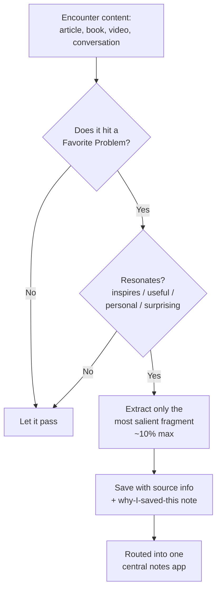

# Chapter 4 — Capture: Keep What Resonates

> [!cite] Book reference
> *Building a Second Brain* — Tiago Forte. Part Two: "The Method: The Four Steps of CODE," Chapter 4: "Capture—Keep What Resonates." Source: user's uploaded PDF.

> [!summary] One-line takeaway
> Capture is curation, not accumulation: save only the small fraction of what you encounter that genuinely resonates (tested against a short list of your own "favorite problems" and four concrete criteria), take only the most salient fragment of each source, and treat the felt sense of resonance — not an analytical checklist — as the primary signal.

## Why this chapter matters
This is the first of the four CODE steps covered in depth, and it sets the tone for the whole method: Forte spends more effort here warning against capturing *too much* than teaching you how to capture more. That's a deliberate signal — Capture is the step most people over-invest in, and getting it wrong here (hoarding instead of curating) undermines every step that follows.

## Direct quotes from the book
> [!quote] Epigraph
> "Everything not saved will be lost." — Nintendo "Quit Screen" message

> [!quote] On choosing an information diet
> "Just as with the food we put into our bodies, it is our responsibility and right to choose our information diet... You are what you consume, and that applies just as much to information as to nutrition."

> [!quote] Taylor Swift on capturing fleeting ideas
> "I kind of have to capitalize on the excitement of me getting that idea and see it all the way through or else I'll leave it behind and assume it wasn't good enough."[^1]

> [!quote] Claude Shannon's definition of information
> "that which surprises you"[^2] — if you're not surprised, you already knew it at some level, so why take note of it?

> [!quote] On the core instruction
> "If you take away one thing from this chapter, it should be to keep what resonates... making decisions analytically, with a checklist, is taxing and stressful... the secret to making reading a habit is to make it effortless and enjoyable."

## The chapter in full (so you never need to re-read it)

### Information as food for the brain
Forte opens with the analogy that information is as necessary for survival as food and water — for understanding environment, maintaining relationships, and making good decisions — and argues we have the same responsibility to curate our "information diet" as our literal diet. A Second Brain is the filter: a private "knowledge garden" seeded only with the most interesting, insightful, useful ideas encountered.

### Building a private collection of knowledge
Two extended creative-process examples anchor the chapter. **Taylor Swift** — described via her documentary films — is shown constantly capturing lyric fragments and melodic hooks in her phone's notes app, editing and riffing on them later; her own account of writing "Blank Space" describes assembling the song from lines she'd jotted down over "the last couple of years," not inventing it all in one sitting.[^3] Forte frames this as proof that even extraordinary natural talent needs a capture system — talent must be "channeled and developed," not just possessed. **Jerry Seinfeld** is quoted describing decades of saving every bit he wrote on yellow legal pads in accordion folders, bluntly rejecting the idea that keeping that material was unusual: "What could possibly be of more value?"

### Creating a knowledge bank
Building on Chapter 2's commonplace-book history, Forte notes that modern professions have their own versions of the same practice: songwriters' "hook books," programmers' "code libraries," lawyers' "case files," marketers' "swipe files." The challenge for everyone else is deciding what's worth keeping without knowing in advance how it'll be used. His answer: radically expand the definition of "knowledge" — it isn't just scholarly wisdom, it's "content" in the everyday digital sense (text snippets, screenshots, bookmarked articles, podcasts), both gathered from outside and created by you (emails, project plans, brainstorms, journal entries). These are "knowledge assets"[^4] — anything usable later to solve a problem, save time, illuminate a concept, or learn from past experience, mundane or profound.

He lists concrete external sources (highlights, quotes, bookmarks/favorites, voice memos, meeting notes, images, takeaways) and internal sources (stories, insights, memories, reflections, musings) worth capturing, and recommends starting with just two or three types you already have the most of, rather than trying to capture from everywhere at once.

### What not to keep
Four categories don't belong in a notes app: **sensitive information** (tax records, passwords, health records — notes apps favor accessibility over security), **specialized file formats** better handled by dedicated apps (Photoshop files, video footage), **very large files** (notes apps are built for lightweight text/images), and **collaboratively-edited documents** (notes apps are for private, individual use).

### Twelve Favorite Problems
Forte introduces an exercise inspired by Richard Feynman, who reportedly described keeping "a dozen of your favorite problems constantly present in your mind... Every time you hear or read a new trick or a new result, test it against each of your twelve problems to see whether it helps."[^5] Forte tells Feynman's famous "wobbling plate" anecdote (from James Gleick's biography[^6]) — noticing a Cornell cafeteria plate's spin-to-wobble ratio sparked purely curious investigation that later informed his Nobel-winning work on rotation in quantum electrodynamics, despite Feynman's own "It doesn't have any importance... Isn't it fun?" response when asked about its use at the time. The exercise: write down your own open-ended "favorite problems" (not yes/no questions) — Forte's own example is his childhood LEGO-organizing obsession evolving into his adult fixation on "how can creativity emerge out of chaos?" — and use this list as an ongoing filter for what's worth capturing, since these interests tend to stay stable for years even as jobs and projects change.

### Capture criteria: avoiding too much or too little
The central practical problem: saving an entire long article "because it's good" just defers the same reading effort to your future self and provides false security (bookmark-and-forget means you don't actually know what it contains). The fix: recognize that value within any piece of content is unevenly distributed, and extract only the most salient fragment — a passage, not a chapter; a few quotes, not a transcript; a few screenshots, not a whole site — always keeping a link back to the source. Forte names this the "Curator's Perspective": economical capture now means less organizing/distilling/expressing burden later.[^7] He offers four concrete criteria for what's worth keeping:
1. **Does it inspire me?** Inspiration can't be summoned on demand, but a saved collection of inspiring material can be revisited when needed — Forte's own example is a folder of customer testimonials he reopens when feeling discouraged.
2. **Is it useful?** Like a carpenter's workshop "offcuts" bin — a statistic, reference, or diagram that costs nothing to keep and often turns out to be the missing piece later. Forte keeps a folder of stock images/graphics for this reason.
3. **Is it personal?** Your own reflections, memories, and mementos — nobody else values or has access to the specific wisdom gained from your own life. Forte cites saving screenshots of warm/funny text exchanges with family.
4. **Is it surprising?** Directly opposing confirmation bias[^8] — Forte invokes Claude Shannon's information-theoretic definition of information as "that which surprises you." If a note doesn't have the potential to change your mind, its value as a *note* (versus a reminder of something you already believed) is questionable.

### Ultimately, capture what resonates
Despite offering four analytical criteria, Forte's stated headline advice is the opposite of analysis: keep what *resonates* — a felt, intuitive, often-inexplicable sense of being moved or surprised (quickened pulse, widened eyes, a subtle slowing of time), rather than a reasoned checklist decision. He grounds this in two bodies of research: that "emotions organize—rather than disrupt—rational thinking"[^9], and the Iowa Gambling Task-style card study from *Designing for Behavior Change*, where participants' bodies showed stress responses to a "bad" deck of cards before their conscious minds had figured out the deck was rigged — evidence that intuition can detect patterns before conscious reasoning catches up. He also recommends habitually capturing source metadata (URL, title, author, date)[^10] and any existing structure (headings, bullet points) the original author already provided, since that's free distillation.

### Capture tools, beyond the notes app itself
Forte surveys common capture mechanisms: ebook highlight exports, read-later apps, built-in mobile notes apps, social media "favorite" exports, web clippers, voice/audio transcription, and third-party automation/integrations. He frames these as an "extended nervous system" reaching into the world, with the explicit instruction to always route findings back into one central notes app rather than leaving knowledge scattered across dozens of tools. He gives specific micro-workflows: Kindle highlight-and-export; read-later apps as a "to-read" queue you revisit when free; podcast app clip/bookmark features with auto-transcription; voice memo apps with auto-transcription; YouTube's auto-generated transcripts (via "Open transcript") for copy-pasting quotes; email forwarding to a special notes-app address; and any app with a share/copy-paste function.

### The benefits of externalizing thought
Beyond simple preservation, Forte cites the "Generation Effect"[^11] — actively producing words (writing/speaking) activates more of the brain than passively reading the same words, making written notes more memorable than mere re-reading. He also argues writing *creates* new knowledge, not just transfers existing thoughts, via "detachment gain"[^12] — putting a thought into words triggers new associations that wouldn't otherwise surface. He cites expressive-writing research (one of the most-cited psychology papers of the 1990s[^13]) linking writing about emotional experiences to measurable drops in doctor visits, improved immune response, reduced distress, better grades, and faster reemployment after layoffs — benefits that occurred without anyone reading or responding to what was written. Finally, he names the "reactivity loop" — the urgency/outrage cycle of constant online content — and argues capturing lets you defer judgment on an idea's importance until you're calmer, rather than reacting the instant you encounter it; he notes that much of what seemed urgent when first saved looks "clearly trivial" on later review.

### Closing: "what would this look like if it was easy?"
Forte closes with a deliberately low-pressure prompt: capture is meant to feel effortless, not like a new chore — he personally captures roughly two notes a day. He reiterates there's no "correct" way to capture, nothing is permanent (notes can always be reorganized or deleted later), and CODE's steps can be adopted one at a time rather than all at once.

## Core concepts (quick-scan version)

| Concept | What it means |
|---|---|
| Curator's Perspective | Save the most salient fragment, not the whole source — keep ~10% of the original at most.[^7] |
| Twelve Favorite Problems | A stable, personal list of open-ended questions used as an ongoing filter for what's worth capturing. |
| Four capture criteria | Does it inspire me? Is it useful? Is it personal? Is it surprising? |
| Knowledge asset | Any piece of content/creation (external or internal) usable later to solve a problem, save time, or learn from experience. |
| Resonance (the headline rule) | An intuitive, felt signal (not an analytical checklist) that something is worth saving — the book's stated #1 takeaway, despite also providing four analytical criteria. |
| What not to keep | Sensitive info, specialized file formats, very large files, collaboratively-edited docs. |
| Reactivity loop | The urgency/outrage cycle of the internet — capturing lets you defer reacting until calmer. |

## First-principles breakdown

**The claim, stripped of branding:** selective, low-volume capture of information fragments (not whole sources) — filtered by a mix of stable personal interest and an intuitive "this matters" signal — produces a more useful long-term knowledge store than either passive consumption or indiscriminate archiving.

**What has to actually be true for that to hold:**
1. *Uneven value distribution within sources is real and exploitable.* This is empirically plausible and easy to self-verify (most articles/books have a handful of load-bearing sentences) — it's the premise that makes "save ~10%" a coherent strategy rather than an arbitrary number.
2. *Intuitive resonance and analytical criteria must actually point the same direction most of the time*, or the chapter is internally inconsistent — Forte gives four explicit, checkable criteria, then says the "real" rule is to ignore analysis and trust intuition. The resolution is that the four criteria are offered as a *training aid* to calibrate intuition, not a competing decision procedure — but this is implicit, not stated, and it's exactly the ambiguity the "checklist vs. intuition" community critique below picks up on.
3. *The Twelve Favorite Problems mechanism only works if those problems are genuinely stable.* Forte's evidence for this (his own LEGO-to-PKM arc, asking childhood friends what you were obsessed with) is anecdotal and self-selected — people whose core interests have genuinely shifted (career change, major life event) would get a filter actively pointing at the wrong material. The claim "favorite problems persist for years" is a reasonable generalization, not a universal law.
4. *The capture benefits cited (Generation Effect, detachment gain, expressive-writing health research) are real, well-established psychological findings* — but they're evidence that *writing in general* has cognitive/health benefits, not specifically that Forte's four criteria or resonance-based filtering are the optimal way to decide *what* to write about. The chapter blends "why writing helps" (strong evidence) with "how to decide what's worth writing" (Forte's own framework, much less independently verified) without clearly separating the two.

**Rebuilt in plain terms:** the mechanism actually being described is a two-stage filter — a slow-changing personal relevance filter (favorite problems) combined with a fast, per-item gut-check (resonance/criteria) — applied to small fragments rather than whole documents. That's a sound design in principle (narrow inputs, cheap per-item decisions, durable high-level filter), but its real-world success hinges entirely on whether the person applying it can tell genuine resonance apart from novelty-seeking or completionist impulse — something the chapter asserts can be trained, but doesn't offer a way to verify for any individual reader.

## Visual representation

## Worked example — built directly in your vault
Built two real artifacts for this chapter, both cross-linked below:
- **`03-Resources/Obsidian and PKM/Favorite Problems.md`** — a real, editable Favorite Problems list seeded with Gloss Local-related prompts, following Forte's exercise exactly (open-ended questions, not a forced count of twelve).
- **`Claude Notes/Books/Building a Second Brain/Examples/Example - Capture Note (Highlight).md`** — a demo capture note showing the full pattern this chapter recommends (salient excerpt only, source metadata, a one-line "why I saved this," and which capture criterion it satisfies), clearly labeled as a demo rather than a real captured note.

## What the book doesn't tell you — community perspective (2024–2026)
- **Intuition vs. checklist tension.** At least one reader's public reading notes flag the exact inconsistency raised in the First-principles breakdown above — questioning why the chapter spends several pages on four analytical criteria, then states the opposite ("don't make it an analytical decision") as the real takeaway ([matthewkudija.com reading notes](https://matthewkudija.com/reading-notes/2022-07-15-Building-A-Second-Brain.html)).
- **The capture-volume trap is the single most commonly cited failure mode of this whole book**, and this is the chapter where it originates — multiple reviewers specifically flag that despite Forte's own "10% rule" and curator framing, readers routinely over-capture in practice because resonance is a weak, easily-triggered filter for naturally curious people (echoing the "collector's fallacy" critiques already surfaced in earlier chapter notes, but rooted specifically in this chapter's lenient, feelings-first framing).
- Worth checking the book's own living errata/corrections page for this and every chapter, since Forte explicitly maintains one: [buildingasecondbrain.com/endnotes](https://www.buildingasecondbrain.com/endnotes).

## Deeper commentary — how this applies to your setup specifically
This chapter is the most directly actionable one yet for [[Project Overview|Gloss Local]]: Forte's "save only the most salient fragment, with source info, plus a one-line reason" pattern is almost exactly the shape of a good Gloss Local annotation — a cited answer anchored to a specific line, not a dump of the whole page. The "what not to keep" list is also a useful product-scoping tool: it implies Gloss Local (a notes-app-adjacent tool) shouldn't try to handle large files, sensitive documents, or collaborative editing — it should stay lean and single-purpose, which matches the project's existing local-first, single-user design.

The Favorite Problems exercise is worth doing for real, not just reading about — it's now built as a live file in this vault (linked above) seeded with a Gloss Local-relevant question, specifically so future reading/annotation decisions (in Gloss Local or elsewhere) have a concrete filter to test against, rather than relying on resonance alone.

## Practical / actionable takeaways
- [x] Built a real Favorite Problems list in the vault (`03-Resources/Obsidian and PKM/Favorite Problems.md`) — edit it further with your own questions when you have a moment.
- [x] Built a demo capture note showing the full recommended pattern (`Claude Notes/Books/Building a Second Brain/Examples/Example - Capture Note (Highlight).md`).
- [ ] Next time you're tempted to save an entire article/PDF, apply the "~10%, most salient fragment only" rule explicitly, and add one line on why you saved it.
- [ ] When designing Gloss Local's annotation format, consider whether it already captures source metadata (page/line, book title) automatically — if not, that's a small, high-value addition suggested directly by this chapter.

## Questions / things to decide for your own vault
- Do you want a single running "capture inbox" note/folder in this vault for stray resonant ideas that don't fit an existing book-note or project yet? (This is effectively what `00-Inbox/` is already for — worth confirming it's actually being used this way.)

## Video
- [Taylor Swift being a songwriting genius for 13 minutes (YouTube)](https://www.youtube.com/watch?v=bLHQatwwyWA) — the book's own cited source (endnote 2) for the Taylor Swift capture-habit story told in this chapter.
- [Taylor Swift — "How I Wrote My Massive Hit 'Blank Space'" (NME, YouTube)](https://www.youtube.com/watch?v=8bYUDY4lmls) — the book's own cited source (endnote 3) for the "Blank Space" quote above.

## Sources (external, beyond the book)
- [Building a Second Brain — reading notes, matthewkudija.com](https://matthewkudija.com/reading-notes/2022-07-15-Building-A-Second-Brain.html)
- [Building a Second Brain — official endnotes/corrections page](https://www.buildingasecondbrain.com/endnotes)

## Footnotes
[^1]: Wikipedia, s.v. "Taylor Swift," accessed October 13, 2021 — book's endnote 1; the direct quotes are from Swift's own documentary interviews as cited in endnotes 2-3 below.
[^2]: Marianne Freiberger, "Information is surprise," *Plus Magazine*, March 24, 2015 — the book's cited source for Claude Shannon's definition of information.
[^3]: NME, "Taylor Swift—How I Wrote My Massive Hit 'Blank Space,'" NME.com, October 9, 2015, YouTube video (linked under Video below).
[^4]: César Hidalgo, *Why Information Grows* — the book's own footnote I: Hidalgo describes physical products as "crystals of imagination" that let us turn knowledge into concrete, shareable objects; the same framing extends to digital knowledge assets.
[^5]: James Gleick, *Genius: The Life and Science of Richard Feynman* (New York: Open Road Media, 2011), 226 — source of the "twelve favorite problems" quote and the wobbling-plate anecdote.
[^6]: Same source as above (Gleick, *Genius*, 226).
[^7]: The book's own footnote II: Forte's specific recommendation is to capture no more than ~10% of the original source — convenient, he notes, because 10% is also the limit most ebook platforms allow you to export as highlights.
[^8]: Raymond S. Nickerson, "Confirmation Bias: A Ubiquitous Phenomenon in Many Guises," *Review of General Psychology* 2, no. 2 (June 1998): 175–220.
[^9]: Dacher Keltner and Paul Ekman, "The Science of 'Inside Out,'" *New York Times*, July 3, 2015 — source for "emotions organize—rather than disrupt—rational thinking."
[^10]: The book's own footnote III: source metadata (URL, title, author, date) also lets you recover a page via the Wayback Machine ([archive.org/web](https://archive.org/web/)) if the original disappears.
[^11]: Zachary A. Rosner et al., "The Generation Effect: Activating Broad Neural Circuits During Memory Encoding," *Cortex* 49, no. 7 (2013): 1901–1909.
[^12]: The book's own footnote V, citing Daniel Reisberg's *The Detachment Gain: The Advantage of Thinking Out Loud* — the "functional advantage to putting thoughts into externalized forms."
[^13]: James W. Pennebaker, "Writing about Emotional Experiences as a Therapeutic Process," *Psychological Science* 8, no. 3 (May 1997): 162–66 — one of the book's cited sources for the expressive-writing health findings. The Stephen Wendel *Designing for Behavior Change* reference (card-deck intuition study) is the book's endnote 9 for the same section.

## Claude's pick — what I'd flag as most important
- The "curator's perspective" (save the fragment, not the whole) is the single most immediately useful habit in this chapter — it's concrete, checkable, and directly prevents the over-capture failure mode the community critique names as this book's biggest practical risk.
- The unresolved tension between "use these four criteria" and "actually just trust your gut" is worth sitting with rather than glossing over — in practice, the four criteria are probably best used as training wheels while you calibrate your own intuition, then faded out, not run as a permanent checklist.
- The Twelve Favorite Problems exercise is worth doing for real (it's now live in this vault) — it's the one tool in this chapter that gives "resonance" an actual anchor, rather than leaving it as a pure, unverifiable feeling.

## Related
- Previous: [[Chapter 3 - How a Second Brain Works]]
- Next: [[Chapter 5 - Organize - Save for Actionability]]
- MOC: [[Building a Second Brain - MOC]]
- Worked examples: [[Favorite Problems]], [[Example - Capture Note (Highlight)]]
