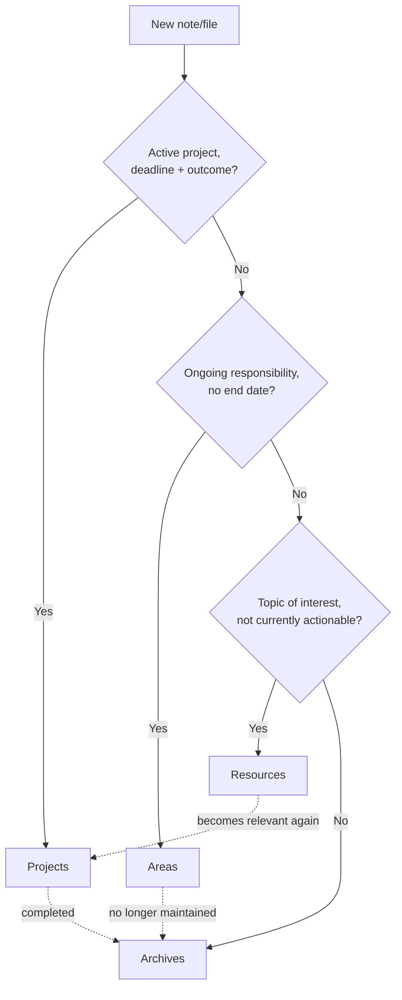

# Chapter 5 — Organize: Save for Actionability

> [!cite] Book reference
> *Building a Second Brain* — Tiago Forte. Part Two: "The Method: The Four Steps of CODE," Chapter 5: "Organize—Save for Actionability." Source: user's uploaded PDF.

> [!summary] One-line takeaway
> This is the chapter that introduces **PARA** — Forte's system for organizing all digital information into Projects, Areas, Resources, and Archives, sorted purely by how actionable it is right now, not by subject or source — and it's the single most consequential chapter in the book for actual vault structure.

## Why this chapter matters
Everything captured in Chapter 4 needs somewhere to go — this is where Forte answers "where do I put this?" definitively. PARA is also the one piece of this book's system that has visibly outgrown the book itself, spawning its own standalone book (*The PARA Method*, 2022) and widespread independent adoption — it's worth reading this chapter as the origin point of a system you've likely already encountered elsewhere.

## Direct quotes from the book
> [!quote] Epigraph
> "Be regular and orderly in your life so that you may be violent and original in your work." — Gustave Flaubert

> [!quote] Twyla Tharp on her "box"
> "The box makes me feel organized, that I have my act together even when I don't know where I'm going yet. It also represents a commitment."

> [!quote] The core organizing question
> "In which project will this be most useful?"

> [!quote] On perfectionism in organizing
> "One of the biggest temptations with organizing is to get too perfectionistic, treating the process of organizing as an end in itself... We need to always be wary of accumulating so much information that we spend all our time managing it, instead of putting it to use in the outside world."

> [!quote] On PARA's real nature
> "PARA isn't a filing system; it's a production system. It's no use trying to find the 'perfect place' where a note or file belongs. There isn't one."

## The chapter in full (so you never need to re-read it)

### Twyla Tharp's box
Forte opens with choreographer Twyla Tharp (160+ works across dance, TV, film, Broadway) and her "box" system from *The Creative Habit*[^1]: a labeled physical file box for each new project, into which everything related to it goes — notebooks, clippings, videos, photos, source material. He tells the story of her Billy Joel dance collaboration project in detail: she started with two written goals on index cards dropped into the box first ("tell a story," "make dance pay"), then filled twelve boxes over the project's life with music, Vietnam War research, costume inspiration, and more — material that fed not just her own thinking but her whole creative team (costume designer, lighting designer, production designer). Tharp names three benefits of the box: it gives her security to take creative risks (since there's always a stable home to return to), lets her put projects on hold and pick them back up later without losing the thread, and lets her later "dig down archaeologically" to reflect on how a finished project actually went. Forte's point: the value of a container isn't sophistication, it's that it's easy to use, create, move, and maintain.

### The Cathedral Effect
Forte introduces the "Cathedral Effect"[^2] — research showing that physical environment shapes thinking (high ceilings prompt abstract thinking, low ceilings prompt concrete thinking) — and argues we routinely design physical spaces with great care but almost never design our *digital* environments, despite spending comparable hours there. His framing: a Second Brain isn't just a tool, it's an environment — "a garden of knowledge" that, like a real garden, requires deliberate tending rather than happening by accident.

### Where 99% of notetakers get stuck
Forte names the predictable next failure point: capturing diligently but having no system to organize or retrieve what's captured, which produces *more* overwhelm, not less. He recounts years of failed experiments (physical-organizing techniques, specialized notebooks, Dewey decimal-style schemes, organizing by date/subject/kind) — all failed because none were integrated into daily life; every time he fell off the system, he reverted to a simple default of dropping everything into whichever project folder he was currently using. The realization that followed: make that default — organizing by current project — the *permanent* system rather than the fallback. Refined over years with thousands of students, this became **PARA**: Projects, Areas, Resources, Archives.[^3] The key structural claim: PARA organizes by *actionability*, not by subject, topic, or source — the only question that matters is "in which project will this be most useful?" He illustrates the problem with subject-based filing directly: a useful article on resilience saved to a "Psychology" folder is technically correct but practically useless, because that folder will eventually contain dozens of unrelated, non-actionable notes you'd have to wade through.

He's explicit about scope-management here too: organizing should never become an end in itself — there's a seductive, false satisfaction in pure order that can quietly replace the actual goal (using the knowledge). PARA is also explicitly meant to be used identically across every platform (notes app, file system, cloud drives) — one consistent organizing *logic*, even though you'll always use multiple tools, none of which can do everything.

### How PARA works — the four categories
1. **Projects** — short-term efforts you're actively working on now, with two defining features: a beginning *and* an end, and a specific completion outcome ("finalize," "launch," "publish"). Forte connects this to the "Hollywood model"[^4] of work — assemble a team for exactly the project's duration, then disband — increasingly common across all knowledge work, not just film.
2. **Areas** — long-term responsibilities with no final end date (Finances, Health, Product Development, Direct Reports) where the goal is maintaining a *standard*, not reaching a finish line — "even if you win the lottery, you'll still have finances to manage."
3. **Resources** — a catch-all for topics/interests that aren't currently actionable but may become useful later (hobbies, subjects you're researching, reference material) — like the subject-specific class notebooks you kept in school.
4. **Archives** — anything from the other three categories that's no longer active. Forte stresses there's no penalty to keeping digital archives indefinitely (unlike physical clutter), as long as it's out of the way of current focus; everything remains searchable and instantly recallable if ever needed again.

He walks through a real behind-the-scenes look at his own PARA folders (notes app, documents folder) — active projects generally number five to fifteen, note counts per project range from a couple to hundreds, and the whole system is only three levels deep: top-level PARA category → project/area/resource folder → individual notes.

### "Where do I put this?" — the decision order
Capturing and organizing should be two *separate* steps in time, not one — deciding where something belongs the instant you capture it adds friction that discourages capturing at all. Most notes apps have an inbox/daily-notes holding area for exactly this reason; organizing happens later, in a dedicated pass (previewed here, covered fully in Chapter 9's weekly review). Once you're ready to organize, PARA gives a strict, ordered checklist, from most to least actionable:
1. Which project would this help most?
2. If none: which area?
3. If none: which resource?
4. If none: archives.
The underlying logic: place a note where it'll resurface *soonest* relative to when it'll actually matter, not where it's topically "correct."

### The kitchen analogy
Forte draws a direct parallel: archives are the freezer (cold storage, rarely touched), resources are the pantry (available but tucked away), areas are the fridge (checked on relatively often), and projects are pots actively on the stove. Organizing a kitchen by ingredient type instead (all fruit together, frozen or not) would be absurd — yet that's exactly how most people organize notes (all book notes together, all quotes together), by source/type instead of by what they're *for*. His conclusion: PARA is "a production system," not a filing system — there's no single correct folder for any given note, because the right answer depends on your *current, changing* relationship to that information, not on the information's fixed topic.

### The Apple Store lesson: completed projects are oxygen
Forte recounts working at a busy Apple Store in San Diego, trying (and failing) to help customers organize thousands of migrated files one at a time in one-hour sessions. His pivot: moving everything into a single dated "Archive" folder regardless of content, then helping customers focus entirely on what they actually wanted to *create* right now (a video, a website, a genealogy project). Despite initial anxiety about "losing" old files, not one customer ever came back wanting to reorganize the old archive — instead they came back with stories of real creative impact (a fundraising drive, a small-business loan application, a first-generation college graduation). His two takeaways: cluttered digital workspaces actively impede creative thinking (hence the importance of archiving, not deleting), and *completed* creative projects — not elaborate, well-maintained systems — are "the oxygen" that actually sustains a Second Brain's value over time.

### Closing advice: "move quickly, touch lightly"
Borrowing advice from a mentor who saw his own tendency toward brute-force, burnout-prone overwork, Forte recommends the lightest viable first step: create project folders only (not areas/resources yet, to avoid building empty, unused containers), and use a short list of prompts to surface your actual current projects — what's nagging at you unaddressed, what's on your calendar needing follow-up, what's already on your to-do list that's secretly part of a bigger project, what's cluttering your desktop/downloads/bookmarks because it belongs to something larger. He explicitly tells readers not to bother reorganizing existing notes — archive them wholesale and start clean, trusting search to surface anything needed later. PARA, he stresses one final time, is dynamic by design — never finished, never "perfect," meant to shift continuously as your actual commitments change.

## Core concepts (quick-scan version)

| Category | Time horizon | Test question | Kitchen analogy |
|---|---|---|---|
| Projects | Short-term, has an end | "Am I actively working toward a specific outcome, on a deadline?" | Pots on the stove |
| Areas | Ongoing, no end date | "Is this a standard I'm responsible for maintaining indefinitely?" | The fridge |
| Resources | Latent, may become relevant | "Is this a topic I'm interested in but not currently acting on?" | The pantry |
| Archives | Inactive | "Was this active once, but isn't now?" | The freezer |

Organizing order when placing any note: Project → Area → Resource → Archive (most to least actionable).

## First-principles breakdown

**The claim, stripped of branding:** information should be organized by its relationship to your *current* goals (actionability), not by its intrinsic subject matter — because subject-based organization optimizes for a question ("what is this about") you rarely actually ask, at the expense of the question you actually ask under time pressure ("what do I need right now").

**What has to actually be true for that to hold:**
1. *Most retrieval happens under a specific, goal-driven need, not open-ended browsing.* This is the load-bearing assumption — if you mostly rediscover information by browsing broadly (the way library patrons browse a shelf), subject-based filing would actually serve you better. PARA bets specifically on goal-driven retrieval being the dominant case for most knowledge workers, which is plausible for project-based work but less obviously true for, say, open research or creative wandering (which Chapter 3's "incubation" superpower explicitly wants to support) — there's a real, understated tension between PARA's actionability focus and the earlier chapter's praise of "slow burn" ideas maturing without a specific project attached yet.
2. *The Projects/Areas boundary must be meaningfully decidable in practice*, or the system's core question ("which category?") becomes a source of friction rather than a reduction of it. The widely-repeated community complaint (Projects vs. Areas ambiguity, see below) suggests this boundary is less crisp in practice than the "has an end date" test implies — many real commitments (e.g., "get healthier") sit in an ambiguous zone between a bounded project and an open-ended area, and the test doesn't resolve which.
3. *Reorganization cost must stay low as material moves between categories over time* (Forte's own example: a coaching note migrating from Project → Area → Resource → Archives → Project again). This is only true if the underlying tool makes moving/re-tagging items nearly free — which holds for most modern notes apps, but is a real, unstated technology dependency of the whole system (the same retrieval/reuse condition flagged repeatedly in earlier chapters, here specialized to "reorganization," not just retrieval).
4. *The Apple Store anecdote generalizes a narrower claim than it first appears to.* The real, defensible finding there is "indiscriminate archiving of old, low-relevance material removes a *psychological* blocker to starting new work" — a claim about motivation and clutter, not evidence that PARA's four-category structure specifically (versus, say, any decluttering approach) is what unlocked those customers' projects. Worth separating "archiving helps people start" (well-supported by the anecdote) from "PARA specifically is the right taxonomy" (not really tested by this story at all).

**Rebuilt in plain terms:** PARA's real contribution isn't the four category names — it's the single underlying rule "sort by actionability, re-sort whenever that changes, and don't let sorting become its own project." That rule is sound and well-motivated. The four-category taxonomy is a reasonable default implementation of that rule, but the Projects/Areas boundary is the weakest joint in the design, and it's worth expecting — and not over-worrying about — real ambiguity there in practice, per the tie-breaker guidance already built into this vault's existing PARA reference (linked below).

## Visual representation

## Worked example — built directly in your vault
**This structure already exists in your vault, built during the earlier processing of the "Obsidian Second Brain" book** — `00-Inbox/`, `01-Projects/`, `02-Areas/`, `03-Resources/`, `04-Archive/` at the vault root implement exactly the PARA system this chapter defines (Tiago Forte is, in fact, PARA's original creator — the other book's treatment of PARA is itself downstream of this chapter). Rather than duplicate it, this chapter cross-links to the existing decision-support note:
- **[[Where Does This Go - Quick Reference]]** (in the Obsidian Second Brain book folder) — already contains a working PARA decision tree, a tie-breaker table for Projects-vs-Areas-vs-Resources ambiguity, and real worked examples from this vault (including the actual [[Project Overview|Gloss Local]] project, filed under Projects). I've added a short cross-reference there (see below) noting this chapter as PARA's original source.
- This is a case where the skill's "check for existing structure before building new" step applied directly — no new folders were created for this chapter, since the system was already correctly in place.

## What the book doesn't tell you — community perspective (2024–2026)
- **The Projects/Areas boundary is the most commonly cited practical pain point.** Multiple independent sources (a how-to guide, a Hacker News discussion, an agency owner's account of adapting PARA for team use) converge on the same complaint: Archives and Resources are intuitive, but deciding whether something is a bounded Project or an ongoing Area is genuinely ambiguous in everyday use, not just a theoretical edge case ([lucapallotta.com](https://www.lucapallotta.com/para/); [Hacker News](https://news.ycombinator.com/item?id=30916260)).
- **PARA was designed for individuals, and breaks down under team use without loosening.** One agency owner who tried scaling BASB/PARA to a team found the original rigid, single-user-oriented tooling (Evernote, Things) didn't support real-time collaboration, and concluded the first step to making PARA work for a team is deliberately relaxing its strictness ([Forte Labs — PARA for Teams](https://fortelabs.com/blog/para-for-teams/)).
- **Perfectionism trap, acknowledged by practitioners, not just critics.** At least one reviewer candidly describes knowing the PARA definitions well in theory, but still getting stuck trying to set the system up "perfectly" before ever using it for actionability — exactly the failure mode Forte himself warns against in this chapter, suggesting the warning alone doesn't fully prevent it.

## Deeper commentary — how this applies to your setup specifically
This chapter is a good moment to note explicitly: your vault's existing `01-Projects/Gloss Local/` placement is a textbook-correct PARA decision per this chapter's own test — Gloss Local has a stated goal (stable, local, free-across-devices) and an implicit finish line, even though it's also a long-running personal interest that could plausibly feel like an Area. That's exactly the kind of judgment call this chapter says is normal and expected, not a sign of a flawed system.

One thing worth watching as Gloss Local itself matures: its own data (annotations, cited answers) will eventually need its own internal "actionability" logic — a parallel to PARA, but for reading material rather than general notes. Worth keeping this chapter's core rule in mind if that's ever designed: organize annotations by what you're currently using them for (a specific project, a specific ongoing interest), not by which book they came from — the same mistake the kitchen analogy warns against (grouping by source/type instead of by use).

## Practical / actionable takeaways
- [x] Confirmed this vault's existing PARA folders already satisfy this chapter's worked example — no new structure needed.
- [ ] Next time something feels ambiguous between Project and Area in this vault, use the existing tie-breaker table in [[Where Does This Go - Quick Reference]] rather than treating the ambiguity as a system failure.
- [ ] Consider periodically doing the "move quickly, touch lightly" prompt list from this chapter (what's nagging you, what's on your calendar, what's cluttering your desktop) as a lightweight project-discovery exercise — distinct from, but complementary to, the weekly review covered in Chapter 9.

## Questions / things to decide for your own vault
- None new — this chapter's structural question was already resolved by the existing vault layout.

## Video
- [Tiago Forte — The PARA Method: Simplify, Organize, and Master Your Digital Life | Talks at Google (YouTube)](https://www.youtube.com/watch?v=UrmUYWOOyFg) — Forte's own official talk on PARA, directly covering this chapter's content from the primary source.

## Sources (external, beyond the book)
- [The PARA Method on Paper — Every / Forte Labs](https://every.to/forte-labs/para-on-paper)
- [The PARA Method: How I Organize my Digital Information — lucapallotta.com](https://www.lucapallotta.com/para/)
- [The PARA Method — Hacker News discussion](https://news.ycombinator.com/item?id=30916260)
- [PARA for Teams — Forte Labs](https://fortelabs.com/blog/para-for-teams/)

## Footnotes
[^1]: Twyla Tharp, *The Creative Habit: Learn It and Use It For Life* (New York: Simon & Schuster, 2003), 80 — the book's own endnote 1 for this chapter, source of all the Tharp quotes above.
[^2]: Joan Meyers-Levy and Rui Zhu, "The Influence of Ceiling Height: The Effect of Priming on the Type of Processing That People Use," *Journal of Consumer Research* 34, no. 2 (2007): 174–86 — the book's cited source for the "Cathedral Effect."
[^3]: The book's own footnote I: "Para" is a Greek word meaning "side by side" (as in "parallel") — Forte's intended reminder that a Second Brain works *alongside* your biological brain, not instead of it.
[^4]: Adam Davidson, "What Hollywood Can Teach Us About the Future of Work," *New York Times Magazine*, May 5, 2015 — the book's cited source for the "Hollywood model" of project-based work.

## Claude's pick — what I'd flag as most important
- "Organize by actionability, not by subject" is the single most portable idea in this chapter — it's useful even completely independent of adopting PARA's specific four categories.
- The Apple Store anecdote is the chapter's best piece of practical wisdom, but as the First-principles section notes, its real lesson is narrower than it looks: archiving old clutter removes a psychological blocker to starting new work, which is worth remembering on its own even separate from PARA.
- Since this vault already has PARA built out from a prior book, the most useful thing this chapter adds isn't new structure — it's the origin context and the explicit "it's a production system, not a filing system" framing, which is worth remembering the next time a Projects-vs-Areas decision feels harder than it should.

## Related
- Previous: [[Chapter 4 - Capture - Keep What Resonates]]
- Next: [[Chapter 6 - Distill - Find the Essence]]
- MOC: [[Building a Second Brain - MOC]]
- Existing vault resource: [[Where Does This Go - Quick Reference]]
