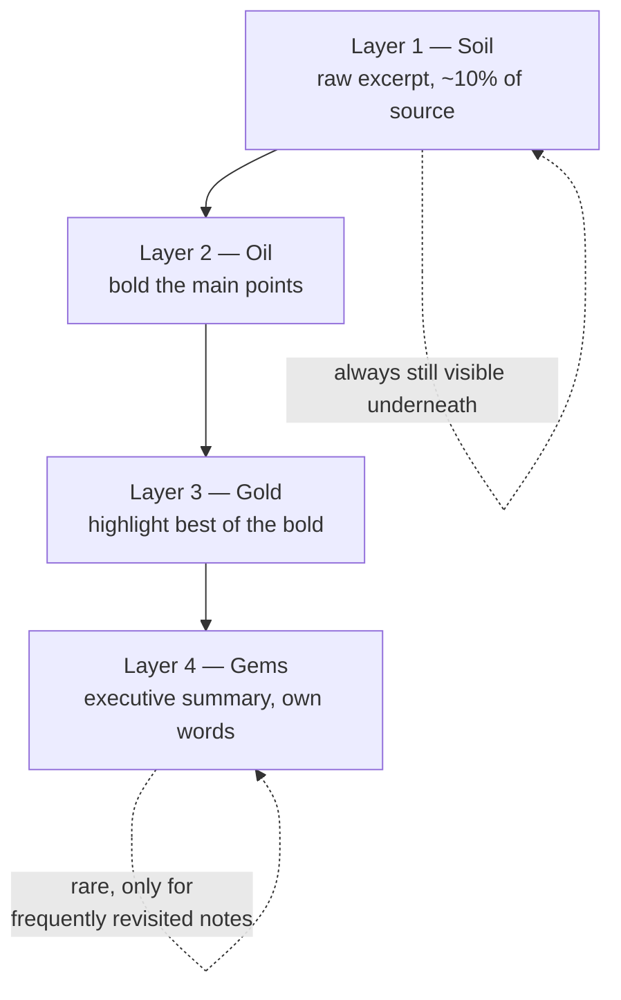

# Chapter 6 — Distill: Find the Essence

> [!cite] Book reference
> *Building a Second Brain* — Tiago Forte. Part Two: "The Method: The Four Steps of CODE," Chapter 6: "Distill—Find the Essence." Source: user's uploaded PDF.

> [!summary] One-line takeaway
> **Progressive Summarization** — highlighting a note in successive, nested layers (excerpt → bold → highlight → your-own-words summary) — turns a captured note into something your future self can grasp in seconds, and the technique is fundamentally about *forgetting* as much as possible, not remembering everything.

## Why this chapter matters
Capture (Ch.4) and Organize (Ch.5) get information into your Second Brain and into the right folder — neither makes it fast to actually *use*. This chapter is where "discoverability" becomes the central design problem, and it directly explains why the volume-focused habits Capture and Organize might encourage can become counterproductive without this step.

## Direct quotes from the book
> [!quote] Epigraph
> "To attain knowledge, add things every day. To attain wisdom, remove things every day." — Lao Tzu

> [!quote] Coppola on his prompt book
> "the script was really an unnecessary document; I didn't need a script because I could have made the movie just from this notebook."

> [!quote] The core instruction
> "I endeavored to distill the essence of each scene into a sentence, expressing in a few words what the point of the scene was."

> [!quote] On what distillation actually is
> "Progressive Summarization is not a method for remembering as much as possible—it is a method for forgetting as much as possible. As you distill your ideas, they naturally improve, because when you drop the merely good parts, the great parts can shine more brightly."

> [!quote] On notes as a product for your future self
> "Each note is like a product you are creating for the benefit of that future customer. If they don't buy it... then all the value of the work you're doing now will be lost."

## The chapter in full (so you never need to re-read it)

### Coppola's Godfather notebook
Forte opens with the unlikely story of how Francis Ford Coppola — a relative outsider, not a major studio director — came to make *The Godfather* after financial desperation (and his partner George Lucas's prompting) overcame his initial reluctance.[^1] Coppola's key tool was a "prompt book"[^2] — a technique from his theater studies at Hofstra — a reinforced three-ring binder into which he cut and pasted pages of Mario Puzo's novel, annotated with his first-read impressions, then broken down scene-by-scene across five criteria: synopsis, historical context, imagery/tone, core intention, and pitfalls to avoid. Coppola used visual cues (more ink, more colored pens, more underlines) to signal increasing importance to his future self, and considered the notebook — not the script — the film's real production document.

### "Quantum notetaking" and discoverability
Forte frames notetaking as "sending packets of knowledge through time" (echoing the Introduction) — most captured ideas won't be usable the instant you encounter them, so the real design problem is ensuring they survive, intact and findable, until the moment they do become relevant. He names **discoverability** — "the degree to which a piece of content or information can be found in a search of a file, database, or other information system"[^3] — as the single most commonly missing ingredient in people's notes. He identifies a specific paradox: the more notes you accumulate, the harder (not easier) they become to productively use, unless something actively counteracts that growth — which either discourages people from capturing at all, or sends them tool-hopping whenever volume gets overwhelming.

### Progressive Summarization — the four layers
Forte's answer is **Progressive Summarization**: applying highlighting (a skill everyone already has from school) in successive layers, each layer distilling the previous one, each using different formatting so the layers stay visually distinguishable. He names the four layers with a mnemonic[^4]: **Layer 1 ("soil")** — the raw excerpt captured, already limited to only the most relevant passages, not the whole source. **Layer 2 ("oil")** — bolding the main points within that excerpt, done later (breaks, evenings, whenever you're low-energy but still productive). **Layer 3 ("gold")** — highlighting only the best of the bolded parts (often just one or two sentences), reserved for notes that are especially long, interesting, or valuable. **Layer 4 ("gems")** — a bullet-point executive summary in your own words, added at the top, reserved for the rare notes you find yourself revisiting again and again — a sign the content is a genuine cornerstone of your thinking.

He walks through four real worked examples from his own notes: a **Wikipedia article** on "Baumol's Cost Disease," captured once with no distillation, then quickly distilled months later right before he needed to reference it live on a panel; an **online article** about Google's "structured interviews" hiring practice, saved speculatively as a freelancer with no immediate use, distilled and actioned nearly two years later when he finally hired his first employee; a **podcast** conversation (with Meghan Telpner of the Academy of Culinary Nutrition[^5]) captured from memory after the episode ended (since he was driving), later distilled under launch-campaign time pressure and directly inspiring a new "executive coaching tier" for his course; and **meeting notes** from a friend's recording-studio advice, later distilled into a literal hardware-store shopping list by bolding only the purchase-relevant items.

### Zooming in and out
He compares the layered structure to a map app: sometimes you want full detail (Layer 1), sometimes a quick glance (Layer 3 or 4) — and crucially, nothing is ever deleted across layers, so distillation is reversible and low-risk; you can always return to the full original if a highlight choice turns out wrong.

### Picasso's bull and Ken Burns
Two more creative-distillation examples: Picasso's eleven-lithograph *Le Taureau* (1945-46) sequence[^6], where he first *adds* detail to a bull drawing before progressively stripping it down to a single continuous abstracted line — Forte's point being that you can't skip straight to the minimal version; you have to pass through the detailed version first to know what's essential. And documentary filmmaker Ken Burns, who reportedly uses only 1 hour of finished film for every 40-50 hours of raw footage shot[^7] — distillation at an extreme ratio, in service of surfacing only the most compelling material.

### Three common mistakes
1. **Over-highlighting** — the single most common failure, a holdover from school-style "highlight everything in case it's on the test." Forte's rule of thumb: each layer should keep no more than 10-20% of the previous layer's volume.
2. **Highlighting without a purpose** — distillation (unlike capture/organize) takes real time and effort, so it should happen only when you're actually about to use a note for something specific (writing, a call, a presentation), not preemptively on everything you've ever captured. He names the "campsite rule" applied to information — every time you touch a note, leave it slightly more discoverable than you found it[^8] — rather than doing a dedicated, upfront distillation pass on your whole archive.
3. **Making highlighting difficult** — don't analyze or categorize each point; apply the same resonance-based intuition from Chapter 4 (surprising, useful, inspiring, personal) to decide what to bold/highlight within a note, not a separate analytical process.

### Closing: keep your future self in mind
Forte reiterates that distillation only has value if it makes notes fast to re-use — "if you can't locate a piece of information quickly... you might as well not have it at all." He closes Part Two's Distill chapter with a direct practice exercise: take one piece of recent content, save only the best excerpts (Layer 1), bold the resonant parts (Layer 2), highlight only the very best of those (Layer 3), then test yourself days later — can you grasp the gist in 30 seconds from the highlights alone? He notes this judgment (what's worth highlighting) is a skill that improves with repetition, not something to get "right" immediately.

## Core concepts (quick-scan version)

| Layer | Nickname | What happens | When to do it |
|---|---|---|---|
| 1 | Soil | Save only the most relevant excerpt (~10% of source) | At capture time |
| 2 | Oil | Bold the main points within the excerpt | Low-energy downtime, when revisiting |
| 3 | Gold | Highlight only the best of the bolded parts | For especially valuable/long notes |
| 4 | Gems | Executive summary, in your own words | Only for notes you revisit repeatedly |

Rule of thumb: each layer ≤ 10-20% of the volume of the layer before it. Never delete — all layers stay visible, so distillation is always reversible.

## First-principles breakdown

**The claim, stripped of branding:** iteratively marking a subset of a subset of a subset of saved text (rather than writing a fresh summary once) produces a more useful artifact than either the raw excerpt alone or a single, upfront summary — because it preserves full context while making the gist retrievable at a glance, at whatever level of detail the moment requires.

**What has to actually be true for that to hold:**
1. *The "zoom levels" metaphor only pays off if you genuinely revisit notes at variable levels of urgency/depth.* If every reuse of a note required full-detail reading anyway, the layering would add pure overhead with no benefit. This is a real, checkable prediction: Progressive Summarization should feel most valuable for notes you reference under time pressure (the panel-speaking example, the launch-prep example) and least valuable for notes you only ever read once in full — which the book's own four worked examples actually confirm, somewhat by accident, since three of the four involve exactly this kind of pressured, partial re-access.
2. *Deferred distillation (doing it "when you're about to use it," not at capture time) only works if you can reliably relocate the right raw note later.* This is the same retrieval dependency flagged in every earlier chapter — Progressive Summarization doesn't solve discoverability on its own; it assumes PARA (Ch.5) already got the note into a findable location, and only then adds within-note discoverability on top.
3. *The "forgetting as much as possible" framing is doing real conceptual work, not just rhetoric.* It resolves an apparent tension: distillation looks like it's destroying information (highlighting less and less), but because Layer 1 is preserved underneath every later layer, nothing is actually lost — what's lost is only the *default visibility* of the less-important material. This is a genuinely clever design choice (progressive disclosure, in UI terms) rather than true lossy compression, and it's worth naming explicitly since the chapter's own "forgetting" language could otherwise be read as literally discarding information.
4. *Picasso's bull analogy is evocative but imperfectly mapped onto notetaking.* Picasso's distillation happened through repeated, skilled *redrawing* — a generative act requiring deep domain mastery built over a career. Progressive Summarization's "distillation" is closer to selective subtraction (highlighting a subset of existing words) than to Picasso's active resynthesis. The chapter blurs this distinction; it's worth noting the analogy illustrates the *spirit* of "detail first, then simplify" rather than describing the same cognitive operation.

**Rebuilt in plain terms:** Progressive Summarization is really a progressive-disclosure interface applied to a text note — each layer is a coarser index into the layer below it, built lazily (only when you're about to need it) rather than eagerly (at capture time). Its entire value proposition rests on two things actually holding in practice: that you genuinely revisit notes at variable urgency, and that the underlying organization (PARA) already makes the right raw note findable in the first place. Skip either precondition, and the layering itself adds cost without the compounding benefit it's designed to produce.

## Visual representation

## Worked example — built directly in your vault
Built **`Claude Notes/Books/Building a Second Brain/Examples/Example - Progressive Summarization (4 Layers).md`** — a real, four-layer demo applying the technique to a passage from this very book's Introduction, showing the actual 10-20%-per-layer compression ratio in practice and explaining why Layer 4 was warranted for this particular idea but wouldn't be for most notes.

## What the book doesn't tell you — community perspective (2024–2026)
- **Forte's own stated pitfalls are themselves the most-cited critique.** Multiple summaries single out "over-highlighting" as the most common real-world failure of this technique — practitioners report defaulting to school-style exhaustive highlighting despite the explicit 10-20% guidance, suggesting the habit is hard to unlearn even when clearly warned against ([mmapped.blog book summary](https://mmapped.blog/posts/16-building-a-second-brain)).
- **A deeper critique questions the selectivity premise itself**: one analysis argues that rigid, resonance-based capture/distillation criteria risk oversimplifying how learning actually happens — curiosity-driven exploration doesn't always announce itself as "surprising" or "useful" in the moment, and material that seems unremarkable on first contact sometimes turns out to matter most in hindsight, which a strict "highlight only what resonates now" approach could systematically miss ([goodbooksummary.com](https://www.goodbooksummary.com/building-a-second-brain-by-tiago-forte-book-summary)).
- **Worth connecting to the "collector's fallacy" critique raised in earlier chapter notes**: Progressive Summarization is explicitly Forte's own answer to that exact failure mode (volume without processing) — so this chapter is the place to judge whether his own proposed fix actually resolves the critique, or just moves the same discipline problem one step later (deciding *when* to distill, instead of deciding *whether* to capture).

## Deeper commentary — how this applies to your setup specifically
Progressive Summarization is a strong direct model for a feature [[Project Overview|Gloss Local]] could consider: instead of a single cited answer per selection, an annotation could support the same "soil → oil → gold → gems" progression — the AI's initial cited answer as Layer 1, a user's own bolded takeaway as Layer 2, and so on — letting annotations mature in place rather than being fixed the moment they're created. That would also directly answer the "capture vs. retrieval" tension flagged across every earlier chapter note: Gloss Local's annotations would get *more* discoverable the more they're used, not just accumulate as flat, equally-weighted entries.

The "distill only when you're about to use it" principle is also a useful design constraint: Gloss Local doesn't need to force users to process every annotation immediately — it's consistent with this chapter's guidance to let that happen lazily, triggered by actual reuse, rather than as upfront overhead at capture time.

## Practical / actionable takeaways
- [x] Built a real four-layer Progressive Summarization demo in this vault (linked above) to make the abstract technique concrete.
- [ ] Next time you're about to use a captured note for something specific (writing, a call, a decision), apply the layering live rather than pre-distilling notes you haven't yet decided to use.
- [ ] Watch your own highlighting ratio against the 10-20%-per-layer guideline — if a note's Layer 2 looks almost as long as Layer 1, that's the "over-highlighting" mistake in action.
- [ ] Consider the progressive-disclosure idea (Layer 1→4) as a concrete, buildable feature direction for Gloss Local annotations, worth a design note of its own later.

## Questions / things to decide for your own vault
- Should existing notes in this vault (e.g., earlier chapter notes) ever get a "Layer 4" executive-summary treatment, or is the MOC (built at the end, Chapter-by-chapter index) already serving that role at the book level? Worth revisiting once the MOC is built.

## Video
- [Francis Coppola's Notebook (2001 short documentary, YouTube)](https://www.youtube.com/watch?v=awce_j2myQw) — the book's own cited source (endnote 3) for Coppola's prompt-book process described in this chapter.

## Sources (external, beyond the book)
- [Book summary: Building a Second Brain — mmapped.blog](https://mmapped.blog/posts/16-building-a-second-brain)
- [Building a Second Brain: The Infrastructure of Modern Creativity — goodbooksummary.com](https://www.goodbooksummary.com/building-a-second-brain-by-tiago-forte-book-summary)

## Footnotes
[^1]: "Inside Francis Ford Coppola's Godfather Notebook," *Hollywood Reporter* — the book's own endnote 1 for this chapter.
[^2]: Francis Coppola's Notebook, imdb.com, 2001 — the book's own endnote 3; see also the YouTube documentary linked under Video above.
[^3]: Wikipedia, s.v. "Discoverability" — the book's own footnote I.
[^4]: The book's own footnote II: the soil/oil/gold/gems mnemonic for the four layers, as Forte personally frames them.
[^5]: Meghan Telpner, Academy of Culinary Nutrition (blog) — the book's own endnote 5, source of the podcast example.
[^6]: AFI's 100 Years…100 Movies – 10th Anniversary Edition, Television Academy (endnote 2); Artyfactory, "Animals in Art—Pablo Picasso" (endnote 6) — the book's cited source for the Picasso bull lithograph sequence.
[^7]: The book's own footnote VI, citing Ken Burns' MasterClass lecture on documentary filmmaking and his own described file-everything habit for project-related material.
[^8]: The book's own footnote VII: this "leave marks that make future effort easier" principle is called **stigmergy** — the same mechanism ants use (pheromone trails) to let other ants find food sources more efficiently.

## Claude's pick — what I'd flag as most important
- "Progressive Summarization is a method for forgetting as much as possible" is the single most important reframe in this chapter — it resolves the apparent contradiction between "capture generously" (Ch.4) and "keep only the essential" (this chapter): nothing is actually lost, only de-prioritized in what's shown by default.
- The three common mistakes (especially over-highlighting) are worth treating as a literal checklist the first several times you try this technique — the community evidence suggests the "highlight everything" instinct from school is genuinely hard to override without deliberate attention.
- The Gloss Local design idea (letting annotations mature through layers rather than being fixed at creation) is the most concrete, product-relevant insight from this entire chapter — worth a dedicated design note at some point, separate from book-notes.

## Related
- Previous: [[Chapter 5 - Organize - Save for Actionability]]
- Next: [[Chapter 7 - Express - Show Your Work]]
- MOC: [[Building a Second Brain - MOC]]
- Worked example: [[Example - Progressive Summarization (4 Layers)]]
