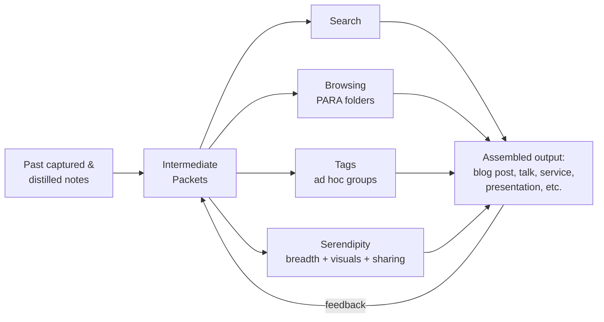

# Chapter 7 — Express: Show Your Work

> [!cite] Book reference
> *Building a Second Brain* — Tiago Forte. Part Two: "The Method: The Four Steps of CODE," Chapter 7: "Express—Show Your Work." Source: user's uploaded PDF.

> [!summary] One-line takeaway
> The final CODE step reframes creative output as assembling small, reusable "Intermediate Packets" (not starting from a blank page every time), retrieved through four complementary methods (search, browsing, tags, serendipity) — and insists that real creativity is collaborative and remixed, never created from a pure void.

## Why this chapter matters
Capture, Organize, and Distill build the knowledge store — this chapter is where it actually gets used. It's also the longest sustained argument in the book against the "lone genius" myth of creativity, and introduces the retrieval problem explicitly for the first time (previous chapters focused on storage; this one focuses on getting things back out).

## Direct quotes from the book
> [!quote] Epigraph
> "Verum ipsum factum" ("We only know what we make") — Giambattista Vico

> [!quote] Octavia Butler's three rules for herself
> "Don't leave your home without a notebook... Don't walk into the world without your eyes and ears focused and open... Don't make excuses about what you don't have or what you would do if you did, use that energy to 'find a way, make a way.'"

> [!quote] On intermediate work
> "All the intermediate work—the notes, the drafts, the outlines, the feedback—tends to be underappreciated and undervalued... all that valuable knowledge we worked so hard to acquire dissolves from our memory like a sandcastle washed away by the ocean waves."

> [!quote] On the myth of solitary creativity
> "A common myth of creativity is that of the solitary artist, working in total isolation... In my experience, this isn't how creativity works at all."

> [!quote] The "80 percent done" rule of thumb[^1]
> "Only start projects that are already 80 percent done."

## The chapter in full (so you never need to re-read it)

### Octavia Butler
Forte tells the extended story of science-fiction writer Octavia Butler — raised by a single, working mother, bullied and self-described as believing she was "ugly and stupid, clumsy, socially hopeless," with dyslexia that made schoolwork hard, and harshly critiqued by teachers ("Hyperbolic," "You're not even trying").[^2] At twelve, a terrible B-movie (*Devil Girl From Mars*) convinced her she could do better. As she began writing seriously, she adopted the persona "Octavia" and three self-imposed rules (quoted above) that launched a lifelong commonplace-book habit: tracking grocery lists, finances, daily word-count contracts with herself, personal failings and desired qualities, alongside story material — song lyrics, character ideas, research topics, news details. She traveled to the Amazon and Incan ruins for firsthand research, insisting "the greater your ignorance, the more verifiably accurate must be your facts." Her novel *Parable of the Sower* hit the NYT bestseller list in 2020 — fourteen years after her death[^3] — its climate-collapse premise resonating anew during COVID-19. Butler pioneered Afrofuturism, centering Black protagonists navigating radical change, and became the first science-fiction writer to win a MacArthur "Genius" Fellowship (1995). Her archive — 9,062 items filling 386 boxes — was donated to the Huntington Library,[^4] which is how so much of this granular life detail survives at all. Forte's point: Butler's success came directly from relentlessly capturing and drawing on her lived experience ("Use what you have; even if it seems meager, it may be magic in your hands") — the myth of the blank-page genius is just that, a myth.

### Protecting attention, and the cost of losing intermediate work
Forte frames attention as the knowledge worker's scarcest resource, and argues that focusing only on final deliverables (the common "begin with the end in mind" advice) has a hidden flaw: the enormous amount of *intermediate* work (notes, drafts, outlines, feedback) typically gets discarded once a project ends, wasting the attention invested in producing it. His fix: treat that intermediate material as a reusable asset, not disposable scaffolding — which is the entire premise of Express.

### Intermediate Packets
Forte names the small, reusable units of work-in-progress **Intermediate Packets (IPs)**[^5] — a term covering the same idea every field already has its own name for: "modules" in software, "betas" in startups, "sketches" in architecture, "pilots" in TV, "prototypes" in engineering, "concept cars" in auto design, "demos" in music. He illustrates with a salesperson's building blocks (brochures, scripts, lead lists, past call notes) to show even "non-knowledge-work" roles rely on reusable assets. He names five concrete kinds of IPs: **distilled notes** (books/articles already processed via Progressive Summarization), **outtakes** (material cut from a past project but possibly reusable), **work-in-process** (documents/plans from past projects), **final deliverables** (completed work components), and **documents created by others** (with proper citation — "you always cite your sources... giving credit doesn't lessen the value of your contribution, it increases it"). He lists four concrete benefits of thinking in IPs: becoming interruption-proof (you only hold one small packet in mind at a time, not an entire project), being able to make progress in any span of free time (however short), getting more frequent feedback (small pieces are easier to share for input than a finished opus), and eventually being able to assemble entire projects largely from pre-existing IPs rather than starting from scratch.

### Assembling building blocks
Forte argues it's far more powerful to notice IPs you're already incidentally producing (bookmarks, journal entries, highlighted passages, social posts, slides, diagrams, meeting recordings, email answers, blog posts, templates/checklists) than to deliberately manufacture new ones. His conference-planning example breaks a seemingly from-scratch mega-project (agenda, breakout list, livestream checklist, announcement email, speaker invitations, website) into components that can each be modeled on or reused from past examples, rather than built from nothing. The reframe: ask "how could I acquire or assemble this, instead of making it myself?"

### Four retrieval methods
Because the connection between a saved IP and a future use is inherently unpredictable, Forte argues there's no single reliable retrieval system — instead, four complementary methods, used roughly in this order:
1. **Search** — nearly free, best when you roughly know what you're looking for; limited when you don't know the right terms or are looking for non-text content (images).
2. **Browsing** — navigating your PARA folder structure manually; research[^6] shows people often *prefer* manual browsing over search because folder/file names provide contextual "scaffolding" that search lacks, and it uses older, more natural spatial-navigation parts of the brain.[^7] Limited for notes you'd never think to look for in an "obvious" folder.
3. **Tags** — cross-cutting labels applied regardless of folder location, useful specifically for ad hoc, cross-disciplinary groupings (his example: tagging scattered notes "FAQ" to assemble a customer-facing FAQ page without moving them from their existing homes). Forte explicitly does *not* recommend tags as a primary system — the overhead of tagging every note outweighs the benefit compared to search/browsing — and defers detailed tagging strategy to a free bonus chapter at buildingasecondbrain.com/bonuschapter.[^8]
4. **Serendipity** — the "most mysterious, but in many ways most powerful" method: unplanned connections that surface from deliberately keeping diverse material jumbled together. He names three ways to cultivate it: keep retrieval searches/browsing a little broader than strictly necessary (check adjacent folders, not just the exact match); save images alongside text, since visual pattern recognition is faster and more intuitive than reading; and share ideas with others, since their unpredictable reactions (bored by what excites you, excited by what you think is obvious) surface things you couldn't have found alone.

### Three stages of expressing — case studies revisited
Returning to Chapter 3's Remembering/Connecting/Creating framework, Forte gives three new, concrete student examples:
- **Remember — Benigno** (business consultant, Philippines): previously would "keep reading and bookmarking, then forget about it." After capturing and Progressive-Summarizing a cryptocurrency article in just 8 minutes before sharing it with friends, he found the highlighted version was actually usable by his friends (unlike a raw long article), while also banking material for a future article of his own.
- **Connect — Patrick** (church pastor, Colorado): uses his Second Brain to design memorial services, recording conversations with grieving families via auto-transcription so he can stay fully present instead of note-taking live, then spending just 15 minutes per interview (down from 5-7 hours at the end of the whole process) highlighting only what resonated. His own words: this frees him to be present with grieving families, knowing "80 percent of the work is already done" by the time he sits down to write the service.
- **Create — Rebecca** (professor of educational psychology, Florida): drops short notes into her inbox whenever inspired in the weeks before a talk, so that by the time she sits down to write an outline, the metaphors/research/stories/diagrams (IPs) are already assembled — she just has to string them together, rather than needing one large uninterrupted block of time she rarely has as a busy professional and mother.

### Creativity is inherently collaborative; everything is a remix
Forte argues the "solitary artist" myth is false across every medium — musicians need engineers, actors need directors, even solitary-seeming writing is "a dance between an author and their editor." Reframing work as IPs makes it inherently more shareable: small pieces are easier to show, easier to get specific feedback on, and less threatening to expose than a finished, heavily-invested-in whole. He argues this habit shifts your self-concept from "sole originator of ideas" to "curator of the collective thinking of your network" — and that you typically can't know in advance which of your notes will turn out to be disproportionately valuable "cornerstones"; you discover that only by sharing and watching what resonates with others.

He closes with **kitbashing**[^9] — model makers (Adam Savage, Industrial Light & Magic) combining prefabricated commercial kit parts (WWII flak cannons, battleships, tanks) into new models rather than fabricating from scratch, to stay within time/budget — as the literal, physical version of what IPs let you do with knowledge work: remix existing pieces (a web banner's shape, a slide's layout, a song's style) rather than reinventing from nothing, always citing sources and influences. He recalls the personal turning point of someone first calling something he'd made "your work" — recognizing a body of output with its own identity, separate from himself — as the moment productivity shifts from "tasks only I can do" to "assets I can assemble, acquire, or delegate."

### Closing: "we only know what we make"
Forte's closing argument, via the Vico epigraph: reading about an idea isn't the same as knowing it — knowledge only becomes real through making something concrete with it, imperfectly, before you feel fully ready. He frames Express not as needing to become a professional creator, but as taking ownership of your own ideas enough to share them in whatever arena you're already in (family, friends, colleagues, neighbors) — starting with the smallest possible project if necessary, to prove to yourself that your ideas can have an impact.

## Core concepts (quick-scan version)

| Concept | What it means |
|---|---|
| Intermediate Packet (IP) | A small, reusable unit of work-in-progress — distilled notes, outtakes, work-in-process, final deliverables, or others' documents (cited). |
| Four retrieval methods | Search (fast, needs rough target) → Browsing (PARA folders, more natural/preferred) → Tags (ad hoc cross-cutting groups, used sparingly) → Serendipity (unplanned, cultivated via breadth, visuals, sharing). |
| Kitbashing | Reusing/remixing prefabricated parts (physical or informational) instead of building from scratch every time. |
| "80% done" rule | Only start new projects you're already most of the way toward, via existing captured/organized/distilled material. |
| Three stages (Express-specific examples) | Remember (Benigno), Connect (Patrick), Create (Rebecca) — concrete case studies of each. |

## First-principles breakdown

**The claim, stripped of branding:** creative/professional output is reliably faster and higher-quality when assembled from small, previously-captured, reusable fragments than when produced by starting from an empty page each time — provided those fragments can actually be found again when needed.

**What has to actually be true for that to hold:**
1. *The "blank page" starting cost must be real and significant* — this is well-supported generally (writer's block, analysis paralysis under a fully-open task are well-documented phenomena), and consistent with the Junger "ammunition, not writer's block" idea from Chapter 3. IPs work because they convert an open-ended generation task into a smaller selection/arrangement task, which is cognitively easier.
2. *Retrieval must actually succeed often enough to make saving IPs worth the upfront effort* — this is the same retrieval dependency raised in every chapter so far, now made explicit and structural: this chapter is effectively the book's answer to "how do you guarantee retrieval," via four overlapping, partially-redundant methods rather than one perfect one. That's a reasonable design response to an acknowledged unsolved problem (the chapter is honest that there's "no single, perfectly reliable retrieval system") rather than a claim that retrieval is fully solved.
3. *Serendipity, as described, is not actually random — it's a designed-for outcome of specific precursor choices* (keeping diverse material together, saving visuals, sharing broadly). This reframes "serendipity" from luck into an engineering decision: the chapter's real claim is narrower and more defensible than "surprising connections will happen" — it's "you can raise the *probability* of useful unplanned connections through specific, repeatable habits," which is a testable, falsifiable claim distinct from mysticism about creativity.
4. *The "creativity is always collaborative/remixed" claim is strong and well-evidenced* (kitbashing, the author-editor relationship, Butler's own voracious borrowing from research) but it's worth separating from the IP-retrieval claims above — this is really a separate argument (about the *nature* of creativity) bundled into the same chapter as a practical system (IPs/retrieval). Both are plausible, but one is a philosophical claim about creativity in general, the other is a specific, actionable workflow recommendation — they don't logically depend on each other.

**Rebuilt in plain terms:** this chapter's actual mechanism is "lower the activation energy of starting work by pre-assembling partial components," combined with "treat finding those components as a solvable-but-not-perfectly-solvable problem, so use several overlapping retrieval strategies rather than betting on one." Both halves are sound engineering advice independent of whether you buy into "Second Brain" as a concept — they're closer to standard software-engineering wisdom (modularity, redundant indexes) applied to personal knowledge work.

## Visual representation

## Worked example — built directly in your vault
This chapter is more about retrieval habits than new folder structure (PARA already covers organization from Chapter 5), so no new top-level vault structure was needed. Noting instead a direct, concrete application: the chapter note you're reading right now, and every other chapter note in this book-notes project, is itself built from Intermediate Packets in the sense this chapter describes — extracted quotes, footnoted citations, and community-research snippets gathered chapter-by-chapter are exactly the kind of reusable "distilled notes" and "documents created by others" (properly cited) the chapter recommends assembling from, rather than writing each note from a blank page.

## What the book doesn't tell you — community perspective (2024–2026)
- **"Intermediate Packets" lands better with technical readers than the rest of the book's framing.** A Hacker News commenter who was broadly skeptical of the book's vagueness singled out IPs as the one concept that "made sense" to someone with a technical/software background — likely because it maps directly onto familiar ideas like modularity and component reuse ([Hacker News discussion](https://news.ycombinator.com/item?id=31792336)).
- **The deferred tagging bonus chapter is itself a tacit admission of scope-management.** Multiple reader summaries note Forte explicitly tells readers to wait until they have hundreds of notes and several completed projects before investing in tagging — a rare moment of the book actively discouraging early adoption of one of its own techniques, worth remembering given this book's general reputation for encouraging over-building systems early.
- **General verbosity critique, again.** Several reviews (Goodreads, Fable) reiterate that this book tends toward repetition and could be more actionable per page — worth weighing against how much of "The chapter in full" above could be compressed if you're optimizing purely for your own reference rather than completeness.

## Deeper commentary — how this applies to your setup specifically
The Intermediate Packets framing is directly applicable to how [[Project Overview|Gloss Local]] annotations should be designed to be used, not just stored: an annotation (a cited answer to a selected passage) is itself an IP — a small, reusable unit that should be assemblable into something larger (an essay, a book review, a research summary) later, not a dead-end artifact. The four retrieval methods are also a useful checklist for Gloss Local's eventual UX: does it support search (presumably, via SQLite), browsing (by book? by date?), tags, and does its data model leave room for the kind of serendipitous cross-book connection this chapter values (e.g., surfacing an old annotation from a different book while reading a new one)? Worth treating as a product-design checklist, not just book-notes trivia.

## Practical / actionable takeaways
- [ ] When creating anything substantial in this vault or in Gloss Local's own development, consciously ask "which of this already exists as an IP I can reuse?" before starting from scratch — the chapter's own "80% done" framing is a genuinely useful gut-check before committing to a new piece of work.
- [ ] Apply the "share work in small pieces for feedback" principle literally to Gloss Local's own development — showing a partial feature for feedback early is the direct parallel to Forte's "share Intermediate Packets, not finished opuses."
- [ ] Hold off on an elaborate tagging strategy for this vault until there's a genuine cross-cutting need (per the book's own explicit caution) — folders (PARA) and search should carry most of the retrieval load for now.

## Questions / things to decide for your own vault
- Does this vault need a lightweight tagging convention yet, or is folder-based browsing plus Obsidian's native search already sufficient? Worth revisiting only once a genuine cross-project need for tags actually arises, per this chapter's own advice.

## Video
- [Adam Savage — "Inside Adam Savage's Cave: Model Making for Movies" (Adam Savage's Tested, YouTube)](https://www.youtube.com/watch?v=vKRG6amACEE) — the book's own cited source (endnote 7) for the kitbashing discussion in this chapter.

## Sources (external, beyond the book)
- [Building a Second Brain: The Book — Hacker News discussion](https://news.ycombinator.com/item?id=31792336)
- [Building a Second Brain — Goodreads reviews](https://www.goodreads.com/book/show/59616977-building-a-second-brain)

## Footnotes
[^1]: The book's own footnote IV: Forte's rule of thumb — "only start projects that are already 80 percent done" — meaning he commits to finishing only once most of the capture/organize/distill work is already in place.
[^2]: Octavia E. Butler, *Bloodchild and Other Stories: Positive Obsession* (New York: Seven Stories, 2005), 123–36 — the book's own endnote 1 for Butler's early life and self-assessment.
[^3]: Dan Sheehan, "Octavia Butler has finally made the New York Times Best Seller list," LitHub.com, September 3, 2020 — the book's own endnote 3.
[^4]: Butler's archive (9,062 items, 386 boxes) has been available to researchers at the Huntington Library since 2010, per the book's own endnote 4; see also Lynell George, *A Handful of Earth, A Handful of Sky: The World of Octavia Butler* (Santa Monica: Angel City Press, 2020), the book's endnote 2.
[^5]: The book's own footnote I: "IP" doubles as both "Intermediate Packet" and "Intellectual Property" — Forte's intentional pun, emphasizing that you own and can reuse these assets freely.
[^6]: Deborah Barreau and Bonnie A. Nardi, "Finding and Reminding: File Organization from the Desktop," *ACM SIGCHI Bulletin* 27, no. 3 (1995): 39–43 — the book's endnote 5, on people's preference for manual browsing over search.
[^7]: The book's own footnote II, citing Barbara Tversky (Teachers College, Columbia): "We are far better and more experienced at spatial thinking than at abstract thinking... spatial thinking can substitute for and scaffold abstract thought." See also William P. Jones and Susan T. Dumais, "The spatial metaphor for user interfaces," *ACM Digital Library* 4, no. 1 (1986) — the book's endnote 6.
[^8]: The book's own footnote III: a free bonus chapter on tagging is available at buildingasecondbrain.com/bonuschapter, since Forte considers tagging strategy "a subject unto itself" beyond what's needed to get started.
[^9]: Adam Savage, "Inside Adam Savage's Cave: Model Making for Movies," Adam Savage's Tested, YouTube — the book's own endnote 7, source of the kitbashing discussion (linked under Video above).

## Claude's pick — what I'd flag as most important
- Intermediate Packets is the single most transferable idea in this chapter, independent of the rest of the Second Brain system — it's a general-purpose antidote to blank-page paralysis that applies to almost any kind of creative or professional output.
- The four-retrieval-methods framework is quietly one of the most intellectually honest moments in the book: Forte explicitly admits there's no single reliable retrieval system, which is a useful corrective after several chapters that could otherwise read as over-promising.
- The reframe of serendipity as something you can deliberately engineer (breadth, visuals, sharing) rather than wait for is worth remembering on its own — it converts a vague, mystical-sounding idea into three concrete habits.

## Related
- Previous: [[Chapter 6 - Distill - Find the Essence]]
- Next: [[Chapter 8 - The Art of Creative Execution]]
- MOC: [[Building a Second Brain - MOC]]
