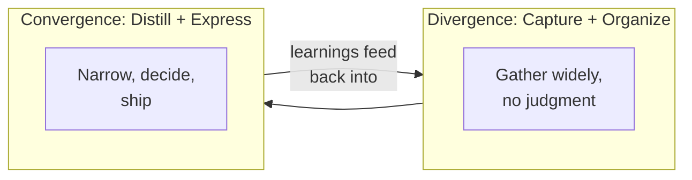
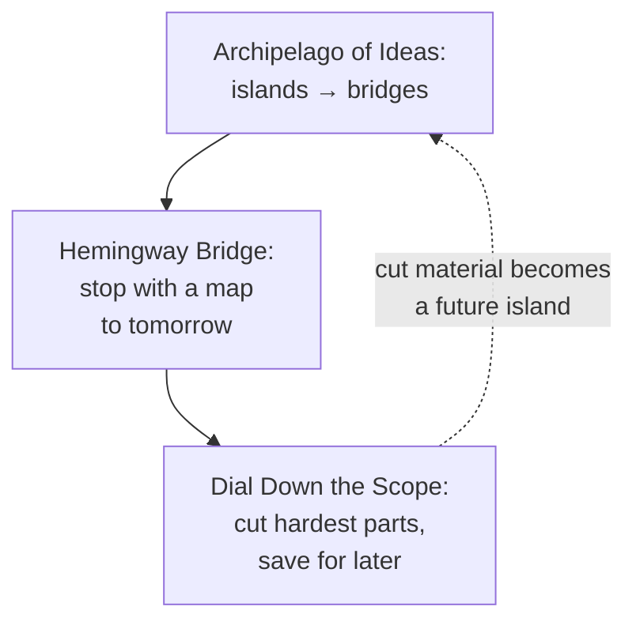

# Chapter 8 — The Art of Creative Execution

> [!cite] Book reference
> *Building a Second Brain* — Tiago Forte. Part Three: "The Shift: Making Things Happen," Chapter 8: "The Art of Creative Execution." Source: user's uploaded PDF.

> [!summary] One-line takeaway
> All creative work alternates between **divergence** (opening up, gathering widely, exploring without judgment) and **convergence** (narrowing, deciding, finishing) — and this chapter gives three concrete Second Brain techniques (Archipelago of Ideas, Hemingway Bridge, Dial Down the Scope) specifically for getting unstuck in the harder of the two: convergence.

## Why this chapter matters
This is the first chapter of Part Three, "The Shift" — moving from building the system (Parts One/Two) to actually using it to finish things. It directly addresses the gap between "I have a Second Brain full of notes" and "I actually shipped something," which is where many PKM practitioners get stuck.

## Direct quotes from the book
> [!quote] Epigraph
> "Creative products are always shiny and new; the creative process is ancient and unchanging." — Silvano Arieti

> [!quote] What Forte learned from his father
> "By the time you sit down to make progress on something, all the work to gather and organize the source material needs to already be done. We can't expect ourselves to instantly come up with brilliant ideas on demand."

> [!quote] On standardization and creativity
> "Building a Second Brain is really about standardizing the way we work, because we only really improve when we standardize the way we do something."

> [!quote] Steven Johnson on the Archipelago of Ideas
> "Instead of confronting a terrifying blank page, I'm looking at a document filled with quotes... Now each chapter starts life as a kind of archipelago of inspiring quotes, which makes it seem far less daunting. All I have to do is build bridges between the islands."[^1]

> [!quote] On why convergence is hard
> "The more imaginative and curious you are, the more diverse your interests, and the higher your standards and commitment to perfection, the more difficult you will likely find it to switch from divergence mode into convergence mode."

## The chapter in full (so you never need to re-read it)

### Forte's father, and creativity as a practiced routine
Forte opens with his multicultural upbringing (a Brazilian singer-guitarist mother, a Filipino painter father[^2]) and specifically his father's disciplined "strategies" for integrating creativity into daily life: sketching biblical scenes during church sermons as seeds for 8-10-foot canvases later, buying oddly-shaped vegetables at the supermarket to use as still-life models, glancing sideways at a painting-in-progress hung in the living room during family TV time to catch what's missing from a fresh angle. Forte's takeaway, explicitly rejecting the "tortured artist" stereotype: his father's *orderliness* was what enabled (not hindered) a prolific, decades-long body of work, because by the time he sat down to actually paint, the raw material had already been gathered and processed elsewhere. Forte generalizes this into the chapter's thesis: all of CODE exists to let your "fallible, endlessly creative first brain" do only what it's uniquely good at (imagining, inventing, innovating, creating), while the Second Brain handles everything upstream of that moment. He compares this standardization to weightlifting form, musical notation, and spelling/grammar conventions — not to constrain creativity, but to let you improve at the underlying craft reliably over time, since creative *products* constantly change (Instagram → Snapchat → TikTok) while the creative *process* itself is ancient and stable.

### Divergence and convergence
Forte names the core pattern underlying all creative work, borrowed from Design Thinking (Stanford d.school / IDEO)[^3]: **divergence** — opening the space of possibilities, gathering widely, exploring without judgment (the whiteboard full of sketches, the overflowing wastepaper basket, photos spread across the floor) — followed by **convergence** — narrowing down, cutting options, committing to a final direction. He maps this onto writers (diverge: raw material, character sketches, research / converge: outlines, drafts), engineers (diverge: researching solutions / converge: choosing an approach, building), designers (diverge: samples, user interviews / converge: wireframes, final files), and photographers (diverge: shooting broadly / converge: selecting, archiving the rest). He then maps CODE directly onto this pattern: **Capture + Organize = divergence** (gathering and storing seeds of imagination); **Distill + Express = convergence** (narrowing down and building something new from the assembled material).

### Three strategies for convergence
Forte argues convergence — not divergence — is where most people get stuck, especially the most curious, perfectionist people, because narrowing options feels like a loss ("creative grief") and further research/exploration *feels* productive while actually just postponing completion. Three Second-Brain-dependent techniques help:

**1. The Archipelago of Ideas.** Named after Steven Johnson's metaphor (quoted above): instead of a blank page, gather a critical mass of relevant quotes/sources/points (linked to full notes elsewhere in your Second Brain) as "islands," then switch to convergence mode and build "bridges" connecting them into a logical sequence. Forte frames this as digital outlining with five advantages over paper: malleable/editable after the fact, can link out to deeper detail instead of overloading the page, supports multimedia (not just text), fully searchable, and accessible/editable from any device. The deeper mechanism: an Archipelago separates **selection** (divergent — which ideas to include) from **sequencing** (convergent — what order they go in), two cognitively incompatible modes that are much harder to do simultaneously than sequentially.

**2. The Hemingway Bridge.** Named after Ernest Hemingway's reported habit of stopping each writing session only once he knew what came next in the story — never writing until he was fully drained of ideas.[^4] Applied to notetaking: in the last few minutes of a work session, write down next steps, current status/open questions, details likely to be forgotten, and your intention for the next session. This "bridges" today's momentum into tomorrow's starting point, and Forte adds a refinement: also send your current draft/IP to someone for feedback before stopping, so you return not just to your own notes but to fresh input as well.

**3. Dial Down the Scope.** Borrowed from software engineering's concept of "scope" (the full feature set of a product): as a deadline approaches, cut the most difficult, uncertain, or non-essential features first (rather than delaying the whole release) to ship something smaller but real. Applied generally: don't wait for "everything ready" before starting (an impossible bar — "like waiting until all the traffic lights across town are green at the same time") — cut the project down to a smaller, shippable version, and crucially, *save* everything you cut in your Second Brain rather than discarding it, since a scrapped slide, sentence, or agenda item can become the seed of something else later. He lists concrete examples of dialing down ambitious goals: writing a book → a series of articles → a single social post; a paid workshop → a free local meetup → a small group exercise; a short film → a YouTube video → a livestream → a rough phone recording sent to a friend. He frames this as resolving a chicken-and-egg problem: you can't get useful feedback without showing people something concrete, but you don't know what to build until you have that feedback — dialing down scope breaks the deadlock by letting you ship something small enough to test quickly.

He's explicit that divergence and convergence aren't one-directional — they loop: finishing one convergence cycle (shipping a small version) feeds learning back into a new divergence cycle, repeating until something is genuinely "done."

### Case study: the garage remodel
Forte walks through his own home-office remodel project as a worked example of all three techniques together: a 15-minute initial Archipelago outline (headings that emerged organically: Intro, Cost, Ideas, Phases, Aesthetics, Zoom Setup, Equipment, Open Questions) linked to existing relevant notes (a friend's studio-design advice, café photos for aesthetic inspiration, Zoom-lighting best practices); weeks of incremental capture (Pinterest photos, a soundproofing conversation, a contractor list, YouTube studio tours) strung together via repeated Hemingway Bridges during scarce pockets of free time; and finally Dialing Down the Scope once the project's ambitions ballooned (wall removal, a skylight, backyard redesign) by moving the most extravagant ideas to a "someday/maybe" section and adding hard budget/deadline constraints, which immediately clarified next steps (finding a contractor, finalizing the floorplan).

### Closing exercise
Forte's practical close: pick one uncertain/challenging project, build an Archipelago outline from what's already on your mind plus a PARA search for relevant existing notes/IPs, then set a short timer (15-20 minutes) and attempt a first pass using *only* already-gathered material — no new research, no new tabs. If you can't finish in one sitting, build a Hemingway Bridge (open questions, to-dos, people to consult) and share the draft for feedback before stopping. If stuck, apply Dial Down the Scope. Keep capturing new notes/IPs throughout, since starting the process tends to surface more relevant material via pattern recognition.

## Core concepts (quick-scan version)

| Technique | Problem it solves | How it works |
|---|---|---|
| Archipelago of Ideas | Blank-page paralysis | Gather linked source-quotes/points as "islands" first (divergent), then sequence them into a logical flow (convergent) — separately, not simultaneously. |
| Hemingway Bridge | Losing momentum between sessions | Stop each session by writing next steps/open questions/intentions — never stop "empty." |
| Dial Down the Scope | Waiting for "everything ready" before shipping | Cut the hardest/least-essential parts first (not delay the whole thing); save what's cut for reuse elsewhere later. |
| Divergence ↔ Convergence | The universal creative-work pattern | Diverge (Capture + Organize): open up, gather widely. Converge (Distill + Express): narrow down, decide, finish. Loops repeatedly, not linear. |

## First-principles breakdown

**The claim, stripped of branding:** creative work reliably stalls at one specific transition — from open-ended gathering to committed narrowing — and that transition can be made easier with three structural tricks: separating selection from sequencing, pre-committing to a resumption point before stopping, and treating scope as a adjustable variable rather than a fixed requirement.

**What has to actually be true for each technique to hold:**
1. *Archipelago of Ideas* assumes selection and sequencing really are distinct cognitive modes that interfere with each other when combined — this is a specific, testable claim (related to general findings that generation and evaluation compete for the same attentional resources), not just an analogy. Its practical dependency is explicit in the chapter itself: it only works if your Second Brain already has retrievable material to gather into islands — this technique is a direct payoff of Chapters 4-6 working, not a standalone trick.
2. *Hemingway Bridge* assumes that an explicit, written resumption point meaningfully beats an implicit one (just "remembering where you left off"). This is plausible given everything in Chapters 1-3 about working-memory decay and the cost of context-switching, but the chapter's only evidence is Hemingway's own reported habit (anecdotal, single case, possibly apocryphal as commonly retold) — a reasonable technique, resting on thin direct evidence, though consistent with well-established cognitive-load research more broadly.
3. *Dial Down the Scope* assumes that most of a project's value is front-loaded in a smaller subset of its features — the "80/20"-style assumption that lets you cut aggressively without losing most of the value. This holds well for software (Forte's own source domain) and many other projects, but isn't universal: some creative or scientific work has no meaningful "smaller version" (a proof isn't 80% as useful if you omit the hardest lemma) — worth treating this technique as domain-dependent rather than universally applicable, which the chapter doesn't explicitly flag.
4. *The divergence/convergence model itself*, borrowed wholesale from Design Thinking, inherits that framework's own well-documented critique: it can flatten what is often a messier, non-linear, iterative reality into a clean two-phase story for teachability — useful as a simplified mental model, but not a literal description of how creative cognition works moment-to-moment.

**Rebuilt in plain terms:** the three techniques aren't really about "creativity" in the abstract — they're three different ways of reducing the number of decisions you have to make simultaneously at any one moment (separate selecting from ordering; separate stopping from re-starting; separate "what's possible" from "what's happening in this version"). That's a general cognitive-load-reduction principle, and it's the same underlying move as Intermediate Packets (Ch.7) and Progressive Summarization (Ch.6) — this chapter is really showing three more applications of one consistent strategy running through the whole book: don't make any single moment do too much cognitive work at once.

## Visual representation

## Worked example — built directly in your vault
This chapter's techniques are workflow habits, not folder structures — no new top-level vault artifact needed. The existing `01-Projects/Gloss Local/` folder is itself the natural place to practice all three techniques going forward: an Archipelago-style outline for a feature decision, Hemingway Bridge notes at the end of a work session, and a "someday/maybe" subsection for scope cut during active development — worth adopting there directly rather than building a separate demo.

## What the book doesn't tell you — community perspective (2024–2026)
- **Divergence/convergence inherits Design Thinking's own well-known critique.** Design Thinking (the explicit source of this chapter's core model) has been criticized for oversimplifying what is, in reality, a much messier and iterative process into a clean two-phase narrative that's easy to teach but doesn't fully match how creative cognition actually unfolds — notably in Natasha Jen's widely-shared "Design Thinking is Bullshit" talk and Jon Kolko's "The Divisiveness of Design Thinking" essay ([interactions.acm.org](https://interactions.acm.org/archive/view/may-june-2018/the-divisiveness-of-design-thinking)).
- **A specific counter-critique on convergence itself:** some design critics argue the "divergence first, then converge" framing misrepresents how skilled practitioners actually work — expert designers often converge much earlier and more continuously throughout a project than the clean two-phase model implies, rather than doing one big divergent phase followed by one big convergent phase ([designdialogues.com — "Design Thinking's Convergence Diversion"](https://designdialogues.com/design-thinkings-convergence-diversion/)).
- No direct, substantive public critique of the Archipelago/Hemingway Bridge/Dial Down the Scope techniques specifically was found — commentary on this chapter tends to be descriptive/positive summary rather than critical analysis, which is itself worth noting as a gap (these three named techniques appear less independently scrutinized than PARA or Progressive Summarization).

## Deeper commentary — how this applies to your setup specifically
All three techniques map directly onto how to actually build [[Project Overview|Gloss Local]], not just write notes about it: an Archipelago-of-Ideas-style design note (gathering relevant technical references, past decisions, and constraints before attempting a build decision) would apply the same selection/sequencing separation this chapter recommends for writing. Hemingway Bridges are a near-perfect fit for a solo side project worked on in scattered free time — ending each coding session with a short "next steps / open questions" note directly addresses the real risk (already flagged in project memory) that Gloss Local's actual Ollama/model behavior "has not been verified yet" on real hardware — a Hemingway Bridge note at the end of the next session would be a good place to record exactly what was tested and what wasn't.

Dial Down the Scope is arguably the most directly relevant idea in this whole book for Gloss Local specifically: the project already shows signs of healthy scope discipline (LlamaParse and painted covers explicitly removed, per project memory) — this chapter gives a name and a repeatable process for that instinct, and a reminder to actually *save* anything cut (a "someday/maybe" note) rather than just dropping it.

## Practical / actionable takeaways
- [ ] Next time you sit down to work on Gloss Local, end the session with an explicit Hemingway Bridge note (next steps, open questions, what you expect to test next) rather than just stopping.
- [ ] Before the next non-trivial Gloss Local design decision, build a quick Archipelago of Ideas note (gather relevant past notes/constraints first, sequence them second) rather than deciding from a blank page.
- [ ] If Gloss Local's scope starts expanding again, apply Dial Down the Scope explicitly — identify the most uncertain/expensive features first, and move them to an explicit "someday/maybe" list rather than silently letting the project balloon.

## Questions / things to decide for your own vault
- Would a dedicated "Hemingway Bridge" note template (date, next steps, open questions, intention) be useful as a lightweight addition to `05-Templates/`? Worth considering if this habit sticks after a few uses.

## Video
No credible, clearly-relevant video found specifically for this chapter's three named techniques (Archipelago of Ideas, Hemingway Bridge, Dial Down the Scope) — most search results were text summaries rather than video content, and a Design Thinking explainer video would address only the chapter's borrowed background concept, not Forte's own specific techniques. Omitting this section rather than including a loosely-related link.

## Sources (external, beyond the book)
- [The Divisiveness of Design Thinking — Jon Kolko, interactions.acm.org](https://interactions.acm.org/archive/view/may-june-2018/the-divisiveness-of-design-thinking)
- [Design Thinking's Convergence Diversion — designdialogues.com](https://designdialogues.com/design-thinkings-convergence-diversion/)

## Footnotes
[^1]: The book's own endnote 1: Danny Choo, "DIY: How to write a book," boingboing, January 27, 2009 — source of the Steven Johnson "archipelago of inspiring quotes" quote.
[^2]: The book's own footnote I: Forte made a short documentary on his father's life and work, *Wayne Lacson Forte: On My Way To Me*.
[^3]: The book's own footnote II: Forte credits Design Thinking (Stanford Design School, popularized by IDEO from the 1980s-90s onward) as his source for the divergence/convergence model.
[^4]: The book's own footnote IV: Forte frames the Hemingway Bridge as "ending with the beginning in mind" — a deliberate rephrasing of Stephen Covey's "begin with the end in mind."

## Claude's pick — what I'd flag as most important
- Dial Down the Scope is the single most broadly useful idea in this chapter — it directly names a trap (waiting for a project to be "fully ready") that affects nearly everyone, and gives a concrete, repeatable way out of it.
- The Archipelago of Ideas' real insight isn't the "island" metaphor, it's the explicit claim that selecting and sequencing are different cognitive modes best done separately — worth remembering as a general writing/planning principle independent of Forte's specific technique name.
- Worth reading this chapter's divergence/convergence model as a simplified but useful lens, not a literal description of creative cognition — the Design Thinking critique (oversimplification, premature or continuous convergence in skilled practice) is a reasonable caveat to keep in mind rather than a reason to discard the model.

## Related
- Previous: [[Chapter 7 - Express - Show Your Work]]
- Next: [[Chapter 9 - The Essential Habits of Digital Organizers]]
- MOC: [[Building a Second Brain - MOC]]
