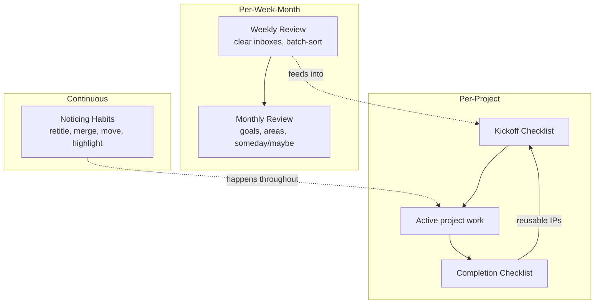

# Chapter 9 — The Essential Habits of Digital Organizers

> [!cite] Book reference
> *Building a Second Brain* — Tiago Forte. Part Three: "The Shift: Making Things Happen," Chapter 9: "The Essential Habits of Digital Organizers." Source: user's uploaded PDF.

> [!summary] One-line takeaway
> A Second Brain needs ongoing maintenance, done in small, low-effort increments woven into regular work — not big one-time cleanups — via three habits: Project Kickoff/Completion Checklists, Weekly/Monthly Reviews, and "Noticing Habits" (small in-the-moment improvements).

## Why this chapter matters
Everything up to this point describes what to do with information once — this chapter is about sustaining the system indefinitely, which is where most PKM efforts (per multiple earlier community critiques) actually fail. It's the most process-heavy chapter in the book, and directly addresses the "r/PKMS graveyard" failure mode flagged in earlier chapter notes.

## Direct quotes from the book
> [!quote] Epigraph
> "Habits reduce cognitive load and free up mental capacity, so you can allocate your attention to other tasks... It's only by making the fundamentals of life easier that you can create the mental space needed for free thinking and creativity." — James Clear

> [!quote] On what "being organized" actually is
> "'Being organized' isn't a personality trait you're born with, nor is it merely a matter of finding the right apps or tools. Being organized is a habit—a repeated set of actions you take as you encounter, work with, and put information to use."

> [!quote] On maintenance timing
> "There's no time that's magically going to become available for you to stop everything and completely reorganize your digital world."

> [!quote] The closing principle
> "A perfect system you don't use because it's too complicated and error prone isn't a perfect system—it's a fragile system that will fall apart as soon as you turn your attention elsewhere."

## The chapter in full (so you never need to re-read it)

### Mise en place
Forte opens with the culinary discipline of **mise en place** ("everything in its place"), developed in France from the late 1800s[^1] — the practice professional chefs use to produce high volumes of high-quality food under constant time pressure: always returning the mixing spoon to the same place, wiping a knife clean immediately after use, laying out ingredients in order of use. He frames this as chefs' "external brain," automating repetitive mechanics so attention stays free for the creative parts of cooking. His parallel claim for knowledge workers: we face the same quality-under-constant-pressure tension ("sprinters who are also trying to run a marathon"), and the only realistic time to maintain our systems is *during* regular work, not during some mythical future block of free time that never actually arrives. He names three habit categories for this ongoing maintenance: **Project Checklists** (consistent starts/finishes), **Weekly and Monthly Reviews** (periodic resets), and **Noticing Habits** (small in-the-moment improvements) — the "maintenance schedule" for a Second Brain, analogous to a car's oil changes and tire rotations.

### The knowledge flywheel and two checklists
Forte frames attention as an investable asset (like money reinvested by investors) that compounds only if past work's output gets recycled into future work, rather than discarded at project's end. He identifies project start and project finish as the two decisive moments for this recycling, each with its own checklist.

**Project Kickoff Checklist** (modeled on an airline pilot's preflight checklist, to avoid leaving project starts to chance):
1. Capture current thinking (a messy initial brainstorm: what you know, what you don't, your goal, who to talk to, what to read/listen to).
2. Review PARA folders/tags that might contain relevant existing notes.
3. Search across all folders for related terms you might have missed via browsing alone.
4. Move (or tag) relevant notes into the new project folder.
5. Build an outline (an Archipelago of Ideas, per Ch.8) from the gathered material and plan next steps.
He stresses this whole first pass should take only 20-30 minutes — it's planning *how* to tackle the project, not executing it — and offers optional additions: premortem questions[^2] (what's most likely to fail, before starting), stakeholder communication, defined success criteria, and an official kickoff (useful even solo, he notes).

**Project Completion Checklist** (the other half — equally important, since without it, future Kickoff Checklists have nothing to draw from):
1. Mark the project complete in your task manager.
2. Cross out the associated goal and move it to a "Completed" list (a deliberate record of past wins, useful for motivation later).
3. Review the project's Intermediate Packets and relocate reusable ones to other project/area/resource folders.
4. Move the whole project folder to archives, across every platform used (notes app, file system, cloud drive).
5. If the project is actually being paused/canceled rather than finished: add a "Current status" note (a Hemingway Bridge, per Ch.8) — last actions taken, why it stalled, who was involved, lessons learned — before archiving, so it can be picked back up later with minimal re-orientation cost.
He notes this pass should take even less time than Kickoff (10-15 minutes), since there's no certainty any given piece of salvaged material will actually be reused — invest only enough effort that your future self can quickly judge relevance later. Optional additions here: postmortem questions, stakeholder close-out communication, success-criteria evaluation, and actively celebrating completion.

### Weekly and Monthly Reviews
Forte credits David Allen's *Getting Things Done*[^3] as the origin of the Weekly Review practice (a regular reset: capture new to-dos, review active projects, set next week's priorities), and adds one explicit layer on top: reviewing and batch-sorting the past week's captured notes into PARA folders.

**Weekly Review** (his own, performed roughly every 3-7 days):
1. Clear email inbox (action items → task manager; notes → notes app).
2. Check calendar (past couple weeks for follow-ups, next couple weeks for prep).
3. Clear computer desktop (relevant files → PARA folders).
4. Clear notes inbox — batch-sort the week's captured notes (typically 5-15) into PARA folders with clear titles, explicitly *without* highlighting, summarizing, or deep engagement at this stage — that effort is deliberately deferred to whenever the note is actually needed (per Ch.6's "distill only with a purpose in mind").
5. Choose the coming week's committed tasks, now made with full visibility into everything just surfaced.

**Monthly Review** (more reflective/holistic):
1. Review/update goals (quarterly and yearly) — what succeeded, what didn't, why.
2. Review/update the project list — archive completed/canceled projects, add new ones, keep it an accurate mirror of real current commitments (since projects are PARA's central organizing unit).
3. Review areas of responsibility (health, finances, relationships, home) for anything needing attention — area folders, he notes, often seed future projects before those projects even exist (his own example: a "Home" area folder collecting remodel inspiration long before the remodel became an active project).
4. Review "someday/maybe" items — things wanted eventually but not actionable now (his example: wanting a dog, deferred until becoming a homeowner made it realistic) — just in case any have become newly actionable.
5. Reprioritize tasks with the full month's context now visible.

### Noticing habits
The third, least structured category: small, opportunistic actions taken *while already working* rather than during a scheduled review — capturing an idea instead of dismissing it as "nothing," highlighting something that resonates in the moment, improving a note's title for future discoverability, moving/linking a note to a more relevant project, merging overlapping notes or combining IPs into something larger, or sharing an existing IP with someone else it could help. Forte contrasts notes with to-dos here directly: an overlooked to-do can be genuinely costly, but an unsorted note has essentially no downside to waiting — it'll simply sit in the inbox until there's time, with no penalty. He directly challenges the common belief that organizing requires a dedicated large block of time — in his experience, even people who do carve out such blocks tend to get lost in minutiae and make less progress than expected, finishing demoralized rather than caught up. His alternative: organize continuously, in small increments, as changing priorities naturally surface the need (his examples: moving a "Costa Rica" vacation's relevant Spanish-phrase notes out of a general "Languages" resource folder; reactivating an old "Engineering hire" archive folder when a new hiring need arises).

### Closing: a perfect system you don't use isn't perfect
Forte closes by reiterating forgiveness as a design principle: nothing breaks if notes sit unsorted for weeks; there's no need to capture every idea (the important ones recur); PARA placement decisions are low-stakes because search backstops imperfect filing. His final line of argument: a system that demands perfection to function is actually fragile, not robust — the goal is a *working* system (both "it works" and "it's part of your regular working life"), not an immaculately organized encyclopedia nobody actually maintains.

## Core concepts (quick-scan version)

| Habit | Cadence | Core purpose |
|---|---|---|
| Project Kickoff Checklist | At project start | Recycle past relevant material instead of starting from zero; 20-30 min first pass. |
| Project Completion Checklist | At project end | Salvage reusable IPs before archiving; Hemingway Bridge note if paused rather than finished; 10-15 min. |
| Weekly Review | Every 3-7 days | Clear inboxes (email, calendar, desktop, notes), batch-sort without deep processing, choose next week's tasks. |
| Monthly Review | Monthly | Reflect on goals, update project list, review areas and someday/maybe items, reprioritize. |
| Noticing Habits | Continuous, opportunistic | Small in-the-moment improvements (titles, merges, moves, highlights) with zero scheduled overhead. |

## First-principles breakdown

**The claim, stripped of branding:** a knowledge-management system only stays useful if its maintenance cost is distributed in small, low-friction increments across normal work, rather than concentrated in occasional large efforts — because large maintenance efforts are both harder to schedule reliably and, per the chapter's own anecdotal observation, less effective per hour invested than people expect.

**What has to actually be true for that to hold:**
1. *Small, frequent maintenance must actually have lower total cost than large infrequent maintenance* — this is a real claim about effort elasticity, not just a scheduling preference. It's well-supported by the mise en place analogy (an established, decades-proven professional practice) and by general software-engineering wisdom (continuous small refactoring vs. rare "big rewrite" efforts, which notoriously tend to fail or stall) — this is one of the chapter's best-grounded claims.
2. *The Weekly Review's "sort without processing" step depends entirely on Progressive Summarization (Ch.6) being deferred correctly* — this chapter is explicit that no highlighting/summarizing happens during weekly sorting, which only works if you trust a later, purpose-driven distillation pass (per Ch.6's own "highlight only with a purpose" rule) to happen when actually needed. If that later pass doesn't reliably happen, notes accumulate in a permanently under-processed state — the Weekly Review's low cost is only sustainable *because* it explicitly borrows against a promise made in an earlier chapter.
3. *"Noticing habits" assume a baseline level of genuine engagement with the system* — small opportunistic improvements only happen if you're already spending meaningful time inside your notes app for other reasons (per Ch.5's "your Second Brain is an environment, not just storage"). This habit category has no mechanism of its own; it's parasitic on the system already being used regularly for real work, which makes it the weakest, least actionable of the three habit categories on its own (hardest to adopt deliberately, since it isn't really a discrete practice).
4. *The "forgiving system" framing is a deliberate hedge against perfectionism*, and it's worth noting this directly counters earlier chapters' own precision (PARA's four categories, Progressive Summarization's layer ratios, four retrieval methods) — the chapter is effectively saying "all that structure is optional scaffolding, not a hard requirement," which is reassuring but also slightly in tension with how rigorously those earlier systems were presented. Worth reading as "aim for the structure, but don't let its absence stop you," not "the structure doesn't matter."

**Rebuilt in plain terms:** this chapter's real contribution is applying one consistent principle (amortize cost in small increments, don't batch it) to three different timescales — per-project (checklists), per-week/month (reviews), and continuous (noticing) — the same underlying idea as mise en place, mise en place being itself just this principle applied to a kitchen. The weakest link, explicitly acknowledged by the chapter's own "forgiving system" framing, is that none of these habits are strictly necessary — they're all recoverable if skipped, which is a feature (low stakes) but also means none of them have strong enforcement, which is exactly why "not maintaining the system" is such a commonly cited practical failure mode for this whole book.

## Visual representation

## Worked example — built directly in your vault
**Weekly and Monthly Review templates already exist in this vault** — `05-Templates/Weekly Review Template.md` and `05-Templates/Monthly Review Template.md`, built during the earlier "Obsidian Second Brain" book processing. The existing Weekly Review template is lighter than Forte's own 5-step version above (it focuses on reflection and top-3-outcomes rather than the inbox-clearing mechanics) — worth noting as a genuine, deliberate difference rather than an oversight: it already cross-references an AI-assisted version in [[Chapter 8 - AI Inside Your Second Brain]]. No new template was created to avoid duplicating existing, working structure; if you want Forte's specific 5-step inbox-clearing mechanics added, that would be a deliberate enhancement to consider, not an automatic one.

## What the book doesn't tell you — community perspective (2024–2026)
- **Forte's own "one-touch weekly review" has a tool-dependency failure mode.** An analysis comparing weekly-review systems notes Forte's version is "deeply tied to digital note-taking infrastructure like Notion or Roam" — without that infrastructure already in place and populated, the Capture→Organize phases it depends on lose their value entirely, meaning the review's low cost is conditional on substantial prior setup ([planwith.ai comparison](https://planwith.ai/blog/5-weekly-review-systems-deep-compared)).
- **GTD's Weekly Review — which this chapter explicitly builds on — is widely reported as the hardest GTD habit to sustain**, even among dedicated practitioners, according to David Allen himself (it's his "Master Key to GTD" specifically because it's also the easiest habit to let lapse) — worth taking as a signal that Forte's lighter version likely inherits at least some of that same adherence difficulty, not solves it outright ([planwith.ai — Science Behind Weekly Reviews](https://planwith.ai/blog/science-behind-weekly-reviews)).
- **Forte's version is explicitly narrower than GTD's**, omitting GTD's "waiting-for" lists and full context-based action-list coverage in favor of the knowledge-management angle GTD underemphasizes — a reasonable trade-off, but one worth knowing if you're combining this system with a separate full GTD task-management practice rather than using it standalone.

## Deeper commentary — how this applies to your setup specifically
The Project Kickoff/Completion Checklist pair is directly adoptable for [[Project Overview|Gloss Local]] development sessions: a lightweight kickoff pass (what do I already know, what existing notes/decisions apply, what's the plan for this session) before diving into a new feature, and a completion pass (any reusable snippets, config, or decisions worth saving before moving on) at the end of a working session — both cheap enough to actually stick, per this chapter's own "small and frequent beats large and rare" argument.

The tool-dependency critique is worth taking seriously for Gloss Local specifically, given it's explicitly local-first and not built on an existing PKM platform — any "review habit" built around Gloss Local's own data (annotations, reading history) would need its own lightweight review mechanism designed in from the start, rather than assuming an external notes app's weekly-review conventions transfer automatically.

## Practical / actionable takeaways
- [x] Confirmed Weekly/Monthly Review templates already exist in this vault; no duplicate built.
- [ ] Consider whether to add Forte's specific 5-step inbox-clearing mechanics to the existing Weekly Review template, or keep the current reflection-focused version — a deliberate choice, not a gap to silently fix.
- [ ] Try a lightweight Kickoff/Completion checklist pair for the next discrete chunk of Gloss Local work, scaled down to a solo-project, few-minutes version.
- [ ] Watch your own adherence to whichever review cadence you choose — per the GTD community data above, expect this to be the habit most likely to lapse, and don't treat a lapse as system failure (per the chapter's own "forgiving system" framing).

## Questions / things to decide for your own vault
- Should this vault's existing Weekly Review template be left as-is (reflection-focused) or extended with Forte's inbox-clearing steps? Worth deciding deliberately rather than defaulting either way.

## Video
No credible, directly relevant video found for this chapter's specific content (mise en place applied to knowledge work, or Forte's own checklists) beyond generic weekly-review explainer content already covered by text sources above. Omitting this section rather than including a loosely-related link.

## Sources (external, beyond the book)
- [5 Weekly Review Systems Compared: GTD, Bullet Journal, Scrum, Sunday Reset & AI — planwith.ai](https://planwith.ai/blog/5-weekly-review-systems-deep-compared)
- [The Science Behind Weekly Reviews — planwith.ai](https://planwith.ai/blog/science-behind-weekly-reviews)
- [The Weekly Review is an Operating System — Forte Labs](https://fortelabs.com/blog/the-weekly-review-is-an-operating-system/)

## Footnotes
[^1]: The book's own endnote 1: Dan Charnas, *Work Clean: The Life-Changing Power of Mise-en-Place to Organize Your Life, Work, and Mind* (Emmaus, PA: Rodale Books, 2016) — Forte's cited source for the mise en place discussion.
[^2]: The book's own footnote I: a "premortem" is the inverse of a postmortem — asking what's likely to go wrong *before* a project starts, so you can act preventively.
[^3]: The book's own footnote III: David Allen's *Getting Things Done* (GTD) is framed as a complementary system — applying the same "get it off your mind" principle to actionable to-dos that this book applies to notes and knowledge.

## Claude's pick — what I'd flag as most important
- "A perfect system you don't use isn't perfect" is the single most important corrective in this entire book, and worth remembering every time any of the earlier chapters' precise rules (PARA's four categories, 10-20% Progressive Summarization ratios) start to feel like a burden rather than a help.
- The Project Kickoff/Completion Checklist pair is the most immediately transferable habit in this chapter — cheap, bounded in time (20-30 / 10-15 minutes), and directly reinforces the "recycle attention like an investable asset" framing that ties back to Chapter 7's Intermediate Packets.
- The tool-dependency critique of Forte's own review system is worth taking seriously, not dismissing — it's a reminder that "low cost in practice" claims throughout this book are often conditional on infrastructure (PARA folders, distilled notes, a working notes app) already being in place, which is exactly the retrieval/reuse precondition flagged across nearly every chapter note so far.

## Related
- Previous: [[Chapter 8 - The Art of Creative Execution]]
- Next: [[Chapter 10 - The Path of Self-Expression]]
- MOC: [[Building a Second Brain - MOC]]
- Existing vault templates: [[Weekly Review Template]], [[Monthly Review Template]]
