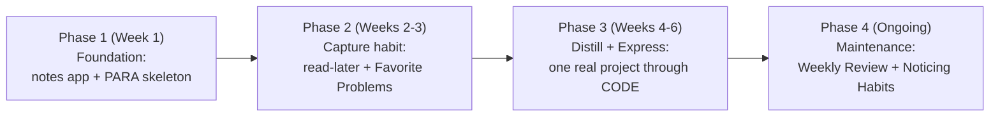

# Building a Second Brain — Practical Setup Guide

A phased, standalone action plan for actually implementing what *Building a Second Brain* teaches — sequenced so you build one real habit at a time instead of trying to adopt all of CODE/PARA at once. This guide doesn't re-explain the concepts; it links out to the chapter notes for that. Think of it as the answer to "okay, what do I actually *do*, starting this week?"

> [!tip] Before you start
> Per [[Chapter 10 - The Path of Self-Expression]]'s closing advice: there's no single correct way to do this. If a phase below doesn't fit how you actually work, skip or adapt it. The goal is a system you use, not one that's theoretically complete.

## The four phases

---

## Phase 1 — Foundation (aim: finish in under a week)
Goal: get the bare infrastructure in place. Don't try to populate it yet.

1. **Confirm your notes app.** You already have one (this Obsidian vault). Per [[Chapter 3 - How a Second Brain Works]], the only requirement is that it's multimedia, informal, open-ended, and action-oriented — Obsidian satisfies all four. No further tool decision needed here.
2. **Confirm PARA exists.** It already does, at the vault root (`00-Inbox/`, `01-Projects/`, `02-Areas/`, `03-Resources/`, `04-Archive/`) — see [[Chapter 5 - Organize - Save for Actionability]] and [[Where Does This Go - Quick Reference]] for the decision tree. Nothing to build here either; just get familiar with the existing structure if you haven't already.
3. **Create folders only for your currently active projects** — not Areas or Resources yet (per Chapter 5's explicit "start with projects only" advice, to avoid empty, unused containers). If `01-Projects/Gloss Local/` is your main active project, that's likely sufficient to start.
4. **Write your Favorite Problems list.** Already built and live at [[Favorite Problems]] (in `03-Resources/Obsidian and PKM/`) — per [[Chapter 4 - Capture - Keep What Resonates]]. Spend 10 minutes adding 2-3 more of your own.

**Checkpoint:** you should be able to answer "where would a new idea about Gloss Local go?" without hesitation.

---

## Phase 2 — Build the Capture habit (aim: 2-3 weeks)
Goal: make capturing low-friction and automatic, without worrying yet about distilling or using what you capture.

1. **Pick one read-later or capture mechanism** you'll actually use consistently — could be as simple as Obsidian's own quick-capture into `00-Inbox/`, or a browser clipper if most of your capture is from the web. Per [[Chapter 4 - Capture - Keep What Resonates]], the tool matters far less than consistency.
2. **Apply the "keep ~10%" rule** — practice capturing only the most salient excerpt, not whole articles. See the real demo at [[Example - Capture Note (Highlight)]].
3. **Test your captures against the four criteria** (inspiring / useful / personal / surprising) and your Favorite Problems list for the first couple of weeks, until resonance-based capture starts to feel automatic.
4. **Don't organize yet.** Let captures sit in `00-Inbox/` — per [[Chapter 5]], capture and organize are deliberately separate steps in time.

**Checkpoint:** you're capturing something most days without having to think hard about whether to.

---

## Phase 3 — Run one real project through the full CODE cycle (aim: 4-6 weeks)
Goal: experience Capture → Organize → Distill → Express end-to-end on one real, moderately challenging piece of work, rather than theorizing about the system.

1. **Choose one project** — ideally something with genuine uncertainty (per [[Chapter 8 - The Art of Creative Execution]]'s "the more uncertain, the better" advice). A good candidate: a specific Gloss Local feature or design decision.
2. **Run a Project Kickoff Checklist** (20-30 min, per [[Chapter 9 - The Essential Habits of Digital Organizers]]): brainstorm current thinking, search/browse existing notes, gather relevant material into the project folder, build an outline.
3. **Build an Archipelago of Ideas** for it (per [[Chapter 8]]) — gather relevant notes/sources as "islands" before worrying about sequence.
4. **Practice Progressive Summarization** on the gathered notes (per [[Chapter 6 - Distill - Find the Essence]]) — see the real demo at [[Example - Progressive Summarization (4 Layers)]]. Only distill what you're about to actually use.
5. **Produce one small Intermediate Packet** (per [[Chapter 7 - Express - Show Your Work]]) — a draft, a decision doc, a diagram — and share it with someone for feedback, even informally.
6. **If you stall**, apply Dial Down the Scope or a Hemingway Bridge (both in [[Chapter 8]]) rather than waiting for a "better time" to continue.
7. **Run a Project Completion Checklist** once done (per [[Chapter 9]]) — salvage reusable Intermediate Packets, archive the rest.

**Checkpoint:** you've shipped one small, real thing using the system, and you have at least one reusable Intermediate Packet sitting in a folder for next time.

---

## Phase 4 — Ongoing maintenance (aim: make it permanent)
Goal: keep the system alive without it becoming its own project.

1. **Establish a Weekly Review cadence** — every 3-7 days, per [[Chapter 9]]. Start minimal: just clear `00-Inbox/` and pick the week's priorities. The existing [[Weekly Review Template]] in this vault already supports the reflection side; add inbox-clearing as a habit even if it's not written into the template.
2. **Do a lighter Monthly Review** — goals, project list, Areas, someday/maybe items (per [[Chapter 9]]); the existing [[Monthly Review Template]] is available for this.
3. **Practice Noticing Habits continuously** — retitle a poorly-named note when you see one, merge duplicates, move a note when its relevance shifts. No schedule needed; this happens *while* you're already in the vault for other reasons.
4. **Revisit this whole project periodically.** Per [[Chapter 10 - The Path of Self-Expression]], using a Second Brain is a lifelong practice, not a finished project — expect your own habits here to keep evolving.

**Checkpoint:** you go multiple weeks without the system feeling like a burden, and you're not accumulating an ever-growing backlog of unsorted notes.

---

## If you only do one thing from each phase
- Phase 1: confirm your project folders are current.
- Phase 2: capture the best excerpt, not the whole thing.
- Phase 3: finish one small Intermediate Packet and share it.
- Phase 4: clear your notes inbox at least once a week.

## Related
- [[Building a Second Brain - MOC]]
- [[Use Cases Guide]]
