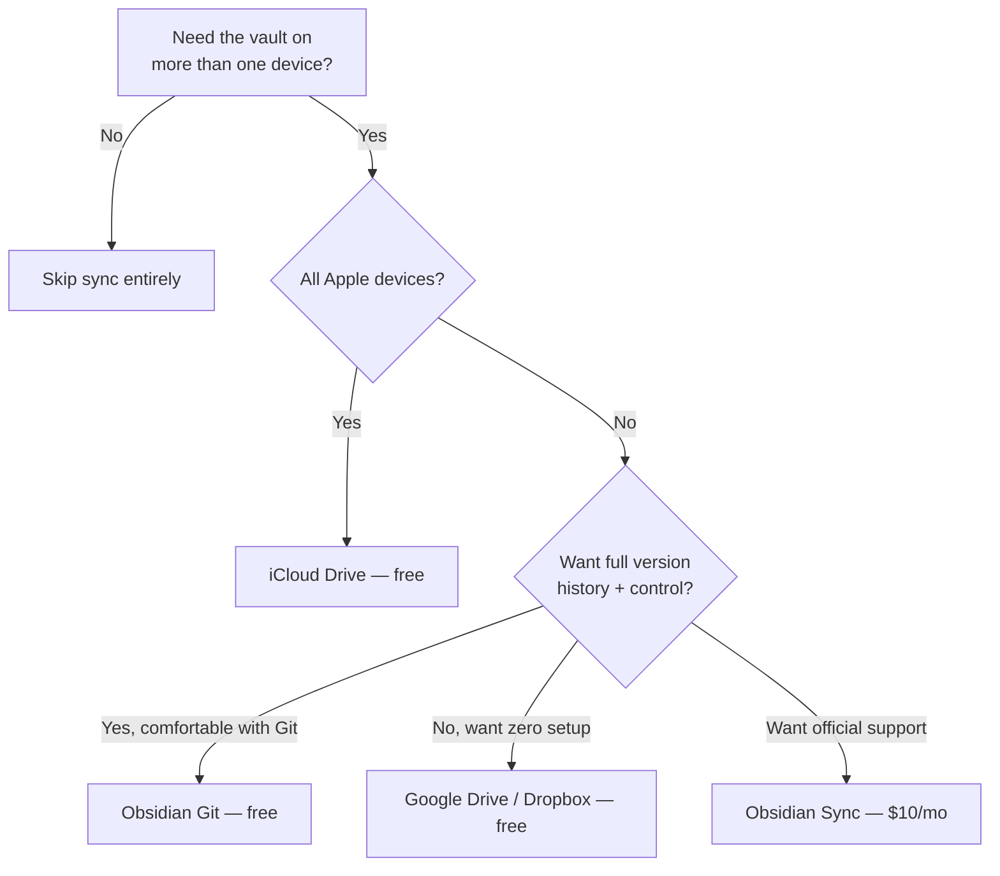

# Chapter 1 — Setting Up Obsidian: Your Knowledge Vault in 15 Minutes

> [!cite] Book reference
> *Obsidian Second Brain: The Complete System for Knowledge Management, Note-Taking, and Getting Things Done* — Chipak, Anderson. Chapter 1: "Setting Up Obsidian — Your Knowledge Vault in 15 Minutes." Source: your uploaded EPUB; no public URL exists for this title, so this note cites page/chapter location only.

> [!summary] One-line takeaway
> Obsidian is a free, local-first, Markdown-based note app — your "second brain" needs a home before it needs a system, and that home takes about 15 minutes to build.

## Why this chapter matters
Before any method (PARA, Zettelkasten, daily capture) can work, you need the container. This chapter is pure setup: install Obsidian, create a vault, learn the interface, learn minimal Markdown, memorize a few shortcuts, and decide how (or whether) to sync across devices. Nothing here requires a paid account.

## Direct quotes from the book
> [!quote] On the philosophy of local-first
> "That home is Obsidian — a free, local-first note-taking application that stores everything as plain Markdown files on your own computer... No paid subscriptions required. No data sent to a cloud server you do not control."

> [!quote] On vault portability
> "A vault in Obsidian is simply a folder on your computer... your data is never locked inside a proprietary database. You can open your vault folder in any file manager and see exactly what is there."

> [!quote] On linking
> "Of all these elements, [[Double Brackets]] is the most important feature in Obsidian... Every time you notice that a note relates to another note and you add a link, you are adding intelligence to the system."

> [!quote] On the two shortcuts that matter most
> "The two shortcuts to internalize first are Ctrl+O and Ctrl+P... Once these two shortcuts are in your muscle memory, Obsidian becomes dramatically faster to use."

## Core concepts

### 1. What a "vault" actually is
- A vault = a plain folder on your computer. Every note is just a `.md` text file inside it.
- No proprietary database, no lock-in — you can open the folder in Finder/Explorer and see every file.
- Naming convention suggested by the book: `Second-Brain`, placed somewhere stable (e.g. `~/Documents/Second-Brain` on macOS/Linux, `C:\Users\YourName\Documents\Second-Brain` on Windows).
- **No account required** to use core Obsidian — sync prompts can be dismissed entirely.

> [!tip] Your setup
> You're already building inside a vault at `SecondBrain`, with this note stored under a `Claude Notes` subfolder — functionally identical to what the book describes, just named to fit your own system.

### 2. The four interface areas
| Area | Location | Purpose |
|---|---|---|
| File Explorer | Left panel | Vault's table of contents; create/navigate notes and folders |
| Note Editor | Center | Where you write; toggle between Source/Live Preview/Reading mode |
| Right Sidebar | Right panel | Backlinks, Tags, Outline panels |
| Ribbon | Far left | Quick icons for Graph View, Canvas, etc. |

- **Backlinks panel** — shows every note that links *to* the current note. This is what makes the graph self-navigating.
- **Graph View** (`Ctrl/Cmd+G`) — visualizes notes as nodes and links as edges. Sparse at first; becomes genuinely useful after a few months of consistent linking.

### 3. Markdown — the 20% you actually need
```
# Heading 1
## Heading 2
**bold**
*italic*
- bullet point
  - indented sub-bullet
[[Link to Another Note]]
> blockquote
> [!NOTE] callout block
- [ ] task checkbox
```
- `[[Double Brackets]]` is called out as **the single most important feature** — it's how notes link to each other (the "synapses" of the second brain).
- Linking a note automatically populates the *other* note's Backlinks panel — connection happens without extra work.

### 4. Essential keyboard shortcuts
| Action | Windows/Linux | macOS |
|---|---|---|
| Command Palette | `Ctrl+P` | `Cmd+P` |
| Quick Open (search notes) | `Ctrl+O` | `Cmd+O` |
| New note | `Ctrl+N` | `Cmd+N` |
| Graph View | `Ctrl+G` | `Cmd+G` |
| Toggle Edit/Reading | `Ctrl+E` | `Cmd+E` |
| Start internal link | `[[` | `[[` |
| Search all notes | `Ctrl+Shift+F` | `Cmd+Shift+F` |

> [!tip] Priority shortcuts
> The book stresses **Quick Open** and the **Command Palette** as the two to internalize first — master those two before anything else.

### 5. Sync options compared
| Option | Cost | Notes |
|---|---|---|
| Obsidian Sync | $10/month | Official, handles encryption + version history automatically |
| iCloud Drive | Free | Apple-ecosystem only |
| Google Drive / Dropbox | Free (with existing account) | Cross-platform; occasional conflicts if editing on two devices before sync completes |
| Obsidian Git plugin | Free | Push/pull to GitHub/GitLab; requires Git familiarity; covered in Ch. 9 |

- Recommended default for most readers: Drive/Dropbox now, add Git later if you want full version control.
- ⚠️ If planning to use the Git plugin eventually, avoid nesting the vault inside a cloud-sync folder — the two can conflict.

## Visual representation



## Worked example (built inside your vault)
To make the linking mechanic concrete rather than theoretical, three example files were created under `Claude Notes/Examples/`:
- **`Meeting Note Template.md`** — a blank, copy-pasteable version of the book's meeting-note format, ready to duplicate for real meetings.
- **`Example - Product Roadmap Kickoff.md`** — a filled-in sample meeting note that links out using `[[Example - Project Feature X]]`.
- **`Example - Project Feature X.md`** — the target note. Open it in Obsidian and look at the **Backlinks panel**: the kickoff note will appear there automatically, with no manual indexing.

> [!tip] Try it yourself
> Open `Example - Project Feature X.md` in Obsidian right now and glance at the right sidebar. That's the entire value proposition of Chapter 1 made visible in under 10 seconds.

## What the book doesn't tell you — community perspective (r/ObsidianMD + 2026 setup guides)
Independent of the book, current practitioner consensus (Reddit's r/ObsidianMD and several 2026 setup guides) converges on a few points worth knowing *before* you over-invest in setup:

- **The "overengineering trap" is the #1 beginner failure mode.** A recurring weekly post pattern on r/ObsidianMD is some version of "spent 10 hours configuring plugins and themes, never wrote a single note." One survey (Forte Labs, cited across multiple 2026 guides) found that system-building itself — not a lack of time — was the single biggest reported time sink among PKM (personal knowledge management) practitioners, ahead of actual note-taking.
- **Minimal recommended starting kit:** enable the core plugins that ship with Obsidian (Daily Notes, Templates, Backlinks, Outgoing Links), then add at most 2–3 community plugins to start — commonly Dataview, Templater, and Calendar (these line up with what the book itself recommends in Chapter 5, so you're not contradicting it, just sequencing it: add plugins gradually, with real use between additions, rather than all at once in Chapter 1).
- **Folder count:** start with 4 folders at most (Inbox, Notes, Daily, Attachments) or go straight to PARA (covered in Chapter 2) — both are considered fine starting points; the point is to not design a 20-folder taxonomy before writing a single note.
- **A counter-opinion worth knowing:** some high-volume users (one cited example has ~4,800 notes and *zero* folders) argue links alone are sufficient organization at scale, and folders are just clutter-reduction, not the "real" system. This is a more advanced, higher-maintenance style — worth knowing exists, but not a recommended starting point for Chapter 1's "15-minute setup" goal.
- **2026 trend relevant to you specifically:** several guides now describe connecting a coding agent (Claude Code or similar) directly to an Obsidian vault via filesystem access, often governed by a standing instructions file at the vault root — which is effectively the exact workflow you're using right now (a Claude session with direct write access to `SecondBrain`). Worth considering a short `CLAUDE.md` or similar instructions note at your vault root later, once the structure settles, so future sessions know your conventions without re-explaining them.

## Deeper commentary — how this applies to *your* setup specifically
A few places where the book's generic advice intersects with decisions you've already made elsewhere:

- **Sync strategy.** Your [[Gloss Local project]] memory already describes a no-subscription, local-first pattern — Mac as hub, Windows + phone as clients, Google Drive for backups. The same shape applies cleanly here: skip the $10/month Obsidian Sync, keep the vault outside any Drive-synced folder only if you plan to adopt Obsidian Git later (Ch. 9); if you don't think you'll touch Git, putting `SecondBrain` inside your existing Drive-synced folder is simpler and consistent with how Gloss Local already handles backups.
- **Where this note itself lives.** Everything generated in this session is scoped to `Claude Notes/` (and `Claude Notes/Examples/` for demos) rather than mixed into your real PARA structure once you build it in Chapter 2 — intentional, so AI-generated scaffolding stays clearly separated from your own notes and is easy to prune or promote later.
- **Where the book's advice is a bit dated/optimistic:** the book implies account-free use is permanent and frictionless; in practice Obsidian still nudges fairly often toward Sync/Sign-in dialogs in the mobile app specifically — dismissible, but worth expecting on your phone client.

## Practical / actionable takeaways
- [ ] Vault is created and named consistently (done: `SecondBrain`)
- [ ] Decide sync strategy deliberately (see commentary above) rather than defaulting to whatever's already installed
- [ ] Memorize `Cmd+O` (quick open) and `Cmd+P` (command palette) this week
- [ ] Practice creating at least one more `[[link]]` of your own (beyond the worked examples) before moving to Chapter 2
- [ ] Resist installing more than 2–3 plugins this week — per community consensus, this is the single most common beginner mistake

## Questions / things to decide for your own vault
- Sync strategy: Drive/Dropbox now vs. Git later — decide before the vault has hundreds of notes, since migrating sync methods later is more friction than deciding once up front.
- Whether a `CLAUDE.md`-style instructions note at the vault root (per the 2026 AI-agent trend above) would help future sessions stay consistent with your conventions.

## Sources (external, beyond the book)
- [Obsidian Second Brain: 2026 Setup Guide (+ AI) — Ainotely](https://ainotely.com/blog/obsidian-second-brain/)
- [Obsidian Setup Guide (2026): From Empty Vault to Working Second Brain — Rubab's Digital](https://rubabsdigital.com/blog/obsidian-setup-guide)
- [How to Build a Second Brain in Obsidian: Complete Setup Guide + Free Templates — Matt Giaro](https://mattgiaro.com/second-brain-obsidian/)
- [Build an Obsidian Second Brain a Stranger Can Run in 9 Steps](https://blog.atharvashah.com/p/my-second-brain-setup-that-actually-compounds-obsidian)
- [Stop Overengineering Your Obsidian Vault: A Minimal Developer Setup That Works — Code Culture](https://codeculture.store/blogs/developer-culture/obsidian-minimal-developer-setup)
- [Obsidian as a Second Brain for AI Agents — Complete Setup Guide](https://mattmatheson.github.io/RandomPhoneBuilds/obsidian-second-brain-ai/)

## Claude's pick — what I'd flag as most important
If you only remember three things from this chapter:
1. **The vault is just a folder of plain text files** — no lock-in, no proprietary format. This single fact is why everything else in this system (sync choice, AI tools, backups) stays flexible later.
2. **`[[double brackets]]`, not folders, are where this system's real power comes from.** Chapter 2 will give you folders, but the linking habit you build starting now matters more long-term than getting the folder structure perfect.
3. **Don't let the sync-method decision linger.** It's cheap to decide now, expensive to migrate later once you have hundreds of notes — see the open question below.

## Related
- Next: [[Chapter 2 - PARA Folder System]]
- MOC: [[Obsidian Second Brain - MOC]]
- Quick reference: [[Where Does This Go - Quick Reference]]
- Setup sequencing: [[Practical Obsidian Setup Guide]]
- Worked examples: `Claude Notes/Examples/`
