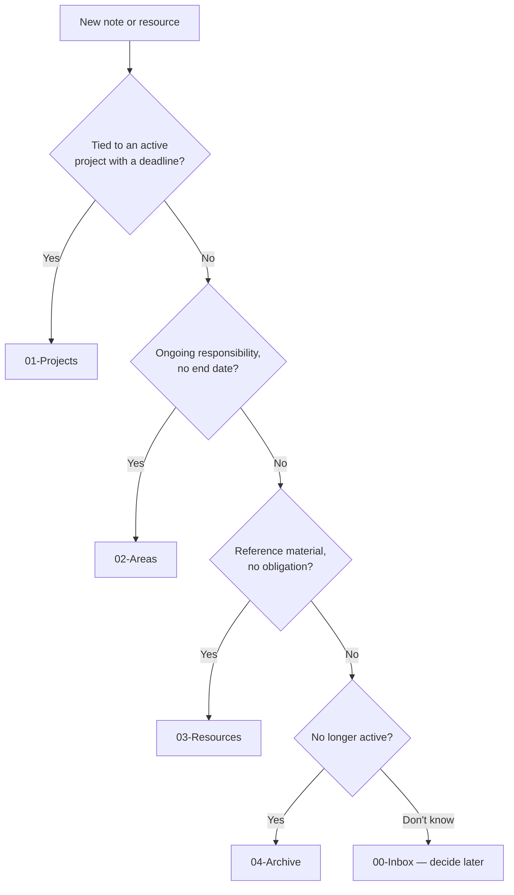

# Chapter 2 — PARA: The Folder System That Makes Everything Findable

> [!cite] Book reference
> *Obsidian Second Brain: The Complete System for Knowledge Management, Note-Taking, and Getting Things Done* — Chipak, Anderson. Chapter 2: "PARA — The Folder System That Makes Everything Findable." Source: your uploaded EPUB; no public URL exists for this title.

> [!summary] One-line takeaway
> PARA (Projects, Areas, Resources, Archive) organizes information by how actionable it is right now, not by topic — every note has exactly one obvious home, and the Inbox exists so you never have to decide that in the moment of capture.

## Why this chapter matters
Chapter 1 gave the vault a home; this chapter gives it a skeleton. PARA was created by Tiago Forte (Building a Second Brain) and is the single most commonly recommended starting structure in the Obsidian community — not because it's clever, but because it's *complete*: every piece of information fits exactly one of four buckets, with no fifth ambiguous category.

## Direct quotes from the book
> [!quote] On why topic-based folders fail
> "A topic-based system (folders named 'Marketing,' 'Philosophy,' 'Health') stores information by what it is about. PARA stores information by how actionable it is — by how you currently relate to it."

> [!quote] On what makes a Project a Project
> "What makes something a Project is the combination of a definite goal and a horizon. When the website launches, that project is done... Projects are temporary by definition."

> [!quote] On the Inbox
> "The Inbox rule is simple: everything captured goes to Inbox first. Do not think about where it belongs... The friction of stopping to decide 'does this go in Resources or Areas?' kills the habit of capturing in the first place."

> [!quote] On archiving
> "The Archive is not a concession of failure — it is a sign that things are getting done... Keep it that way by archiving ruthlessly."

## Core concepts

### The four categories
| Letter | Category | Defining question | Ends? |
|---|---|---|---|
| P | **Projects** | Does this have a deadline and a specific outcome? | Yes — archives when done |
| A | **Areas** | Is this an ongoing responsibility with no end date? | No — maintained indefinitely |
| R | **Resources** | Is this reference material I'm interested in, with no obligation attached? | No — grows/evolves |
| A | **Archive** | Is this no longer active? | N/A — cold storage, nothing deleted |

> [!tip] The Areas vs. Resources distinction
> The book's sharpest clarifying rule: **personal accountability**. An Area is something you're *responsible* for maintaining (e.g. "Finance" if you manage your own budget). A Resource is something you're merely *interested* in (e.g. "Marketing" as a topic, if you're not a marketer). The same topic can be both, depending on your relationship to it — the label isn't about the subject, it's about you.

### The vault folder structure (as specified in the book)
```
00-Inbox
01-Projects/
  Launch Website
  Q3 Performance Report
02-Areas/
  Health / Finance / Career / Home
03-Resources/
  Marketing / Programming / Leadership / Writing
04-Archive/
05-Templates/
06-Daily-Notes/
```
Numbered prefixes exist purely so Obsidian's alphabetical sort keeps them in logical order (00 always sorts above 01, etc.) — not a Johnny-Decimal system, just a sort hack.

### The decision tree for "where does this go?"
1. Tied to an active Project? → `01-Projects/[Project]`
2. An ongoing responsibility? → `02-Areas/[Area]`
3. Reference material, no obligation? → `03-Resources/[Topic]`
4. No longer active? → `04-Archive`
5. Don't know yet? → `00-Inbox` (resolve at weekly review)

> [!important] Key insight from the book
> All three of "Projects," "Areas," and "Resources" can be *correct* placements for the same note (e.g. a negotiation-tactics article could go in a Project, an Area, or a Resource folder) — PARA isn't about objectively correct categorization, it's about placing things where *you* will naturally look, given your current priorities. Don't over-deliberate this.

## Visual representation



A full, standalone version of this diagram — with tie-breaker heuristics for the ambiguous cases — lives in [[Where Does This Go - Quick Reference]].

### Common mistakes (per the book)
1. **Too many folders** — more than ~10 root folders or ~12 subfolders per category means you're optimizing for filing, not finding.
2. **Perfectionism from day one** — Inbox backlog and misclassified notes are normal; the weekly review is where this self-corrects.
3. **Never archiving** — a stale Projects list creates cognitive noise; archive ruthlessly the moment something finishes.
4. **Reorganizing instead of capturing** — if you're spending 20 minutes moving notes between Resources subfolders, stop; let backlinks do the connecting, not folder placement.

## Worked example — built directly in your vault
Rather than leave this abstract, the full PARA skeleton now exists at the root of `SecondBrain/`:

```
00-Inbox/                         ← guide + example raw capture
01-Projects/
  Gloss Local/                    ← your real, active project
  Second Brain Build-Out/         ← this very project (book notes + guides)
02-Areas/
  Knowledge Management/           ← ongoing vault maintenance
03-Resources/
  Obsidian and PKM/                ← reference home for your own PKM notes
04-Archive/                       ← empty, intentional
05-Templates/                     ← pointer to the Ch.1 example template
06-Daily-Notes/                   ← empty, covered properly in Ch.3
```

A couple of real decisions worth noting since they illustrate the decision tree:
- **Gloss Local** went in `01-Projects` because it's a concrete build with an end state (stable local fork running across your devices), not an open-ended responsibility.
- **Second Brain Build-Out** (this very effort — chapter notes, setup guide, use-case guide) is *also* a Project for the same reason: it finishes when all chapters + guides exist, at which point the folder archives and the surviving content lives permanently in `03-Resources/Obsidian and PKM` and `Claude Notes/`.
- `Claude Notes/` (holding this note and Chapter 1's) was deliberately **not** folded into `03-Resources` yet — it stays as a clearly-separate staging area so AI-generated book notes are easy to tell apart from your own PARA-organized thinking, until you decide to merge or keep them separate permanently.

## What the book doesn't tell you — community perspective (r/ObsidianMD, Obsidian Forum, 2026 guides)
PARA is widely adopted but not uncontroversial. Worth knowing the pushback before you commit to it rigidly:

- **"Folders fight Obsidian's grain."** A recurring technical critique: Obsidian's whole philosophy is link-first (knowledge as a graph, not a tree), so a strict PARA folder hierarchy can quietly work against the wikilink-driven workflow the app is actually built around. One critique on the Obsidian Forum ("The PARA method and the hard facts of life") goes further, arguing PARA organizes *files*, not *notes* — and calls the folder-sorting itself "monkey work" that gets in the way of idea collisions when you're trying to spark new insights, since folders are silos and insight often comes from *unrelated* notes bumping into each other.
- **Areas vs. Resources ambiguity is a real recurring complaint** — several sources note this is the single most common point of friction for new PARA adopters (which matches the book's own acknowledgment above, just with less reassurance that it's fine).
- **For AI-agent workflows specifically** (relevant to how you're building this vault), the ambiguity that's a "shrug" for a human is "a bug for a deterministic agent query" — e.g. whether "Prompt engineering" is an Area or a Resource is unresolvable without a human judgment call, which complicates any Claude/agent-driven automation over the vault later. One mitigation some 2026 guides suggest: a frontmatter "contract" (consistent YAML fields like `type: project` / `status: active`) so an agent can query structure deterministically instead of guessing from folder location alone — worth considering once you're further in, since this note and the ones in your vault already carry `tags` and `status` frontmatter as a head start on that pattern.
- **Common adaptations**: layering **MOCs** (Maps of Content — index notes linking to everything on a topic) on top of PARA so topics aren't trapped by nesting; combining PARA's top level with a Johnny Decimal-style numbering for sub-areas; or using tags instead of folders entirely for people who want PARA's *logic* without rigid folders.

## Deeper commentary — how this applies to your setup specifically
- Your vault now literally demonstrates the ambiguity the critiques describe: **Second Brain Build-Out** could arguably be a Resource (it's about learning a topic) rather than a Project — it was placed as a Project here because it has a concrete finish line (all chapters + guides complete), which matches the book's own test ("horizon + definite goal") more than the "topic I'm curious about" test for Resources. This is exactly the kind of call PARA expects you to make yourself, case by case.
- Given you're already running a no-subscription, local-first project ([[Gloss Local]]) with a similar "build once, maintain forever" shape, you'll likely hit the same Project → Area transition there eventually: once Gloss Local is stable and just running, it should move from `01-Projects` to something like `02-Areas/Home Lab` or similar — worth flagging now so it doesn't go stale in Projects later (the #3 mistake above).
- Since this vault is being partly built *by* an AI agent with direct filesystem access, the frontmatter-contract mitigation mentioned above is worth adopting deliberately rather than as an afterthought — every note created so far (Chapters 1–2, project/area/resource overviews) already carries `tags` and either `status` or category-implying frontmatter, which costs nothing now and pays off if you want me (or any agent) to query the vault structurally later instead of re-reading everything.

## Practical / actionable takeaways
- [x] Six PARA folders + Inbox created at vault root
- [x] At least one real Project, Area, and Resource folder populated (not just placeholders)
- [ ] During your first real weekly review, resolve the one open "is this a Project or a Resource?" judgment call flagged above for Second Brain Build-Out
- [ ] Decide if/when `Claude Notes/` content should migrate into `03-Resources/Obsidian and PKM`
- [ ] Keep root folder count at or under ~10 — resist adding new top-level categories; subfolder within the existing four instead
- [ ] Archive `Second Brain Build-Out` once all chapters + guides are finished (don't let it go stale)

## Questions / things to decide for your own vault
- Folders vs. tags vs. hybrid: do you want strict PARA folders long-term, or is a lighter tag-based / MOC-based approach (per the community critique above) a better fit once the vault grows past a few hundred notes?
- Whether to formalize a frontmatter contract (e.g. always include `type: project|area|resource|archive`) now, while the vault is still small, rather than retrofitting it later.

## Sources (external, beyond the book)
- [The PARA method and the hard facts of life — Obsidian Forum](https://forum.obsidian.md/t/the-para-method-and-the-hard-facts-of-life/22279)
- [Four Folders Won't Hold: Configuring Obsidian as Memory for Your AI — Andreas Wasita](https://wasita.net/blog/four-folders-wont-hold/)
- [What Are The Best PARA Method Alternatives? (4 Other Methods) — Matt Giaro](https://mattgiaro.com/para-method-alternatives/)
- [How To Implement PARA Method in Obsidian (Simple Guide) — Matt Giaro](https://mattgiaro.com/para-obsidian/)
- [The PARA Method in Obsidian: A Practical Guide to Organizing Your Vault — Dan Holloran](https://danholloran.me/posts/the-para-method-in-obsidian-a-practical-guide)
- [Structure a Findable Obsidian Vault — Folders, Links, Dates and Daily Notes — dsebastien](https://www.dsebastien.net/structure-a-findable-obsidian-vault-folders-links-dates-and-daily-notes/)

## Claude's pick — what I'd flag as most important
1. **The folder isn't about the topic, it's about your relationship to it right now.** This single reframe (actionability over subject matter) is what makes PARA actually decidable in practice — re-read this if you ever catch yourself stuck on "where does this really belong."
2. **The Areas-vs-Resources test is "am I accountable for it, or just interested in it?"** — genuinely the most useful one-line heuristic in the whole chapter, and the one most people forget under pressure.
3. **Archive ruthlessly, the moment something finishes.** This is the easiest discipline to let slide and the one the book is most insistent about — a stale Projects list is a bigger failure mode than a slightly-wrong folder choice.
4. If you take nothing else: see [[Where Does This Go - Quick Reference]] whenever you're stuck — that's exactly what it's for.

## Related
- Previous: [[Chapter 1 - Setting Up Obsidian]]
- Next: [[Chapter 3 - The Daily Capture]]
- MOC: [[Obsidian Second Brain - MOC]]
- Quick reference: [[Where Does This Go - Quick Reference]]
- Applies differently per persona: [[Second Brain Use Cases Guide]]
- Vault structure built this chapter: `00-Inbox/`, `01-Projects/`, `02-Areas/`, `03-Resources/`, `04-Archive/`, `05-Templates/`, `06-Daily-Notes/`
