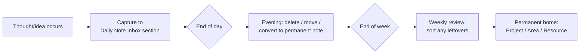

# Chapter 3 — The Daily Capture: Never Lose a Thought Again

> [!cite] Book reference
> *Obsidian Second Brain: The Complete System for Knowledge Management, Note-Taking, and Getting Things Done* — Chipak, Anderson. Chapter 3: "The Daily Capture — Never Lose a Thought Again." Source: your uploaded EPUB; no public URL exists for this title.

> [!summary] One-line takeaway
> Every idea you lose is a capture failure, not a creativity failure — the Daily Note is the single frictionless entry point for everything, and it's deliberately a temporary holding area, not a filing system (that's what the weekly review and PARA folders are for).

## Why this chapter matters
Chapter 1 built the vault, Chapter 2 gave it folders. This chapter gives it a pulse: a daily ritual that catches thoughts before the "forgetting curve" erases them, without forcing you to classify anything in the moment.

## Direct quotes from the book
> [!quote] On cognitive offloading
> "Once you trust that your second brain will hold your thoughts, your mind stops trying to hold them itself. This is called cognitive offloading... Your working memory clears. Your focus sharpens."

> [!quote] On what to capture
> "The bar for capturing is not 'this is interesting right now.' The bar is: 'Would I want to find this in six months, and would it still matter?'"

> [!quote] On the Inbox workflow
> "This workflow separates capture from organization deliberately. When you try to organize as you capture, you interrupt the flow of thinking."

> [!quote] On the long game
> "It is not about any single note. It is about the cumulative weight of thousands of small captures that form a knowledge base uniquely calibrated to your mind, your work, and your curiosity."

## Core concepts

### The Daily Note as the entry point
One note per day, auto-created, serving three roles at once: journal, capture log, task list. Setup is built into Obsidian core (Settings → Core Plugins → Daily Notes), recommended date format `YYYY-MM-DD` for clean chronological sorting.

### What to capture vs. not
| Capture | Don't capture |
|---|---|
| Ideas that shifted your perspective, even slightly | Everything you read (reading ≠ learning) |
| Meeting decisions + action items | Info you can Google in 2 seconds |
| The one paragraph from an article that mattered | Other people's entire work (synthesize, don't copy) |
| Sudden ideas (most valuable, most easily lost) | Anxiety/noise (that's what reflection sections are for) |

### Quick-capture methods (friction-elimination, ranked by the book's emphasis)
1. **QuickAdd plugin** — global hotkey → text prompt → appends straight to today's note, no navigation. Called "arguably the most powerful capture tool... completely free." (Full setup covered in Ch.5.)
2. **Mobile app + sync**, set to open directly to today's Daily Note.
3. **Voice notes → transcribe** for hands-busy moments (driving, exercising).

### The Inbox workflow (capture now, organize later)
During the week: everything → Daily Note, no stopping to classify. During the weekly review (Ch.7): for each capture, **Move it** (to a permanent/project/resource note), **Elaborate it** (worth developing → new note), or **Delete it** (no guilt). This is deliberately the same shape as Chapter 2's `00-Inbox` folder — the Daily Note *is* your inbox for loose thoughts, the folder is your inbox for loose files.

### Linking on the fly
Wrap any concept/name/idea in `[[double brackets]]` as you capture — Obsidian creates a "ghost" placeholder note if it doesn't exist yet, which activates once you write it. No upfront planning needed; link naturally, let the network emerge.

### Three essential templates (beyond Daily Note)
Book Note, Meeting Note, Article Summary — each with frontmatter + structured sections, built once and reused for years.

## Visual representation

## Worked example — built directly in your vault
Four real template files now exist at `05-Templates/`:
- **`Daily Note Template.md`** — the exact structure from the book (Morning Intention / Captures / Tasks / Meetings / Evening Reflection).
- **`Book Note Template.md`** — includes the YAML frontmatter (`author`, `rating`, `date-read`, `tags`, `status`) the book flags as a "pro tip" for later Dataview queries (Ch.5).
- **`Meeting Note Template (Full).md`** — the fuller Ch.3 version (Agenda/Decisions/Action Items/Open Questions/Follow-up), distinct from the simpler Ch.1 demo template in `Claude Notes/Examples/`.
- **`Article Summary Template.md`** — Core Argument / Key Points / My Response / Related Notes.

A live example also exists at `06-Daily-Notes/2026-11-18.md` — today's date, filled in with real captures about *this very project*, demonstrating the linking-on-the-fly mechanic (it links to the Chapter 2 note and to the Second Brain Build-Out project). Delete or overwrite it once you start your own genuine daily habit — it's a demo, not a permanent fixture.

> [!tip] Note on folder choice
> The book sets `New file location` to `Inbox/` or `Daily Notes/` — this vault already has `06-Daily-Notes/` from Chapter 2's PARA build-out, so that's what the template was configured against. If you set this up yourself in the Obsidian app (Settings → Daily Notes), point `New file location` and `Template file location` at `06-Daily-Notes/` and `05-Templates/Daily Note Template` respectively.

## What the book doesn't tell you — community perspective (Obsidian Forum, Hacker News, 2026 blogs)
The daily-note habit is popular but has real, documented failure modes worth knowing before you commit to it blindly:

- **"Productivity porn" effect.** A recurring forum admission: elaborate daily-note systems can create a *false sense* of productivity — writing extensively about your day can feel like progress while substituting for actually doing the work.
- **Template/schema drift.** As your template evolves over months (you'll inevitably tweak it), older entries follow an outdated schema. If you later query across them with Dataview, you need conditional logic to handle the inconsistency — effectively a data-migration problem vaults aren't built to handle gracefully. Mitigation: keep the template boring and stable for as long as possible; resist "improving" it every few weeks.
- **The "empty node" problem.** Vaults end up with a cluster of daily notes where some are rich with backlinks and others are just a bare date — the days life got in the way. This is normal, not a sign of failure; the book's own six-month framing (the compound effect) assumes exactly this unevenness.
- **A genuine structural debate**: some experienced users argue the entire daily-note model is "fitting a pen-and-paper habit into new technology" — paper needed one page per day because paper is physically bound that way; software doesn't need that constraint. The alternative some propose is a single running inbox note rather than 365 separate files per year. Worth knowing this is a real, contested design choice, not settled consensus — the book picks the daily-note side without mentioning the debate exists.
- **Plugin fragility ("plugin entropy")**: stacking QuickAdd + Templater + Periodic Notes + Calendar for the capture workflow means an Obsidian update can break one of them, turning you into a de facto sysadmin for your own diary. Worth going slow on plugin installs (also echoed in Ch.5's own community research below).

## Deeper commentary — how this applies to your setup specifically
- You're on Mac + Windows + phone (per your [[Gloss Local]] setup pattern) — the mobile-capture piece of this chapter matters more for you than for a single-device user. Decide your sync method (flagged as an open question in Chapter 1) before leaning hard on the daily-note habit, since a capture that doesn't sync before you switch devices is a capture you can't find later.
- Given the schema-drift risk above, and that this vault is partly maintained by an AI agent, it's worth fixing the Daily Note template now (as built) and treating changes to it deliberately rather than casually — exactly the frontmatter-consistency point raised in the Chapter 2 note.
- The "single running inbox vs. 365 daily files" debate is worth you personally having an opinion on before the vault has hundreds of daily notes — switching models later is far more painful than deciding once, same as the sync-method decision from Chapter 1.

## Practical / actionable takeaways
- [x] Daily Note template built at `05-Templates/Daily Note Template.md`
- [x] Book, Meeting (full), and Article templates built at `05-Templates/`
- [x] Example daily note with live captures demonstrating linking-on-the-fly
- [ ] In the actual Obsidian app, enable Core Plugin "Daily Notes" and point it at `06-Daily-Notes/` + `05-Templates/Daily Note Template`
- [ ] Decide: one running inbox note, or genuine daily files? (see community debate above)
- [ ] Start the real habit: delete the demo daily note once you're capturing for real
- [ ] Resist editing the Daily Note template more than once in the first month — let it stabilize before refining it

## Questions / things to decide for your own vault
- Daily files vs. single running inbox — which fits how you actually think day to day?
- Where will mobile captures land before they sync, given your multi-device setup?

## Sources (external, beyond the book)
- [Is keeping daily notes separate a best practice? — Obsidian Forum](https://forum.obsidian.md/t/is-keeping-daily-notes-separate-a-best-practice/3619)
- [Daily Notes VS Single Inbox — Obsidian Forum](https://forum.obsidian.md/t/daily-notes-vs-single-inbox/21464)
- [Why digital Daily Notes don't work (for everyone) — Obsidian Forum](https://forum.obsidian.md/t/why-digital-daily-notes-dont-work-for-everyone/36638)
- [Writing down what I do in Obsidian — Hacker News discussion](https://news.ycombinator.com/item?id=33527296)
- [Obsidian daily notes vs an automatic diary — Deariary](https://blog.deariary.com/posts/2026-05-11-obsidian-daily-notes-vs-automatic-diary)

## Claude's pick — what I'd flag as most important
1. **The capture bar is "would I want this in six months," not "is this interesting right now."** Almost every over-cluttered vault traces back to ignoring this one filter.
2. **Separating capture from organizing is the actual mechanism, not a nicety.** Trying to classify while capturing is what kills the habit — if you remember only one causal chain from this chapter, it's that one.
3. **Don't over-invest in quick-capture tooling (QuickAdd, voice-to-text) before the basic habit has survived two weeks.** The tool matters far less than people assume; the habit is the whole game.

## Related
- Previous: [[Chapter 2 - PARA Folder System]]
- Next: [[Chapter 4 - The Zettelkasten Method]]
- MOC: [[Obsidian Second Brain - MOC]]
- Quick reference: [[Where Does This Go - Quick Reference]]
- Templates built this chapter: `05-Templates/Daily Note Template.md`, `Book Note Template.md`, `Meeting Note Template (Full).md`, `Article Summary Template.md`
- Live example: `06-Daily-Notes/2026-11-18.md`
