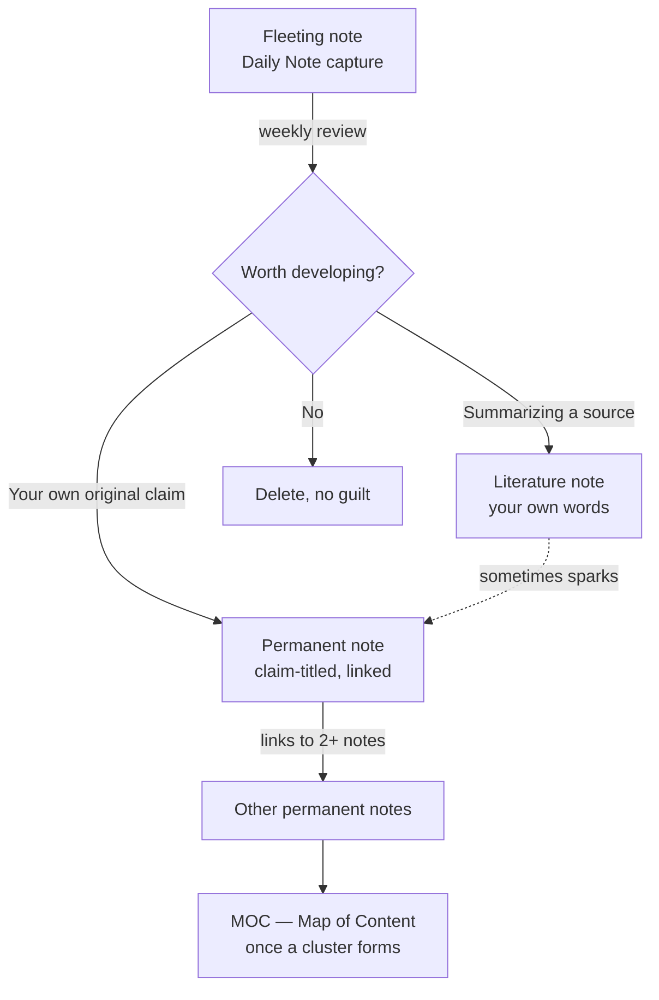

# Chapter 4 — The Zettelkasten Method: Build a Web of Ideas That Thinks for You

> [!cite] Book reference
> *Obsidian Second Brain: The Complete System for Knowledge Management, Note-Taking, and Getting Things Done* — Chipak, Anderson. Chapter 4: "The Zettelkasten Method — Build a Web of Ideas That Thinks for You." Source: your uploaded EPUB; no public URL exists for this title.

> [!summary] One-line takeaway
> Zettelkasten (Niklas Luhmann's "slip-box") means writing atomic, one-idea notes in your own words and linking them to related notes — over time the *network* of links becomes more valuable than any single note, and writing starts to feel like retrieval rather than creation.

## Why this chapter matters
PARA (Ch.2) tells you *where* a note lives. Zettelkasten tells you *what a note should contain and how it connects*. This is the chapter that turns a well-organized folder of documents into an actual thinking partner.

## Direct quotes from the book
> [!quote] Luhmann on his own method
> "'I only do what is easy,' Luhmann once said. 'I only write when I immediately know how to do it. If I falter for a moment, I put the matter aside and do something else.'"

> [!quote] On the four rules for a permanent note
> "One idea per note... Your own words... Always link to related notes... A title that states the idea... Now the title itself is a thought. You can agree or disagree with it."

> [!quote] On literature notes
> "A note full of copied quotes is a storage device. A note full of your synthesis is a thinking device."

> [!quote] On PARA vs. Zettelkasten
> "PARA answers the question: WHERE does this belong?... Zettelkasten answers the question: WHAT does this note say, and how does it connect?... The folder determines navigation. The links determine thinking."

## Core concepts

### The three note types (per Sönke Ahrens, *How to Take Smart Notes*)
| Type | What it is | Where it lives in this vault |
|---|---|---|
| **Fleeting** | Quick, unpolished, temporary — holds a thought until processed | `06-Daily-Notes/` captures (Ch.3) |
| **Literature** | Summary of something you read/watched, in your own words | Book/Article templates → `03-Resources/[Topic]` |
| **Permanent** | Your own original idea, claim, or connection — rare, high-value | `03-Resources/[Topic]/Ideas/` or a dedicated Zettelkasten folder |

Ratio matters: expect roughly **one permanent note per week** even from heavy reading — "that ratio is healthy."

### The Permanent Note Formula (four rules)
1. **One idea per note** — split if you notice two distinct paragraphs about different things.
2. **Your own words** — if you can't restate it without the source, you don't understand it yet.
3. **Always link** — an unlinked note is "an isolated neuron."
4. **A title that states a claim** — not "Notes on creativity" (a topic) but "Constraints drive creativity more than freedom" (a claim you can agree or disagree with).

### How to link without over-linking
Link when you feel genuine recognition ("this relates to something I've written"). Don't link every mention of a word — that's noise, not signal. Heuristic: link to notes that would help *future you* understand this note more deeply, not to prove you've read something.

### Maps of Content (MOCs)
A structural note that links to a cluster of related permanent notes with a short description of how they relate — "a table of contents for a region of your second brain." Not a summary; a navigation hub.

### Reading the Graph View
- **Large/highly-connected nodes** = your most important, load-bearing ideas.
- **Isolated nodes** = knowledge that exists but isn't integrated yet — a prompt to ask "where does this connect?"
- **Bridge notes** connecting two separate clusters = often your most original insights.

### PARA + Zettelkasten together
They operate at different layers: PARA = spatial/folder organization by actionability; Zettelkasten = content/network organization by meaning, cutting across folders. Fleeting notes live in Daily Notes; literature notes live in Resources subfolders; permanent notes live in a dedicated Ideas folder — but all can link to each other regardless of folder.

## Visual representation

## Worked example — built directly in your vault
Rather than leave this theoretical, the book's own worked example was reproduced literally in your vault:
- **`03-Resources/Obsidian and PKM/Ideas/Constraints drive creativity more than freedom.md`** — the exact permanent note from the chapter, with a claim-title, original synthesis, and links.
- **`03-Resources/Obsidian and PKM/Ideas/MOC - Creativity and Constraints.md`** — the matching Map of Content, linking back to the permanent note.

Both are clearly flagged in-file as the book's demo content, not your own thinking — rewrite them once you write your first genuine permanent note, following the four-rule formula above. The `Ideas/` subfolder itself is new structure: it sits inside `03-Resources/Obsidian and PKM/` specifically so permanent notes live near the chapter notes and reference material they grew out of, matching the book's own suggested layout (`Resources/Ideas/`).

## What the book doesn't tell you — community perspective (Obsidian Forum, Hacker News, 2026)
Zettelkasten has a devoted following but also a well-documented failure pattern worth knowing before you commit to the full three-stage model:

- **The "permanent note bottleneck" is extremely common.** Multiple practitioners report notes getting stuck in limbo, never promoted because they're not "good enough" yet. One blogger's conclusion, after this stalled him longer than anything else: drop the permanent-note stage entirely and use just two states (fleeting → literature-with-synthesis), rather than the book's three.
- **Real failure stories exist at scale**, not just friction: one developer documented building Claude-based automation specifically to tag and link notes, and still found permanent notes "just weren't growing at all" — the vault degraded into a plain diary despite the tooling. Worth tempering expectations: the system doesn't run itself just because the method is sound.
- **A contrarian but credible critique**: Luhmann's actual slip-box had relatively few *linked* cards — his real innovation was in *sequences* that let one idea grow into another over time, not a densely cross-linked graph. Several forum posts argue the "make lots of connections" framing (which is also how this book frames it) is a modern productivity-blog simplification, not what Luhmann actually did.
- **Overhead-vs-payoff skepticism**: on Hacker News, some report reluctance to add links/tags unless they can predict future need — resulting in vaults that are mostly glorified to-do lists. The consensus there is that Zettelkasten pays off more for academics/writers producing long-form original work than for project-based, day-to-day work — worth weighing honestly against your own likely use case.
- **"Atomic notes" itself is contested** — some argue the emphasis on one-idea-per-note is a misreading, and Zettelkasten's real purpose is as a *writing* tool (building trains of thought toward an essay or book) rather than a connection-making tool for its own sake.

## Deeper commentary — how this applies to your setup specifically
- Given the "permanent note bottleneck" is the single most common real-world failure mode, and you're building this vault somewhat quickly with AI assistance, the honest risk is ending up with plenty of *literature* notes (chapter notes like this one) and very few genuine *permanent* notes — exactly the failure pattern described above. Chapter notes about a book, however detailed, are literature notes by the book's own definition, not permanent notes; the real test of this method for you will be whether you write original claim-titled notes of your own once the chapter-note series is done.
- The PARA-vs-Zettelkasten "folders vs. links" tension flagged back in the Chapter 2 note is the same tension the community critiques raise about folders fighting Obsidian's link-first design — worth treating `Ideas/` as a loose landing spot rather than a rigid taxonomy, per the book's own "don't over-organize" instinct from Ch.2.
- Worth deciding now, while the vault is small: do you actually want the full fleeting→literature→permanent pipeline, or would the simpler two-stage model (per the "dropped permanent notes" blogger above) fit how you actually think? This is cheap to decide today and expensive to unwind after 500 notes.

## Practical / actionable takeaways
- [x] Worked example permanent note + MOC built in `03-Resources/Obsidian and PKM/Ideas/`
- [ ] Write one genuine permanent note of your own this week, following the four-rule formula — not a book summary, an actual claim you believe
- [ ] During your first weekly review, promote at least one Daily Note capture into a literature or permanent note, per the step-by-step workflow in the chapter
- [ ] Decide: three-stage model (fleeting/literature/permanent) as the book describes, or a simplified two-stage model per the community critique above
- [ ] Check Graph View (`Cmd+G`) periodically — look for isolated nodes and bridge notes as a diagnostic, not just a visualization

## Questions / things to decide for your own vault
- Three-stage vs. two-stage note pipeline — which matches how you actually think?
- Is your use case (notes about a project-based, local-first build like Gloss Local) actually a good fit for Zettelkasten's academic/writing-oriented strengths, or is a lighter linking habit without the full ceremony more appropriate?

## Sources (external, beyond the book)
- [Against Zettelkasten — Obsidian Forum](https://forum.obsidian.md/t/against-zettelkasten/115309)
- [Why I Dropped Permanent Notes From My Zettelkasten — PhD Compass](https://www.phd-compass.com/why-i-dropped-permanent-notes-from-my-zettelkasten/)
- [My Obsidian Vault Made 21 Permanent Notes in 3.5 Years, So I Redesigned It — DEV Community](https://dev.to/sho7650/my-obsidian-vault-made-21-permanent-notes-in-35-years-so-i-redesigned-it-2229)
- [Zettelkasten is complex, obscure and not for you — Obsidian Forum](https://forum.obsidian.md/t/zettelkasten-is-complex-obscure-and-not-for-you/94498)
- [Debating the usefulness of atomic notes — Obsidian Forum](https://forum.obsidian.md/t/debating-the-usefulness-of-atomic-notes-a-novel-pragmatic-obsidian-based-approach-to-pkm-strategies/38077)
- [Stop Taking Regular Notes; Use a Zettelkasten Instead — Hacker News discussion](https://news.ycombinator.com/item?id=23386630)

## Claude's pick — what I'd flag as most important
1. **A permanent note's title must be a claim, not a topic.** This is the single most mechanical, checkable rule in the whole chapter — "Constraints drive creativity more than freedom" vs. "Notes on creativity" — and it's the fastest way to self-audit whether something you wrote is actually a permanent note or just a disguised literature note.
2. **The permanent-note bottleneck is the most common real-world failure of this entire method** (confirmed by community research, not just a theoretical risk) — watch for it directly in your own vault, since chapter notes like this one are literature notes by definition, not permanent ones.
3. **One permanent note a week is a floor, not an achievement** — don't mistake volume of literature notes (summaries) for progress on the thing that actually compounds.

## Related
- Previous: [[Chapter 3 - The Daily Capture]]
- Next: [[Chapter 5 - The 10 Essential Plugins]]
- MOC: [[Obsidian Second Brain - MOC]]
- Quick reference: [[Where Does This Go - Quick Reference]]
- Worked example: `03-Resources/Obsidian and PKM/Ideas/Constraints drive creativity more than freedom.md`, `MOC - Creativity and Constraints.md`
