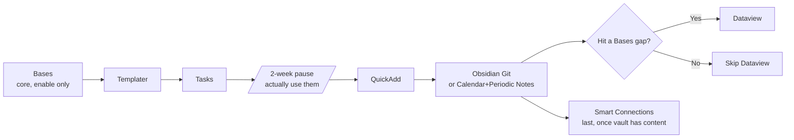

# Chapter 5 — The 10 Essential Plugins That Transform Obsidian

> [!cite] Book reference
> *Obsidian Second Brain: The Complete System for Knowledge Management, Note-Taking, and Getting Things Done* — Chipak, Anderson. Chapter 5: "The 10 Essential Plugins That Transform Obsidian." Source: your uploaded EPUB; no public URL exists for this title.

> [!summary] One-line takeaway
> Ten free, actively-maintained plugins turn Obsidian from a Markdown editor into a full second-brain operating system — but install them slowly, one at a time, not all at once.

## Why this chapter matters
Obsidian's plugin ecosystem (1,000+ community plugins) is both its greatest strength and the #1 cause of beginner overwhelm. This chapter is a curated, opinionated shortlist — the ones experienced users return to regardless of workflow.

## Direct quotes from the book
> [!quote] On the trap
> "The temptation... is to install too many, too fast, and end up with a vault that feels more like a software project than a thinking tool."

> [!quote] On Dataview
> "Without Dataview, answering these questions means searching manually. With Dataview, you write one query and get a live, always-updated answer."

> [!quote] On Obsidian Git
> "Your second brain is irreplaceable... Obsidian Git prevents this with automatic, frequent, silent backups to the cloud."

> [!quote] On Smart Connections
> "As your second brain grows to hundreds or thousands of notes, some of the most valuable connections become invisible... Smart Connections reads both notes semantically and surfaces the relationship."

## The 10 plugins at a glance
| # | Plugin | What it does | Cost |
|---|---|---|---|
| 1 | **Dataview** | Query your vault like a database (tables/lists from frontmatter + tags) | Free |
| 2 | **Templater** | Dynamic templates — JS, prompts, date math, file ops | Free |
| 3 | **Calendar** | Visual monthly calendar in sidebar, click to open any Daily Note | Free |
| 4 | **Tasks** | Global task queries across the whole vault, due dates/priority/recurrence | Free |
| 5 | **Periodic Notes** | Extends Daily Notes to Weekly/Monthly/Yearly, each auto-templated | Free |
| 6 | **Excalidraw** | Hand-drawn-style whiteboard embedded in notes | Free |
| 7 | **Obsidian Git** | Auto-commit/push vault to GitHub on a schedule — free version history + backup | Free |
| 8 | **Natural Language Dates** | Type `@next Friday` → auto-converts to a formatted date link | Free |
| 9 | **QuickAdd** | Global hotkey → capture prompt → appends straight to today's note | Free |
| 10 | **Smart Connections** | AI semantic search — surfaces conceptually related notes, not just keyword matches | Free (local) or small API cost (cloud) |

### Templater vs. core Templates plugin
| Feature | Core Templates | Templater |
|---|---|---|
| Insert date | Limited formats | Any format, any offset |
| Prompt user for input | No | Yes |
| Run JavaScript | No | Yes |
| Move/rename files | No | Yes |
| Trigger on file creation | No | Yes |

### How the ten work together in one day (per the book)
Morning: Git pulls latest → Calendar → today's note, pre-filled by Templater + a Tasks query. During the day: QuickAdd captures a thought; Natural Language Dates formats a due date; a finished book populates the Dataview reading dashboard via its frontmatter. Evening: Excalidraw for a diagram; Smart Connections surfaces two forgotten related notes. Weekly: Periodic Notes' weekly template, with an embedded Dataview query listing everything touched that week; Git has been quietly committing every 10 minutes the whole time.

## Visual representation

## Worked example — built directly in your vault
Three dashboard notes were created at `Dashboards/` (a new top-level folder — a deliberate, book-sanctioned deviation from strict PARA, since these are cross-cutting utilities rather than Projects/Areas/Resources/Archive material):
- **`Reading Dashboard.md`** — the exact Dataview query from the chapter, ready to populate once you create book notes from the Ch.3 template.
- **`Today's Tasks.md`** / **`Upcoming Tasks.md`** — the Tasks-plugin queries from the chapter.

> [!warning] These won't render yet
> The query blocks are written correctly but will only actually render as live tables once you install the Dataview and Tasks community plugins inside the real Obsidian app (Settings → Community Plugins → Browse → search by name → Install → Enable). Until then they just show as plain code blocks — that's expected, not a bug.

## What the book doesn't tell you — community perspective (r/ObsidianMD, 2026 guides) — and one important update
- **Minimalism is the dominant community advice, even more strongly than the book states.** Multiple 2026 sources note that even power users with 30–40 plugins installed name only ~8 as truly essential, and recommend starting with just **four**: Dataview, Templater, one AI plugin, one sync plugin — master those before adding more. This matches the book's own warning but community sentiment pushes it further: add plugins with real gaps between each, not all ten in one sitting as this chapter might tempt you to.
- **Important 2026 development the book doesn't cover**: Obsidian added **Bases** — native database-style Table/List/Cards/Kanban/Map views over note properties — as a **core plugin** (since v1.9, no install needed) in 2026. Full deep-dive, with confirmed syntax and exact capability gaps, now in [[Bases vs Dataview - 2026 Decision Notes]]. Short version: Bases reads frontmatter only (not Dataview's inline `field:: value` syntax), can't do task-level queries or JavaScript scripting, but covers simple frontmatter tables and dashboards — like the Reading Dashboard above — natively, with no plugin install. Both this chapter's dashboards now have a working `.base` file as the recommended default, Dataview kept as a documented fallback.
- **Smart Connections specifically now ships a Model Context Protocol (MCP) server**, meaning Claude Desktop (or another MCP-aware agent) can read your vault through it directly — directly relevant to how this vault is already being built, with an agent (me) reading and writing files in it. Worth knowing if you want a second, complementary way for an AI to query your vault beyond direct filesystem access.
- **Plugin 7 numbering gap**: the book's own table of contents lists "Plugin 7: Obsidian Git" immediately after Plugin 5 (Periodic Notes) — Plugin 6 (Excalidraw) exists in the chapter body but was dropped from the chapter's own nav/TOC. Minor editing inconsistency in the source material, not a reflection of anything wrong in your vault — flagging it so the numbering doesn't confuse future reference.

## Deeper commentary — how this applies to your setup specifically
- Given your Mac + Windows + phone setup and the still-open sync decision from Chapter 1, **Obsidian Git** is worth prioritizing early if you lean toward Git/GitHub for Gloss Local already — it would unify your backup story across both projects rather than running two different backup philosophies.
- **Smart Connections' local-vs-cloud choice** (no data leaves your computer vs. OpenAI API with minor cost) lines up with the no-subscription, local-first philosophy already established for Gloss Local (Ollama-based) — the local option is the consistent choice if that principle matters to you here too.
- Given the community's stronger minimalism stance, a reasonable install order for you specifically: enable core **Bases** (already covers both dashboards built so far, zero install) → **Templater** → **Tasks** → stop for two weeks and actually use them → then **QuickAdd** and **Obsidian Git** → install **Dataview** only if you hit one of its five confirmed gaps (see [[Bases vs Dataview - 2026 Decision Notes]]) → evaluate **Smart Connections** last, once there's enough vault content for semantic search to be worth anything.

## Practical / actionable takeaways
- [x] Dashboard notes built at `Dashboards/` demonstrating Dataview + Tasks queries
- [ ] Check whether Obsidian's native **Bases** (core, 2026+) already covers your dashboard needs before installing Dataview
- [ ] Install only 3 plugins to start (suggested: Templater, Tasks, and either Dataview or confirm Bases suffices) — wait two weeks before adding more
- [ ] Decide Smart Connections: local model (free, private) vs. OpenAI API (small cost, slightly more accurate) — consistent with your Gloss Local no-subscription stance, local is the natural default
- [ ] Set up Obsidian Git once your sync-method decision (flagged since Ch.1) is finalized

## Questions / things to decide for your own vault
- Does native Bases replace your need for Dataview, given your dashboards are fairly simple right now?
- Local vs. cloud for Smart Connections — same philosophy question as Gloss Local's Ollama choice?

## Sources (external, beyond the book)
- [The Best Obsidian Plugins for 2026 — Sébastien Dubois](https://www.dsebastien.net/the-must-have-obsidian-plugins-for-2026/)
- [Best Obsidian Plugins for an AI-Powered Vault (2026) — Locul](https://locul.ai/blog/best-obsidian-plugins)
- [Best Obsidian Plugins for AI Integration in 2026 — Web2MD](https://web2md.org/blog/best-obsidian-plugins-for-ai-integration-2026)
- [11 Best Obsidian Plugins in 2026 (Organized by Job) — Automate My Life](https://automatemylife.blog/best-obsidian-plugins-2026/)
- [The Best Obsidian Plugins in 2026 (and Which to Skip) — Scribelet](https://scribelet.app/blog/best-obsidian-plugins)
- [Obsidian Reddit Review 2026: Plugins, Pricing, and Honest Opinions](https://www.aitooldiscovery.com/guides/obsidian-reddit)

## Claude's pick — what I'd flag as most important
1. **Install order matters more than the list itself.** The book presents all ten with equal weight; in practice, installing them slowly with real gaps between each is the one piece of advice every community source independently converged on.
2. **Check Bases before installing Dataview.** This wasn't in the book at all (it predates the 2026 update) but is now the single most consequential update to this chapter — see [[Bases vs Dataview - 2026 Decision Notes]] for the full, source-verified breakdown.
3. **Smart Connections' local-vs-cloud choice isn't just a privacy preference for you specifically** — it's free infrastructure reuse, since Ollama already runs for Gloss Local.

## Related
- Previous: [[Chapter 4 - The Zettelkasten Method]]
- Next: [[Chapter 6 - Complete Obsidian Workflows]]
- MOC: [[Obsidian Second Brain - MOC]]
- Deep-dive: [[Bases vs Dataview - 2026 Decision Notes]]
- Setup sequencing: [[Practical Obsidian Setup Guide]]
- Worked example: `Dashboards/Reading Dashboard.md`, `Reading Dashboard.base`, `Today's Tasks.md`, `Upcoming Tasks.md`
