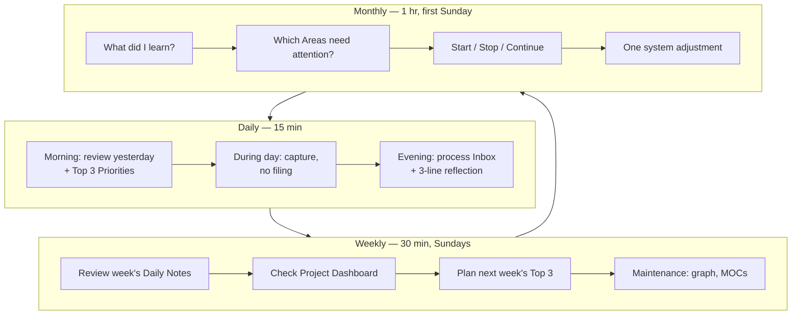

# Chapter 6 — Your Complete Obsidian Workflows: From Capture to Creation

> [!cite] Book reference
> *Obsidian Second Brain: The Complete System for Knowledge Management, Note-Taking, and Getting Things Done* — Chipak, Anderson. Chapter 6: "Your Complete Obsidian Workflows — From Capture to Creation." Source: your uploaded EPUB; no public URL exists for this title.

> [!summary] One-line takeaway
> Three nested habit loops — daily (15 min), weekly (30 min), monthly (1 hour) — are what actually make a second brain work; the vault's architecture (Ch.1-5) is inert without them.

## Why this chapter matters
"The gap between a great system and a great life is habit." Everything built in Chapters 1-5 is scaffolding; this chapter is the muscle that uses it daily. Start with just the daily loop — the other two layer on once it's automatic.

## Direct quotes from the book
> [!quote] On habit over architecture
> "The vault does not become powerful on day one. It becomes powerful on day three hundred."

> [!quote] On the Inbox during the day
> "This is where most productivity systems fall apart: they require you to stop what you are doing and 'process' something. Your Obsidian workflow does not."

> [!quote] On the evening reflection's power
> "Over months, your Daily Notes become a searchable record of your own patterns — when you are most productive, what drains you, what ideas keep returning."

## Core concepts

### The daily workflow — 15 minutes
| When | Duration | Steps |
|---|---|---|
| Morning | 5 min | 1) Review yesterday (copy forward incomplete tasks) 2) Write **Top 3 Priorities** (outcomes, not tasks) 3) Check calendar, note meetings |
| During the day | ~0 extra | Everything captured via Quick Capture → Inbox; meetings get a Meeting-template note; nothing gets filed mid-day |
| Evening | 10 min | 1) Process Inbox — delete / move / convert to permanent note (5 min) 2) Evening Reflection, exactly 3 lines (3 min) 3) Write one permanent note from today's best capture (2 min) |

### The weekly review — 30 minutes, four movements
1. **Review Daily Notes** (10 min) — scan the week's Top 3 Priorities, observe without judging
2. **Review Projects folder** (10 min) — check the Project Dashboard (Ch.7), update status, archive completed
3. **Plan next week's Top 3 Outcomes** (5 min)
4. **Maintenance** (5 min) — check Graph View for orphaned notes, clear remaining Inbox items, update MOCs

### The monthly review — 1 hour, four questions
1. What did you learn this month? (scan permanent notes)
2. What areas need more attention? (check `02-Areas` for which have zero new notes)
3. Start / Stop / Continue — honest portfolio review of Projects
4. One habit/system adjustment for next month

### How the three loops nest
Daily → feeds weekly → feeds monthly → informs next month's daily priorities. Start with daily only; add weekly after ~2 weeks once it's automatic; add monthly after a month of weekly reviews.

## Visual representation

## Worked example — built directly in your vault
- **`05-Templates/Weekly Review Template.md`** and **`Monthly Review Template.md`** — the exact templates from the chapter.
- **`07-Periodic-Notes/Weekly/`** and **`Monthly/`** — new folders (extending the numbered PARA scheme from Chapter 2) where these will actually live once you start the habit, each with a short guide note.
- Your existing `06-Daily-Notes/2026-11-18.md` (from Chapter 3) already has a Top 3 Priorities-shaped morning intention and an evening reflection — it's a reasonable stand-in for what the daily workflow produces, though it predates this chapter's template refinements slightly.

> [!tip] Nothing to "set up" yet
> Unlike Chapters 2-5, this chapter is pure habit, not infrastructure — the folders and templates exist now so they're ready the moment you actually start the daily/weekly/monthly rhythm. The real work here is behavioral, not structural.

## What the book doesn't tell you — community perspective (2026 blogs, dev.to, productivity forums)
- **The real failure mode isn't doing the review badly — it's skipping it silently.** A documented pattern: a user ran a 90-minute review faithfully for six weeks, inconsistently for two months, then stopped entirely and didn't notice for three weeks. Their diagnosis: the format wasn't wrong, it was sized for a version of the week that rarely existed — and open-ended questions ("how was your week?") produce rumination rather than useful reflection, not clarity. This is worth taking seriously given the book's own four-movement, 30-minute structure is already fairly involved for a first attempt.
- **Consistency beats thoroughness, every time** — one pragmatic take argues the review fails far more often from being skipped than from being done badly, which argues for a *shorter* version you'll actually keep doing over the book's full version, at least initially.
- **Elaborate systems (not the habit itself) cause burnout.** The 2026 community consensus largely blames over-engineered weekly-review templates — not the concept of reviewing — for abandonment, echoing the same overengineering theme flagged back in Chapter 1 and 5's research.
- **General Obsidian community advice reinforces starting minimal**: the top advice for new users is to spend the first two weeks with zero plugins and a blank vault before building any review ritual at all — a more conservative sequencing than the book implies by presenting all three loops together in one chapter.

## Deeper commentary — how this applies to your setup specifically
- Given the failure pattern above (sized for a week that rarely exists), and that you're building this vault fast with AI help right now, there's a real risk of over-provisioning the review ritual before you've tested whether the *daily* loop sticks at all. Recommendation: treat the Weekly/Monthly templates as ready-but-dormant — don't schedule a 30-minute Sunday review on your calendar until the daily loop has actually run for two real weeks.
- The "Start / Stop / Continue" monthly question maps directly onto the Project-as-time-bound-with-a-horizon test from Chapter 2 — this is a good moment to actually revisit whether `Second Brain Build-Out` (still in `01-Projects`) should move toward Archive once the remaining chapters + guides are done, which is exactly the kind of review this chapter is designed to prompt.
- Your Daily Note from Chapter 3 already demonstrates the "closed questions beat open rumination" critique in miniature — it has a concrete, answerable intention ("keep going on Second Brain Build-Out") rather than an open "how am I feeling today," which happens to align with the community's advice above even though it predates this chapter.

## Practical / actionable takeaways
- [x] Weekly and Monthly templates + folders built, ready but not yet in active use
- [ ] Run the daily workflow (morning 5 min / evening 10 min) for two real weeks before adding the weekly review
- [ ] When you do start the weekly review, consider trimming the four movements to the two or three that feel most useful first, rather than all four at once
- [ ] Use the first monthly review (once you get there) to decide whether `Second Brain Build-Out` should move to Archive
- [ ] Avoid open-ended reflection prompts ("how was this week?") — prefer the book's specific ones (what worked / what didn't / one change) per the community critique above

## Questions / things to decide for your own vault
- Is 30 minutes realistic for your actual Sunday, or should the weekly review start smaller (e.g. just movements 1 and 3)?
- When the "Second Brain Build-Out" project finishes, where should ongoing vault maintenance live — a new Area, or folded into [[02-Areas/Knowledge Management]] which already exists for exactly this?

## Sources (external, beyond the book)
- [My weekly review clocked 14 minutes median — here's the one structural change that made it stick — DEV Community](https://dev.to/riversea/my-weekly-review-clocked-14-minutes-median-heres-the-one-structural-change-that-made-it-stick-3po8)
- [A weekly review for engineers that isn't about tasks — DEV Community](https://dev.to/productivityforge/a-weekly-review-for-engineers-that-isnt-about-tasks-4ib4)
- [The Obsidian Weekly Review System: A Step-by-Step Workflow — Obsibrain](https://www.obsibrain.com/blog/obsidian-weekly-review-system/)
- [Obsidian Reddit Review 2026: Plugins, Pricing, and Honest Opinions](https://www.aitooldiscovery.com/guides/obsidian-reddit)

## Claude's pick — what I'd flag as most important
1. **"The vault becomes powerful on day three hundred, not day one"** — this single line is the antidote to every over-engineering impulse in Chapters 1, 2, and 5. Worth re-reading whenever you catch yourself tweaking structure instead of using it.
2. **Don't adopt all three loops (daily/weekly/monthly) at once just because this chapter presents them together.** Sequence them — the practical guide already builds this in, but it bears repeating since it's the opposite of how the chapter reads.
3. **Closed, specific reflection questions beat open ones** ("what worked / what didn't / one change" vs. "how was your week") — a small wording choice with an outsized effect on whether the habit survives, per the community research.

## Related
- Previous: [[Chapter 5 - The 10 Essential Plugins]]
- Next: [[Chapter 7 - Run Your Projects Inside Obsidian]]
- MOC: [[Obsidian Second Brain - MOC]]
- Sequencing: [[Practical Obsidian Setup Guide]]
- Worked example: `05-Templates/Weekly Review Template.md`, `Monthly Review Template.md`, `07-Periodic-Notes/`
