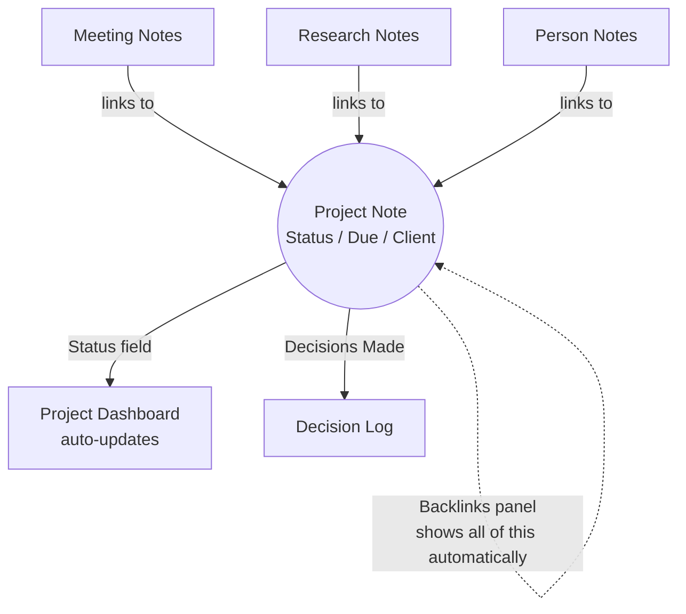

# Chapter 7 — Run Your Projects Inside Obsidian: No Notion Needed

> [!cite] Book reference
> *Obsidian Second Brain: The Complete System for Knowledge Management, Note-Taking, and Getting Things Done* — Chipak, Anderson. Chapter 7: "Run Your Projects Inside Obsidian — No Notion Needed." Source: your uploaded EPUB; no public URL exists for this title.

> [!summary] One-line takeaway
> Keep project notes, meeting notes, research, and decisions in the same linked vault instead of a separate project-management app — the Backlinks panel assembles a complete project dossier automatically, and a Dataview dashboard replaces a manual status spreadsheet.

## Why this chapter matters
The usual failure mode of knowledge workers: notes in one app, tasks in another, meetings in a third — so six months later, nobody can reconstruct *why* a decision was made. This chapter shows the alternative: one project note as the single source of truth, surrounded by links.

## Direct quotes from the book
> [!quote] On fragmentation
> "When a task lives in Asana, it is isolated from everything else you know. It is a to-do item floating in a void... When that same task lives in Obsidian, it sits inside a project note that links to the meeting where the task was born, the research that informed the decision behind it..."

> [!quote] On the Decisions Made section
> "The '## Decisions Made' section is often the most valuable part of a project note, even though most people skip it... Decision memory is one of the things your second brain does better than any project management tool."

> [!quote] On discipline
> "The Dataview dashboard is only as truthful as the notes it reads. Your second brain reflects back what you put into it."

## Core concepts

### The Project Note anatomy
Frontmatter: `Status` (Active / On Hold / Completed / Archived), `Due`, `Client`. Body sections: Tasks (with `due::` syntax for Tasks-plugin queries), Meeting Notes, Resources, **Decisions Made** (timestamped log — the most-skipped, most-valuable section), Next Actions.

### The Project Dashboard (Dataview)
A single note with three live queries — Active, On Hold, Completed This Month — reading frontmatter from every note in the Projects folder. Change a project's `Status` field and it moves sections automatically; no manual spreadsheet maintenance.

### Task querying across the vault
Tasks written anywhere (project notes, meeting notes, daily notes) using `due::` syntax become globally queryable: a "Today's Tasks" note (`not done, due before tomorrow`), a per-project query (`path includes Projects/X`), or a weekly rollup.

### Linking projects to everything
Every meeting note, research note, and person-note that touches a project should link back to it with `[[Project Name]]` — the Backlinks panel then assembles the complete dossier with zero manual indexing.

### When Obsidian isn't enough — n8n automation
For projects that originate *outside* the vault (CRM deal won, contract signed), n8n (free, self-hosted automation) can auto-create or auto-update project notes via the Local REST API plugin — webhook → n8n → formatted file in your vault. Three examples given: auto-create on CRM "Won," auto-update status on signature, and a daily standup digest sent to Telegram/email.

## Visual representation

## Worked example — built directly in your vault
- **`05-Templates/Project Note Template.md`** — the exact structure from the chapter (Tasks / Meeting Notes / Resources / Decisions Made / Next Actions), with `Status`/`Due`/`Client` frontmatter.
- **`Dashboards/Project Dashboard.md` + `Project Dashboard.base`** — the three queries from the chapter, now built *twice*: as the book's own Dataview syntax, and as a working native Bases file (confirmed against Obsidian's official syntax docs) with the same three views (Active / On Hold / Completed This Month). Adjusted to this vault's actual folder name `01-Projects` (the book's own example used a generic `Projects` folder). Full reasoning for defaulting to the `.base` file: [[Bases vs Dataview - 2026 Decision Notes]].
- **`01-Projects/Gloss Local/Project Overview.md`** was updated (not just created) to adopt the Chapter 7 schema — `Status`/`Due`/`Client` frontmatter, a Tasks section, and a Decisions Made section — so it will actually show up correctly in either dashboard implementation. This is a genuine example of the book's own advice: update the project note as things change, don't let it drift out of sync with the dashboard that reads it.

> [!tip] The Bases version needs nothing installed
> Unlike Chapter 5's dashboards, `Project Dashboard.base` works the moment Bases is enabled under Settings → Core Plugins (it ships with Obsidian, no community install) — only the Dataview *option* in `Project Dashboard.md` needs the separate community plugin.

## What the book doesn't tell you — community perspective (2026 reviews, dev blogs)
- **Dataview has real scaling limits.** Once a vault grows past a few thousand notes, Dataview queries can visibly lag or glitch when rendering — worth knowing before you build a dashboard you expect to stay instant forever.
- **It's genuinely not relational.** You cannot build a true relational database (clients → projects → tasks → invoices) the way a proper database or Notion's linked databases can — Dataview is read-only over your existing notes, not a real data layer. If your project tracking needs grow complex (multiple clients, invoicing, dependencies), this is a real ceiling, not just a configuration problem.
- **Team collaboration is the clearest gap.** Nearly every comparison source agrees: Obsidian/Dataview works well for a single person's projects, but onboarding teammates onto a Dataview-based system is painful compared to Notion's native multi-user database views. If "projects" ever means *shared with other people*, this chapter's approach has a ceiling you'll hit quickly.
- **The 2026 "Bases" update matters here specifically.** Confirmed against official docs: Bases covers exactly this chapter's use case (frontmatter-only project tables, filtered and grouped by `Status`) natively, no query syntax needed beyond simple YAML. The remaining gap — inline `due::` task-level rollups across every project — is still Dataview/Tasks-plugin territory, not something this dashboard currently needs. See [[Bases vs Dataview - 2026 Decision Notes]] for the full, source-checked breakdown.
- **Common practitioner reality check**: several 2026 reviewers note the realistic pattern is a *hybrid* — Obsidian/Dataview for personal knowledge and solo project tracking, Notion (or similar) for anything involving a team. Worth being honest with yourself about which category your projects fall into before investing further here.

## Deeper commentary — how this applies to your setup specifically
- **Gloss Local** is a solo, local-first project — exactly the profile this chapter's approach fits well (no team-collaboration gap to worry about). The frontmatter update applied above means it'll now show up correctly in the Project Dashboard once Dataview/Bases is installed.
- Given the scaling caveat above, and that this vault is still small, now is a cheap moment to decide: **Bases first, Dataview only if you hit its limits** — rather than installing Dataview by default the way the book suggests, given the 2026 development the book doesn't know about.
- The n8n automation layer (CRM webhooks, etc.) is almost certainly overkill for your current two tracked projects (Gloss Local, Second Brain Build-Out) — worth filing as a "maybe later" rather than a Chapter 7 action item, since neither project currently originates from an external CRM or e-signature tool.

## Practical / actionable takeaways
- [x] Project Note Template and Project Dashboard built, pointed at the correct `01-Projects` folder name
- [x] Gloss Local's project note updated to the new schema so it'll register correctly on the dashboard
- [ ] When installing plugins (per Ch.5's revised order), check whether Bases alone covers this dashboard before adding Dataview
- [ ] Fill in real `Due` dates and start logging actual `Decisions Made` entries for Gloss Local going forward — the section is only valuable if you actually use it
- [ ] Hold off on n8n automation until/unless a project genuinely originates outside the vault

## Questions / things to decide for your own vault
- Does Gloss Local have a real target completion date worth putting in `Due`? Leaving it blank long-term reduces the dashboard's usefulness.
- Is Bases sufficient for your two-project dashboard, or do you already know you'll need Dataview's deeper query features?

## Sources (external, beyond the book)
- [Obsidian finally fixed the one thing Notion always did better — MakeUseOf](https://www.makeuseof.com/obsidian-bases-notion-database/)
- [Why Developers Are Using Obsidian as a Database, Not a Notes App — Code Culture](https://codeculture.store/blogs/developer-culture/obsidian-dataview-plugin-developer)
- [Notion vs Obsidian 2026: Cloud vs Local-First Notes — TrulyCritic](https://www.trulycritic.com/blog/notion-vs-obsidian-2026)
- [Obsidian Reddit Review 2026: Plugins, Pricing, and Honest Opinions](https://www.aitooldiscovery.com/guides/obsidian-reddit)

## Claude's pick — what I'd flag as most important
1. **The "Decisions Made" section is the single highest-ROI habit in this chapter**, and the easiest to skip under time pressure. The book's own framing ("most people skip it, but it's the most valuable part") is exactly right — it's the difference between a project note and a real decision log.
2. **Know the team-collaboration ceiling before you hit it.** If "projects" ever means shared with other people, this whole approach has a documented limit — worth knowing now rather than discovering it mid-project.
3. **Bases already covers this chapter's dashboard needs for you specifically** — don't install Dataview preemptively here; see [[Bases vs Dataview - 2026 Decision Notes]].

## Related
- Previous: [[Chapter 6 - Complete Obsidian Workflows]]
- Next: [[Chapter 8 - AI Inside Your Second Brain]]
- MOC: [[Obsidian Second Brain - MOC]]
- Deep-dive: [[Bases vs Dataview - 2026 Decision Notes]]
- Applies to your profile specifically: [[Second Brain Use Cases Guide]] (Software Developer / Local-First Builder section)
- Worked example: `05-Templates/Project Note Template.md`, `Dashboards/Project Dashboard.md`, `Project Dashboard.base`, updated `01-Projects/Gloss Local/Project Overview.md`
