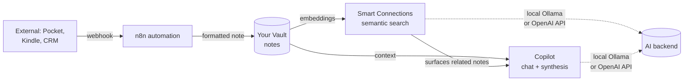

# Chapter 8 — AI Inside Your Second Brain: Ask Questions, Get Answers

> [!cite] Book reference
> *Obsidian Second Brain: The Complete System for Knowledge Management, Note-Taking, and Getting Things Done* — Chipak, Anderson. Chapter 8: "AI Inside Your Second Brain — Ask Questions, Get Answers." Source: your uploaded EPUB; no public URL exists for this title.

> [!summary] One-line takeaway
> AI should amplify retrieval and synthesis of your *existing* notes (search by meaning, summarize, surface forgotten connections) — not replace the act of writing, because writing in your own words is how understanding actually gets built.

## Why this chapter matters
Chapters 1-7 build a vault full of your own thinking. This chapter asks: once it's full, how do you actually get value back out of it beyond manual search? And where's the line past which AI stops helping and starts hollowing the system out?

## Direct quotes from the book
> [!quote] On semantic vs. keyword search
> "You ask 'What did I learn about building trust with clients?' and the system finds notes about relationships, about communication, about consistency — even if none of those notes use the phrase 'building trust.'"

> [!quote] On the core warning of the whole chapter
> "When you write a permanent note in your own words, you are not just storing information. You are forcing your brain to retrieve it, reprocess it, connect it to existing knowledge... This is how understanding is built."

> [!quote] On the right relationship with AI here
> "Use AI to prepare the raw material. Use your own mind to work with it... The vault should feel, when you open it, like coming home to your own mind — not like consulting a very well-read stranger."

## Core concepts

### Smart Connections (free, semantic search + chat)
Builds local embeddings of your notes; a sidebar panel surfaces the top 5-10 semantically related notes as you write (useful even without ever opening the chat); the Smart Chat panel answers natural-language questions grounded in and citing your own notes. Can run fully local (private, free, slightly less accurate) or via OpenAI API (small cost, more accurate).

### Copilot (free, full conversation with vault context)
Complementary to Smart Connections: lets you reference specific notes with `[[note name]]` syntax and have Copilot summarize, connect, or draft from them. The book's suggested division of labor: *"Smart Connections finds the relevant notes you did not think to search for; Copilot helps you think with the notes once you have them."*

### n8n automation for capture (external → vault)
Three example workflows: (1) article saved to Pocket → AI-summarized → formatted note auto-created via the Local REST API plugin; (2) Kindle highlights → Readwise API → AI-grouped-by-theme → structured book note; (3) a Sunday-morning AI-generated "Key Themes This Week" summary written into the Weekly Note before you sit down to review it.

### The explicit limits the book insists on
Resist letting AI capture, summarize, connect, *and* conclude for you — the risk is a vault that no longer sounds like you. The book's test: does the vault feel like "coming home to your own mind," or like consulting a well-read stranger?

## Visual representation

## Worked example — built directly in your vault
`03-Resources/Obsidian and PKM/AI Second Brain Setup Checklist.md` — a configuration checklist (not a template, since this chapter's "worked example" is app-level plugin setup rather than a file) covering both the book's default path (OpenAI API) and a fully local path via Ollama, plus real 2026 indexing-time benchmarks for different vault sizes.

> [!important] You're already living this chapter, one level up
> Worth naming directly: this entire vault is currently being built by an AI (me, via direct filesystem access) reading the book, writing literature notes, and even reproducing the book's own worked examples. That's a more direct AI-vault relationship than anything Chapter 8 describes — it doesn't use Smart Connections or Copilot, it uses an agent with full read/write access to the vault's files. The book's core warning (writing-in-your-own-words is where understanding happens) applies *more* urgently here, not less: everything in `Claude Notes/` so far is literature-note-shaped commentary on the book, explicitly flagged as not your own original thinking. The permanent notes that matter — your actual ideas — still have to come from you.

## What the book doesn't tell you — community perspective (2026 guides, dev.to, HowToGeek)
- **The 2026 consensus pairing is Smart Connections + Copilot, both pointed at a local Ollama backend** — exactly matching your existing [[Gloss Local]] stack. This is a genuine, non-coincidental synergy: you've already solved "run a local LLM reliably" for Gloss Local, and the same Ollama instance can back your Obsidian AI layer with zero additional infrastructure.
- **A direct quote worth noting from one 2026 writer**: *"I quit using NotebookLM and switched to Obsidian with local LLMs, now my notes are finally private"* — reflecting a broader 2026 shift away from cloud-based note-AI tools toward local-first setups, for reasons that align with the no-subscription philosophy already established in Gloss Local.
- **Real privacy caveat**: Ollama binds to loopback (127.0.0.1) by default and isn't reachable from your network unless you deliberately set `OLLAMA_HOST` to expose it — worth confirming you haven't changed this if privacy is the reason you're choosing the local path.
- **Telemetry nuance**: Smart Connections and Copilot both ship with *optional* telemetry that must be explicitly disabled in settings if full privacy matters to you — it's opt-out, not opt-in by default in all cases, worth checking rather than assuming.
- **MCP integration is the 2026 frontier**: Smart Connections reportedly now ships a Model Context Protocol server, meaning an MCP-aware agent (like Claude Desktop) could query the vault through it directly, as an alternative/complement to raw filesystem access — relevant background for how this very session is already interacting with your vault.

## Deeper commentary — how this applies to your setup specifically
- The Ollama overlap with Gloss Local is the single most actionable insight from this chapter for you specifically — it turns "set up AI in Obsidian" from a new project into a five-minute configuration change on infrastructure you already run.
- Given you're already somewhat exposed to the "permanent-note bottleneck" risk flagged in Chapter 4, be deliberate about not letting Smart Connections/Copilot's summarization features substitute for writing your own permanent notes — the chapter's warning is specifically relevant to you given how this vault is being built.
- Worth deciding explicitly: once `Claude Notes/` content is reviewed, do you want an AI chat layer (Smart Connections/Copilot) querying *those* notes too, or only your own `03-Resources` writing? Mixing AI-generated literature notes into an AI chat's training context is a slightly different trust question than querying your own original thinking.

## Practical / actionable takeaways
- [x] AI setup checklist built, both local and API paths documented
- [ ] Decide: local (Ollama, matches Gloss Local) vs. API path — given your established no-subscription preference, local is the natural default here too
- [ ] If going local, confirm `OLLAMA_HOST` hasn't been changed from loopback-only
- [ ] Once ~20+ real notes exist, try Smart Chat with a genuine question to see if semantic retrieval earns its keep for you
- [ ] Re-read the chapter's "Limits of AI" section once a month as the vault grows — it's easy to let this slide as convenience increases

## Questions / things to decide for your own vault
- Local Ollama vs. OpenAI API for the Obsidian AI layer — given Gloss Local already runs Ollama, is there a reason to choose differently here?
- Should AI chat tools have access to `Claude Notes/` (literature notes about this book) or be scoped to your own original resource notes only?

## Sources (external, beyond the book)
- [Best Local LLM for Obsidian: 5 Plugins Compared 2026](https://www.promptquorum.com/power-local-llm/local-llm-with-obsidian-2026)
- [Obsidian Local AI 2026: Connect Ollama with 3 Plugins](https://localaimaster.com/blog/local-ai-obsidian-integration)
- [I quit using NotebookLM and switched to Obsidian with local LLMs, now my notes are finally private — HowToGeek](https://www.howtogeek.com/i-quit-using-notebooklm-and-switched-to-obsidian-with-local-llms-now-my-notes-are-finally-private/)
- [Obsidian 2026: Knowledge Management in the AI Era — MCP, Local LLMs, and Agents in the Vault — DEV Community](https://dev.to/saaro_net/obsidian-2026-knowledge-management-in-the-ai-era-mcp-local-llms-and-agents-in-the-vault-3e96)
- [Obsidian AI Plugins: Copilot vs Smart Connections vs Others — wetheflywheel](https://wetheflywheel.com/en/radar/obsidian-ai-plugins/)

## Claude's pick — what I'd flag as most important
1. **The closing test — "does this feel like coming home to your own mind, or consulting a well-read stranger?"** — is the single best gut-check for whether you've let AI do too much. Worth returning to periodically as you lean on any AI layer more over time.
2. **Your Ollama overlap with Gloss Local is a genuine, non-obvious win** — most readers of this book would treat "set up AI in Obsidian" as new infrastructure; for you specifically it's a five-minute config change on something you already run.
3. **This entire vault is already a more direct version of this chapter's thesis than the chapter itself describes** — worth sitting with that, since it raises the stakes on writing your own permanent notes, not lowers them.

## Related
- Previous: [[Chapter 7 - Run Your Projects Inside Obsidian]]
- Next: [[Chapter 9 - Advanced Obsidian Tips and Customization]]
- MOC: [[Obsidian Second Brain - MOC]]
- Quick reference: [[Where Does This Go - Quick Reference]]
- Worked example: `03-Resources/Obsidian and PKM/AI Second Brain Setup Checklist.md`
