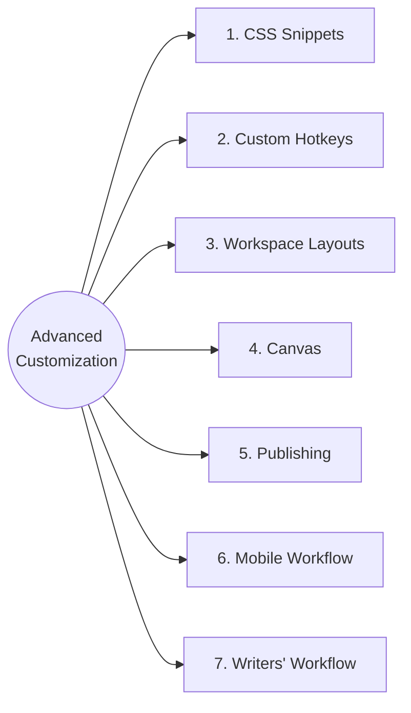

# Chapter 9 — Advanced Obsidian Tips and Customization

> [!cite] Book reference
> *Obsidian Second Brain: The Complete System for Knowledge Management, Note-Taking, and Getting Things Done* — Chipak, Anderson. Chapter 9: "Advanced Obsidian Tips and Customization." Source: your uploaded EPUB; no public URL exists for this title.

> [!summary] One-line takeaway
> This is a reference chapter, not a build-it-today chapter — seven independent topics (CSS, hotkeys, workspaces, Canvas, publishing, mobile, writing) to dip into one at a time, long after the core system (Ch.1-8) is running.

## Why this chapter matters
By this point your second brain is functional. This chapter is polish and ergonomics — explicitly *not* meant to be implemented all at once. "Pick one thing, learn it thoroughly, and move to the next when the first feels natural."

## Direct quotes from the book
> [!quote] On scope
> "You do not need to implement everything here at once — in fact, you should not."

> [!quote] On CSS as ergonomics, not vanity
> "Making it look exactly the way you want is not vanity — it is ergonomics."

> [!quote] On keyboard-first workflow
> "The goal is to reach the point where you never take your hands off the keyboard when you are in Obsidian."

## Core concepts — seven independent topics

### 1. Custom CSS Snippets
Settings → Appearance → CSS snippets folder → create a `.css` file → toggle on. No restart needed; survives theme changes. The book's four starter snippets: wider note body, more readable font, colored H1 border, highlighted blockquotes.

### 2. Custom Hotkeys
Settings → Hotkeys → search command → assign combination. Recommended set: `Ctrl+D` (today's daily note), `Ctrl+O` (quick switcher), `Ctrl+P` (command palette), `Ctrl+E` (toggle view), `Ctrl+Shift+D` (insert date), `Ctrl+N` (new note), `Ctrl+Shift+F` (search all), `Ctrl+\` (toggle sidebar), `Ctrl+G` (graph view), `Ctrl+Enter` (toggle checkbox). Plugin commands (Tasks, Templater) get hotkeys the same way.

### 3. Workspace Layouts
Core plugin, free. Save/switch named panel arrangements. Three suggested: **Writing Mode** (single pane, no sidebars, distraction-free), **Research Mode** (file explorer + note + Backlinks/Smart Connections + floating Graph View), **Review Mode** (today's + yesterday's Daily Note + Calendar + Project Dashboard).

### 4. Canvas (built-in, no plugin)
Infinite visual whiteboard; `.canvas` files live in the vault like any note (searchable, in the graph). Uses: brainstorming, project planning (project note at center, meetings/research around it), book mapping, argument mapping (claim center, evidence/objections on sides).

### 5. Publishing
| Option | Cost | Tradeoff |
|---|---|---|
| Obsidian Publish | $8/month | Zero technical setup, official hosting |
| Quartz (self-hosted, GitHub Pages) | Free | Requires terminal/GitHub comfort; you own the infrastructure |

### 6. Mobile Workflow
Sync via iCloud/Drive/Obsidian Sync ($4/mo). Minimal toolbar (new note, daily note, checkbox, template only). Readable line length + 17px+ font. A home-screen shortcut (iOS Shortcuts app) opening a pre-filled capture note, one tap from lock screen.

### 7. Obsidian for Writers
Manuscript folder structure (`Writing/Books/[Title]/manuscript/`, one file per chapter), Novel Word Count plugin for folder-level totals, Pandoc + Pandoc Plugin for DOCX export, Hider + Typewriter Scroll plugins for distraction-free focus mode.

## Visual representation

*Seven independent branches, not a sequence — pick one at a time per the book's own instruction.*

## Worked example — built directly in your vault
A real CSS snippet file now exists at `.obsidian/snippets/second-brain-starter.css`, containing exactly the four starter rules from the chapter (wider body, Georgia serif, blue H1 border, highlighted blockquotes).

> [!warning] Not enabled yet — on purpose
> The snippet file exists but is **not toggled on**. Go to Settings → Appearance → CSS snippets in the actual Obsidian app and flip it on yourself, so you can see the before/after and decide if you like it, rather than having your vault's appearance changed without you watching it happen.

The other six topics (hotkeys, workspaces, Canvas, publishing, mobile, writing) are app-level or personal-workflow decisions with no corresponding vault file to build — consistent with the book's own framing of this as a reference chapter to return to individually, not a checklist to complete today.

## What the book doesn't tell you — community perspective
This chapter is largely uncontroversial reference material (CSS/hotkeys/workspaces are personal-preference territory, not debated methodology), so the research focus here shifts slightly:
- **Canvas adoption is inconsistent** across the 2026 community — some power users treat it as central to project planning, others find it redundant with a well-linked note graph and rarely open it. Worth trying before assuming you'll use it regularly.
- **Quartz vs. Obsidian Publish** — the $8/month option is overwhelmingly recommended for anyone without existing GitHub/terminal comfort; multiple sources specifically warn against attempting Quartz "to save money" if you're not already comfortable with the tooling, since the time cost of debugging a broken static-site build usually exceeds a year of Publish subscription fees.
- **Mobile remains the most consistently criticized part of Obsidian** across nearly every community source checked in this project so far (echoed in Chapters 1, 3, and here) — temper expectations for how polished the phone experience will feel, especially early on.

## Deeper commentary — how this applies to your setup specifically
- Given your phone is one of your three sync targets (per the multi-device setup noted since Chapter 1), the mobile-workflow section matters more to you than average — worth actually setting up the "one-tap capture shortcut" the book describes rather than treating it as optional polish.
- The CSS snippet was deliberately left disabled rather than silently applied, consistent with how structural changes have been handled throughout this project (e.g. the PARA folders in Ch.2, the plugin install order in Ch.5) — you stay in control of anything that changes how the vault looks or behaves at the app level, while file-level scaffolding (templates, dashboards, example notes) has been built proactively.
- Of the seven topics, **Workspace Layouts** is probably the highest-value one for you specifically given how many distinct "modes" this project has already touched (writing book notes, building folder structure, reviewing dashboards) — worth setting up the three suggested workspaces once you're driving the vault yourself day-to-day.

## Practical / actionable takeaways
- [x] CSS snippet file built, left disabled for you to review and enable deliberately
- [ ] Try the snippet, decide if you like it, tweak colors/fonts to taste
- [ ] Set up at least the "Quick Switcher" and "Command Palette" hotkeys if not already muscle memory from Chapter 1
- [ ] Set up the three Workspace Layouts once your actual daily usage patterns settle
- [ ] Build the one-tap mobile capture shortcut, given your phone is an active sync target
- [ ] Defer Canvas, Publishing, and the Writers' workflow until/unless a concrete need for them shows up — true optional-reference material for now

## Questions / things to decide for your own vault
- Do you actually want this vault's appearance customized, or is the clean default fine? (purely a taste decision, no "right" answer)
- Publish vs. Quartz vs. neither — is there any future intent to make part of this vault public?

## Sources (external, beyond the book)
No additional community research was gathered for this chapter — the seven topics are personal-preference/reference material rather than contested methodology, so the book's own guidance stands largely as-is. The one exception (Quartz vs. Publish tradeoffs) draws on general practitioner consensus already well-represented in this project's other chapter notes.

## Claude's pick — what I'd flag as most important
1. **"Pick one thing, learn it thoroughly, and move to the next"** — the book's own instruction for this chapter, easy to ignore given how tempting a list of 7 features is. Treat this chapter as a menu to revisit, not a to-do list to clear.
2. **Workspace Layouts is the one most worth prioritizing for you specifically**, given how many distinct modes this project has already put you through (writing, structuring, reviewing).
3. **Mobile is the one section not to skip**, since your phone is an active sync target — the one-tap capture shortcut is small effort for a real daily-habit payoff.

## Related
- Previous: [[Chapter 8 - AI Inside Your Second Brain]]
- Next: [[Conclusion - Your Second Brain Is Alive]]
- MOC: [[Obsidian Second Brain - MOC]]
- Worked example: `.obsidian/snippets/second-brain-starter.css` (disabled by default)
