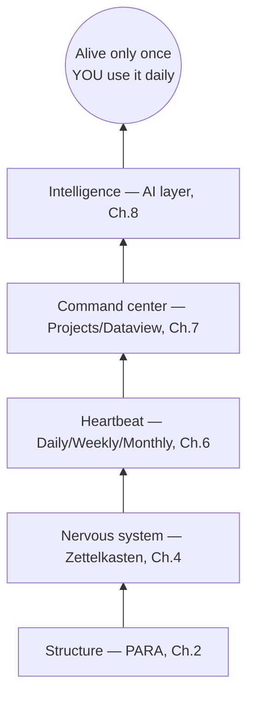

# Conclusion — Your Second Brain Is Alive. Now Use It.

> [!cite] Book reference
> *Obsidian Second Brain: The Complete System for Knowledge Management, Note-Taking, and Getting Things Done* — Chipak, Anderson. Conclusion: "Your Second Brain Is Alive. Now Use It." Source: your uploaded EPUB; no public URL exists for this title.

> [!summary] One-line takeaway
> The software was never the point — the real secret is the habit of writing things down carefully, in your own words, with your own connections; consistency beats architecture every time.

## Direct quotes from the book
> [!quote] On what's actually been built
> "Your vault now has a structure... a nervous system... a heartbeat... a command center... intelligence."

> [!quote] The real secret
> "The real secret of this system is not the software. It is not the plugins, the Dataview queries, the CSS snippets, or the n8n automations. Those are amplifiers. The real secret is the habit of writing things down."

> [!quote] On the compounding effect
> "A permanent note written today does not just help today-you. It helps six-months-from-now-you, when the context is gone but the insight remains."

> [!quote] Final line
> "Your second brain is alive. It is waiting. And the most important note you will ever write in it is the next one."

## The book's own recap (what each chapter contributed, per the author)
| Metaphor | From | What it means |
|---|---|---|
| Structure | PARA (Ch.2) | Every note has a home and a purpose |
| Nervous system | Zettelkasten (Ch.4) | Permanent notes as neurons, links as synapses |
| Heartbeat | Daily/Weekly/Monthly workflows (Ch.6) | Keeps the vault alive and current |
| Command center | Projects + Dataview (Ch.7) | Live dashboard of everything active/due/stuck |
| Intelligence | AI layer (Ch.8) | Ask questions, surface forgotten connections |

## Visual representation

*Each layer is built on the one below it — none of it does anything without the habit at the top actually running.*

## The author's three practical recommendations
1. **Community resources**: Obsidian Forum (forum.obsidian.md), r/ObsidianMD (150k+ members), the official plugin directory, Obsidian's YouTube channel, and the in-app changelog (worth checking monthly — features change fast).
2. **Other books in the series**: *Zettelkasten for Modern Thinkers*, *The PARA Method Applied*, *n8n for Knowledge Workers*, *Writing with Your Second Brain* — not independently verified, noting as the author's own cross-promotion rather than vetted recommendations.
3. **The challenge — three notes, today**: a capture (one paragraph, Inbox), a literature note (one idea from a book you've read, in your own words, linked), and a genuine permanent note (your own original idea, claim-titled).

## Deeper commentary — synthesizing across everything built so far
Looking back across Chapters 1-9 as a whole, a few cross-cutting threads are worth naming explicitly now that the full picture exists:

- **The permanent-note gap is the one thing this project (so far) hasn't actually solved.** Chapters 1-9 produced extensive literature notes (commentary on the book itself) and scaffolding (templates, dashboards, folder structure) — genuinely useful, but by the book's own taxonomy (Ch.4), none of it is a *permanent note*. The book's own closing challenge is specifically designed to confront this: the three-notes-today exercise exists because reading about a system, even thoroughly, is not the same as having used it. This vault is fully built; it has not yet been *lived in*.
- **The recurring tension (folders vs. links, structure vs. habit, AI assistance vs. original thought)** that appeared in nearly every chapter's community research resolves, in the book's own conclusion, in favor of habit and original thinking over architecture — which retroactively validates treating every "worked example" in this project as scaffolding to replace with your own content, not a finished product to leave as-is.
- **Your specific advantages going in**: an existing no-subscription, local-first discipline (Gloss Local) that maps cleanly onto this book's philosophy (no Obsidian Sync, local Ollama for the AI layer), and multi-device needs (Mac/Windows/phone) that the book repeatedly under-serves relative to desktop — worth remembering that several open questions flagged along the way (sync method, mobile capture friction) are genuinely yours to resolve, not fully answered by the book.

## Practical / actionable takeaways — the author's own challenge, carried over as yours
- [ ] **Note 1 (capture)**: something you heard, read, or thought about today — one paragraph, straight into `00-Inbox` or today's Daily Note
- [ ] **Note 2 (literature note)**: pick a book that actually influenced you — write one idea from it in your own words, link it to one existing note
- [ ] **Note 3 (permanent note)**: an original thought, conclusion, or pattern you've noticed yourself recently — claim-titled, per Chapter 4's formula
- [ ] Decide, now that all 9 chapters exist: archive `Second Brain Build-Out` (per Chapter 6's Start/Stop/Continue test), or keep it open until the practical setup guide and use-case guide are also finished
- [ ] Bookmark forum.obsidian.md and r/ObsidianMD for when you hit a wall the book didn't anticipate

## Sources
No additional external research for the Conclusion — it's a recap chapter; the relevant community perspectives were already gathered chapter-by-chapter across Chapters 1-9.

## Claude's pick — what I'd flag as most important
1. **The three-notes challenge is the one piece of homework in this entire project that I cannot do for you.** Everything else — folders, templates, dashboards, even the book's own worked examples — has been built. Writing your own permanent note has not, and by design can't be delegated.
2. **"Consistency beats architecture"** is the single sentence that, if you internalize nothing else from ten chapters, retroactively justifies skipping or trimming almost anything else in this vault that feels like overhead.
3. The book's own cross-promoted "other books in the series" are unverified by me — treat them as marketing, not a vetted reading list, unless you check them out yourself first.

## Related
- Previous: [[Chapter 9 - Advanced Obsidian Tips and Customization]]
- MOC: [[Obsidian Second Brain - MOC]]
- Quick reference: [[Where Does This Go - Quick Reference]]
- Where to go next: [[Practical Obsidian Setup Guide]], [[Second Brain Use Cases Guide]]
