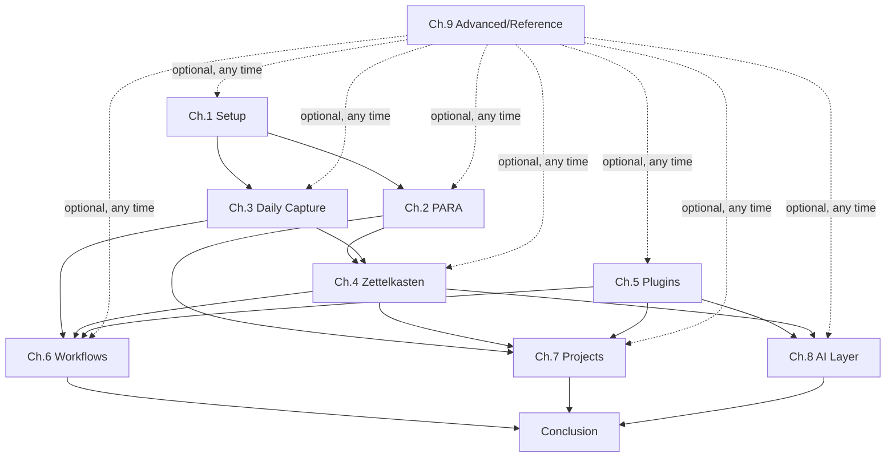

# Obsidian Second Brain — Map of Content

Map of Content for *Obsidian Second Brain: The Complete System for Knowledge Management, Note-Taking, and Getting Things Done* (Chipak, Anderson). All chapter notes, worked examples, and vault structure built while working through the book.

## Chapters
1. [[Chapter 1 - Setting Up Obsidian]] — vault creation, interface, Markdown basics, shortcuts, sync options
2. [[Chapter 2 - PARA Folder System]] — Projects/Areas/Resources/Archive, the decision tree, Inbox rule
3. [[Chapter 3 - The Daily Capture]] — Daily Note, capture habit, templates, linking on the fly
4. [[Chapter 4 - The Zettelkasten Method]] — fleeting/literature/permanent notes, the permanent note formula, MOCs, graph view
5. [[Chapter 5 - The 10 Essential Plugins]] — Dataview, Templater, Calendar, Tasks, Periodic Notes, Excalidraw, Git, Natural Language Dates, QuickAdd, Smart Connections
6. [[Chapter 6 - Complete Obsidian Workflows]] — daily (15 min) / weekly (30 min) / monthly (1 hr) review loops
7. [[Chapter 7 - Run Your Projects Inside Obsidian]] — project notes, Dataview dashboards, task queries, n8n automation
8. [[Chapter 8 - AI Inside Your Second Brain]] — Smart Connections, Copilot, n8n capture automation, limits of AI
9. [[Chapter 9 - Advanced Obsidian Tips and Customization]] — CSS, hotkeys, workspaces, Canvas, publishing, mobile, writing
10. [[Conclusion - Your Second Brain Is Alive]] — recap, the author's three-notes challenge

## How the chapters actually build on each other (not just a linear list)


*Ch.1 is the only true prerequisite. Ch.2 (structure) and Ch.4 (linking) are the two load-bearing chapters everything else builds on. Ch.9 is reference material you can dip into any time, not a dependency for anything.*

## Vault structure this project built (by chapter)
```
00-Inbox/                          ← Ch.2
01-Projects/                       ← Ch.2
  Gloss Local/                     ← Ch.2, updated Ch.7
  Second Brain Build-Out/          ← Ch.2
02-Areas/
  Knowledge Management/            ← Ch.2
03-Resources/
  Obsidian and PKM/                 ← Ch.2
    Ideas/                          ← Ch.4 (permanent note + MOC worked example)
      Constraints drive creativity more than freedom.md
      MOC - Creativity and Constraints.md
    AI Second Brain Setup Checklist.md  ← Ch.8
    Bases vs Dataview - 2026 Decision Notes.md  ← Ch.5/7 deep-dive
04-Archive/                        ← Ch.2 (empty)
05-Templates/
  Daily Note Template.md            ← Ch.3
  Book Note Template.md             ← Ch.3
  Meeting Note Template (Full).md   ← Ch.3
  Article Summary Template.md       ← Ch.3
  Weekly Review Template.md         ← Ch.6
  Monthly Review Template.md        ← Ch.6
  Project Note Template.md          ← Ch.7
06-Daily-Notes/
  2026-11-18.md                     ← Ch.3 (live example)
07-Periodic-Notes/
  Weekly/, Monthly/                 ← Ch.6
Dashboards/                        ← Ch.5/7 (deliberate PARA exception — cross-cutting utility)
  Reading Dashboard.md / Reading Dashboard.base   ← native Bases version added
  Today's Tasks.md
  Upcoming Tasks.md
  Project Dashboard.md / Project Dashboard.base   ← native Bases version added
.obsidian/snippets/
  second-brain-starter.css          ← Ch.9 (disabled by default)
Claude Notes/                       ← all book notes + this MOC
  Examples/                         ← Ch.1 demo (meeting note + backlinks)
```

## Running list of open decisions (collected across all chapters)
These were flagged chapter-by-chapter as things only you can decide — gathered here so they're not scattered across nine separate notes:
- **Sync strategy** (Ch.1): Drive/Dropbox vs. Obsidian Git vs. iCloud, across your Mac/Windows/phone setup
- **Folders vs. tags/links long-term** (Ch.2): strict PARA vs. a lighter hybrid as the vault grows
- **Daily files vs. a single running inbox** (Ch.3)
- **Three-stage vs. two-stage note pipeline** (Ch.4): fleeting/literature/permanent, or a simplified version
- **Dataview vs. native Bases** (Ch.5/7) — **resolved**: both dashboards now default to native Bases (`.base` files, confirmed against official syntax docs), Dataview kept as documented fallback only for the 5 confirmed gaps (inline fields, task-level queries, scripting, inline prose queries, deep rollups). Full writeup: [[Bases vs Dataview - 2026 Decision Notes]]
- **Weekly review scope** (Ch.6): full four-movement version, or trimmed down initially
- **Local Ollama vs. OpenAI API** (Ch.8): for Smart Connections/Copilot — Ollama already runs for Gloss Local
- **Vault appearance** (Ch.9): enable the CSS snippet or leave default
- **Archiving "Second Brain Build-Out"** (Ch.6/Conclusion): once the practical setup guide and use-case guide (still pending) are done

## Known recurring theme across chapters (community research)
Nearly every chapter's research surfaced the same underlying tension in different clothing: **structure/architecture vs. habit/original thinking.** Overengineering folders (Ch.1,2), overengineered daily/weekly templates (Ch.3,6), the permanent-note bottleneck (Ch.4), plugin sprawl (Ch.5), AI doing too much of the thinking (Ch.8) — all variations of the same failure mode the book's own Conclusion names directly: *"consistency beats architecture."*

## Original scope — now complete
- [x] [[Practical Obsidian Setup Guide]] — standalone, phased action plan consolidating Ch.1-9
- [x] [[Second Brain Use Cases Guide]] — student, researcher, PM, writer, developer (Gloss Local-style), personal life admin
