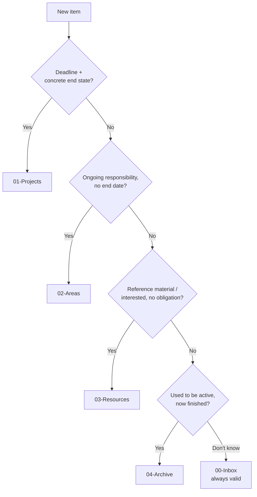
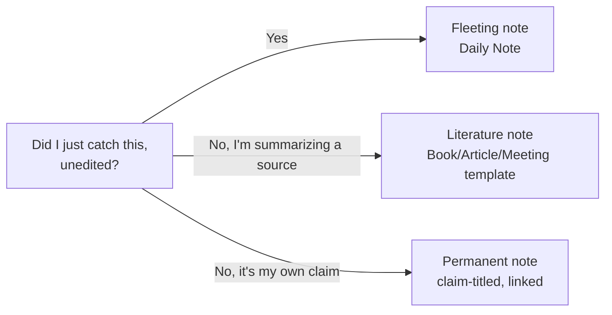

# Where Does This Go? — Quick Reference

Built because this is the single most common point of confusion in the whole system — even the book admits the PARA "where does this belong" question gets genuinely ambiguous. Keep this note open in a pane while you're sorting your Inbox during a weekly review.

> [!note] Primary source now available
> This decision tree was originally built from *Obsidian Second Brain*'s shorter PARA treatment. The full, original-source version of these exact distinctions now lives in [[The PARA Method - MOC|The PARA Method]] by Tiago Forte — specifically [[Chapter 6 - How to Distinguish between Projects and Areas]] (goal+deadline vs. standard+no-end-date, the "sprint vs. marathon" framing) and [[Chapter 7 - How to Distinguish between Areas and Resources]] (responsibility vs. interest, not topic). Those two chapters go considerably deeper than this quick-reference note and are worth reading directly if a tie-breaker below doesn't resolve a specific case.

> [!important] The one rule that dissolves most of the confusion
> You're actually answering **two separate questions**, not one. Answer them one at a time, never together:
> 1. **Which folder?** (a *location* question — PARA)
> 2. **What kind of note is this?** (a *content* question — fleeting / literature / permanent)

---

## Question 1: Which folder? (PARA decision tree)

Ask in this exact order and stop at the first "yes":

1. **Does this belong to something with a deadline and a concrete end state?**
   → `01-Projects/[that project]`
   *(e.g. "Gloss Local stable across devices" — has a finish line)*

2. **Is it about something ongoing you're responsible for maintaining, with no end date?**
   → `02-Areas/[that area]`
   *(e.g. Health, Finance, Career, or an Area like [[02-Areas/Knowledge Management]])*

3. **Is it reference material or an idea you're interested in, with no obligation attached?**
   → `03-Resources/[that topic]`
   *(e.g. a permanent note, an article summary, a topic you're casually learning about)*

4. **Is it something that used to be active but is now finished or inactive?**
   → `04-Archive`

5. **Don't know yet, or it's not a good moment to decide?**
   → `00-Inbox` — **always a valid answer.** You are never required to decide on the spot. See [[Chapter 2 - PARA Folder System#The Inbox Rule Capture Now Organize Later]].

### Visual version of the same decision tree

### The tie-breaker, when two answers feel equally true
This is the *normal* case, not a sign you're doing it wrong. The book is explicit (see [[Chapter 2 - PARA Folder System]]) that the same piece of information can correctly go in a Project, an Area, *or* a Resource, depending only on your current relationship to it — there is no objectively correct folder based on topic alone.

Ask instead: **"Where would I actually go looking for this later?"** — not "what is this technically about."

| If you're thinking... | ...then ask | ...and the answer tells you |
|---|---|---|
| "This could be a Project or an Area" | Does it have a finish line, or does it continue indefinitely? | Finish line → Project. Indefinite → Area. |
| "This could be an Area or a Resource" | Am I personally *responsible* for this, or just *interested* in it? | Responsible → Area. Interested → Resource. |
| "This could be a Resource or Archive" | Is this still relevant to anything I'm actively doing or learning? | Yes → Resource. No → Archive (nothing gets deleted, just moved). |

---

## Question 2: What kind of note is this? (Zettelkasten note type)

Once you know the folder, ask what you're actually writing — this determines *how* to write it, from [[Chapter 4 - The Zettelkasten Method]]:

| Type | What it is | Test | Where it lives |
|---|---|---|---|
| **Fleeting** | Quick, unprocessed, temporary | "Did I just catch this, unedited?" | `06-Daily-Notes/` until your weekly review sorts it |
| **Literature** | Someone else's idea, in your own words | "Am I summarizing a source?" | Book/Article/Meeting templates → `03-Resources/[Topic]` |
| **Permanent** | Your own original idea or claim | "Is this *my* thought, not a summary?" | `03-Resources/[Topic]/Ideas/` — titled as a claim, per the four-rule formula |

Folder answers "where do I look for this." Note-type answers "how should I write it." Mixing these two questions together is the single biggest source of the confusion this note exists to solve.

---

## Worked examples (real judgment calls already made in this vault)
- **Gloss Local** → `01-Projects` (has a finish line: stable across devices), not an Area, even though it's a long-running personal interest — see [[Chapter 2 - PARA Folder System#Worked example — built directly in your vault]].
- **The permanent note example "Constraints drive creativity more than freedom"** → `03-Resources/Obsidian and PKM/Ideas/` — it's a *claim*, not a summary, so it's a permanent note, not a literature note — see [[Chapter 4 - The Zettelkasten Method#Worked example — built directly in your vault]].
- **Second Brain Build-Out** (this whole project) → `01-Projects`, debatable as a Resource instead, flagged explicitly as a judgment call in [[Chapter 2 - PARA Folder System#Deeper commentary — how this applies to your setup specifically]] — included here deliberately so you can see that even the notes in this vault aren't claiming false certainty.

## If you're still stuck after all of this
Put it in `00-Inbox` and move on. That is not a failure state — it is the system working as designed. See [[Chapter 3 - The Daily Capture#The Inbox workflow]] and [[Chapter 6 - Complete Obsidian Workflows#The weekly review — 30 minutes on Sunday]] for how the Inbox gets emptied on a schedule, with a clear head, instead of under pressure in the moment of capture.

## Sources
This note synthesizes the book's own Chapter 2 and Chapter 4 content (see those notes for direct quotes and full community research/citations) rather than introducing new external sources — it's a cross-chapter index, not new research.

## Related
- [[Chapter 2 - PARA Folder System]]
- [[Chapter 4 - The Zettelkasten Method]]
- [[Obsidian Second Brain - MOC]]
- [[Practical Obsidian Setup Guide]]
- PARA's original source: [[Chapter 5 - Organize - Save for Actionability]] (*Building a Second Brain*, Tiago Forte) — this vault's `01-Projects`/`02-Areas`/`03-Resources`/`04-Archive` structure implements that chapter's system directly; this note's Question 1 decision tree still applies unchanged.
