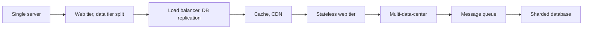

# Chapter 1: Scale From Zero to Millions of Users

> [!cite] Book reference
> *System Design Interview: An Insider's Guide, Second Edition* by Alex Xu. Chapter 1: "Scale From Zero to Millions of Users." Source: the user's uploaded EPUB file.

> [!summary] One-line takeaway
> You scale a system to millions of users through a fixed, repeatable sequence of moves: split tiers, add redundancy at each tier, cache aggressively, go stateless, replicate across regions, decouple with queues, and shard the data layer.

## Why this chapter matters

This chapter sets the baseline architecture that every later chapter in the book assumes. Chapter 2 builds the estimation skills to size this architecture. Chapter 3 gives the interview framework for presenting it. Chapters 4 through 15 each take one piece of this architecture — a cache, a hash ring, a queue — and go deep on it as a stand-alone interview question. Nothing here is specific to one problem; it is the shared vocabulary for the rest of the book.

## Direct quotes from the book

> [!quote] On the purpose of the chapter
> "Designing a system that supports millions of users is challenging, and it is a journey that requires continuous refinement and endless improvement."

> [!quote] On database replication
> "Database replication can be used in many database management systems, usually with a master/slave relationship between the original (master) and the copies (slaves)."[^3]

> [!quote] On what a single point of failure is
> "A single point of failure (SPOF) is a part of a system that, if it fails, will stop the entire system from working."[^8]

> [!quote] On the hardest part of sharding
> "The most important factor to consider when implementing a sharding strategy is the choice of the sharding key."

> [!quote] On the end goal of this chapter
> "Scaling a system is an iterative process. Iterating on what we have learned in this chapter could get us far."

## The chapter in full (so you never need to re-read it)

### Starting point: everything on one server

The chapter opens with the simplest possible setup: one server runs the web app, the database, and the cache together. A request flows like this: the user's browser or app resolves a domain name such as `api.mysite.com` through DNS (a third-party paid service, not something you host yourself), gets back an IP address, for example `15.125.23.214`, and sends an HTTP request straight to that address. The server returns HTML for a web app or JSON for a mobile app. The book shows a sample JSON response for `GET /users/12`, retrieving the user object for ID 12. Traffic arrives from two kinds of clients. Web applications are built from server-side languages like Java or Python for business logic, plus client-side HTML/JavaScript for presentation. Mobile applications talk to the server over HTTP and exchange data as JSON, chosen for its simplicity.

### Splitting into a web tier and a data tier

As the user base grows, one server stops being enough. The design splits into a web tier and a data tier running on separate machines. This lets each tier scale on its own schedule.

At this point you must decide between a relational (SQL) database and a non-relational (NoSQL) one.

**Relational databases** (RDBMS): MySQL, Oracle Database, PostgreSQL. Data is stored in tables and rows, and you can perform SQL joins across tables. The book calls relational the best default option for most developers. These systems have existed for over 40 years and carry a long track record.

**Non-relational databases** (NoSQL): CouchDB, Neo4j, Cassandra, HBase, Amazon DynamoDB.[^2] They group into four categories: key-value stores, graph stores, column stores, and document stores. Joins are generally not supported. The book lists four situations where NoSQL can be the right call instead of the relational default:

- Your application needs super-low latency.
- Your data is unstructured, or has no relational structure at all.
- You only need to serialize and deserialize data, for example as JSON, XML, or YAML.
- You need to store a massive volume of data.

### Vertical scaling versus horizontal scaling

Vertical scaling ("scale up") means adding more CPU or RAM to an existing server. It is simple, but it has a hard ceiling. There is a limit to how much power you can add to one machine, and it gives no failover. If that one server dies, the whole product dies with it.

Horizontal scaling ("scale out") means adding more servers to a pool. It is the more desirable option for large-scale applications because it avoids both of vertical scaling's limitations. But a pool of servers with no traffic-distribution mechanism in front of it has a new problem: a single web server can still be overwhelmed, and users get slow responses or failed connections once it hits its load limit. A load balancer solves this problem.

### Load balancer

A load balancer sits in front of the web tier and evenly distributes incoming traffic across every server in the pool. Users connect to the load balancer's public IP, not to any individual web server's IP. The web servers become unreachable directly from the outside. The load balancer reaches the web servers through private IPs, addresses that work only inside the same network and stay unreachable from the public internet. This is a security improvement as a side effect.

With a load balancer and at least two web servers in place:

- If one server goes offline, all traffic reroutes to the healthy server, and the team adds a replacement server to restore capacity. The site does not go down.
- If traffic grows faster than two servers can handle, you add more servers to the pool, and the load balancer starts routing to them automatically.

The web tier is now solved for redundancy. The data tier still has just one database, with no failover of its own. Database replication solves that.

### Database replication

The book quotes Wikipedia's definition directly: replication typically works through a master/slave relationship between the original (master) copy and the replicated (slave) copies.[^3] The master database handles writes (inserts, updates, deletes). Slave databases hold copies of the master's data and serve only reads. Most applications read far more than they write, so systems typically run more slave databases than masters.

Three benefits of this setup:

- **Better performance.** Writes go to the master, reads spread across the slaves, so more queries run in parallel.
- **Reliability.** If a disaster destroys one database server, the data still exists on the others.
- **High availability.** If one database goes offline, the system still serves data from the others.

Failure handling under replication:

- If a slave goes offline and others remain, reads redirect to the healthy slaves. If it was the only slave, reads redirect temporarily to the master until a replacement slave is provisioned.
- If the master goes offline, a slave is promoted to master. In production this is more delicate than it sounds, because the promoted slave's data might lag behind the dead master's. A data-recovery script has to backfill that gap. The book notes that more advanced replication topologies, multi-master and circular replication, exist to reduce this risk but sit out of scope for the chapter. It points readers to its own reference list instead.[^4][^5]

With both pieces in place, the request flow becomes: DNS resolves the load balancer's IP, the user connects to the load balancer, the load balancer routes the HTTP request to an available web server, the web server reads from a slave database, and any write, update, or delete goes to the master database.

### Cache

A cache is temporary, in-memory storage for the results of expensive computations or for frequently accessed data. It serves repeat requests fast without hitting the database again. The book describes the **read-through** pattern specifically: a web server first checks the cache. On a hit, it returns the cached value directly. On a miss, it queries the database, writes the result into the cache, and then returns it. Other caching strategies exist depending on data shape, size, and access pattern, and the chapter cites a dedicated article on choosing between them.[^6]

The book gives four considerations for running a cache in production:

1. **Decide when to use it.** Cache data that is read often and written rarely. Cache memory is volatile, so a restart wipes it; the cache is never the system of record for important data.
2. **Set an expiration policy.** Too short, and the system reloads from the database too often. Too long, and served data goes stale. No expiration at all means data accumulates in memory permanently.
3. **Keep it consistent with the data store.** The write to the database and the write to the cache are not one atomic transaction, so they can drift out of sync. This gets harder across multiple regions. The chapter cites Facebook's own published account of scaling Memcache for a deeper treatment of this problem.[^7]
4. **Plan for cache failure.** One cache server is a single point of failure. Production setups run multiple cache servers across multiple data centers, and typically overprovision memory to leave headroom as usage grows.

**Eviction policy**: once the cache is full, adding a new item means removing an old one. Least-recently-used (LRU) is the most common policy. Least-frequently-used (LFU) and first-in-first-out (FIFO) serve as alternatives for different access patterns.

### Content delivery network (CDN)

A CDN is a network of geographically distributed servers that cache static content: images, video, CSS, and JavaScript. The closer the CDN server sits to the requesting user, the faster the content loads. The book's own example contrasts a San Francisco-based CDN origin serving Los Angeles users quickly, versus European users slowly.

The CDN workflow the book walks through:

1. A user requests `image.png` from a CDN-provided domain (the book shows real-looking examples from Amazon CloudFront and Akamai, `mysite.cloudfront.net` and `mysite.akamai.com`).
2. If the CDN server does not have that file cached, it requests the file from the origin, which can be a web server or object storage such as Amazon S3.
3. The origin returns the file along with an optional Time-to-Live (TTL) header that tells the CDN how long to keep it cached.
4. The CDN caches the file and serves it to that user. It stays cached until the TTL expires.
5. A second user requesting the same file gets it straight from the CDN cache, with no origin round trip, as long as the TTL has not expired.

Four operational considerations for CDNs:

- **Cost.** You pay third-party CDN providers for data transferred in and out. Caching rarely used assets provides little benefit, so move them out of the CDN.
- **Expiry tuning.** Same tension as application cache TTLs. Too long risks staleness. Too short causes excessive reloading from the origin.
- **Fallback behavior.** Plan for what happens on a CDN outage. Clients should detect the failure and fall back to requesting assets straight from the origin.
- **Invalidation.** You can remove a file before its TTL expires two ways: through the CDN vendor's own invalidation API, or through object versioning, for example appending `?v=2` to the asset's URL to force clients onto a new version.

With cache and CDN added, static assets (JS, CSS, images) stop being served by the web tier entirely, and cached data lightens the database's read load.

### Stateless web tier

To scale the web tier horizontally, any server in the pool must be able to answer any user's request. That requires moving session state (for example, logged-in user data) out of the web servers and into shared, persistent storage, relational or NoSQL, that every web server can read from. This is the stateless architecture.

**Stateful architecture**, by contrast: each server holds a specific client's session data in its own memory. In the book's example, User A's session lives only on Server 1, User B's only on Server 2, User C's only on Server 3. Every request from a given user must be routed to that specific server. Most load balancers can enforce this with sticky sessions,[^10] but sticky sessions add overhead, make adding or removing servers harder, and make handling server failure harder: that server's sessions are simply gone.

**Stateless architecture**: any web server can serve any request, because every server pulls session state from the same shared data store rather than from its own memory. The book recommends NoSQL here specifically for how easily it scales. Once state lives outside the web servers, autoscaling becomes straightforward: adding or removing web servers automatically based on current load.

### Multi-data-center setup

To serve a growing international user base reliably, the design expands to multiple data centers. The book's example splits traffic `x%` to US-East and `(100 minus x)%` to US-West, using geoDNS (also called geo-routing) to route each user to the data center nearest them based on their location. If one data center suffers an outage, for example US-West going down, geoDNS redirects all traffic to the surviving data center, US-East, until the outage resolves.

Three technical challenges a true multi-data-center setup must solve:

- **Traffic redirection.** GeoDNS tools must correctly route each user to their nearest healthy data center.
- **Data synchronization.** Different regions may use different local databases or caches, so failover can route a user to a data center missing their data. The standard fix replicates data across data centers; the chapter cites Netflix's own published account of its asynchronous multi-region replication.[^11]
- **Testing and deployment.** Every location needs testing, and automated deployment tooling keeps every data center's software consistent.[^11]

### Message queue

A message queue is a durable, in-memory component that buffers asynchronous communication between services. **Producers** (or publishers) create messages and publish them to the queue. **Consumers** (or subscribers) read from the queue and act on those messages. Producer and consumer never need to be online at the same time, and each scales independently of the other. That independence is the core value of decoupling them this way.

The book's worked example: a photo-processing feature (cropping, sharpening, blurring) that runs too slow inline. Web servers publish processing jobs to the queue; worker processes pull jobs from the queue and perform the processing asynchronously. When the queue backs up, you add more workers. When it sits empty, you reduce the worker count.

### Logging, metrics, and automation

Below a certain scale, these stay nice-to-haves. Above it, the book calls them essential:

- **Logging** tracks errors and problems, whether monitored per-server or aggregated into a centralized service for easier search.
- **Metrics** give visibility into system health and business performance. The book names three useful tiers: host-level metrics (CPU, memory, disk I/O), aggregated-tier metrics (for example overall database-tier or cache-tier performance), and key business metrics (daily active users, retention, revenue).
- **Automation**, especially continuous integration, verifies every code change automatically and catches problems early. Automating build, test, and deploy pipelines improves developer productivity.

At this stage, the architecture gains a message queue plus logging, monitoring, metrics, and automation tooling (shown collapsed to one data center in the book's figure, purely for space).

### Database scaling: vertical versus horizontal, and sharding

As data keeps growing, the database tier itself needs to scale, through the same two broad strategies as before.

**Vertical scaling** here means buying a bigger database server. The book cites Amazon RDS offering database instances with up to 24 TB of RAM,[^12] and notes that Stack Overflow ran on a single master database in 2013 despite serving over 10 million monthly unique visitors.[^13] But it carries the same drawbacks as before: a hardware ceiling, a higher single-point-of-failure risk, and high cost for the most powerful machines.

**Horizontal scaling**, in the database context, means **sharding**: splitting one large database into smaller, independently managed pieces called shards, each sharing the same schema but holding a distinct slice of the data. The book's example uses `user_id % 4` as the hash function. A request's shard is set by taking the user's ID modulo 4; the result (0 through 3) selects the shard that holds that user's row.

The single most important decision in sharding is the choice of **sharding key** (also called a partition key): the column, or columns, that determines how rows are distributed. A good key spreads data evenly across shards.

Sharding introduces three new problems the book names explicitly:

1. **Resharding data.** Needed when a single shard fills up from overall growth, or when uneven distribution causes one shard to fill faster than others (shard exhaustion). Either case forces you to update the sharding function and physically move data between shards. The book flags consistent hashing, covered in full in Chapter 5, as the standard technique for making this less painful.
2. **The celebrity problem** (also called the hotspot key problem). Excessive load concentrates on one shard — for example, if a social app happens to place Katy Perry, Justin Bieber, and Lady Gaga's data on the same shard, which then drowns in read traffic. The book's suggested fix gives each celebrity account its own shard, with further partitioning if even that falls short.
3. **Joins and de-normalization.** Once data is sharded across servers, SQL joins across shards become impractical. The usual workaround de-normalizes the schema so a query can be answered from a single table, inside a single shard.

The final architecture in the chapter shards the database to absorb rapidly growing traffic, and moves some non-relational workloads into a dedicated NoSQL store to lighten the relational database's load. The chapter cites an article surveying real-world NoSQL use cases for reference.[^14]

### Closing summary: millions of users and beyond

The book closes the chapter by naming scaling as an iterative process. Pushing past millions of users takes further fine-tuning, including decomposing the system into smaller services, but it frames everything already covered as the foundation for that next stage. Its own summary checklist:

- Keep the web tier stateless.
- Build redundancy at every tier.
- Cache data as much as you can.
- Support multiple data centers.
- Host static assets in a CDN.
- Scale the data tier by sharding.
- Split tiers into individual services.
- Monitor the system and use automation tools.

## Core concepts (quick-scan version)

| Concept | What it solves | Key risk if done wrong |
|---|---|---|
| Load balancer | Web tier single point of failure, uneven traffic | Load balancer itself becomes a SPOF if not made redundant |
| Master/slave replication | Data tier SPOF, read scaling | Promoted slave may have stale data after master failure |
| Cache (read-through) | Repeated expensive database reads | Stale data if expiration policy is wrong; volatile, so never the source of truth |
| CDN | Static asset latency, origin load | Cost; staleness if TTL runs too long; no fallback plan for CDN outage |
| Stateless web tier | Horizontal scaling, autoscaling | Requires a fast, reliable shared session store |
| Multi-data-center (geoDNS) | Regional latency, regional outages | Cross-region data synchronization is genuinely hard |
| Message queue | Tight coupling between producer and consumer | Queue itself needs monitoring; backlog growth signals under-provisioned workers |
| Sharding | Database size and write throughput | Resharding cost, celebrity/hotspot problem, lost cross-shard joins |

## First-principles breakdown

Strip away the book's own sequencing and one claim sits underneath this whole chapter: redundancy and decoupling cost throughput and complexity, but buy availability and independent scalability, and at sufficient load this trade always pays for itself. Every technique in the chapter — the load balancer, replication, caching, statelessness, multi-region, queues, sharding — is a specific instance of removing a single point of failure, or breaking a tight coupling between two components so each fails or scales on its own schedule.

This rebuilds into three more basic mechanisms:

1. **Redundancy trades idle capacity for survivability.** A second server, a slave database, or a second data center does nothing useful under normal load. It exists purely to absorb the failure of its sibling. This pays off only once the cost of downtime exceeds the cost of the idle standby capacity. That is why the book treats a single server as perfectly fine at the start.
2. **Caching trades consistency risk for latency and database-load reduction.** A cache bets that most reads can tolerate being slightly stale, in exchange for being fast and cheap. The bet breaks down specifically when writes run frequent relative to reads — exactly the condition the book names for avoiding cache in the first place.
3. **Decoupling (statelessness, queues) trades a fast path for independent scaling.** A stateful server serves a given user faster, with no round trip to a shared store, but that speed comes at the cost of binding that user permanently to one machine. Removing that binding is strictly a scaling and resilience move, not a performance one; in isolation it adds a network hop.

One place this chapter's advice quietly stops working: sharding assumes a key that distributes access evenly, not just storage. Two keys can split 10 million rows into four equal 2.5-million-row shards and still produce wildly unequal load, if access concentrates on a handful of those rows — exactly the celebrity problem. Storage-balance and load-balance are different properties, and the book's own modulo-based example solves only the first one. The chapter states this assumption but does not fully resolve it, leaving the rest to the sharding-key discussion and later chapters.

## Visual representation

See the full staged build-out in [[Chapter 1 - Scaling Journey Architecture]]: single server, load balancer and replication, cache and CDN, stateless tier, multi-data-center, message queue, and sharding, each as its own diagram, plus one composite diagram of the final architecture.

## Worked example, built directly in your vault

Built: [[Chapter 1 - Scaling Journey Architecture]] in `Claude Notes/Books/System Design Interview/Examples/`, a full set of Mermaid diagrams reproducing every stage of the book's own scaling progression, plus a composite final-architecture diagram. This reproduces the book's own worked example, not a new scenario, and it is built as a reusable template: later "design X" chapters link back to it and copy the relevant stage instead of re-deriving an architecture from nothing.

## What the book doesn't tell you, community perspective (2025-2026)

- **Sticky sessions now read more often as a smell than a stopgap.** Recent engineering write-ups frame pinning users to one server as acceptable only for small, early-stage systems, internal tools, or latency-critical cases like high-frequency trading, and as actively risky for anything else. A Redis-backed session store adds only 1-5 ms of latency in most setups, while removing the operational fragility sticky sessions create during deploys and failures.
- **The celebrity/hotspot problem carries well-documented real incidents beyond the book's hypothetical.** Twitter's infrastructure reportedly strained under load whenever Justin Bieber tweeted, because his user ID became a genuine hot key. Instagram faced a similar spike in hashtag-shard load during the 2011 royal wedding. These confirm the book's hypothetical holds up in practice.
- **Common mitigations beyond "give the celebrity their own shard":** key splitting, which appends a bucket suffix to the hot key (for example `celebrity_id:0` through `celebrity_id:15`) so load spreads across several shards and merges back at read time, and aggressive caching of the hot key's data so a well-tuned cache absorbs most reads before they reach a shard.
- **Modern sharding tooling moved the pain; it did not remove it.** Tools like Vitess, Citus, and Spanner now automate shard routing and resharding mechanics that used to be hand-rolled, but the choice of sharding key, and therefore the exposure to hotspots, stays entirely the engineer's responsibility. No tool picks a good key for you.
- **Redis-as-single-point-of-failure is a real trade-off the book does not dwell on.** Centralizing session state removes the web tier's statefulness problem but creates a new one: if the shared Redis cluster goes down, every user gets logged out at once. The shared store itself now needs the same redundancy treatment (replication, failover) the book applied to the primary database.

## Deeper commentary, how this applies to your setup specifically

If you build this out as a learning vault rather than a production system, the highest-leverage move treats this chapter's eight techniques as a checklist to apply to any future "design X" problem — including the ones later in this book — before reaching for anything more exotic. When you reach Chapter 5 (consistent hashing) and Chapter 6 (key-value store), this chapter's sharding and replication sections reappear in more depth. Re-read the sharding and replication sections above once you finish those chapters, to notice what they add.

## Practical and actionable takeaways

- [x] Extracted the chapter's real text, figures, and reference list from the source EPUB rather than from memory.
- [x] Built a reusable architecture-diagram template for the rest of the book.
- [ ] When you reach Chapter 5 (consistent hashing), revisit the "resharding data" problem above and compare the modulo-hash approach here against consistent hashing's fix.
- [ ] When you reach Chapter 6 (key-value store), revisit the replication and sharding sections above; that chapter composes both into one system.
- [ ] Decide, for your own future system-design practice notes, whether to keep diagram style consistent with [[Chapter 1 - Scaling Journey Architecture]] for every subsequent chapter.

## Questions and things to decide for your own vault

- Do you want a single running glossary note across all system-design chapters (load balancer, SPOF, sharding key, and so on), or should each term stay defined locally in the chapter where it first appears?
- Should the eventual static-site publication (GitHub Pages or similar) expose the worked-example diagrams as their own pages, or keep them nested under each chapter?

## Video

[Reading & Explaining System Design Interview (Alex Xu), Chapter 1, Study With Me](https://www.youtube.com/watch?v=WcjaCqXpttw) — a third-party read-through of this exact chapter. No official ByteByteGo/Alex Xu video covering this specific chapter turned up as a verifiable, specific match, so this stands as the closest genuinely relevant video rather than the author's own.

## Sources (external, beyond the book)

- [The Celebrity Problem: How One Viral Post Breaks Sharded Databases](https://towardsdev.com/the-celebrity-problem-how-one-viral-post-breaks-sharded-databases-and-how-rust-helped-prove-it-ade26571f140) — Aaron Philip, Towards Dev
- ["The Justin Bieber Problem": When Celebrities Break the Internet](https://medium.com/@koulvidhi2/the-justin-bieber-problem-when-celebrities-break-the-internet-and-how-engineers-fix-it-0350dee56295) — Vidhi Koul, Medium
- [Designing a Distributed Session Store: Why Sticky Sessions Break Under Load](https://www.josedacruz.com/2026/11/06/designing-a-distributed-session-store-why-sticky-sessions-break-under-load/) — José da Cruz
- [Redis for Session Management: The Right Way to Handle State at Scale](https://prasweb.com/redis-session-management-at-scale/)
- [Sticky Sessions, Session Affinity Trade-offs](https://adhdecode.com/networking/load-balancing/sticky-sessions/) — ADHDecode

## Footnotes

[^1]: Hypertext Transfer Protocol: https://en.wikipedia.org/wiki/Hypertext_Transfer_Protocol
[^2]: Should you go Beyond Relational Databases?: https://blog.teamtreehouse.com/should-you-go-beyond-relational-databases
[^3]: Replication: https://en.wikipedia.org/wiki/Replication_(computing)
[^4]: Multi-master replication: https://en.wikipedia.org/wiki/Multi-master_replication
[^5]: NDB Cluster Replication, Multi-Master and Circular Replication: https://dev.mysql.com/doc/refman/5.7/en/mysql-cluster-replication-multi-master.html
[^6]: Caching Strategies and How to Choose the Right One: https://codeahoy.com/2017/08/11/caching-strategies-and-how-to-choose-the-right-one/
[^7]: R. Nishtala, "Scaling Memcache at Facebook," 10th USENIX Symposium on Networked Systems Design and Implementation (NSDI '13).
[^8]: Single point of failure: https://en.wikipedia.org/wiki/Single_point_of_failure
[^9]: Amazon CloudFront Dynamic Content Delivery: https://aws.amazon.com/cloudfront/dynamic-content/
[^10]: Configure Sticky Sessions for Your Classic Load Balancer: https://docs.aws.amazon.com/elasticloadbalancing/latest/classic/elb-sticky-sessions.html
[^11]: Active-Active for Multi-Regional Resiliency: https://netflixtechblog.com/active-active-for-multi-regional-resiliency-c47719f6685b
[^12]: Amazon EC2 High Memory Instances: https://aws.amazon.com/ec2/instance-types/high-memory/
[^13]: What it takes to run Stack Overflow: http://nickcraver.com/blog/2013/11/22/what-it-takes-to-run-stack-overflow
[^14]: What The Heck Are You Actually Using NoSQL For: http://highscalability.com/blog/2010/12/6/what-the-heck-are-you-actually-using-nosql-for.html

## Claude's pick, what I'd flag as most important

- The sharding key choice (not the sharding mechanism itself) is the single highest-leverage decision in this chapter. Everything downstream — resharding cost, hotspot risk — flows from that one choice.
- Statelessness is the real unlock for autoscaling, not the load balancer. The load balancer only distributes traffic; removing server-local state is what lets you add or remove servers safely at all.
- The book's own summary checklist at the end of the chapter is worth memorizing verbatim. It is the fastest way to open any future "design X" conversation, including an actual interview.

## Related

- Next: [[Chapter 2 - Back-of-the-Envelope Estimation]]
- MOC: [[System Design Interview - MOC]]
- Worked example: [[Chapter 1 - Scaling Journey Architecture]]
