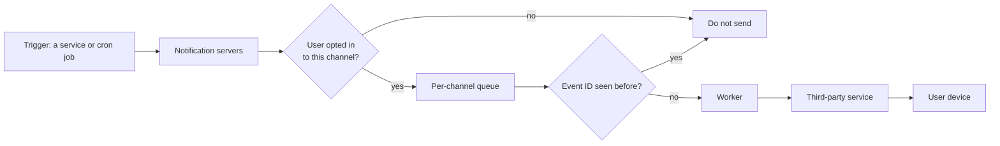

# Chapter 10: Design a Notification System

> [!cite] Book reference
> *System Design Interview: An Insider's Guide, Second Edition* by Alex Xu. Chapter 10: "Design a Notification System." Source: the user's uploaded EPUB file.

> [!summary] One-line takeaway
> A notification system is a fan-out problem across heterogeneous third-party providers (APNs, FCM, SMS, email); the core design challenge is decoupling the decision to notify from the mechanics of delivery, using per-channel queues, so one channel's failures never block another's.

## Why this chapter matters

This chapter is the clearest real-world application yet of Chapter 1's message-queue pattern, used specifically to isolate multiple independent, unreliable third-party dependencies from each other and from the core system. It also introduces the idea that "exactly-once delivery" is not actually achievable in a distributed system, a claim worth carrying forward into any later chapter touching distributed messaging.

## Direct quotes from the book

> [!quote] On what counts as a notification
> "A notification is more than just mobile push notification. Three types of notification formats are: mobile push notification, SMS message, and Email."

> [!quote] On the reliability bar
> "One of the most important requirements in a notification system is that it cannot lose data. Notifications can usually be delayed or re-ordered, but never lost."

> [!quote] On the limits of exactly-once delivery
> "Will recipients receive a notification exactly once? The short answer is no. Although notification is delivered exactly once most of the time, the distributed nature could result in duplicate notifications."

> [!quote] On why per-channel queues matter
> "Each notification type is assigned with a distinct message queue so an outage in one third-party service will not affect other notification types."

## The chapter in full (so you never need to re-read it)

### Step 1: understand the problem and establish design scope

The interviewer exchange establishes: the system supports push notifications, SMS, and email; it is a soft real-time system, notifications should arrive as fast as possible, with a slight delay acceptable under heavy load; supported devices are iOS, Android, and laptop/desktop; notifications can be triggered either by client applications or scheduled server-side; users can opt out entirely; and the daily volume is 10 million push notifications, 1 million SMS messages, and 5 million emails.

### Step 2: propose a high-level design

**The three notification types, each with its own delivery mechanics:**

- **iOS push notification.** Needs three pieces: a provider (which builds and sends the request, carrying a device token and a JSON payload), Apple Push Notification Service (APNS), the remote relay Apple provides, and the iOS device itself as the end client.
- **Android push notification.** Follows the same conceptual flow, but uses Firebase Cloud Messaging (FCM) in place of APNS.
- **SMS message.** Typically routed through a third-party commercial SMS service; the book names Twilio[^1] and Nexmo[^2] as common choices.
- **Email.** Companies can run their own mail servers, but commercial email services are common in practice; the book names Sendgrid[^3] and Mailchimp[^4], both offering better delivery rates and built-in analytics than a self-hosted alternative.

**Contact info gathering flow.** To notify anyone at all, the system first needs device tokens, phone numbers, or email addresses. On app install or first sign-up, API servers collect this contact info and persist it. The book's simplified schema splits this across two tables: a `user` table holding email addresses and phone numbers, and a `device` table holding device tokens, since a single user can own multiple devices, meaning a push notification can legitimately fan out to every device that user owns.

**Notification sending/receiving flow, initial design.** Components: Service 1 through N (any microservice, cron job, or distributed system that triggers a notification, the book's own examples are a billing service reminding customers of a due payment, or a shopping site telling customers their package arrives tomorrow); a single notification system, which exposes APIs to those services and builds the payloads third-party services need; the third-party services themselves, where extensibility matters since a given provider might be unavailable in some markets (the book's example: FCM is unavailable in China, so alternatives like Jpush or PushY are used there instead); and finally the end devices.

This initial design has three identified problems: it is a single point of failure, since one notification server handles everything; it is hard to scale, since databases, caches, and the various notification-processing components cannot scale independently when bundled into one server; and it creates a performance bottleneck, since resource-intensive work (building payloads, waiting on slow third-party responses) can overload the single server, especially at peak times.

**Notification sending/receiving flow, improved design.** Three structural changes fix the above: move the database and cache out of the notification server entirely; add more notification servers with automatic horizontal scaling; and introduce message queues to decouple every component from every other component.

The improved design's components: notification servers (now stateless and horizontally scalable) expose internal-only or verified-client-only APIs to prevent spam, run basic validation (for example on emails and phone numbers), query cache or database for rendering data, and publish notification events to message queues for parallel processing; a cache holds user info, device info, and notification templates; a database holds user, notification, and settings data; message queues remove inter-component dependencies and absorb bursts, with each notification type (iOS, Android, SMS, email) assigned its own distinct queue, specifically so an outage in one third-party provider cannot affect delivery through any other channel; workers pull events off these queues and dispatch them to the appropriate third-party service; and the third-party services and end devices work exactly as already described.

**The six-step send flow:** a service calls the notification server's API; the notification server fetches needed metadata (user info, device token, settings) from cache or database; the event is published to the matching per-type queue; workers pull events from that queue; workers call the corresponding third-party service; the third-party service delivers to the user's actual device.

### Step 3: design deep dive

**Reliability: preventing data loss.** The hard requirement is that a notification may be delayed or reordered, but must never simply be lost. The fix: persist notification data to a database (a notification log) and implement a retry mechanism on top of that persisted record.

**Reliability: exactly-once delivery is not achievable.** The book states plainly that exactly-once delivery does not hold in practice; the distributed nature of the system means duplicates can occur. The mitigation is a dedupe mechanism: when a notification event first arrives, check whether its event ID has been seen before; if so, discard it as a duplicate, otherwise send it. The book points interested readers to further material specifically on why exactly-once delivery is fundamentally unachievable in distributed systems.[^5]

**Notification templates.** At the scale of millions of notifications per day, many notifications share a common shape. A template is a preformatted notification with parameterized slots (item name, date, styling, tracking links) rather than hand-built content every time. The book's own example template reads: "You dreamed of it. We dared it. [ITEM NAME] is back, only until [DATE]," paired with a call-to-action like "Order Now." Templates buy consistency of format, fewer errors, and significant time savings at scale.

**Notification settings.** Users receiving too many notifications tend to feel overwhelmed, so fine-grained opt-in control per channel is standard. The book's schema: a `notification_setting` table keyed by `user_id`, a `channel` field (push, email, or SMS), and an `opt_in` boolean. Every send checks this setting first; an opted-out user for a given channel should never receive a notification through it.

**Rate limiting.** Beyond per-channel opt-out, limiting the total volume of notifications any single user receives matters directly for retention: sending too frequently is a common reason users disable notifications entirely.

**Retry mechanism.** When a third-party service fails to deliver, the event goes back into the message queue to be retried; if the failure persists past some threshold, an alert goes to the engineering team rather than silently continuing to retry forever.

**Security in push notifications.** An appKey/appSecret pair authenticates push notification requests on iOS and Android, so only authenticated or verified clients can send notifications through the system's APIs.[^6]

**Monitoring queued notifications.** A key operational metric is simply the total count of queued, unprocessed notifications. A large and growing queue signals that workers are not keeping pace with incoming volume, and the fix is adding more workers before delivery delay becomes noticeable to users.[^7]

**Event tracking.** Metrics like open rate, click rate, and overall engagement matter for understanding user behavior, and typically require integrating the notification system with a separate analytics service to capture and report on these events.

**Updated design, pulling everything together.** The final design layers in authentication and rate limiting directly on the notification servers; adds a retry mechanism that returns failed notifications to the queue for a bounded number of additional attempts; adds notification templates for consistent, efficient content creation; and adds monitoring and event-tracking systems for both system health and future product improvements.

### Step 4: wrap-up

The book's closing summary ties the chapter's additional components back to five concrete properties of the finished system: reliability, via a robust retry mechanism that minimizes failure rate; security, via the appKey/appSecret pair restricting who can send notifications; tracking and monitoring, instrumented at every stage of the flow to capture useful stats; respecting user settings, by always checking opt-in status before sending; and rate limiting, capping how frequently any one user is notified to avoid driving them to disable notifications altogether.

## Core concepts (quick-scan version)

See the full improved-design diagram, the six-step send flow, and the dedupe-check diagram in [[Chapter 10 - Notification System Flow]].

| Problem from the initial design | Fix in the improved design |
|---|---|
| Single point of failure | Multiple, horizontally scaled, stateless notification servers |
| Hard to scale independently | Database and cache moved out of the notification server |
| Performance bottleneck under load | Message queues absorb bursts and decouple components |
| One provider outage affecting all channels | A distinct queue per notification type |
| Possible data loss | Persisted notification log plus retry mechanism |
| Possible duplicate delivery | Event-ID-based dedupe check |
| Notification overload annoying users | Per-channel opt-in settings plus rate limiting |

## First-principles breakdown

The deepest structural choice in this chapter is assigning one queue per notification type, not one shared queue for all notifications. This is a direct application of a principle the book has used before (Chapter 1's stateless web tier, Chapter 9's per-host crawl queues): isolate failure domains so one dependency's outage cannot propagate into unrelated dependencies. If every notification type shared a single queue, a slow or down third-party SMS provider could back up the entire queue, delaying email and push notifications that have nothing to do with the SMS outage. Splitting by type converts a shared failure domain into several independent ones, at the cost of some added operational complexity (more queues to monitor, more workers to provision per type).

This also reframes the chapter's "exactly-once is unachievable" claim as more than a caveat: it is the direct consequence of combining at-least-once delivery semantics (needed to satisfy "never lose a notification") with a distributed system where a worker can crash, or a network call can time out, after the third-party service has already accepted the notification but before the worker can record that success. There is no way to make both of those failure points atomic with the delivery itself without a true distributed transaction across your system and the third-party provider, which you do not control. Given that constraint, the dedupe check is not a bug fix, it is the correct response to an irreducible property of the problem: accept at-least-once delivery, and push the responsibility for discarding true duplicates onto a separate, idempotent check.

## Visual representation

See the full improved-design diagram, the six-step flow, the dedupe check, and the final design with every deep-dive component layered in, in [[Chapter 10 - Notification System Flow]].

## Worked example, built directly in your vault

Built: [[Chapter 10 - Notification System Flow]] in `Claude Notes/Books/System Design Interview/Examples/`, reproducing the initial design and its three problems, the improved design with per-channel queues, the full six-step send flow, the dedupe-check diagram, the notification settings table, and the final design with every deep-dive component (auth, rate limiting, retry, templates, monitoring) layered in.

## What the book doesn't tell you, community perspective (2025-2026)

- **Deterministic idempotency keys are the standard production pattern for the dedupe check this chapter only sketches.** A commonly reported approach hashes together the event ID, user ID, and channel (sometimes also a content hash and date), writes that key to a fast store like Redis with an atomic SETNX operation and a 24-hour TTL, and treats a key collision as "already sent, discard."
- **A real, frequently reported production failure mode**: Kafka consumer group rebalancing can cause a message to be reprocessed by a new consumer before the original consumer's offset was committed, producing a genuine duplicate delivery to the end user. The reported fix is committing the queue offset only after a successful Redis-based dedup check, not before.
- **Delivery is better modeled as a state machine than a single pass/fail call**, in reports describing real systems: QUEUED, SENT, DELIVERED, with BOUNCED and FAILED as terminal states. A successful call to the third-party provider only moves a notification to SENT, confirming handoff to the provider, not actual delivery to the device, a distinction this chapter does not draw out explicitly.
- **Provider-level message collapsing is a real optimization beyond what the book describes.** FCM's collapse key and APNs' equivalent collapse identifier let a newer notification replace an undelivered older one for the same logical update, well suited to cases like "you have 12 unread messages," where only the latest count actually matters to the user.
- **Concrete 2025-2026 rate-limit figures for the providers this chapter names**: FCM's HTTP v1 API enforces a default quota of 600,000 messages per minute per Firebase project (roughly 10,000 per second sustained), via a one-minute token bucket, returning HTTP 429 on overflow; APNs publishes no fixed numeric limit but will throttle or disconnect connections showing abusive patterns. These numbers are useful ceiling checks when sizing the worker and queue capacity this chapter's design calls for.

## Deeper commentary, how this applies to your setup specifically

This chapter's per-channel-queue pattern, and its explicit "exactly-once is unachievable, so dedupe instead" framing, are both directly reusable well beyond notifications, in any system that fans work out to multiple independent, unreliable external dependencies. If you build or maintain anything that sends outbound webhooks, syncs to multiple third-party APIs, or similarly fans out, this chapter's structure (per-destination queues, idempotency keys, bounded retries, and a dead-letter path for persistent failures) is close to a ready-made blueprint.

## Practical and actionable takeaways

- [x] Extracted the full initial and improved high-level designs, the six-step send flow, and every deep-dive component (reliability, templates, settings, rate limiting, retries, security, monitoring, tracking) from the source EPUB.
- [x] Built a standalone worked-example note with the improved design, the dedupe check, and the fully assembled final design.
- [ ] If you ever build a real notification feature, implement the deterministic idempotency-key pattern from the community research above, rather than the book's simpler event-ID-only dedupe check.
- [ ] Decide whether delivery status in your own future implementation should be tracked as a full state machine (QUEUED, SENT, DELIVERED, BOUNCED, FAILED), matching current production practice, rather than a simple sent/not-sent flag.

## Questions and things to decide for your own vault

- Do you want a standalone note on "fan-out to unreliable third-party dependencies" as a general pattern, since this chapter, Chapter 9's crawler, and potentially later chapters (chat, news feed) all touch variations of the same idea?
- Should "why exactly-once delivery is impossible" become its own short reference note, since it is a foundational distributed-systems fact the book raises here but may be assumed, not re-explained, in later chapters touching messaging?

## Video

[Design a Notification System | System Design Interview (Complete HLD Explained)](https://www.youtube.com/watch?v=ZEN59RT-1Xc) — a third-party walkthrough matching this chapter's exact topic and structure.

## Sources (external, beyond the book)

- [Notification System Design Interview: Multi-Channel Delivery, Fanout, and Idempotency at Scale](https://www.systemdesign.academy/interview/design-notification-system)
- [Why Real-Time Notification Systems Break in Production](https://blog.damir-karimov.com/real-time-notification-systems-are-harder-than-most-teams-expect-and-how-to-build-them-right)
- [Designing a notification system that won't bury your OTP](https://www.techinterview.org/post/3233476887/designing-a-notification-system/)

## Footnotes

[^1]: Twilio SMS: https://www.twilio.com/sms
[^2]: Nexmo SMS: https://www.nexmo.com/products/sms
[^3]: Sendgrid: https://sendgrid.com/
[^4]: Mailchimp: https://mailchimp.com/
[^5]: You Cannot Have Exactly-Once Delivery: https://bravenewgeek.com/you-cannot-have-exactly-once-delivery/
[^6]: Security in Push Notifications: https://cloud.ibm.com/docs/services/mobilepush?topic=mobile-pushnotification-security-in-push-notifications
[^7]: RabbitMQ (referenced for the queued-messages figure credit): https://bit.ly/2sotIa6

## Claude's pick, what I'd flag as most important

- One queue per notification type is a small design decision with outsized impact; it is the single change that converts a shared failure domain into several isolated ones, and it is worth recognizing as the same isolation principle this book keeps reapplying in different guises.
- "Exactly-once delivery does not exist, design for at-least-once plus idempotent dedup instead" is one of the most load-bearing facts in this whole book; it quietly underlies correct design for queues, retries, and distributed messaging generally, not just notifications.
- Respecting notification settings before sending, not after, is a small implementation detail with real product consequences: checking opt-in status first means an opted-out user never even enters the send pipeline, rather than being filtered out downstream after resources were already spent.

## Related

- Previous: [[Chapter 9 - Design a Web Crawler]]
- Next: [[Chapter 11 - Design a News Feed System]]
- MOC: [[System Design Interview - MOC]]
- Worked example: [[Chapter 10 - Notification System Flow]]
