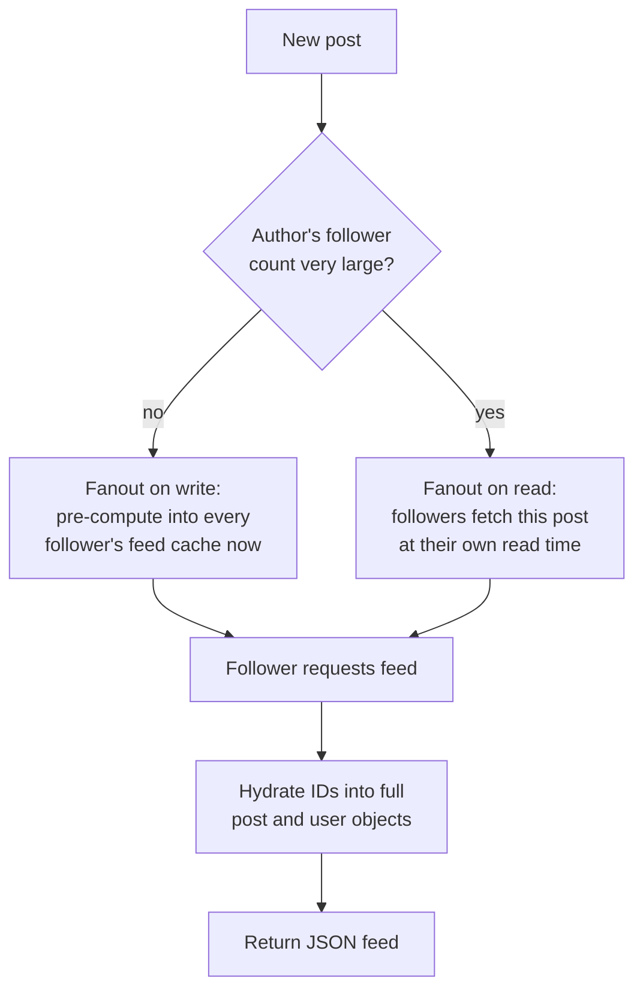

# Chapter 11: Design a News Feed System

> [!cite] Book reference
> *System Design Interview: An Insider's Guide, Second Edition* by Alex Xu. Chapter 11: "Design a News Feed System." Source: the user's uploaded EPUB file.

> [!summary] One-line takeaway
> A news feed splits cleanly into two flows, publishing (fanning a new post out to followers' caches) and retrieval (assembling a feed from cached IDs plus hydrated content), and the single hardest decision is when to pre-compute that fanout (push) versus compute it on demand (pull), which the book resolves with a hybrid, follower-count-based split.

## Why this chapter matters

This is the exact example Chapter 3 used to illustrate the 4-step interview framework, and the book now delivers on that promise in full. It is also the richest composition point in the book so far, directly reusing Chapter 5's consistent hashing (to mitigate the hotkey problem) and Chapter 10's notification system (to alert friends of new content).

## Direct quotes from the book

> [!quote] On what a news feed is
> "News feed is the constantly updating list of stories in the middle of your home page. News Feed includes status updates, photos, videos, links, app activity, and likes from people, pages, and groups that you follow on Facebook."[^1]

> [!quote] On the two fanout models
> "Two types of fanout models are: fanout on write (also called push model) and fanout on read (also called pull model). Both models have pros and cons."

> [!quote] On the hotkey problem
> "If a user has many friends, fetching the friend list and generating news feeds for all of them are slow and time consuming. It is called hotkey problem."

> [!quote] On the chosen resolution
> "We adopt a hybrid approach to get benefits of both approaches and avoid pitfalls in them. Since fetching the news feed fast is crucial, we use a push model for the majority of users. For celebrities or users who have many friends/followers, we let followers pull news content on-demand."

## The chapter in full (so you never need to re-read it)

### Step 1: understand the problem and establish design scope

This is the same worked example Chapter 3 introduced. The requirements: both mobile and web; core features are publishing a post and viewing friends' feeds; the feed is sorted in simple reverse chronological order, not a weighted ranking; a user can have up to 5,000 friends; the system serves 10 million daily active users; and feed content can include both images and video, not just text.

### Step 2: propose a high-level design

The design splits into two flows: **feed publishing** (writing a new post into cache and database, then populating it into friends' feeds) and **news feed building** (for simplicity here, aggregating friends' posts in reverse chronological order).

**Newsfeed APIs.** Two HTTP endpoints anchor the system: `POST /v1/me/feed`, taking a `content` parameter (the post text) and an `auth_token`, and `GET /v1/me/feed`, taking just the `auth_token`, for retrieving the feed.

**Feed publishing, high level.** A user posts content (the book's example: `/v1/me/feed?content=Hello&auth_token={auth_token}`). A load balancer distributes the request to web servers, which route it to internal services: a post service persists the post to database and cache; a fanout service pushes the new content into friends' news feeds, storing that feed data in cache for fast retrieval; and a notification service alerts friends that new content is available, including push notifications.

**Newsfeed building, high level.** A user requests `/v1/me/feed`. The load balancer routes to web servers, which call the newsfeed service, which fetches the feed from the news feed cache, specifically the post IDs needed to render it, not the full content.

### Step 3: design deep dive

**Web servers, in the publishing path.** Beyond routing, web servers enforce authentication (only users with a valid `auth_token` can post) and rate limiting (capping how many posts a user can make in a given period), explicitly to prevent spam and abusive content.

**Fanout: the central design decision.** Fanout is the process of delivering a post to all of a user's friends. Two models:

- **Fanout on write (push).** The feed is pre-computed at write time: a new post is delivered into each friend's cache immediately upon publishing. Pros: the feed updates in real time and can be pushed to friends immediately, and reads are fast since the feed is already assembled. Cons: for a user with a very large friend/follower count, fetching that full list and generating feeds for every one of them is slow, the hotkey problem; and pre-computing feeds for inactive users who rarely check their feed wastes computing resources.
- **Fanout on read (pull).** The feed is assembled on demand, at read time, when a user loads their home page. Pros: no wasted computation on inactive users, since nothing is computed until they actually request their feed; and no hotkey problem, since nothing is pushed out to anyone. Cons: reads are slow, since the feed is assembled live rather than pre-built.

**The book's resolution: a hybrid model.** Since fast reads matter for most users, push is used for the majority. For celebrities or users with very large follower counts specifically, the system switches to pull, letting followers fetch that content on demand instead of fanning it out eagerly. Consistent hashing (Chapter 5, explicitly cross-referenced) helps further by distributing the resulting load more evenly.

**Fanout service, step by step:**

1. Fetch friend IDs from a graph database, a data store purpose-built for managing relationship data and friend recommendations.[^2]
2. Get friend info from the user cache, then filter based on each friend's own settings, for example muting (so a muted friend's posts never appear, even though the friendship itself still exists) or selective sharing (a user choosing to share with, or hide from, specific people).
3. Send the filtered friend list and the new post's ID to a message queue.
4. Fanout workers consume from that queue and write the resulting news feed data into the news feed cache, conceptually a `<post_id, user_id>` mapping table, appended to on every new post.
5. The result is a feed cache storing only IDs, not full user or post objects, since storing full objects would consume far too much memory; a configurable per-user size limit further bounds memory, since most users rarely scroll back through more than their most recent content, keeping the cache miss rate low in practice.

**Newsfeed retrieval, step by step**, with media content served from a CDN for fast delivery:

1. A user requests `/v1/me/feed`.
2. The load balancer routes the request to web servers.
3. Web servers call the news feed service.
4. The news feed service fetches the relevant list of post IDs from the news feed cache.
5. Because a feed needs far more than bare IDs, username, profile picture, post content, images, and so on, the news feed service fetches the full user and post objects from the user cache and post cache to fully hydrate the response.
6. The fully hydrated feed is returned to the client as JSON for rendering.

**Cache architecture, five layers.** The book divides the cache tier into five distinct purposes:

- **News Feed**: stores feed IDs.
- **Content**: stores full post data, with especially popular content promoted into a hot cache.
- **Social Graph**: stores user relationship data.
- **Action**: stores whether a user liked, replied to, or otherwise acted on a given post.
- **Counters**: stores aggregate counts, likes, replies, followers, following.

### Step 4: wrap-up

The book is explicit that there is no single perfect design here, every company's constraints differ, and understanding your own design's tradeoffs matters more than memorizing one fixed answer. With remaining interview time, it points to a now-familiar set of scaling talking points rather than re-explaining them: database scaling (vertical versus horizontal, SQL versus NoSQL, master-slave replication, read replicas, consistency models, sharding), plus the recurring cross-chapter themes of keeping the web tier stateless, caching aggressively, supporting multiple data centers, decoupling components with message queues, and monitoring key metrics (the book's own examples: peak-hour QPS, and feed-refresh latency).

## Core concepts (quick-scan version)

See the full publishing flow, fanout service internals, hybrid-model diagram, retrieval flow, and five-layer cache table in [[Chapter 11 - News Feed Fanout Flows]].

| Design question | The book's answer |
|---|---|
| When is the feed assembled? | Mostly at write time (push); at read time for huge-follower accounts (pull) |
| What does the news feed cache store? | Only `<post_id, user_id>` pairs, never full objects |
| How is the hotkey problem mitigated? | Pull model for celebrities, plus consistent hashing to spread load |
| How does a muted or privacy-restricted friend's post get excluded? | Filtering happens inside the fanout service, before data ever reaches the feed cache |
| Where does media content live? | A CDN, separate from the feed cache entirely |

## First-principles breakdown

The push-versus-pull tradeoff in this chapter is really a question of where you pay an unavoidable cost: once, per post, regardless of who reads it (push), or repeatedly, per read, regardless of how many people ever actually look (pull). Push is a bet that most friends will eventually view most posts, making the upfront fanout cost worth paying once. That bet fails exactly in two symmetric ways: it fails for inactive users (the fanout cost is paid but never collected, since they never read it) and it fails for extremely popular posters (the fanout cost multiplies by an enormous follower count, making the single write disproportionately expensive). The hybrid model does not eliminate this tradeoff; it segments the population so each group gets the strategy that matches its own actual read/write ratio: normal users (where reads vastly outnumber the one-time publish, favoring pre-computation) and celebrities (where a single post's potential fanout cost vastly outnumbers any individual follower's chance of reading it immediately, favoring deferral).

This reframes the "hotkey problem" naming itself as more precise than it first appears: the problem is not really about a popular user's data being hot in the caching sense (frequently read), it is about a popular user's post being hot in the write-amplification sense, one write event triggering a number of downstream writes proportional to follower count. Chapter 5's consistent hashing helps with the caching-hotspot half of this problem (spreading read load for popular content across more servers), but it does not reduce the actual write amplification itself, that reduction is what switching celebrities to pull accomplishes.

## Visual representation

See the full publishing flow, fanout internals, hybrid-model decision diagram, retrieval flow, and cache-layer table in [[Chapter 11 - News Feed Fanout Flows]].

## Worked example, built directly in your vault

Built: [[Chapter 11 - News Feed Fanout Flows]] in `Claude Notes/Books/System Design Interview/Examples/`, reproducing the full publishing flow, the fanout service's five internal steps, a side-by-side comparison of push versus pull, the hybrid model's decision logic, the complete retrieval flow, and the five-layer cache architecture table, cross-linked to both Chapter 5 (consistent hashing) and Chapter 10 (notification system).

## What the book doesn't tell you, community perspective (2025-2026)

- **The hybrid threshold is reported as a concrete, tunable number in practice, not just a vague "celebrities" category.** A commonly cited pattern: push for accounts under roughly 10,000 followers, using something like Redis sorted sets fed by a Kafka consumer group, and pull for accounts at or above that threshold, where followers fetch directly from the author's own post index at read time and the result is merged into their pre-computed feed.
- **Twitter's own architecture reportedly evolved past this exact hybrid model.** After running a push/pull hybrid for roughly a decade, Twitter retired its original Fanout Service in 2023 in favor of candidate-sourcing inside a system called Home Mixer, built around Earlybird. This suggests the book's hybrid model is a strong, durable starting point, but not necessarily where a mature, extremely high-scale system ultimately lands.
- **Instagram's feed is described as leaning more heavily push-based than the book's hybrid suggests**, asynchronously pushing new posts into each follower's feed store via a task queue and message broker (reportedly RabbitMQ in some accounts), reserving pull-style computation for ranking and recommendation layers rather than for basic fanout itself.
- **Modern feeds increasingly layer ranking models on top of this chapter's simple reverse-chronological sort.** 2025-2026 sources describe large platforms running on the order of 1,000 distinct ranking models across different surfaces (feed, stories, recommendations, and so on), a scale of complexity the book deliberately sets aside by fixing the sort order to reverse chronological for this exercise.
- **"Skip fanout for inactive users, defer it until they log back in" is reported as a concrete production optimization** beyond the book's binary push/pull split: rather than choosing one strategy per user permanently, some systems dynamically skip the push-time fanout work specifically for followers who have not logged in recently, computing their feed lazily on their next visit instead.

## Deeper commentary, how this applies to your setup specifically

Since this is the exact example worked through in Chapter 3, it is worth rereading this chapter immediately after Chapter 3's own high-level sketch of it, to see concretely how a 4-step interview answer (scope, high-level design, deep dive, wrap-up) expands into the full chapter-length treatment given a full chapter's worth of time rather than a 10-15 minute high-level-design window.

## Practical and actionable takeaways

- [x] Extracted both flows (publishing, retrieval) in full, the fanout service's complete internal steps, the hybrid push/pull model, and the five-layer cache architecture from the source EPUB.
- [x] Built a standalone worked-example note with every flow diagrammed and explicit cross-links to Chapter 5 and Chapter 10.
- [ ] Reread Chapter 3's high-level sketch of this same news feed example immediately after this chapter, to compare the interview-pace version against the full chapter-length version.
- [ ] When this book's later chapters introduce ranking or recommendation systems (if any do), compare them against this chapter's deliberately simplified reverse-chronological sort.

## Questions and things to decide for your own vault

- Do you want a standalone note specifically on "write amplification" as a general distributed-systems concept, since this chapter's hotkey problem is really a write-amplification problem wearing a caching-sounding name?
- Should feed ranking (as opposed to this chapter's reverse-chronological default) become a tracked open question for a future book or research pass, since this chapter explicitly scopes it out rather than addressing it?

## Sources (external, beyond the book)

- [Fan-Out on Write vs Fan-Out on Read: How Twitter and Instagram Build News Feeds](https://codemia.io/blog/path/Re-evaluating-Fan-Out-on-Write-vs-Fan-Out-on-Read-Under-Celebrity-Traffic-Spikes-2025) — Codemia
- [News Feed Architecture: Fan-Out on Write vs Read, Hybrid Strategies and Feed Ranking](https://www.calibreos.com/learn/hld-news-feed) — CalibreOS
- [Designing a news feed and where fanout falls apart](https://www.techinterview.org/post/3233476400/designing-a-news-feed-where-fanout-falls-apart/)

## Footnotes

[^1]: How News Feed Works: https://www.facebook.com/help/327131014036297/
[^2]: Friend of Friend recommendations with Neo4j and SQL Server: http://geekswithblogs.net/brendonpage/archive/2015/10/26/friend-of-friend-recommendations-with-neo4j.aspx

## Claude's pick, what I'd flag as most important

- The hybrid push/pull split is one of the cleanest examples in the whole book of resolving a tradeoff by segmenting the population rather than picking one global answer; it is worth remembering as a general technique, not just a news-feed-specific fact.
- Storing only IDs in the news feed cache, then hydrating at read time, is a small but important pattern: it decouples "what belongs in this feed" from "what that content currently looks like," so editing a post or updating a profile picture does not require touching every feed that references it.
- Filtering by mute and privacy settings inside the fanout service, before data ever enters the feed cache, is worth noting specifically: it means privacy enforcement happens once, at write time, rather than being re-checked on every single read.

## Related

- Previous: [[Chapter 10 - Design a Notification System]]
- Next: [[Chapter 12 - Design a Chat System]]
- MOC: [[System Design Interview - MOC]]
- Worked example: [[Chapter 11 - News Feed Fanout Flows]]
