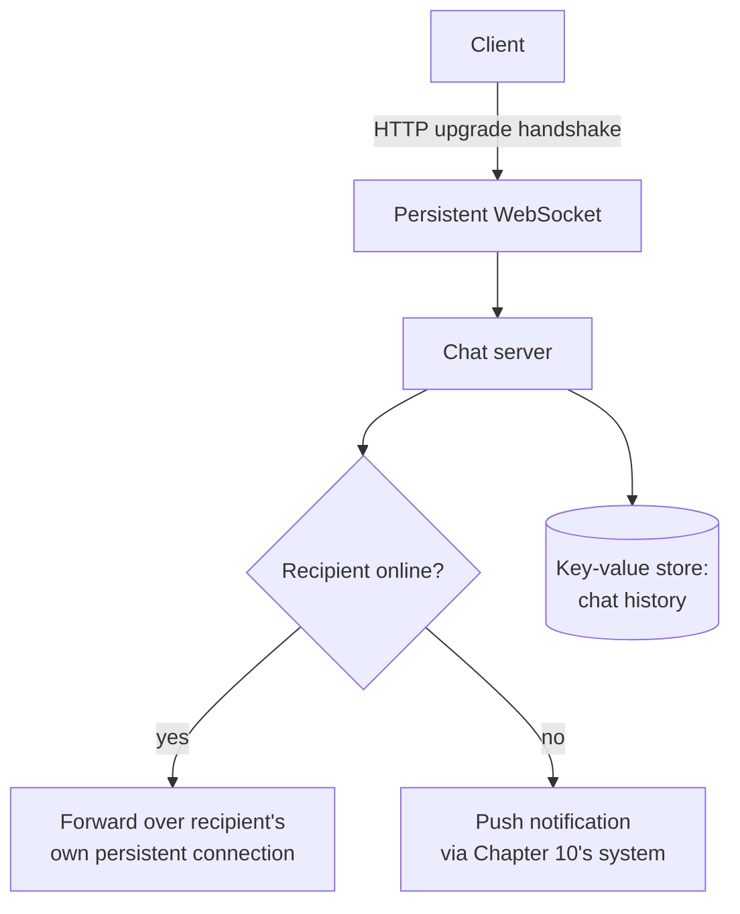

# Chapter 12: Design a Chat System

> [!cite] Book reference
> *System Design Interview: An Insider's Guide, Second Edition* by Alex Xu. Chapter 12: "Design a Chat System." Source: the user's uploaded EPUB file.

> [!summary] One-line takeaway
> A chat system is built on one persistent, bidirectional WebSocket connection per client, a stateful chat service that is the one genuinely hard part to scale, and a key-value store chosen specifically because chat history is enormous in volume, mostly read at the recent end, and needs fast random access.

## Why this chapter matters

This is the book's first design built around a genuinely stateful, long-lived connection, a sharp contrast with every earlier chapter's stateless-web-tier default. It also directly reuses Chapter 7's unique ID generator (for message ordering) and Chapter 10's notification system (for offline delivery), making it one of the most heavily composed chapters in the book.

## Direct quotes from the book

> [!quote] On why requirements matter immediately
> "A chat app performs different functions for different people. It is extremely important to nail down the exact requirements. For example, you do not want to design a system that focuses on group chat when the interviewer has one-on-one chat in mind."

> [!quote] On why WebSocket is chosen
> "WebSocket is the most common solution for sending asynchronous updates from server to client ... WebSocket connections generally work even if a firewall is in place. This is because they use port 80 or 443 which are also used by HTTP/HTTPS connections."

> [!quote] On why a single-server design is a red flag
> "If we propose a design where everything fits in one server, this may raise a big red flag in the interviewer's mind. No technologist would design such a scale in a single server. Single server design is a deal breaker due to many factors."

> [!quote] On why naive presence tracking fails
> "It is common for users to disconnect and reconnect to the internet frequently in a short time ... Updating online status on every disconnect/reconnect would make the presence indicator change too often, resulting in poor user experience."

## The chapter in full (so you never need to re-read it)

### Step 1: understand the problem and establish design scope

The book opens by stressing that chat apps serve very different purposes: one-on-one apps (Messenger, WeChat, WhatsApp), office group-chat apps (Slack), and large-group, low-latency voice-chat apps (Discord) are not interchangeable design targets. The interviewer exchange settles on: both one-on-one and group chat; both mobile and web; 50 million daily active users; a 100-person cap on group chat; text messages only (no attachments); a 100,000-character message size limit; end-to-end encryption deferred unless time allows; and chat history retained forever.

The chapter's scope, matching a Facebook Messenger-style product: low-latency one-on-one chat; small group chat (max 100); online presence; multi-device support (the same account logged in on several devices at once); and push notifications. The target scale is explicitly 50 million DAU.

### Step 2: propose a high-level design

**Clients never talk directly to each other.** Every client connects to a chat service, which must receive messages from clients, find the correct recipient(s) and relay the message, and hold a message server-side if the recipient is currently offline, until they come back online.

**Choosing a server-to-client protocol.** The sender side is straightforward: a client-initiated HTTP request, with a keep-alive header maintaining a persistent connection and cutting down on repeated TCP handshakes; the book notes Facebook itself originally used HTTP this way.[^1] The receiver side is harder, since HTTP is fundamentally client-initiated, and the server needs a way to push data to the client unprompted. Three techniques, each a step beyond the last:

- **Polling.** The client periodically asks the server "anything new?" Wasteful when run frequently, since most polls return nothing, consuming server resources for no benefit.
- **Long polling.** The client holds a request open until a message arrives or a timeout passes, then immediately reopens another request. Three real problems: sender and receiver may not land on the same (typically stateless, round-robin load-balanced) server, so the server holding a long-poll connection for the receiver may not be the server that received the sender's message; the server has no reliable way to detect a disconnected client; and it remains inefficient for quiet users, who still trigger periodic reconnects after every timeout even with nothing to say.
- **WebSocket.** A persistent, bidirectional connection, client-initiated but then upgraded from an HTTP handshake into something the server can also push through freely. It works through most firewalls, since it reuses ports 80/443, the same ports ordinary HTTP/HTTPS traffic already uses. Since WebSocket is bidirectional, the book notes there is no strong reason not to use it for the sender side too, simplifying the design by using one protocol for both directions rather than mixing HTTP (sending) with WebSocket (receiving).

**High-level architecture, three categories:**

- **Stateless services.** Traditional request/response services (login, signup, profile management) sitting behind a load balancer, routed by request path; these can be monolithic or microservices, and the book notes many can simply be integrated from existing market solutions rather than built from scratch. The one stateless service worth deeper discussion is service discovery, whose job is handing a client the DNS hostname of the specific chat server it should connect to.
- **Stateful service.** The chat service itself is the system's only stateful component, since each client holds a persistent network connection to one specific chat server and, as long as that server stays healthy, normally does not switch away from it. Service discovery works closely with the chat service specifically to avoid overloading any single chat server.
- **Third-party integration.** Push notifications are the most important integration, informing users of new messages even when the app itself is not running; the book points directly back to Chapter 10's notification system design for the details.

**Scalability and why single-server is a non-starter.** The book runs a deliberately provocative thought experiment: at 1 million concurrent users, assuming roughly 10 KB of server memory per connection (a rough, language-dependent figure), holding every connection in memory would only need about 10 GB, in theory fitting on one modern server. Despite this being numerically plausible, proposing a literal single-server design is treated as a serious red flag, with single point of failure named as the single biggest reason among several. It is fine to start the conversation from a single-server sketch, but only if you are explicit with the interviewer that it is a deliberate starting point, not the final answer.

**The adjusted high-level design** layers in: chat servers (facilitating message send/receive over the persistent WebSocket); presence servers (managing online/offline status); API servers (handling login, signup, profile, and everything else stateless); notification servers (sending push notifications); and a key-value store holding chat history, so that when an offline user returns, she sees her full prior conversation.

**Storage: choosing a database type.** The system has two distinct kinds of data. Generic data (user profile, settings, friends list) fits naturally into relational databases, scaled with the now-familiar replication and sharding techniques. Chat history itself is the harder case, and the book walks through its actual access pattern: the data volume is enormous, with a cited study showing Facebook Messenger and WhatsApp together processing 60 billion messages a day;[^2] only recent chats are accessed frequently, with users rarely digging into old history; some features (search, jumping to a specific message, viewing mentions) still require genuine random access, which the storage layer must support; and the read-to-write ratio for one-on-one chat sits around roughly 1:1.

The book recommends key-value stores for chat history specifically, for four reasons: they scale horizontally with ease; they offer very low read/write latency; relational databases handle the "long tail" of data poorly,[^3] since random access against large indexes gets expensive; and proven real systems already validate this choice, with Facebook Messenger built on HBase[^4] and Discord on Cassandra.[^5]

**Data models.** For one-on-one chat, the message table's primary key is `message_id`, deliberately not `created_at`, since two messages can legitimately share the same creation timestamp and still need a strict order. For group chat, the primary key becomes a composite `(channel_id, message_id)`, with `channel_id` as the partition key, since every query in a group chat context operates within one specific channel ("channel" and "group" are used interchangeably here).

**Generating message_id.** The ID must satisfy two requirements: uniqueness, and sortability by time (a newer message's ID must exceed an older one's). Three candidate approaches: a database `auto_increment`, unavailable in most NoSQL stores; a global 64-bit sequence generator, explicitly Chapter 7's snowflake approach;[^6] or a local sequence number generator, unique only within a given one-on-one or group channel rather than globally. The book settles on the local approach as sufficient and simpler, since maintaining strict order within one conversation is genuinely all that is required, a global total order across unrelated conversations is not needed by anything in this design.

### Step 3: design deep dive

**Service discovery.** Picks the best chat server for an incoming client based on criteria like geographic proximity and current server capacity; the book names Apache ZooKeeper as a popular real implementation.[^7] Flow: a user logs in; the load balancer routes to API servers; after authentication, service discovery selects a server (the book's example: server 2) and returns that choice to the client; the client then opens its WebSocket connection directly to that assigned server.

**One-on-one message flow:** User A sends a message to chat server 1; chat server 1 obtains a message ID from the ID generator; the message goes to a message sync queue; the message is persisted to the key-value store; if User B is online, the message forwards to whichever chat server User B is actually connected to (chat server 2 in the book's example); if User B is offline, a push notification goes out via the push notification servers instead; finally, if delivered live, chat server 2 forwards the message to User B over their own persistent WebSocket connection.

**Multi-device synchronization.** Each of a user's devices (the book's example: a phone and a laptop) maintains its own independent `cur_max_message_id`, tracking the newest message ID that device has already seen. A message counts as new for a given device precisely when its recipient ID matches the logged-in user, and its message ID exceeds that device's own `cur_max_message_id`. Because each device tracks this independently, synchronization reduces to each device simply pulling anything newer than its own counter from the key-value store, no cross-device coordination required.

**Small group chat flow.** With the book's 3-member example (A, B, C): when A sends a message, it is copied into each other member's own message sync queue, treated conceptually as a personal inbox. This design keeps sync logic simple, since a client only ever needs to check its own inbox, and remains cheap specifically because group size stays small (the book notes WeChat caps groups at 500 members for a similar reason). For much larger groups, copying a full message into every single member's inbox would become prohibitively expensive, which the book flags explicitly as the point this simple design stops working.

**Online presence.** Presence servers manage status and talk to clients over WebSocket. Three flows trigger a status change:

- **Login.** Once a WebSocket connection is established (via the already-described service discovery flow), the user's online status and `last_active_at` timestamp are written to the key-value store, and the presence indicator flips to online.
- **Logout.** Status flips back to offline in the key-value store.
- **Disconnection**, the genuinely hard case. Naively marking a user offline on every dropped connection, then online again on reconnect, fails badly in practice, since real connections flap constantly (the book's example: a user's phone losing signal briefly in a tunnel), and flipping the status on every blip produces a flickering, unreliable-feeling indicator. The fix is a heartbeat mechanism: an online client periodically sends a heartbeat (the book's own example cadence: every 5 seconds); if presence servers receive a heartbeat within a defined window x (the book's illustrative value: 30 seconds), the user counts as online; otherwise, offline. This absorbs brief, harmless network blips without ever flipping status for them.

**Online status fanout.** How do a user's friends learn that she just came online? The book describes a publish-subscribe model, where every friend pair maintains its own dedicated channel; when User A's status changes, the event publishes to each of her distinct friend-pair channels (the book's example: channels A-B, A-C, A-D), and each friend is subscribed to exactly the channel connecting them to A, receiving the update over their own WebSocket connection. This scales fine for small friend/group counts, again citing WeChat's 500-member cap as validation, but breaks down badly at real scale: a status change inside a 100,000-member group would naively generate 100,000 separate events. The book's proposed fix is switching from proactive fanout to on-demand fetching, pulling presence data only when a user actually opens a group or manually refreshes their friend list, rather than pushing every change to everyone continuously.

### Step 4: wrap-up

The book summarizes the finished architecture: WebSocket for real-time client-server communication; chat servers for real-time messaging; presence servers for online status; push notification servers for offline delivery; a key-value store for chat history; and API servers for everything else. With extra interview time, it names several further talking points: extending to media files (photos, video), which are far larger than text and raise compression, cloud storage, and thumbnail-generation questions; end-to-end encryption, with WhatsApp's own implementation cited as a reference point;[^9] client-side message caching, to cut down on redundant data transfer; improving load time, citing Slack's own geographically distributed edge cache (Flannel) built specifically to speed up loading users' data and channels;[^10] and error handling, covering both a chat server going offline (handled by service discovery routing affected clients to a new server) and a general message resend mechanism, built from the now-familiar combination of retries and queueing.

## Core concepts (quick-scan version)

See the full service discovery flow, one-on-one message flow, multi-device sync logic, group chat flow, and presence/heartbeat mechanism in [[Chapter 12 - Chat System Message Flows]].

| Design question | The book's answer |
|---|---|
| How does the server push to the client? | WebSocket, upgraded from an initial HTTP handshake |
| What is the one stateful component? | The chat service itself, since each client holds a persistent connection to one specific server |
| What database type for chat history? | A key-value store (HBase, Cassandra), chosen for scale, low latency, and weak long-tail performance of relational indexes |
| How is message order guaranteed? | A per-conversation local sequence number, not a global one |
| How does presence avoid flickering on brief disconnects? | A heartbeat with a timeout window, not an instant online/offline flip |
| How does status fanout avoid overload in huge groups? | On-demand fetch instead of proactive push, once group size gets large |

## First-principles breakdown

The chapter's single most consequential architectural choice is making the chat service stateful at all, which cuts directly against every earlier chapter's stateless-by-default preference (Chapter 1, Chapter 9, Chapter 11 all lean on statelessness for easy horizontal scaling). This is not a contradiction; it is a necessary consequence of the problem's actual shape: a server needs to push data to a specific client whenever a message arrives for them, and doing that requires holding an open connection to that exact client somewhere. Once that constraint exists, service discovery's real job becomes managing the resulting statefulness carefully (picking the right server up front, rerouting cleanly on failure) rather than pretending the system can stay stateless like everything built so far.

The local-versus-global message ID decision reveals a more general principle worth carrying forward: a guarantee only needs to be as strong as the actual query pattern that depends on it. Nothing in this chapter's feature set ever compares message order across two unrelated conversations, so paying for a globally unique, globally ordered ID (Chapter 7's snowflake machinery) would be solving a stronger problem than the one that actually exists. The simpler local-sequence approach is not a shortcut, it is the correctly scoped solution.

The presence heartbeat section demonstrates the same kind of principle in a different guise: the real problem is distinguishing a genuine disconnection from transient network noise, and the heartbeat timeout window is essentially a cheap, tunable signal-processing filter, trading a small amount of detection latency (up to the timeout window) for a large reduction in false-positive status flips. Where this chapter's design is explicit about its own limits: both the inbox-copy group chat design and the publish-subscribe presence fanout are stated outright to work only at small scale (capped group sizes), with the book naming the exact breaking point (100,000-member groups) rather than implying the design generalizes indefinitely.

## Visual representation

See the full protocol comparison, service discovery flow, message flow, multi-device sync, group chat flow, and presence heartbeat/fanout diagrams in [[Chapter 12 - Chat System Message Flows]].

## Worked example, built directly in your vault

Built: [[Chapter 12 - Chat System Message Flows]] in `Claude Notes/Books/System Design Interview/Examples/`, reproducing the protocol comparison (polling, long polling, WebSocket), the full service discovery and one-on-one message flows, the multi-device sync logic, the small group chat flow, the three message-ID generation strategies compared, and the presence heartbeat and status-fanout mechanisms, cross-linked to Chapter 7's ID generator and Chapter 10's notification system.

## What the book doesn't tell you, community perspective (2025-2026)

- **Slack's own published presence architecture matches this chapter's heartbeat idea closely, with concrete numbers.** Reports describe clients sending a heartbeat every 15 seconds, with idle-but-connected users stretching to 60-second intervals, combined with a separate WebSocket ping/pong check every 10 seconds; after three failed ping/pong rounds, the server initiates a clean disconnect with an immediate presence update, a more layered version of this chapter's single-timeout heartbeat.
- **Slack's real architecture splits the "chat service" this chapter treats as one component into four cooperating services**: Gateway Servers (WebSocket termination), Channel Servers (stateful pub/sub via consistent hashing, directly echoing Chapter 5), Admin Servers, and Presence Servers, with session data stored in Redis specifically so any server can pick up a reconnecting client.
- **The presence-fanout breaking point this chapter names (100,000-member groups) is reported as a real, documented production failure mode**, sometimes described as a "self-inflicted DDoS": a broadcast-to-everyone presence model for a user with a very large follower or group count can generate an overwhelming event volume from a single status change, and the reported fix matches this chapter's own suggestion, selective subscription, where a client only receives presence updates for users it can actually currently see.
- **Production systems reportedly combine two different messaging backbones rather than picking one.** Redis Pub/Sub is used for ephemeral, low-latency events like typing indicators and presence (sub-millisecond latency, no durability needed), while Kafka handles durable, replayable, strictly ordered message streams, matching this chapter's own message-persistence requirements but adding an explicit split this chapter does not draw.
- **Discord's reconnection design goes further than this chapter's service-discovery rerouting.** Discord uses a session-specific `resume_gateway_url` plus a numbered resume operation and sequence numbers, letting a reconnecting client resume precisely where it left off on the specific shard already holding its session state, rather than simply being handed a fresh server with no continuity.

## Deeper commentary, how this applies to your setup specifically

This chapter is a strong candidate for hands-on practice beyond notes, since a minimal one-on-one chat system (a WebSocket server, a simple key-value store, and the local message-ID scheme) is small enough to prototype in an evening, and doing so directly tests whether the stateful-service tradeoff this chapter introduces actually clicks, rather than staying an abstract idea.

## Practical and actionable takeaways

- [x] Extracted the full protocol comparison, service discovery flow, both message flows (one-on-one and group), multi-device sync, and the complete presence/heartbeat/fanout design from the source EPUB.
- [x] Built a standalone worked-example note with every flow diagrammed, cross-linked to Chapter 7's ID generator and Chapter 10's notification system.
- [ ] If you prototype a toy chat system, implement the local (per-conversation) message ID scheme specifically, and confirm for yourself why a global ID would be solving a stronger problem than you actually have.
- [ ] Compare this chapter's single-timeout heartbeat against Slack's reported layered heartbeat-plus-ping/pong design, and decide which level of complexity you would actually reach for in a real system of your own scale.

## Questions and things to decide for your own vault

- Do you want a standalone note on "stateful versus stateless services, and when each is actually required," since this is the first chapter in the book to deliberately break from the stateless default, and that tradeoff is worth tracking as its own cross-chapter theme?
- Should Redis Pub/Sub versus Kafka (ephemeral low-latency events versus durable ordered streams) become a short standalone reference note, given it is likely to resurface in later chapters touching real-time or streaming data?

## Sources (external, beyond the book)

- [Design Slack, Fixing WebSocket Fanout Amplification](https://thecodeforge.io/system-design/design-slack/) — TheCodeForge
- [Designing a Real-Time Chat System at Scale](https://dev.to/damir-karimov/designing-a-real-time-chat-system-at-scale-53k7) — DEV Community
- [How to Build a Chat or Messaging App, Architecture, WebSockets and Scaling](https://getstream.io/blog/build-chat-messaging-app/) — GetStream

## Footnotes

[^1]: Erlang at Facebook: https://www.erlang-factory.com/upload/presentations/31/EugeneLetuchy-ErlangatFacebook.pdf
[^2]: Messenger and WhatsApp process 60 billion messages a day: https://www.theverge.com/2016/4/12/11415198/facebook-messenger-whatsapp-number-messages-vs-sms-f8-2016
[^3]: Long tail: https://en.wikipedia.org/wiki/Long_tail
[^4]: The Underlying Technology of Messages: https://www.facebook.com/notes/facebook-engineering/the-underlying-technology-of-messages/454991608919/
[^5]: How Discord Stores Billions of Messages: https://blog.discordapp.com/how-discord-stores-billions-of-messages-7fa6ec7ee4c7
[^6]: Announcing Snowflake: https://blog.twitter.com/engineering/en_us/a/2010/announcing-snowflake.html
[^7]: Apache ZooKeeper: https://zookeeper.apache.org/
[^8]: From nothing, the evolution of WeChat background system (Chinese): https://www.infoq.cn/article/the-road-of-the-growth-weixin-background
[^9]: End-to-end encryption: https://faq.whatsapp.com/en/android/28030015/
[^10]: Flannel, An Application-Level Edge Cache to Make Slack Scale: https://slack.engineering/flannel-an-application-level-edge-cache-to-make-slack-scale-b8a6400e2f6b

## Claude's pick, what I'd flag as most important

- This chapter's willingness to make the chat service deliberately stateful, after ten chapters of defaulting to stateless, is itself the most important lesson: statelessness is a default worth deviating from only when the problem genuinely requires a persistent, addressable connection, as it does here.
- The local-versus-global message ID decision is a clean, memorable example of "match the guarantee's strength to what the system actually needs," worth carrying into any future design question involving ordering.
- The explicit breaking points named for both the group-chat inbox design and presence fanout (capped group size, 100,000-member groups respectively) model good interview and design behavior: stating exactly where your design stops working is more valuable than implying it scales indefinitely.

## Related

- Previous: [[Chapter 11 - Design a News Feed System]]
- Next: [[Chapter 13 - Design a Search Autocomplete System]]
- MOC: [[System Design Interview - MOC]]
- Worked example: [[Chapter 12 - Chat System Message Flows]]
