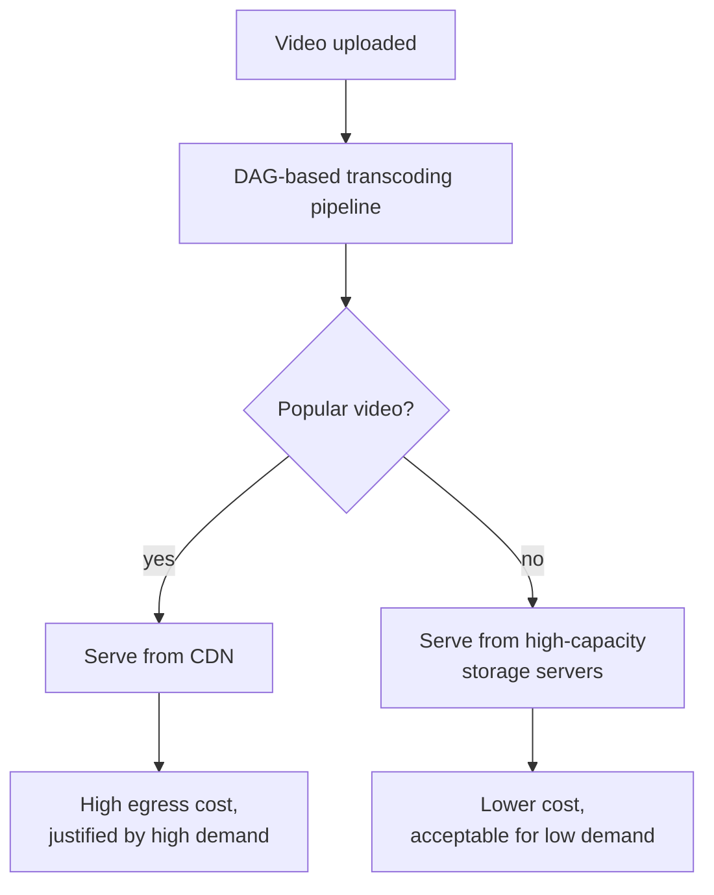

# Chapter 14: Design YouTube

> [!cite] Book reference
> *System Design Interview: An Insider's Guide, Second Edition* by Alex Xu. Chapter 14: "Design YouTube." Source: the user's uploaded EPUB file.

> [!summary] One-line takeaway
> A video platform splits into two parallel flows, upload (store, transcode via a DAG-based pipeline, distribute to CDN) and streaming (serve from the nearest edge via a chosen streaming protocol); nearly every real optimization in the chapter exists to tame CDN cost, which the back-of-envelope math reveals is enormous by default.

## Why this chapter matters

This is the book's most infrastructure-heavy chapter, leaning almost entirely on existing cloud services (CDN, blob storage) rather than building new primitives from scratch, which is itself an explicit, stated interview strategy. It is also the most complex single pipeline in the book, the video transcoding architecture, and its DAG-based model is a reusable pattern for any computationally expensive, highly parallelizable processing pipeline, not just video.

## Direct quotes from the book

> [!quote] On why not build everything yourself
> "System design interviews are not about building everything from scratch. Within the limited time frame, choosing the right technology to do a job right is more important than explaining how the technology works in detail."

> [!quote] On the real cost of CDN
> "From the rough cost estimation, we know serving videos from the CDN costs lots of money. Even though cloud providers are willing to lower the CDN costs significantly for big customers, the cost is still substantial."

> [!quote] On why transcoding is necessary
> "Raw video consumes large amounts of storage space. An hour-long high definition video recorded at 60 frames per second can take up a few hundred GB of space."

> [!quote] On the key cost-saving insight
> "Previous research shows that YouTube video streams follow long-tail distribution. It means a few popular videos are accessed frequently but many others have few or no viewers."[^11][^12]

## The chapter in full (so you never need to re-read it)

### Why this problem is harder than it looks

The book opens with 2020-era YouTube statistics to establish genuine scale: 2 billion monthly active users, 5 billion videos watched per day, 73% of US adults using the platform, 50 million creators, $15.1 billion in 2019 ad revenue (up 36% year over year), 37% of all mobile internet traffic, and availability in 80 languages.[^1][^2] The point is explicit: despite looking simple (upload, click play), enormous infrastructure sits underneath.

### Step 1: understand the problem and establish design scope

The interviewer scopes the interview tightly: the core features are uploading and watching a video; supported clients are mobile apps, web browsers, and smart TVs; 5 million DAU; 30 minutes average daily time spent; a large international user base; broad support for most video resolutions and formats; encryption required; a 1 GB maximum video size, explicitly targeting small-to-medium videos rather than full-length films; and explicit encouragement to leverage existing cloud infrastructure rather than building everything from scratch.

**Requirements**: fast uploads; smooth streaming; the ability to change video quality; low infrastructure cost; high availability, scalability, and reliability; and support across mobile, web, and smart TV.

**Back-of-the-envelope estimation**: at 5 million DAU, 5 videos watched per day per user, and 10% of users uploading one video per day, with an average video size of 300 MB, daily upload storage comes to 150 TB (5,000,000 * 10% * 300 MB). For CDN cost specifically, using AWS CloudFront pricing as a reference point at $0.02/GB (assuming all US traffic, for simplicity),[^3] streaming alone costs roughly $150,000 per day (5,000,000 users * 5 videos * 0.3 GB * $0.02). The book is explicit that this number, while reducible at scale through negotiated enterprise pricing, remains substantial regardless, setting up the cost-saving optimizations covered later.

### Step 2: propose a high-level design

**Why lean on existing cloud services.** The book gives two direct reasons: in a time-boxed interview, choosing the right existing technology for a job matters more than explaining its internals (naming blob storage for source videos is sufficient; designing blob storage itself would be overkill); and building scalable blob storage or a CDN from scratch is genuinely difficult and costly, with the book noting that even Netflix runs on AWS[^4] and Facebook uses Akamai's CDN,[^5] rather than building either themselves.

**Three top-level components**: the **client** (computer, mobile phone, smart TV); the **CDN**, where videos are stored and streamed from on playback; and **API servers**, handling everything except the video stream itself (feed recommendations, generating upload URLs, updating the metadata database and cache, user signup, and so on).

**Video uploading flow, components:** a user; a load balancer distributing requests across API servers; API servers themselves; a sharded, replicated metadata DB; a metadata cache; original storage, a blob store for the as-uploaded source video (the book quotes Wikipedia's definition of a BLOB, binary large object, as a collection of binary data stored as a single entity);[^6] transcoding servers, which convert the source video into other formats and bitrates for different devices and bandwidth levels; transcoded storage, a separate blob store for the converted outputs; the CDN itself; a completion queue, a message queue carrying transcoding-completion events; and a completion handler, a pool of workers pulling those events and updating the metadata store accordingly.

**The upload flow runs as two parallel processes:**

- **Flow a, uploading the actual video.** The video lands in original storage; transcoding servers fetch it and begin transcoding; once transcoding finishes, two things happen in parallel, the transcoded output moves to transcoded storage and then distributes to the CDN, while a completion event is simultaneously queued, picked up by completion-handler workers, which update the metadata database and cache; finally, the API servers tell the client the video is ready to stream.
- **Flow b, updating metadata.** Concurrently with the file upload itself, the client sends a separate request carrying metadata (filename, size, format, and so on), which API servers write into the metadata cache and database directly.

**Video streaming flow.** Streaming, unlike downloading, lets a device begin playback before the full file transfers, loading small chunks continuously instead. Before describing the flow itself, the book introduces the concept of a streaming protocol, a standardized way to control video data transfer, naming four real examples: MPEG-DASH (Dynamic Adaptive Streaming over HTTP), Apple HLS (HTTP Live Streaming), Microsoft Smooth Streaming, and Adobe HTTP Dynamic Streaming (HDS). The book is explicit that memorizing these names is unnecessary; what matters is understanding that different protocols support different encodings and playback clients, so choosing the right one for your use case is the real design decision.[^7] Streaming itself happens directly from the CDN, with the edge server geographically nearest the viewer delivering the content, keeping latency low.

### Step 3: design deep dive

**Video transcoding, why it matters.** A camera or phone encodes video in whatever native format it uses; for smooth playback elsewhere, that video needs re-encoding into compatible bitrates and formats (bitrate being the rate bits are processed over time; higher bitrate generally means higher quality, at the cost of more processing power and faster network requirements). Four concrete reasons transcoding is necessary: raw video consumes enormous storage (the book's own example: an hour of 60fps high-definition footage can run to a few hundred GB); many devices and browsers only support specific formats, so compatibility requires re-encoding; quality should adapt to the viewer's actual bandwidth, serving higher resolution to high-bandwidth connections and lower resolution to constrained ones; and network conditions change in real time, especially on mobile, so automatic or manual quality switching mid-playback matters for a smooth experience.

Most encoding formats split into two parts: the **container** (the "basket" holding video, audio, and metadata together, identifiable by file extension, .avi, .mov, .mp4) and the **codec** (the compression/decompression algorithm, with H.264, VP9, and HEVC named as the most widely used).

**The DAG (directed acyclic graph) model.** Transcoding is computationally expensive and time-consuming, and different content creators need genuinely different processing (watermarks for some, self-supplied thumbnails for others, high-definition source video for yet others). To support this variability while staying highly parallel, the book adopts a DAG-based task model, citing Facebook's own streaming video engine as direct precedent and inspiration.[^8] In this model, a video splits into video, audio, and metadata tracks, each of which can then run through its own tasks: inspection (checking for quality issues or malformed files), video encoding (producing different resolutions, codecs, and bitrates), thumbnail generation (either user-supplied or auto-generated), and watermarking (an identifying image overlay).

**Video transcoding architecture, six components:**

- **Preprocessor.** Four jobs: splitting video into Group of Pictures (GOP) chunks, independently playable segments usually a few seconds long; handling older clients or browsers that cannot split video themselves, by performing GOP splitting server-side instead; generating the actual DAG from configuration files content programmers write (the book's own example shows a minimal two-node, one-edge DAG built directly from such a configuration); and caching segmented video and metadata in temporary storage, specifically so a failed encoding step can retry from persisted data rather than restarting from scratch.
- **DAG scheduler.** Breaks a DAG into discrete stages of tasks and places them into the resource manager's task queue. The book's own example: an original video splits into a first stage (video, audio, metadata), with the video track then splitting further into a second stage covering video encoding and thumbnail generation, while the audio track's second-stage task is audio encoding.
- **Resource manager**, built from three queues plus a task scheduler: a task queue (a priority queue of pending tasks), a worker queue (tracking worker utilization), a running queue (tracking currently bound task/worker pairs), and the task scheduler itself, which pulls the highest-priority pending task, finds the best available worker for it, instructs that worker to execute it, records the binding in the running queue, and removes the entry once the job completes.
- **Task workers.** Execute the individual DAG-defined tasks; different workers can specialize in different task types.
- **Temporary storage.** A mix of storage types chosen by data shape: metadata, small and frequently accessed, suits an in-memory cache; video and audio data, large, suits blob storage. Everything in temporary storage is freed once its corresponding processing step completes.
- **Encoded video**, the pipeline's final output (the book's own example filename: `funny_720p.mp4`).

**System optimizations, speed.** Three distinct techniques: **parallelize uploading** by splitting a video into GOP-aligned chunks client-side before upload, which both speeds up transfer and allows resuming just the failed chunk rather than restarting the whole upload on failure; **place upload centers near users**, implemented via CDN-based regional upload centers (the book's example: a North America center and an Asia center), so users upload to whichever is geographically closest; and **build parallelism throughout the pipeline** by introducing message queues between stages that would otherwise depend synchronously on each other's output (the book's own before/after: without a queue, the encoding module must wait on the download module's output directly; with a queue in between, the encoding module can process whatever events are already queued, in parallel, without blocking on the exact timing of the upstream stage).

**System optimizations, safety.** **Pre-signed upload URLs**: the client first requests a scoped, temporary upload URL from API servers (the book notes this exact term is AWS S3's terminology; Microsoft Azure calls the equivalent feature a Shared Access Signature[^10]), then uploads directly to that URL, ensuring only authorized clients can write to the correct storage location. **Protecting copyrighted content**, three named options: DRM systems (Apple FairPlay, Google Widevine, Microsoft PlayReady); AES encryption paired with an authorization policy, decrypting content only for authorized viewers at playback time; and visual watermarking, an identifying overlay such as a company logo.

**Cost-saving optimizations.** Grounded directly in cited research showing YouTube's own video access pattern follows a long-tail distribution, a small number of videos account for the overwhelming majority of views, with most videos getting very few or none.[^11][^12] Four concrete optimizations follow from this single observation: serve only the most popular videos from the (expensive) CDN, and route everything else through cheaper, high-capacity storage servers instead; skip pre-generating every encoded version for unpopular, especially short, content, encoding it on demand only when actually requested; skip distributing region-specific popular content globally, when it is genuinely only popular in one region; and, at sufficiently large scale, build an owned CDN and partner directly with ISPs (the book's own example: Netflix's approach, partnering with providers like Comcast, AT&T, and Verizon), a massive undertaking that only makes economic sense for the largest streaming companies. The book stresses that every one of these decisions should be grounded in actual historical viewing-pattern analysis, not assumption.[^12][^13]

**Error handling.** The book separates failures into two categories: **recoverable errors** (for example, a video segment that fails to transcode), handled with a retry policy, falling back to a proper error response to the client only if retries are exhausted and the system judges the failure unrecoverable; and **non-recoverable errors** (for example, a malformed video format), where running tasks for that video are stopped immediately and an appropriate error is returned without retrying. A component-by-component playbook follows directly: upload errors retry a few times; clients too old to split by GOP fall back to server-side splitting; transcoding errors retry; preprocessor errors trigger DAG regeneration; DAG scheduler errors trigger task rescheduling; a downed resource-manager queue fails over to a replica; a downed task worker has its task retried on a different worker; downed API servers are simply bypassed, since they are stateless, with traffic routed elsewhere; a downed metadata cache node is covered by replication, with a replacement brought up to restore full redundancy; a downed database master gets a slave promoted in its place; and a downed database slave is covered by reading from another slave while a replacement is provisioned.

### Step 4: wrap-up

With extra time, the book names: scaling the stateless API tier horizontally, which is straightforward precisely because it holds no state; scaling the database via the now-familiar replication and sharding; **live streaming**, which shares uploading, encoding, and streaming in common with the chapter's main design, but differs in three concrete ways, a stricter latency requirement (possibly demanding a different streaming protocol), lower need for heavy parallelism (since small chunks already process in near real time rather than being batched), and a different error-handling posture, since any error-recovery step that takes too long is simply unacceptable for a live broadcast; and **video takedowns**, removing content that violates copyright, depicts illegal acts, or is otherwise prohibited, caught either automatically during upload processing or later through user flagging.

## Core concepts (quick-scan version)

See the full upload flow, transcoding architecture, DAG example, and optimization tables in [[Chapter 14 - Video Upload and Transcoding Pipeline]].

| Design question | The book's answer |
|---|---|
| Why not build CDN or blob storage from scratch? | Not a good use of limited interview time; even Netflix and Facebook lean on third-party infrastructure for this |
| Why does transcoding need its own complex pipeline, not a single script? | Different creators need genuinely different processing (watermarks, custom thumbnails, varying source quality); a DAG model supports that variability while staying parallel |
| Why is CDN cost such a central concern? | The back-of-envelope math shows a plausible $150,000/day streaming cost; nearly every later optimization exists to reduce this |
| What single data fact drives the cost optimizations? | Video popularity follows a long-tail distribution, so uniform CDN treatment of all videos is wasteful |
| How does the pipeline stay fault-tolerant? | A specific, component-by-component playbook: retry recoverable failures, fail fast on non-recoverable ones, exploit statelessness and replication everywhere possible |

## First-principles breakdown

The deepest idea underlying this entire chapter is that a video platform's real engineering problem is not storage or playback, it is parallelizing an expensive, heterogeneous transformation pipeline safely. The DAG model exists specifically because different inputs (a watermarked 4K upload versus a plain 480p clip) legitimately need different processing graphs, and a system that tried to hardcode one fixed pipeline for every video would either waste computation on unneeded steps or fail to support legitimate variation. Representing the pipeline as data (a DAG generated from configuration) rather than as code lets the system support new processing requirements without redeploying the pipeline itself, the same kind of abstraction-for-flexibility tradeoff seen in other chapters, just applied to compute graphs instead of data schemas.

The cost-saving section reveals a second, more general principle: uniform infrastructure treatment of non-uniform demand is wasteful, and the fix is always to measure the actual distribution before optimizing. Every one of the four cost-saving techniques (CDN-vs-storage-server split, on-demand encoding for unpopular content, region-scoped distribution, an owned CDN at the largest scale) is a direct consequence of the same single empirical fact, the long-tail popularity distribution, applied at a different point in the system. This is worth noticing as a pattern distinct from this chapter's content: whenever a system's cost scales with "treat every item the same," check first whether the actual usage distribution is uniform; if it clearly is not (and popularity distributions almost never are), differential treatment based on measured demand is very often the single highest-leverage optimization available, cheaper and more effective than any clever technical trick applied uniformly.

## Visual representation

See the full upload flow, DAG example, transcoding architecture, and optimization/error-handling tables in [[Chapter 14 - Video Upload and Transcoding Pipeline]].

## Worked example, built directly in your vault

Built: [[Chapter 14 - Video Upload and Transcoding Pipeline]] in `Claude Notes/Books/System Design Interview/Examples/`, reproducing the full capacity and CDN cost math, both parallel upload flows, the complete six-component transcoding architecture with a worked DAG example, the container-versus-codec distinction, every speed and safety optimization, the four cost-saving techniques, and the full component-by-component error-handling playbook.

## What the book doesn't tell you, community perspective (2025-2026)

- **AV1 has moved from experimental to dominant at the platforms this chapter is modeled on.** YouTube reportedly serves over 75% of its video playback via the AV1 codec as of 2026 (up from roughly 50% in 2024), and Meta reports AV1 powering more than 70% of playback across Facebook, Instagram, and Messenger, a generation beyond the H.264/VP9/HEVC options this chapter names.
- **AV1's real-world bitrate savings are more modest than early lab figures suggested, but still substantial.** Production-preset benchmarks show roughly 30-40% lower bitrate than H.264 and 15-25% lower than HEVC at comparable quality, directly cutting the CDN egress cost this chapter's back-of-envelope math treats as a given.
- **Per-title encoding has reportedly replaced the fixed bitrate ladder this chapter implies.** Rather than encoding every video into the same fixed set of resolutions and bitrates, modern pipelines reportedly tune the encoding ladder per title (or even per shot), with cited 2025-2026 benchmarks showing 18-22% average bitrate reduction versus a fixed ladder, at no measurable quality loss.
- **Concrete CDN break-even economics help quantify this chapter's own cost-saving logic.** At a reported $2 per TB of egress, a video needs roughly 2,000 viewing hours per hour of source footage to break even on its encoding cost; at a much higher $85 per TB, that threshold drops to around 47 hours, a useful concrete anchor for reasoning about exactly when the chapter's "encode unpopular content on demand" strategy actually pays off.
- **Software AV1 encoding carries a real, cited cost tradeoff this chapter's codec discussion does not surface.** Software AV1 encoding (via libaom-av1) runs roughly 10 to 50 times slower than H.264 encoding; hardware AV1 encoders have narrowed that gap substantially but still cost more per job, a direct, current-day instance of the chapter's own "transcoding is computationally expensive" point.

## Deeper commentary, how this applies to your setup specifically

This chapter's DAG-based transcoding architecture is a genuinely reusable pattern well beyond video: any pipeline where different inputs legitimately need different processing graphs (image processing with optional filters, document ingestion with optional OCR or translation steps, ETL pipelines with per-source transformation needs) can borrow this same shape, generate the task graph from configuration, schedule it onto a pool of workers via priority queues, and persist intermediate state for safe retries.

## Practical and actionable takeaways

- [x] Extracted the full capacity and CDN cost estimation, both parallel upload flows, the complete six-component transcoding architecture, every optimization category, and the full error-handling playbook from the source EPUB.
- [x] Built a standalone worked-example note with every flow and table reproduced in full.
- [ ] If you ever build a media-processing pipeline of your own, consider the DAG-from-configuration pattern here as a starting architecture, rather than hardcoding one fixed processing sequence.
- [ ] Revisit this chapter's long-tail cost-saving logic the next time you design any system serving highly uneven demand (not just video), and check whether the same differential-treatment principle applies.

## Questions and things to decide for your own vault

- Do you want a standalone note comparing H.264, VP9, HEVC, and AV1 specifically, since this chapter names the first three and current practice has shifted meaningfully toward the fourth?
- Should "long-tail distribution as a general cost-optimization principle" become its own cross-chapter note, since it is likely to resurface wherever a future chapter touches caching or storage tiering for uneven demand?

## Sources (external, beyond the book)

- [AV1 Encoding in 2026: When It Cuts Your CDN Bill](https://www.forasoft.com/blog/article/av1-codec-production-streaming-2026) — Fora Soft
- [The Developer's Guide to Video Encoding for Streaming: Codecs, Bitrate Ladders, and Cloud Pipelines](https://www.mux.com/articles/video-encoding-for-streaming-developers-guide) — Mux
- [Video Transcoding Pipeline Design](https://sujeet.pro/articles/video-transcoding-pipeline) — Sujeet Jaiswal

## Footnotes

[^1]: YouTube by the numbers: https://www.omnicoreagency.com/youtube-statistics/
[^2]: 2019 YouTube Demographics: https://blog.hubspot.com/marketing/youtube-demographics
[^3]: Cloudfront Pricing: https://aws.amazon.com/cloudfront/pricing/
[^4]: Netflix on AWS: https://aws.amazon.com/solutions/case-studies/netflix/
[^5]: Akamai homepage: https://www.akamai.com/
[^6]: Binary large object: https://en.wikipedia.org/wiki/Binary_large_object
[^7]: Here's What You Need to Know About Streaming Protocols: https://www.dacast.com/blog/streaming-protocols/
[^8]: SVE, Distributed Video Processing at Facebook Scale: https://www.cs.princeton.edu/~wlloyd/papers/sve-sosp17.pdf
[^9]: Weibo video processing architecture (Chinese): https://www.upyun.com/opentalk/399.html
[^10]: Delegate access with a shared access signature: https://docs.microsoft.com/en-us/rest/api/storageservices/delegate-access-with-shared-access-signature
[^11]: YouTube scalability talk by early YouTube employee: https://www.youtube.com/watch?v=w5WVu624fY8
[^12]: Understanding the characteristics of internet short video sharing, A YouTube-based measurement study: https://arxiv.org/pdf/0707.3670.pdf
[^13]: Content Popularity for Open Connect: https://netflixtechblog.com/content-popularity-for-open-connect-b86d56f613b

## Claude's pick, what I'd flag as most important

- The DAG-from-configuration pattern is the single most reusable architectural idea in this chapter, well beyond video; it is worth remembering as a general technique for any system where different inputs legitimately need different processing graphs.
- The long-tail distribution insight is this chapter's real intellectual core: almost every cost-saving technique described is just that one fact applied repeatedly, which is worth noticing explicitly rather than memorizing four separate "optimizations."
- The explicit advice to lean on existing cloud infrastructure, and the stated reasoning for why (interview time constraints, and that even Netflix and Facebook do the same), is a genuinely transferable piece of interview and real-world engineering judgment, not just scope-limiting advice specific to this chapter.

## Related

- Previous: [[Chapter 13 - Design a Search Autocomplete System]]
- Next: [[Chapter 15 - Design Google Drive]]
- MOC: [[System Design Interview - MOC]]
- Worked example: [[Chapter 14 - Video Upload and Transcoding Pipeline]]
