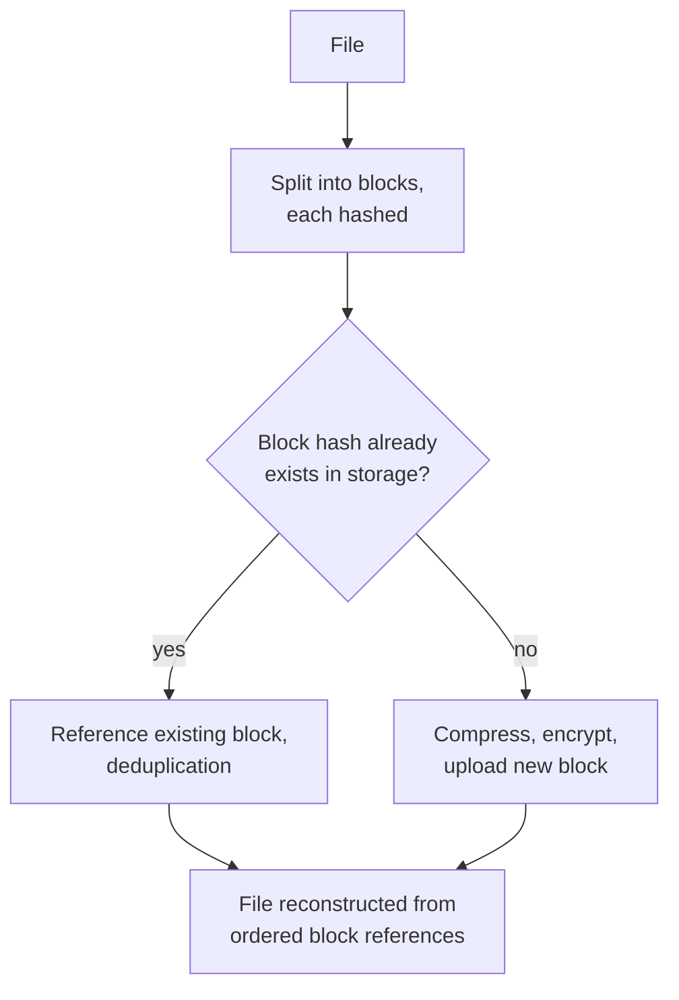

# Chapter 15: Design Google Drive

> [!cite] Book reference
> *System Design Interview: An Insider's Guide, Second Edition* by Alex Xu. Chapter 15: "Design Google Drive." Source: the user's uploaded EPUB file.

> [!summary] One-line takeaway
> A cloud storage service is built on block-level storage (splitting files into hashed, independently stored chunks), which unlocks delta sync and deduplication; the one genuinely hard requirement, strong consistency for metadata, pushes the design toward a relational database specifically because ACID guarantees come for free there and would otherwise have to be rebuilt by hand.

## Why this chapter matters

This chapter walks through the book's most literal "start simple, hit a wall, fix it" narrative, arguably its clearest demonstration of the organic, incremental design process the book has modeled implicitly all along. It also makes the book's only explicit, reasoned case for choosing a relational database over NoSQL specifically because of ACID guarantees, a useful counterweight to Chapter 6's NoSQL-leaning default.

## Direct quotes from the book

> [!quote] On the two excluded features
> "Features not discussed in this chapter include: Google doc editing and collaboration. Google doc allows multiple people to edit the same document simultaneously. This is out of our design scope."

> [!quote] On the consistency requirement
> "Our system requires strong consistency by default. It is unacceptable for a file to be shown differently by different clients at the same time."

> [!quote] On why a relational database, specifically
> "Achieving strong consistency in a relational database is easy because it maintains the ACID (Atomicity, Consistency, Isolation, Durability) properties. However, NoSQL databases do not support ACID properties by default."[^9]

> [!quote] On the sync conflict rule
> "The first version that gets processed wins, and the version that gets processed later receives a conflict."

## The chapter in full (so you never need to re-read it)

### What Google Drive is

A file storage and synchronization service for documents, photos, videos, and other files, accessible from any computer, phone, or tablet, with easy sharing between friends, family, and coworkers.[^1]

### Step 1: understand the problem and establish design scope

The interviewer exchange establishes: core features are upload, download, file sync, and notifications; both mobile and web; any file type is supported; files must be encrypted at rest; a 10 GB file size limit; and 10 million DAU.

**In scope**: adding files (the easiest path being drag-and-drop); downloading files; syncing across multiple devices automatically; viewing file revision history; sharing with others; and notifications when a file is edited, deleted, or shared with the user.

**Explicitly out of scope**: real-time collaborative document editing (Google Docs-style simultaneous multi-user editing), named directly as a separate, much harder problem.

**Non-functional requirements**: reliability (data loss is unacceptable for a storage system); fast sync speed (slow sync drives users away); efficient bandwidth usage (especially important for users on mobile data); scalability; and high availability even when parts of the system degrade.

**Back-of-the-envelope estimation**: 50 million signed-up users, 10 million DAU, each given 10 GB of free storage; users upload 2 files per day, averaging 500 KB each; a 1:1 read-to-write ratio. Total allocated storage: 50 million * 10 GB = 500 petabytes. Upload QPS: 10,000,000 * 2 / 24 / 3,600, about 240; peak QPS roughly double that, about 480.

### Step 2: propose a high-level design

**The book's chosen teaching method here is deliberately incremental**: start from a single server, hit a real wall, fix it, repeat, specifically to reinforce earlier chapters' lessons organically rather than presenting a finished architecture cold.

**Single-server starting point**: one web server (Apache) handling upload/download, one database (MySQL) tracking metadata, and a `drive/` root directory on disk, organized into per-user namespace subdirectories, each holding that user's uploaded files under their original filenames; a file or folder is uniquely addressed by its namespace plus relative path.

**Core APIs, three of them:**

1. **Upload a file.** Two upload types: simple upload for small files, and resumable upload for large files facing real risk of network interruption, implemented as a three-step flow,[^2] retrieve a resumable upload URL first, then upload data while monitoring progress, then resume from where it left off if interrupted.
2. **Download a file**, identified by its path.
3. **List file revisions**, given a path and a limit on how many revisions to return.

Every API requires authentication and runs over HTTPS, with SSL protecting data in transit between client and backend.

**Moving away from a single server, the first real wall**: storage fills up (the book's own dramatized moment: a "10 MB left" space alert). The first fix is sharding storage across multiple servers by `user_id`. This stops the immediate crisis but leaves an unresolved worry: what happens if a single storage server itself goes down, risking permanent data loss. The book's narrative resolves this by moving file storage to Amazon S3,[^3] which supports both same-region and cross-region replication (a region being a geographic area containing AWS data centers; a bucket functioning like a folder), storing redundant copies across regions specifically to guard against data loss and preserve availability.

**Further decoupling, once S3 removes the storage-loss worry**: add a load balancer to spread traffic across web servers and absorb a web server failure by redistributing its load; scale web servers up or down independently of everything else, now that a load balancer sits in front of them; move the metadata database out of the original single server entirely, and apply replication and sharding to it for availability and scalability; and keep file storage on S3, replicated across at least two separate geographic regions for durability.

**Sync conflicts.** When two users modify the same file at nearly the same time, a genuine conflict occurs. The book's resolution rule: whichever update the system processes first wins outright; the other update receives a conflict instead of being silently overwritten. The losing user is then shown both versions, their own local copy and the server's latest version, and chooses to merge the two manually or simply pick one to keep. The book notes explicitly that true simultaneous multi-user editing (Google Docs-style) is a substantially harder problem, pointing interested readers to further material on differential synchronization.[^4][^5]

**High-level design, full component list**: the user (browser or mobile app); block servers, which upload file blocks to cloud storage (block-level storage splits a file into chunks, each with a unique hash stored in the metadata database and stored as an independent object in S3, reassembled in order to reconstruct the full file; the book cites Dropbox's own 4MB maximum block size as a reference point);[^6] cloud storage itself; cold storage, for files that have gone unaccessed for a long time; a load balancer distributing traffic across API servers; API servers, handling everything except the upload flow itself (authentication, profile management, metadata updates); the metadata database, holding metadata only, never the files themselves; a metadata cache for fast reads; a notification service, a publish/subscribe system informing relevant clients when a file is added, edited, or removed elsewhere, so they know to pull the latest version; and an offline backup queue, holding pending changes for clients that are currently offline, so they can sync once they reconnect.

### Step 3: design deep dive

**Block servers and two bandwidth optimizations.** Sending an entire file on every edit wastes bandwidth for large, frequently modified files. Two fixes: **delta sync**, syncing only the specific blocks that actually changed, using a dedicated sync algorithm;[^7][^8] and **compression**, applied per block, with the specific algorithm chosen by file type (gzip or bzip2 for text; different algorithms for images and video). The book's own flow for a newly added file: split into blocks, compress each block, encrypt each block (for security), then upload to cloud storage. For an edited file, the same flow applies, but only to the blocks that actually changed, the book's own example highlighting exactly two changed blocks (block 2 and block 5) out of a larger set, with only those two transferred.

**Strong consistency is a hard, explicit requirement.** It is unacceptable for different clients to see different states of the same file at the same time, and this bar applies to both the metadata cache and database layers. Since memory caches default to eventual consistency (different replicas can briefly disagree), achieving strong consistency requires two things: keeping cache replicas and the master in agreement, and invalidating caches on every database write so cache and database never diverge. The book's stated reason for choosing a relational database here specifically: achieving strong consistency is comparatively easy in a relational database, since it natively maintains ACID properties,[^9] whereas NoSQL databases do not provide ACID by default, and would require that guarantee to be built by hand in application-level synchronization logic instead. This is a direct, explicit design choice in favor of relational over NoSQL, a contrast worth noting against Chapter 6's NoSQL-leaning default for a different kind of problem.

**Metadata database schema**, a deliberately simplified version covering only the most important fields: `User` (username, email, profile photo, and so on); `Device` (device info, including a `push_id` used for mobile push notifications; a user can register multiple devices); `Namespace` (a user's root directory); `File` (everything about the current, latest version of a file); `File_version` (read-only version history rows, preserving revision integrity); and `Block` (everything about an individual file block; joining a version's blocks in the correct order reconstructs that exact version of the file).

**Upload flow**, two requests running in parallel from the client: **add file metadata** (client sends new-file metadata; it is stored with upload status "pending"; the notification service is informed; the notification service tells other relevant clients a file is being uploaded) and **upload the file itself** (client sends file content to block servers; block servers split, compress, and encrypt the file into blocks and upload them to cloud storage; cloud storage triggers a completion callback to API servers once done; file status flips to "uploaded" in the metadata DB; the notification service is informed and in turn tells other relevant clients the file is now fully uploaded). Editing a file follows essentially the same flow, so the book does not repeat it separately.

**Download flow**, triggered whenever a file changes elsewhere. Two ways a client learns about such a change: if it is online, the notification service informs it directly that new changes exist somewhere and it should pull them; if it is offline, the change is cached, and the client picks it up once it reconnects. Once a client knows a change exists, the detailed flow runs: the notification service informs the client; the client requests metadata; API servers fetch that metadata from the metadata DB and return it; once the client has the metadata, it requests the relevant blocks from block servers; block servers fetch those blocks from cloud storage and return them; the client downloads the new blocks and reconstructs the file locally.

**Notification service, protocol choice.** The book weighs long polling (Dropbox's own choice)[^10] against WebSocket, and picks long polling for two reasons specific to this use case: communication here is not actually bidirectional, the server tells the client about changes, never the reverse, and notification events are infrequent with no burst pattern, unlike a chat application's traffic, where WebSocket's bidirectional, persistent-connection strengths are genuinely needed. Mechanically: each client holds a long-poll connection to the notification service; on detecting a relevant change, the client closes that connection, connects to the metadata server to fetch the actual update, and then immediately reopens a fresh long-poll connection, whether it received a real response or simply hit the connection timeout.

**Saving storage space.** Storing full revision history across multiple data centers for reliability can consume storage very quickly. Three mitigations: **deduplicating blocks**, since two blocks sharing the same hash value are identical and only need storing once, at the account level; **an intelligent backup strategy**, either capping the number of stored versions outright (oldest replaced once the cap is hit) or weighting recent versions more heavily for files edited extremely frequently (the book's own example: a document edited over 1,000 times in a short period does not need every single edit preserved; favoring recent versions over an exhaustive history, with the exact cutoff determined experimentally); and **moving cold data to cheaper storage**, specifically citing Amazon S3 Glacier as far cheaper than standard S3 for files inactive for months or years.[^11]

**Failure handling.** Load balancer failure: a secondary load balancer takes over, with health monitored via periodic heartbeat signals between load balancers. Block server failure: other block servers simply pick up its unfinished or pending jobs. Cloud storage failure: since S3 buckets replicate across multiple regions, files unavailable in one region are fetched from another. API server failure: stateless, so traffic simply redirects to a healthy server. Metadata cache failure: replicated across multiple nodes, so a failed node's data remains reachable elsewhere while a replacement is provisioned. Metadata DB failure: a downed master gets a slave promoted in its place (with a new slave brought up to restore redundancy); a downed slave is covered by reading from another slave while a replacement is provisioned. Notification service failure is the most structurally distinct case: since every online client holds its own long-poll connection, and the book cites a 2012 Dropbox talk reporting over 1 million open connections per machine,[^6] a downed notification server drops every one of those connections at once, forcing every affected client to reconnect; even though a single server can sustain many open connections, reconnecting all of them simultaneously is reportedly a comparatively slow process. Offline backup queue failure: queues are replicated, so a failed queue's consumers simply re-subscribe to the backup queue.

### Step 4: wrap-up

The book frames the design's defining combination as strong consistency, low bandwidth usage, and fast sync working together, built from two main flows (managing file metadata, and syncing files) plus the notification service's long-polling mechanism. With remaining time, it raises a genuine design alternative: uploading directly from the client straight to cloud storage, skipping block servers entirely. This would make uploads faster, since the file only transfers once rather than first to block servers and then to cloud storage, but carries two real drawbacks: the same chunking, compression, and encryption logic would then need separate, error-prone reimplementation across every client platform (iOS, Android, web) instead of living centrally on block servers; and client-side encryption is inherently less trustworthy, since a client can be hacked or manipulated far more easily than a centrally controlled server. The book also notes a further architectural evolution worth considering: extracting online/offline presence tracking out of the notification service entirely into its own dedicated presence service, so that functionality becomes reusable by other services beyond just file notifications.

## Core concepts (quick-scan version)

See the full single-server-to-scaled-out progression, block server flow, upload/download flows, and sync conflict resolution in [[Chapter 15 - Google Drive Upload and Sync Flows]].

| Design question | The book's answer |
|---|---|
| Why block-level storage instead of whole-file storage? | Enables delta sync and deduplication, both impossible if files are treated as opaque wholes |
| Why a relational database for metadata? | Native ACID support directly satisfies the hard strong-consistency requirement |
| Why long polling over WebSocket for notifications? | Communication here is one-directional and infrequent; WebSocket's bidirectional strength is not needed |
| How are sync conflicts resolved? | First-processed-wins; the loser is shown both versions and chooses how to reconcile, never silently overwritten |
| How is storage cost controlled for version history? | Deduplication, capped or recency-weighted version retention, and moving cold data to cheaper storage |

## First-principles breakdown

The chapter's real engineering insight is that treating a file as a sequence of independently addressable blocks, rather than as one opaque unit, is what makes nearly every other optimization in the chapter possible at all. Delta sync, deduplication, and parallel block upload all depend on the same underlying fact: a block's identity (its hash) is independent of which file or version it belongs to, so the system can detect "this exact content already exists somewhere" regardless of where it was first seen. This is the same core idea Chapter 6 used for Merkle trees and Chapter 9 used for content deduplication, applied here specifically to file storage rather than key-value replication or crawled pages.

The explicit choice of a relational database for metadata, against this book's general NoSQL-leaning tendency in other chapters, is worth treating as a genuine, principled exception rather than an inconsistency. The deciding factor is not "relational is generally better," it is that this specific requirement (strong consistency, stated as a hard, non-negotiable bar) happens to be a native, built-in property of relational databases via ACID, while achieving the same guarantee in a NoSQL store would mean reimplementing that property by hand. This models a more general, transferable principle: choose infrastructure based on which guarantees it provides natively for your hardest, least-negotiable requirement, not by defaulting to whichever technology felt right in a previous, differently-shaped problem.

Where this chapter's design draws an explicit, honest boundary: real-time collaborative editing (two people typing in the same document simultaneously) is named outright as a fundamentally harder problem, requiring operational transformation or CRDT-style techniques this chapter does not attempt to solve. The sync-conflict rule (first-processed-wins, show both copies) works precisely because it assumes conflicts are rare, occasional events between otherwise-independent edits, an assumption that breaks down completely under genuine simultaneous co-editing, where conflicts would be constant rather than occasional.

## Visual representation

See the full single-server-to-scaled-out progression, block server pipeline, delta sync diagram, upload/download flows, and sync conflict resolution in [[Chapter 15 - Google Drive Upload and Sync Flows]].

## Worked example, built directly in your vault

Built: [[Chapter 15 - Google Drive Upload and Sync Flows]] in `Claude Notes/Books/System Design Interview/Examples/`, reproducing the full capacity math, the single-server-to-scaled-out architectural journey, the block-server pipeline with delta sync, both the upload and download flows in full, the sync-conflict resolution logic, the long-polling-versus-WebSocket tradeoff, and all three storage-saving techniques.

## What the book doesn't tell you, community perspective (2025-2026)

- **Dropbox's real conflict-resolution behavior is reported to match this chapter's approach closely, with a specific naming convention.** Rather than attempting an automatic merge, Dropbox reportedly saves the losing edit as a distinctly named "conflicted copy" file (for example, appending the conflicting user's name and a timestamp to the filename), leaving the user to manually reconcile the two, essentially the same first-processed-wins-plus-show-both-copies strategy this chapter describes.
- **Dropbox's actual delta sync implementation is reported to use SHA-256 hashing over roughly 4MB blocks** (matching the exact block size this chapter cites from Dropbox as a reference point), with reported bandwidth savings exceeding 60% for typical editing patterns, a concrete, measured figure for the abstract benefit this chapter describes.
- **CRDTs and operational transformation are explicitly reserved for real-time co-editing, not general file sync, in reported production practice**, directly confirming this chapter's own boundary: these far more complex conflict-resolution techniques are considered worthwhile specifically for Google Docs-style simultaneous editing, and considered overkill for ordinary, infrequent file sync conflicts like the ones this chapter handles.
- **More sophisticated active-active storage architectures reportedly apply vector clocks to file metadata itself**, the same conflict-detection mechanism Chapter 6 introduced for key-value store replicas, now applied to multi-primary file metadata replication rather than to the file content, suggesting this chapter's simpler first-processed-wins rule is itself a simplification of a more general distributed-systems technique already covered earlier in the book.

## Deeper commentary, how this applies to your setup specifically

The single-server-to-scaled-out narrative this chapter walks through is worth treating as a template for thinking about your own future systems: rather than trying to design the final, fully scaled architecture up front, identify the next concrete failure a simple design will actually hit (as this chapter does explicitly: storage fills up, then a storage server might die, then a single web server becomes a bottleneck), and let each real constraint motivate exactly one specific fix, in the order those constraints would actually bite.

## Practical and actionable takeaways

- [x] Extracted the full single-server-to-scaled-out journey, the complete block-server and delta-sync design, both upload and download flows, the sync-conflict resolution rule, and all storage-saving techniques from the source EPUB.
- [x] Built a standalone worked-example note with every flow and the capacity math reproduced in full.
- [ ] Compare this chapter's relational-database-for-ACID choice against Chapter 6's NoSQL-leaning key-value store design, and write out explicitly what specific requirement flips the decision each way.
- [ ] If you ever build or study a real sync system, check whether its conflict resolution matches this chapter's first-processed-wins-plus-show-both-copies rule, or uses something more sophisticated (CRDTs, vector clocks on metadata), and understand why.

## Questions and things to decide for your own vault

- Do you want a standalone cross-chapter note comparing every place this book chooses relational versus NoSQL (Chapter 6's key-value default, this chapter's relational-for-ACID choice), since the two chapters reach opposite conclusions for principled, not arbitrary, reasons?
- Should "block-level deduplication via content hashing" become its own cross-chapter reference note, given it is now the third chapter (after 6 and 9) to lean on the same hash-based identity trick in a different context?

## Sources (external, beyond the book)

- [Cloud Sync Conflicts and Scaling for Teams](https://sesamedisk.com/cloud-storage-synchronization-conflicts/) — Sesame Disk
- [Delta Sync and Merkle Trees](https://www.systemdesignsandbox.com/learn/delta-sync) — System Design Sandbox
- [File Storage System Design (Dropbox / Google Drive), FAANG Interview Guide](https://intervu.dev/blog/file-storage-dropbox-google-drive-system-design/)

## Footnotes

[^1]: Google Drive: https://www.google.com/drive/
[^2]: Upload file data: https://developers.google.com/drive/api/v2/manage-uploads
[^3]: Amazon S3: https://aws.amazon.com/s3
[^4]: Differential Synchronization: https://neil.fraser.name/writing/sync/
[^5]: Differential Synchronization, YouTube talk: https://www.youtube.com/watch?v=S2Hp_1jqpY8
[^6]: How We've Scaled Dropbox: https://youtu.be/PE4gwstWhmc
[^7]: Tridgell, A., and Mackerras, P. (1996). The rsync algorithm.
[^8]: Librsync: https://github.com/librsync/librsync
[^9]: ACID: https://en.wikipedia.org/wiki/ACID
[^10]: Dropbox security white paper: https://www.dropbox.com/static/business/resources/Security_Whitepaper.pdf
[^11]: Amazon S3 Glacier: https://aws.amazon.com/glacier/faqs/

## Claude's pick, what I'd flag as most important

- Block-level storage (splitting files into independently hashed chunks) is this chapter's single foundational idea; delta sync, deduplication, and parallel upload are all downstream consequences of that one architectural choice, not independent features.
- The explicit, reasoned choice of relational over NoSQL here, because ACID is native and ACID is what strong consistency actually needs, is a genuinely useful counterexample to keep alongside Chapter 6's NoSQL default; the lesson is "choose based on the requirement," never "always prefer X."
- The single-server-to-scaled-out narrative structure is itself worth remembering as a design and storytelling technique, both for interviews and for real system design: motivating each architectural addition with a concrete failure it fixes is more persuasive, and more honest, than presenting a finished architecture with no visible reasoning behind it.

## Related

- Previous: [[Chapter 14 - Design YouTube]]
- Next: [[Chapter 16 - The Learning Continues]]
- MOC: [[System Design Interview - MOC]]
- Worked example: [[Chapter 15 - Google Drive Upload and Sync Flows]]
