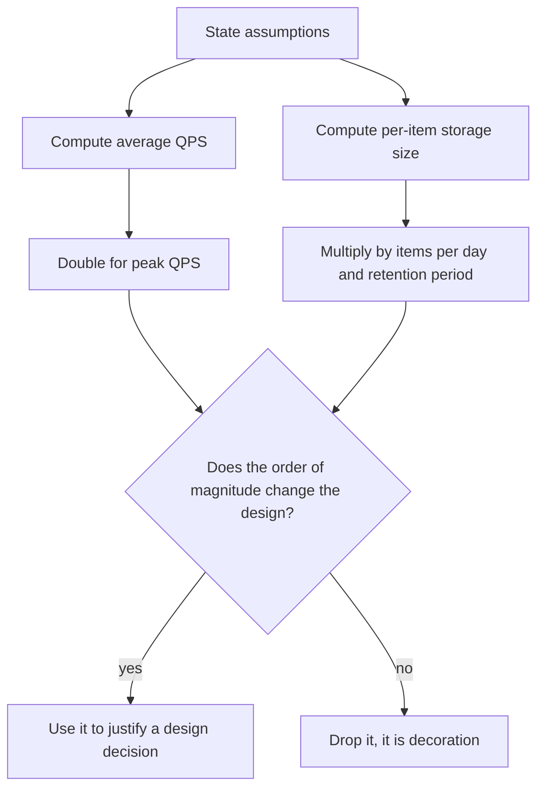

# Chapter 2: Back-of-the-Envelope Estimation

> [!cite] Book reference
> *System Design Interview: An Insider's Guide, Second Edition* by Alex Xu. Chapter 2: "Back-of-the-Envelope Estimation." Source: the user's uploaded EPUB file.

> [!summary] One-line takeaway
> Back-of-the-envelope estimation is a small, memorizable toolkit (powers of two, latency numbers, availability nines, a QPS formula) used to sanity-check whether a design can plausibly meet its capacity and performance requirements.

## Why this chapter matters

Chapter 1 built an architecture; this chapter gives you the arithmetic to size it. Every later "design X" chapter in the book opens its own estimation section using exactly this toolkit, so this chapter is read once and reused constantly, never revisited chapter by chapter the way a "design X" chapter is.

## Direct quotes from the book

> [!quote] On what back-of-the-envelope estimation is
> "Back-of-the-envelope calculations are estimates you create using a combination of thought experiments and common performance numbers to get a good feel for which designs will meet your requirements."[^1]

> [!quote] On what matters in the interview
> "Back-of-the-envelope estimation is all about the process. Solving the problem is more important than obtaining results."

> [!quote] On precision
> "There is no need to spend valuable time to solve complicated math problems. Precision is not expected."

> [!quote] On labeling units
> "When you write down '5', does it mean 5 KB or 5 MB? You might confuse yourself with this. Write down the units because '5 MB' helps to remove ambiguity."

## The chapter in full (so you never need to re-read it)

### Why this skill exists

In a system design interview, you are sometimes asked to estimate system capacity or performance requirements, and the book opens by quoting Jeff Dean, a Google Senior Fellow, on what back-of-the-envelope calculations actually are: thought experiments combined with common performance numbers, used to judge whether a design will meet its requirements.[^1] Doing this well, the chapter argues, depends on three pieces of background knowledge: the power of two, latency numbers every programmer should know, and availability numbers.

### Power of two

Distributed systems deal in enormous data volumes, but every calculation reduces to the same basics. A byte is 8 bits, and one ASCII character takes one byte of memory. From there the standard unit ladder follows powers of two: kilobyte, megabyte, gigabyte, terabyte, petabyte, each roughly a thousand times the one before it (the book's own Table 2-1 lays this out precisely; it is reproduced in full in the worked-example cheat sheet linked below).

### Latency numbers every programmer should know

The chapter brings in Dr. Jeff Dean's well-known table of typical computer operation times, originally from 2010.[^1] The book is upfront that some of these numbers have aged as hardware improved, but argues they still convey the right intuition about relative speed. A Google engineer later built a visualization of these numbers that also accounts for how perception of "fast" and "slow" shifts over time, and the book's Figure 2-1 reproduces that visualization as of 2020.[^3]

Four conclusions the book draws directly from this table:

- Memory is fast, but disk is slow.
- Avoid disk seeks if at all possible.
- Simple compression algorithms are fast, so compress data before sending it over the internet if you can.
- Data centers usually sit in different regions, and moving data between them takes real, measurable time.

### Availability numbers

High availability means a system stays continuously operational for a long period, measured as a percentage, where 100% means zero downtime. Most real services land somewhere between 99% and 100%. A service level agreement (SLA) formally defines, between a provider and a customer, the uptime level the provider promises to deliver. The book notes that Amazon,[^4] Google,[^5] and Microsoft[^6] all set SLAs at 99.9% or higher for their cloud compute services. Uptime is conventionally expressed "in nines": more nines means less allowed downtime, and the book's Table 2-3 maps each nines level to its corresponding downtime budget (reproduced in the worked-example cheat sheet below).

### Worked example: estimating Twitter's QPS and storage

The book walks a full estimation end to end, explicitly noting the numbers are invented for the exercise and are not real Twitter figures.

**Stated assumptions:**
- 300 million monthly active users
- 50% of users use the product daily
- Each user posts 2 tweets per day, on average
- 10% of tweets include media
- Data is retained for 5 years

**Query-per-second (QPS) estimate:**
- Daily active users (DAU): 300 million times 50%, giving 150 million
- Tweet QPS: 150 million users times 2 tweets, divided by 24 hours, divided by 3,600 seconds, giving roughly 3,500
- Peak QPS: about double the average, giving roughly 7,000

**Media storage estimate**, using an average tweet made of a 64-byte tweet ID, 140 bytes of text, and, where present, 1 MB of media:
- Daily media storage: 150 million times 2 tweets times 10% times 1 MB, giving 30 TB per day
- Five-year media storage: 30 TB times 365 days times 5 years, giving roughly 55 PB

### Tips for the interview itself

The book frames the exercise as being about process, not precision, and names four concrete habits:

1. **Round and approximate aggressively.** A problem like "99,987 divided by 9.1" wastes interview time for no benefit; simplify it to "100,000 divided by 10" and move on. Precision is not the goal.
2. **Write down your assumptions.** State them explicitly so you, and your interviewer, can refer back to them.
3. **Label your units.** A bare "5" is ambiguous between 5 KB and 5 MB; always write the unit.
4. **Practice the common estimation types**, specifically QPS, peak QPS, storage, cache size, and number of servers, since these repeat across almost every system design interview.

## Core concepts (quick-scan version)

| Concept | What it gives you | Rule of thumb from the book |
|---|---|---|
| Powers of two | Converting row/request counts into storage sizes | 1 KB ~ 10^3, 1 MB ~ 10^6, 1 GB ~ 10^9, and so on |
| Latency numbers | Relative cost of memory, disk, network, cross-region calls | Memory fast, disk slow, cross-region round trips cost real time |
| Availability nines | Translating an SLA percentage into an actual downtime budget | More nines, less downtime, harder and costlier to hit |
| QPS formula | Sizing a service's request load | Average QPS from DAU and actions per day, then double for peak |
| Storage formula | Sizing a service's data footprint | Per-item size, times items per day, times retention period |

## First-principles breakdown

The book's real claim is narrower than "learn these tables": an estimate is only useful if a wrong guess would have changed the design decision downstream. Precision is explicitly not the goal, which only makes sense once you notice that every number here feeds into a decision with wide tolerance bands, for example whether you need one server or ten, not whether you need exactly seven or exactly eight. Community critique (below) sharpens this into an even more basic principle: compute a number only if a design decision actually depends on its order of magnitude. If the design would not change whether the true answer is 10 times larger or 10 times smaller, the calculation is decoration, not analysis.

This also explains why the book insists on writing down assumptions and rounding aggressively, two moves that look sloppy in isolation. An assumption, once written down, becomes a hypothesis a reviewer (or interviewer) can challenge directly, which is more valuable than a hidden assumption buried in unstated precision. Rounding aggressively keeps the arithmetic fast enough that it stays a tool for reasoning about the design, rather than becoming the task itself.

Where this stops working: the latency table is already acknowledged in the book as partly outdated from its 2010 origin, and the chapter does not update it for current hardware (SSD and NVMe storage, modern network fabrics, and so on). Treat the table's absolute numbers as illustrative, not current, and lean on its relative ordering (memory beats network beats disk) instead, which has held up far better than its specific nanosecond figures.

## Visual representation

## Worked example, built directly in your vault

Built: [[Chapter 2 - Estimation Cheat Sheet]] in `Claude Notes/Books/System Design Interview/Examples/`, reproducing the book's own powers-of-two table, latency numbers table, availability nines table, and the full Twitter QPS/storage worked example, plus a reusable five-step estimation template for every later chapter.

## What the book doesn't tell you, community perspective (2025-2026)

- **"False precision" is the single most common failure mode practitioners flag.** Multiple 2025-2026 guides name the core error as not arithmetic, but carrying exact-looking figures through a calculation that started from a guess. One source puts it bluntly: using an exact 86,400 instead of a rounded 10^5 for seconds in a day signals you missed the point of the exercise.
- **A real, recurring critique is that estimation can become theater with no payoff.** A widely discussed practitioner thread describes the exercise, done without being tied to any decision, as "the arithmetic was correct and the exercise was decoration." The suggested fix mirrors this chapter note's first-principles section above: only compute a number if a materially different answer would change the design.
- **Some engineers report that top-tier interviewers do not expect this step at all.** A community discussion thread captures the view that at some companies, interviewers are more interested in the design conversation than in watching a candidate do napkin math, treating full back-of-the-envelope estimation as optional rather than mandatory.
- **2025-2026 interview prep sources note the latency table's blind spot around AI workloads.** Reference numbers written years before today's AI-infrastructure boom did not account for GPU-bound inference latency, batching trade-offs, or embedding caches now showing up inside otherwise-classic system design problems.

## Deeper commentary, how this applies to your setup specifically

For a learning vault, the most useful habit from this chapter is treating the five-step template in the worked-example note as a forcing function: before accepting any "design X" chapter's own capacity numbers at face value, run the same five steps yourself and compare. That turns a read-only book chapter into deliberate practice, and it is a good test of whether you actually understand why each later chapter reaches the specific numbers it reaches.

## Practical and actionable takeaways

- [x] Extracted the chapter's tables (powers of two, latency, availability) and worked example from the source EPUB.
- [x] Built a reusable, standalone estimation cheat sheet and template.
- [ ] When reading each later "design X" chapter, pause at its own capacity-estimate section and redo the math yourself using the five-step template before reading the book's answer.
- [ ] Decide whether to keep a running "estimation practice log" elsewhere in the vault, tracking your own QPS/storage guesses against the book's answers over time.

## Questions and things to decide for your own vault

- Do you want updated, current-hardware latency numbers added as a second table alongside the book's original 2010/2020 figures, or is the book's original table enough since the relative ordering still holds?
- Should the reusable estimation template eventually become an Obsidian template file (in `05-Templates/`) you can insert with a hotkey, rather than only living inside this worked-example note?

## Sources (external, beyond the book)

- [Back-of-the-Envelope, Revisited](https://www.designgurus.io/course-play/advanced-system-design-fundamentals/doc/backoftheenvelope-revisited)
- [The calculation that makes System Design interviews feel scary, but should not](https://www.mhayk.com/2026/07/21/system-design-how-to-estimate-scale-without-panic/)
- [Do you really need to do back of the envelope calculations/estimates to succeed in System Design interviews?](https://www.teamblind.com/post/Do-you-really-need-to-do-back-of-the-envelope-calculationsestimates-to-succeed-in-System-Design-interviews-NezgkYY6) — Blind
- [The System Design Interview Trap in 2026: Why Engineers Fail and How to Succeed?](https://medium.com/@fahimulhaq/the-system-design-interview-trap-why-engineers-fail-and-how-to-succeed-a3984b16c35c) — Fahim ul Haq, Medium

## Footnotes

[^1]: J. Dean, "Google Pro Tip: Use Back-Of-The-Envelope-Calculations To Choose The Best Design": http://highscalability.com/blog/2011/1/26/google-pro-tip-use-back-of-the-envelope-calculations-to-choo.html
[^2]: System design primer: https://github.com/donnemartin/system-design-primer
[^3]: Latency Numbers Every Programmer Should Know: https://colin-scott.github.io/personal_website/research/interactive_latency.html
[^4]: Amazon Compute Service Level Agreement: https://aws.amazon.com/compute/sla/
[^5]: Compute Engine Service Level Agreement (SLA): https://cloud.google.com/compute/sla
[^6]: SLA summary for Azure services: https://azure.microsoft.com/en-us/support/legal/sla/summary/

## Claude's pick, what I'd flag as most important

- The real skill in this chapter is not the arithmetic; it is deciding which numbers are even worth computing. That filter (would a 10x-wrong answer change the design) is more valuable long-term than any individual table.
- Rounding and labeling units are not shortcuts, they are correctness habits. An unlabeled "5" is a latent bug in your own reasoning, not just an interview faux pas.
- Treat the 2010-era latency table as a ranking, not a lookup table. Its ordering (memory, then network within a data center, then disk, then cross-region) has aged far better than its specific nanosecond values.

## Related

- Previous: [[Chapter 1 - Scale From Zero to Millions of Users]]
- Next: [[Chapter 3 - A Framework for System Design Interviews]]
- MOC: [[System Design Interview - MOC]]
- Worked example: [[Chapter 2 - Estimation Cheat Sheet]]
