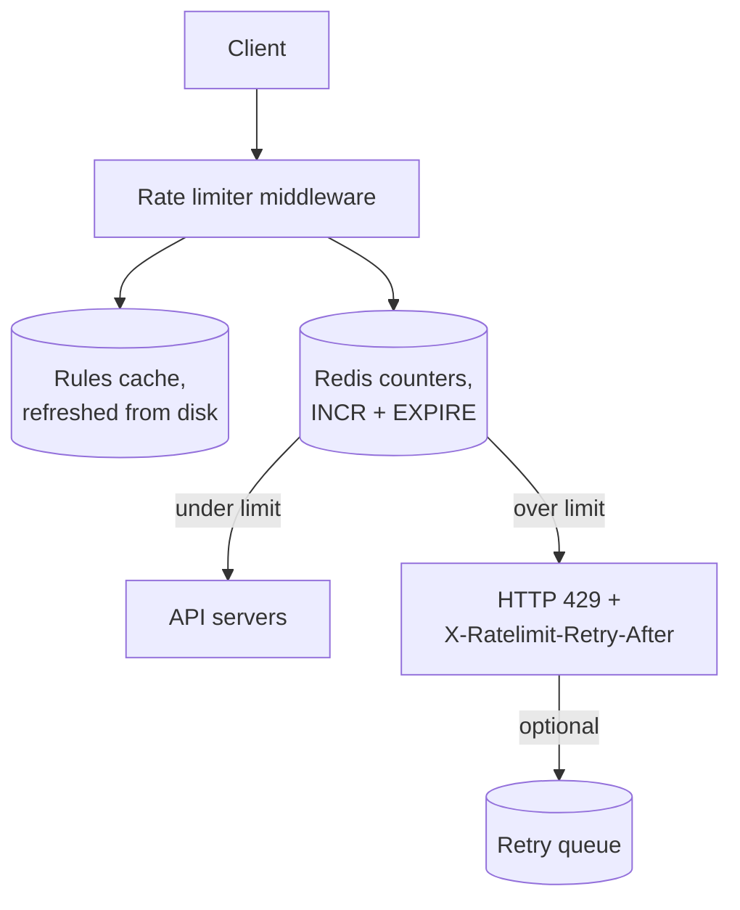

# Chapter 4: Design a Rate Limiter

> [!cite] Book reference
> *System Design Interview: An Insider's Guide, Second Edition* by Alex Xu. Chapter 4: "Design a Rate Limiter." Source: the user's uploaded EPUB file.

> [!summary] One-line takeaway
> A rate limiter is a counter-plus-threshold problem at heart; the interesting engineering is in choosing the right counting algorithm for your traffic shape, and in making that counter survive being shared across many stateless servers.

## Why this chapter matters

This is the first "design X" chapter in the book, and it is the first place the 4-step framework from Chapter 3 gets applied end to end against a real problem. It also reintroduces the stateless web tier and shared data store ideas from Chapter 1, now applied specifically to a counter that must be consistent across servers.

## Direct quotes from the book

> [!quote] On what a rate limiter is
> "In the HTTP world, a rate limiter limits the number of client requests allowed to be sent over a specified period. If the API request count exceeds the threshold defined by the rate limiter, all the excess calls are blocked."

> [!quote] On client-side enforcement
> "Client is an unreliable place to enforce rate limiting because client requests can easily be forged by malicious actors. Moreover, we might not have control over the client implementation."

> [!quote] On the sliding window counter's real-world accuracy
> "According to experiments done by Cloudflare, only 0.003% of requests are wrongly allowed or rate limited among 400 million requests."[^10]

> [!quote] On race conditions
> "Both requests (threads) believe they have the correct counter value 4. However, the correct counter value should be 5."

## The chapter in full (so you never need to re-read it)

### What a rate limiter is and why you want one

A rate limiter controls the rate of traffic a client or service is allowed to send, for example capping a user to 2 posts per second, 10 account creations per day from one IP, or 5 reward claims per week from one device. The book names three concrete benefits before any design begins:

- **Preventing resource starvation from denial-of-service attacks**,[^1] intentional or not. Nearly every large API enforces some form of this: Twitter caps tweets at 300 per 3 hours,[^2] and Google Docs' API defaults to 300 read requests per user per 60 seconds.[^3]
- **Reducing cost.** Fewer excess requests means fewer servers, and tighter spend on metered third-party APIs, for example credit checks, payments, or health-record lookups, which are commonly billed per call.
- **Preventing server overload** caused by bots or simple user misbehavior.

### Step 1: understand the problem and establish design scope

The chapter's interviewer exchange establishes a server-side API rate limiter (not client-side), flexible enough to throttle by IP, user ID, or other properties, built for a large user base, running in a distributed environment, with the implementation choice (standalone service vs. embedded in application code) left to the candidate, and with a requirement to inform throttled users.

Requirements summary:

- Accurately limit excessive requests.
- Low latency; the limiter must not slow down HTTP response time.
- Minimal memory use.
- Distributed rate limiting, shareable across multiple servers or processes.
- Clear exceptions returned to throttled users.
- High fault tolerance: a rate limiter failure (for example its cache server going offline) must not take down the rest of the system.

### Step 2: propose a high-level design

**Where to put the rate limiter.** Client-side enforcement is unreliable, since client requests can be forged and you may not control the client's implementation at all. Server-side placement is the default; a third option is a dedicated rate-limiting middleware in front of the API servers, which is effectively what a cloud API gateway provides (a fully managed service that often also handles SSL termination, authentication, and IP whitelisting[^4]). The book's own worked example: with a limit of 2 requests per second, a client sending 3 requests in one second gets its first two routed through and its third rejected with HTTP 429 (too many requests).

The choice between building this on your own servers versus in a gateway depends on your stack, your team's engineering bandwidth, and your business priorities. The book's guidance: check whether your current language and cache stack make server-side rate limiting efficient; recognize that server-side gives you full control over the algorithm while a third-party gateway may constrain your choices; if you already run a microservice architecture with an API gateway doing authentication and IP whitelisting, adding rate limiting there is a natural fit; and if you lack the engineering resources to build your own, a commercial gateway is the pragmatic choice.

**The five algorithms.** The chapter surveys five, each with distinct tradeoffs:

1. **Token bucket.** A bucket with fixed capacity accumulates tokens at a preset rate; once full, new tokens overflow and are discarded. Each request consumes one token; if tokens are available, the request proceeds and a token is removed, otherwise the request is dropped. Parameters: bucket size (maximum tokens) and refill rate (tokens added per second). The number of buckets needed depends on the rules: separate buckets per API endpoint (for example one for posting, one for friend requests, one for likes), per IP address if throttling by IP, or one shared global bucket for a system-wide cap. Widely used in practice: both Amazon[^5] and Stripe[^6] rely on it. Pros: easy to implement, memory efficient, naturally allows short bursts of traffic as long as tokens remain. Cons: the two parameters (bucket size, refill rate) can be genuinely hard to tune correctly.
2. **Leaking bucket.** Similar in spirit, but requests process at a strictly fixed rate, typically via a FIFO queue. An incoming request is enqueued if the queue is not full, otherwise dropped; the system pulls and processes requests from the queue at regular intervals. Parameters: bucket (queue) size and outflow rate. Shopify uses this approach for its own rate limiting.[^7] Pros: memory efficient given a bounded queue, and a stable, predictable outflow rate. Cons: a burst of traffic fills the queue with old requests, so if they are not drained in time, newer requests get rate limited even though they just arrived; the two parameters are, again, not trivial to tune.
3. **Fixed window counter.** The timeline divides into fixed-size windows, each with its own counter; every request increments its window's counter by one; once the counter crosses a predefined threshold, further requests in that window are dropped until the next window begins. Pros: memory efficient, easy to understand, and quota resets neatly at window boundaries for use cases that want that. Cons: a serious edge-of-window problem. The book's own example: a system allowing 5 requests per minute sees 5 requests between 2:00:00-2:01:00 and 5 more between 2:01:00-2:02:00, both individually within quota, but the 1-minute window from 2:00:30-2:01:30 lets 10 requests through, twice the allowed rate.
4. **Sliding window log.** Fixes the fixed-window edge problem by tracking individual request timestamps, usually in a Redis sorted set.[^8] On a new request: remove timestamps older than the start of the current rolling window, add the new request's timestamp to the log, and accept the request only if the resulting log size does not exceed the allowed count. The book's own worked trace, for a limit of 2 requests per minute: a request at 1:00:01 is allowed into an empty log; a request at 1:00:30 brings the log to size 2, still allowed; a request at 1:00:50 brings the log to size 3, exceeding the limit of 2, so it is rejected (its timestamp still stays logged); a request at 1:01:40 triggers removal of the two now-outdated timestamps (1:00:01 and 1:00:30), dropping the log back to size 2, so the new request is accepted. Pros: very accurate, no rolling window will ever exceed the stated rate limit. Cons: memory-heavy, since even rejected requests' timestamps remain stored.
5. **Sliding window counter.** A hybrid of fixed window counter and sliding window log. The book's worked formula: `requests in rolling window = requests in current window + requests in previous window * overlap percentage of the rolling window with the previous window`. Worked example: limit of 7 requests per minute, 5 requests in the previous minute, 3 so far in the current minute, and a new request arriving 30% into the current minute (so the rolling window overlaps 70% of the previous minute): `3 + 5 * 0.7 = 6.5`, rounded down to 6, which is under the limit of 7, so the request is allowed, though the very next request would hit the cap. Pros: smooths out traffic spikes since the rate is based on the previous window's average, and stays memory efficient. Cons: it is only an approximation, since it assumes requests were evenly distributed within the previous window; the book cites Cloudflare's own measurement that this inaccuracy affected only 0.003% of requests across 400 million measured requests, suggesting the approximation holds up well in practice.[^10]

**High-level architecture.** At a high level, a rate limiter is a counter per user, IP, or other key, compared against a limit. Databases are too slow for this due to disk access latency, so an in-memory cache is used instead, commonly Redis, which offers `INCR` (increment the stored counter by 1) and `EXPIRE` (set a timeout after which the counter auto-deletes).[^11] The resulting flow: a client's request hits the rate-limiting middleware, which fetches the relevant counter from Redis and checks it against the limit; if the limit is reached, the request is rejected; otherwise it proceeds to the API servers, and the counter is incremented and saved back to Redis.

### Step 3: design deep dive

**Rate limiting rules.** The book shows real examples from Lyft's open-sourced rate-limiting component:[^12] a YAML-style rule capping marketing messages to 5 per day, and another capping login attempts to 5 per minute. Rules like these are typically written in configuration files and stored on disk, not hardcoded.

**Handling a request that exceeds its limit.** The API returns HTTP 429 (too many requests). Depending on the use case, the request can instead be enqueued for later processing rather than simply dropped, for example holding orders rate-limited by a system overload for later fulfillment rather than rejecting them outright.

**Rate limiter response headers.** Three headers communicate throttling state back to the client: `X-Ratelimit-Remaining` (requests left in the current window), `X-Ratelimit-Limit` (the window's total allowance), and `X-Ratelimit-Retry-After` (seconds to wait before trying again, sent alongside the 429).

**Detailed design.** Rules live on disk; workers periodically pull them into a cache. A client's request hits the rate-limiter middleware first, which loads rules from cache and fetches counters and last-request timestamps from the Redis cache; based on that, it either forwards the request to the API servers, or returns a 429 and either drops the request or forwards it to a queue.

### Rate limiter in a distributed environment

Running on one server is straightforward; scaling to many servers introduces two distinct problems.

**Race conditions.** The counter check-then-increment pattern (read the counter, check whether incrementing it would exceed the threshold, write it back) is unsafe under concurrency. The book's own trace: if the counter sits at 3 and two requests read it concurrently before either writes back, both independently compute 4 and write 4, when the correct final value should have been 5. Locks are the obvious fix, but they slow the system down meaningfully. The two commonly used alternatives are a Lua script (which runs atomically inside Redis) and Redis's sorted-set data structure.[^8][^13]

**Synchronization.** Supporting millions of users typically requires more than one rate limiter server. Because the web tier is stateless, a given client's requests may land on different rate-limiter instances over time; if those instances do not share state, each one has an incomplete, locally inconsistent view of that client's usage, and the rate limiter stops working correctly. Sticky sessions are one possible fix, pinning a client to one rate-limiter instance, but the book advises against this since it is neither scalable nor flexible. The better approach is a centralized data store, again Redis, that every rate-limiter instance reads from and writes to.

### Performance optimization

Two areas the book highlights:

- **Multi-data-center deployment.** Latency climbs for users far from your data center, so the book recommends the same edge-server pattern used by major cloud providers; as of May 2020, it cites Cloudflare running 194 geographically distributed edge servers,[^14] automatically routing traffic to the nearest one.
- **Eventual consistency for cross-node synchronization.** Rather than paying for strong consistency between rate-limiter nodes, the book recommends an eventual consistency model, and points forward to Chapter 6's "Consistency" section for a full treatment of what that means.

### Monitoring

Once deployed, the book recommends tracking two things: whether the chosen algorithm is actually effective, and whether the configured rules are effective. If rules are too strict, valid requests get dropped and should be relaxed; if the algorithm becomes ineffective under a sudden traffic spike, for example a flash sale, it may need to be swapped out, and the book specifically names token bucket as a good fit for absorbing burst traffic.

### Step 4: wrap-up and further talking points

The book closes by naming three additional topics worth raising if interview time allows:

- **Hard versus soft rate limiting.** Hard limiting never allows the threshold to be exceeded; soft limiting tolerates a brief overage.
- **Rate limiting at other OSI layers.** The chapter's own design operates at layer 7 (application, HTTP); rate limiting by IP address using Iptables operates at layer 3 (network) instead.[^15] The book lists the OSI model's full 7 layers for reference: physical, data link, network, transport, session, presentation, application.[^16]
- **Client-side best practices to avoid being rate limited**: cache responses client-side to avoid redundant calls, understand your own limits and pace requests accordingly, catch exceptions so the client degrades gracefully, and build sufficient backoff into retry logic.

## Core concepts (quick-scan version)

See the full comparison table, decision tree, and Redis implementation diagram in [[Chapter 4 - Rate Limiter Algorithms Reference]].

| Requirement | How the design meets it |
|---|---|
| Low latency | In-memory Redis counters, not database reads |
| Distributed consistency | Centralized Redis store, not sticky sessions |
| Accurate limiting | Algorithm choice (log/counter variants) matched to accuracy needs |
| Fault tolerance | Rate limiter failure should fail open or degrade, not take down the API tier |
| Clear client feedback | HTTP 429 plus `X-Ratelimit-*` headers |

## First-principles breakdown

Every algorithm in this chapter is answering the same underlying question differently: how much memory are you willing to spend to know exactly how many requests happened in exactly the right window of time? Fixed window counter spends the least memory and gets the least accurate answer (the edge-of-window doubling problem). Sliding window log spends the most memory (a timestamp per request) and gets a perfectly accurate answer. Token bucket, leaking bucket, and sliding window counter all sit in between, trading some accuracy or some flexibility for a fixed, small memory footprint.

This reframes the "which algorithm should I pick" question as a single first-principles test, not a memorization exercise: does your traffic have legitimate bursts you must tolerate (token bucket), does it need a strictly fixed output rate regardless of input bursts (leaking bucket), or does it just need to be fair at window boundaries cheaply (sliding window counter)? Sliding window log is the special case you reach for only when the 0.003% approximation error sliding window counter carries (per Cloudflare's own measurement) is actually unacceptable for your use case, which for most APIs it is not.

The race-condition section reveals a second, more general principle underneath the whole chapter: any counter shared across concurrent writers needs either atomicity (a single operation that reads and writes together, as Lua scripting and Redis sorted sets provide) or strong consistency enforced through locking, and locking is explicitly rejected here because it is too slow for a system this latency-sensitive. The chapter's answer, atomic operations over locks, is really just restating the chapter's own requirement list: low latency and distributed correctness are both non-negotiable, so the solution space narrows to mechanisms that give you both at once.

## Visual representation

## Worked example, built directly in your vault

Built: [[Chapter 4 - Rate Limiter Algorithms Reference]] in `Claude Notes/Books/System Design Interview/Examples/`, with a decision tree for choosing an algorithm, a full side-by-side comparison table, both of the book's own worked numeric examples (the fixed-window edge problem and the sliding-window-counter formula) reproduced step by step, the Redis implementation diagram, and a distributed-deployment checklist.

## What the book doesn't tell you, community perspective (2025-2026)

- **A simple heuristic has emerged for choosing between the two most common algorithms in production**: "do legitimate clients burst? Yes, use token bucket. No, use sliding window counter." This matches the book's own pros/cons but compresses them into a single practical question engineers report actually using day to day.
- **Token bucket handles variable request cost well, something the book does not emphasize.** Production write-ups describe assigning different token costs per endpoint, for example a bulk export costing 10 tokens against a simple status check costing 1, letting one bucket represent genuinely different load profiles rather than treating every request as equal.
- **A common production pattern trades a small accuracy loss for large latency savings**: local, in-memory rate limiters per server, periodically synced asynchronously to a central Redis store, accepting roughly 1% enforcement error rather than adding a network round trip (reported around 5 ms) to every single request. This sits between the book's "single Redis store" design and a fully local, unsynchronized one.
- **Clock drift is a sharper real-world problem for token bucket than the book discusses.** Because refill timing depends on elapsed time since the last refill, clock skew across distributed nodes can meaningfully distort the effective rate, a failure mode worth testing for explicitly if you implement this for real.
- **Cloudflare's own published number for sliding window counter accuracy is more specific than the book's single percentage**: a mean difference of about 6% between the estimated and true rate, alongside the 0.003% mis-classification rate the book already cites, giving a fuller picture of exactly how approximate this algorithm is in practice.

## Deeper commentary, how this applies to your setup specifically

If you build a personal project with any public-facing API, this chapter is the single most directly reusable one in the book so far: the Redis `INCR`/`EXPIRE` pattern, or a managed equivalent, is genuinely the right default for almost any small-to-medium service, and picking token bucket versus sliding window counter using the one-question heuristic above is enough to start, without needing to implement sliding window log at all.

## Practical and actionable takeaways

- [x] Extracted all five algorithms, their parameters, pros, cons, and the book's own two worked numeric examples from the source EPUB.
- [x] Built a reusable algorithm-comparison and decision-tree reference, plus a distributed-deployment checklist.
- [ ] If you build a real API, decide now which of the five algorithms fits your actual traffic shape, using the one-question heuristic from the community research above.
- [ ] Revisit the "eventual consistency" pointer once you reach Chapter 6, and confirm you understand why the book explicitly defers that explanation there.

## Questions and things to decide for your own vault

- Do you want a small, runnable code sample (for example a Redis Lua script implementing sliding window counter) added to this book's `Examples/` folder, or does the algorithmic description above suffice for a learning vault?
- Should rate limiting get its own cross-chapter glossary entry, given it is referenced again later (Chapter 6's consistency section, and likely again in later distributed-systems chapters)?

## Video

[Rate Limiter System Design: Token Bucket, Leaky Bucket, Scaling](https://www.youtube.com/watch?v=YXkOdWBwqaA) — matches this chapter's exact topic and algorithm set.

## Sources (external, beyond the book)

- [Rate-limiting algorithms compared: token bucket, leaky bucket, sliding window, and fixed window](https://blog.arcjet.com/rate-limiting-algorithms-token-bucket-vs-sliding-window-vs-fixed-window/) — Arcjet
- [From Token Bucket to Sliding Window: Pick the Perfect Rate Limiting Algorithm](https://api7.ai/blog/rate-limiting-guide-algorithms-best-practices) — API7.ai
- [Token Bucket vs. Sliding Window: Building Rate Limiters That Actually Hold Under Load](https://dev.to/darshilsomani019/token-bucket-vs-sliding-window-building-rate-limiters-that-actually-hold-under-load-4h7i) — DEV Community

## Footnotes

[^1]: Rate-limiting strategies and techniques: https://cloud.google.com/solutions/rate-limiting-strategies-techniques
[^2]: Twitter rate limits: https://developer.twitter.com/en/docs/basics/rate-limits
[^3]: Google docs usage limits: https://developers.google.com/docs/api/limits
[^4]: IBM microservices: https://www.ibm.com/cloud/learn/microservices
[^5]: Throttle API requests for better throughput: https://docs.aws.amazon.com/apigateway/latest/developerguide/api-gateway-request-throttling.html
[^6]: Stripe rate limiters: https://stripe.com/blog/rate-limiters
[^7]: Shopify REST Admin API rate limits: https://help.shopify.com/en/api/reference/rest-admin-api-rate-limits
[^8]: Better Rate Limiting With Redis Sorted Sets: https://engineering.classdojo.com/blog/2015/02/06/rolling-rate-limiter/
[^9]: System Design, Rate limiter and Data modelling: https://medium.com/@saisandeepmopuri/system-design-rate-limiter-and-data-modelling-9304b0d18250
[^10]: How we built rate limiting capable of scaling to millions of domains: https://blog.cloudflare.com/counting-things-a-lot-of-different-things/
[^11]: Redis website: https://redis.io/
[^12]: Lyft rate limiting: https://github.com/lyft/ratelimit
[^13]: Scaling your API with rate limiters: https://gist.github.com/ptarjan/e38f45f2dfe601419ca3af937fff574d#request-rate-limiter
[^14]: What is edge computing: https://www.cloudflare.com/learning/serverless/glossary/what-is-edge-computing/
[^15]: Rate Limit Requests with Iptables: https://blog.programster.org/rate-limit-requests-with-iptables
[^16]: OSI model: https://en.wikipedia.org/wiki/OSI_model#Layer_architecture

## Claude's pick, what I'd flag as most important

- The "do legitimate clients burst" heuristic is worth memorizing over all five algorithms individually; it collapses the whole decision into one question you can answer in seconds, in an interview or in a real design review.
- The race-condition section is a small, self-contained case study in why "read, check, write" patterns are unsafe under concurrency, a pattern that recurs constantly outside rate limiting too.
- Rejecting sticky sessions here is the same lesson as Chapter 1's stateless-web-tier section, applied to a counter instead of a user session; it is worth noticing these are the same underlying tradeoff.

## Related

- Previous: [[Chapter 3 - A Framework for System Design Interviews]]
- Next: [[Chapter 5 - Design Consistent Hashing]]
- MOC: [[System Design Interview - MOC]]
- Worked example: [[Chapter 4 - Rate Limiter Algorithms Reference]]
