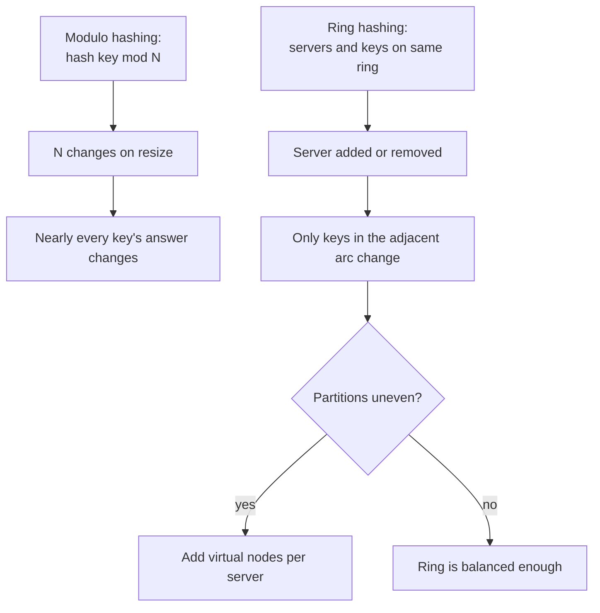

# Chapter 5: Design Consistent Hashing

> [!cite] Book reference
> *System Design Interview: An Insider's Guide, Second Edition* by Alex Xu. Chapter 5: "Design Consistent Hashing." Source: the user's uploaded EPUB file.

> [!summary] One-line takeaway
> Plain `hash(key) % N` rebalances almost everything when N changes; consistent hashing fixes this by mapping both servers and keys onto a ring, so a membership change only moves the keys sitting in the affected arc.

## Why this chapter matters

Chapter 1 flagged resharding as a core problem with its modulo-based sharding example and pointed forward to this chapter for the fix. This chapter delivers that fix, and the resulting technique becomes a recurring building block: Chapter 6's key-value store, and several of the distributed-systems-heavy chapters later in the book, assume you already understand the ring.

## Direct quotes from the book

> [!quote] On the core definition
> "Consistent hashing is a special kind of hashing such that when a hash table is re-sized and consistent hashing is used, only k/n keys need to be remapped on average, where k is the number of keys, and n is the number of slots. In contrast, in most traditional hash tables, a change in the number of array slots causes nearly all keys to be remapped."[^1]

> [!quote] On the failure mode this solves
> "This means that when server 1 goes offline, most cache clients will connect to the wrong servers to fetch data. This causes a storm of cache misses."

> [!quote] On why virtual nodes exist
> "As the number of virtual nodes increases, the distribution of keys becomes more balanced. This is because the standard deviation gets smaller with more virtual nodes, leading to balanced data distribution."

## The chapter in full (so you never need to re-read it)

### The rehashing problem

A common load-balancing approach for n cache servers uses `serverIndex = hash(key) % N`. The book's own example: 4 servers and 8 string keys, each assigned via this formula. This works cleanly while the server pool size stays fixed and data distribution is even. The problem surfaces the moment a server is added or removed. If server 1 goes offline, N drops from 4 to 3; the same keys produce the same hash values, but `hash % 3` now routes almost every key to a different server than `hash % 4` did, not just the keys that happened to live on the removed server. The practical consequence is severe: most cache clients suddenly contact the wrong server, producing a storm of cache misses across the system. Consistent hashing exists specifically to prevent this.

### Consistent hashing, defined

The book quotes Wikipedia directly: consistent hashing, when a hash table resizes, remaps only `k/n` keys on average, where k is the key count and n is the slot count, in sharp contrast to traditional hashing, where a slot-count change remaps nearly everything.[^1]

### Hash space and the hash ring

Using SHA-1 as the hash function, the output space runs from 0 to 2^160 minus 1. Plotting that entire range and then connecting its two ends produces a ring. Servers get mapped onto this ring using the same hash function, typically applied to server IP or name; the book's example places 4 servers on the ring this way. Keys get mapped onto the same ring using a different hashing step (notably, with no modular operation this time).

### Server lookup

To find which server owns a given key, walk clockwise from the key's position on the ring until you reach the first server. In the book's 4-server, 4-key example, each key maps cleanly to the server immediately clockwise from it.

### Adding a server

With this clockwise-lookup rule, adding a new server only requires redistributing the keys that now fall between the new server and the previous server clockwise from it. The book's example: adding server 4 only moves key0, since server 4 becomes the new first-server-clockwise from key0's position; key1, key2, and key3 are entirely unaffected, because their nearest clockwise server has not changed.

### Removing a server

Symmetrically, removing a server only redistributes the keys that were assigned to it; everything else is untouched. The book's example: removing server 1 only remaps key1, which moves to server 2 (the new first server clockwise from its position); the rest of the keys stay exactly where they were.

### Two problems with the basic ring approach

The underlying algorithm traces back to Karger et al. at MIT.[^1] Its basic steps are simple: map servers and keys onto the ring with a uniformly distributed hash function, then walk clockwise from a key to find its server. Two problems emerge in practice:

1. **Uneven partition sizes.** A partition is the hash space between two adjacent servers on the ring. Because server placement depends on where their hashes happen to land, partitions can end up wildly uneven in size. The book's example: if server s1 is removed, server s2's partition can end up twice the size of s0's and s3's partitions, purely as an artifact of where those servers happened to hash onto the ring.
2. **Non-uniform key distribution.** Similarly, depending on where servers land, most keys can end up concentrated on one server while others sit nearly empty. The book's own illustrative case has most keys landing on server 2, with server 1 and server 3 holding none at all.

### Virtual nodes

The fix for both problems is virtual nodes (also called replicas): instead of placing each physical server once on the ring, each server is represented by many points on the ring. The book's example uses 3 virtual nodes per server for illustration (`s0_0`, `s0_1`, `s0_2` for server 0, and similarly for server 1), noting explicitly that real-world systems use far more than 3. Lookup logic is unchanged: walk clockwise from a key until the first virtual node is found, then map that virtual node back to its real server. The book's example: key k0 resolves, going clockwise, to virtual node `s1_1`, which belongs to server 1.

More virtual nodes produce a more balanced distribution, because the standard deviation of load across servers shrinks as virtual node count grows. The book cites an outside experiment showing standard deviation around 10% of the mean at 100 virtual nodes per server, improving to around 5% at 200 virtual nodes.[^2] This is a genuine tradeoff, not a free win: more virtual nodes means more memory spent storing virtual-node metadata, so the right count is tuned to the system's actual requirements.

### Finding the affected keys on a membership change

When a server joins or leaves, you need to know exactly which keys require redistribution. The rule is symmetric in both directions: starting from the changed node's position, walk anticlockwise around the ring until you hit the previous server; every key in that arc is affected. The book's examples: adding server 4 affects the keys between s3 and s4 (moving to s4); removing server 1 affects the keys between s0 and s1 (moving to s2, the next server clockwise from the removed s1).

### Wrap-up: benefits and real-world adoption

The book closes by naming three concrete benefits of consistent hashing:

- Minimizes the number of keys redistributed when servers are added or removed.
- Makes horizontal scaling easier, since data ends up more evenly distributed.
- Mitigates the hotspot/celebrity key problem (first raised back in Chapter 1): if data for several extremely popular accounts, the book's own recurring example is Katy Perry, Justin Bieber, and Lady Gaga, happened to land on the same shard under naive sharding, consistent hashing's more even distribution reduces the odds of that concentration happening in the first place.

The chapter lists five real, named systems using consistent hashing in production: the partitioning component of Amazon's Dynamo database,[^3] data partitioning across the cluster in Apache Cassandra,[^4] Discord's chat application,[^5] Akamai's content delivery network,[^6] and Google's Maglev network load balancer.[^7]

## Core concepts (quick-scan version)

See the full ring diagrams, add/remove walkthroughs, and the virtual-node tuning table in [[Chapter 5 - Consistent Hashing Ring Walkthrough]].

| Concept | What it fixes | Cost |
|---|---|---|
| Hash ring (servers and keys on the same ring) | Modulo hashing's full-reshuffle problem on resize | None beyond the hashing step itself |
| Clockwise lookup rule | Deterministic, stable key-to-server mapping | A lookup walk, typically implemented via a sorted structure, not a literal scan |
| Virtual nodes | Uneven partition sizes and non-uniform key distribution | More memory to store virtual-node metadata per server |
| Anticlockwise affected-range rule | Knowing exactly which keys to redistribute on a membership change | None; this is a property of the ring, not an added cost |

## First-principles breakdown

The entire chapter reduces to one structural idea: locality of change. Under modulo hashing, a server count change alters every key's modular result simultaneously, because N appears in the divisor for every single key's computation; there is no way to change N without touching every key's answer. Under ring hashing, a server's position only affects the narrow arc of keys physically adjacent to it on the ring; everything else's nearest-clockwise-server computation is entirely unaffected, because it was never a function of total server count in the first place.

This explains why virtual nodes are a tuning knob, not a separate fix: they do not change the locality property at all, they simply add more "adjacency points" per server, so each server's slice of the ring gets sampled more finely and evenly. More virtual nodes is strictly a variance-reduction mechanism on top of a correctness property (locality of change) that the plain ring already provides.

The community research below reveals where this chapter's specific implementation stops being the only answer: the ring is one way to achieve O(k/n) remapping, not the only way. Jump consistent hash achieves similar locality with zero stored state, at the cost of only supporting append/remove-from-the-end membership changes, not arbitrary removal. Rendezvous hashing achieves arbitrary removal with zero stored state too, at the cost of a lookup that scales linearly with node count, which becomes genuinely slow at thousands of nodes. The book's choice (ring plus virtual nodes) is the right general-purpose default, explicitly because it is the only one of the three that handles arbitrary removal cheaply while keeping lookup cost low, not because it is unconditionally best.

## Visual representation

See the ring diagrams, the add/remove walkthroughs, and the virtual-node standard-deviation table in [[Chapter 5 - Consistent Hashing Ring Walkthrough]].

## Worked example, built directly in your vault

Built: [[Chapter 5 - Consistent Hashing Ring Walkthrough]] in `Claude Notes/Books/System Design Interview/Examples/`, reproducing the book's own modulo-hashing failure case, the ring lookup rule, the add-server and remove-server walkthroughs, the virtual-node standard-deviation table, and a new comparison table weighing the ring against jump consistent hash, rendezvous hashing, and Maglev.

## What the book doesn't tell you, community perspective (2025-2026)

- **Rendezvous (HRW) hashing predates Karger's consistent hashing paper by a year** (Thaler and Ravishankar, 1996) and achieves arbitrary node removal with zero stored ring state, by computing `hash(key, server)` against every server and picking the highest scorer. Its real-world cost: benchmarks at 5,000 nodes show it taking roughly 7,300 microseconds per lookup, over 2,000 times slower than a ring lookup's roughly 3.4 microseconds, because it must hash against every node on every lookup.
- **Jump consistent hash** gives near-perfect balance with O(ln N) lookup time and no stored state at all, but it only supports adding or removing buckets at the end of a sequential ID range, not arbitrary mid-list removal, which limits it to specific storage backends where that constraint is acceptable.
- **Maglev**, Google's own network load balancer (already cited in the book itself), precomputes a lookup permutation table for O(1) lookups; the cost shows up at membership-change time, since the table must be rebuilt rather than incrementally patched.
- **2025-2026 practical guidance converges on a simple decision rule**: use the ring with virtual nodes as the default; use jump hash specifically when there is no place to persist state and your shard count only grows; use rendezvous hashing below a few dozen nodes where exact per-node weighting and simple failover ordering matter more than raw lookup speed; use Maglev when lookups must be O(1) at very large scale and membership changes are comparatively rare.
- **Newer research beyond this book's scope**: AnchorHash (2020) rehashes into a fixed, pre-allocated anchor set; MementoHash (2023) keeps a small record of removed buckets specifically to handle random failures without requiring a fixed capacity ceiling, reportedly outperforming AnchorHash on average-case lookup time.

## Deeper commentary, how this applies to your setup specifically

This chapter is a good one to revisit once you reach Chapter 6's key-value store design, since that chapter builds its own data partitioning directly on top of this ring, including virtual nodes. If you are tracking open questions across chapters in one place, this is a natural spot to cross-reference Chapter 1's "resharding data" problem and Chapter 6's partitioning section once you reach it, to see the same underlying idea solved at three different points in the book.

## Practical and actionable takeaways

- [x] Extracted the full ring mechanism, the two identified problems, the virtual-node fix, and the five real-world adopters from the source EPUB.
- [x] Built a standalone worked-example note with ring diagrams and a comparison against modern alternatives not covered in the book.
- [ ] When you reach Chapter 6 (key-value store), check how its partitioning scheme reuses or extends this chapter's ring and virtual-node ideas.
- [ ] Decide whether a future "design X" chapter in this book ever calls for jump hash, rendezvous hashing, or Maglev instead of the book's default ring approach, and note why.

## Questions and things to decide for your own vault

- Do you want a single cross-chapter note tracking every place "the celebrity/hotspot problem" reappears across this book (Chapter 1's sharding section, this chapter's wrap-up, and likely later chapters), rather than re-explaining it locally each time?
- Should the comparison table of ring vs. jump hash vs. rendezvous vs. Maglev live only in this chapter's worked example, or does it deserve its own standalone reference note if later chapters also reference these alternatives?

## Video

[Consistent Hashing | Algorithms You Should Know #1](https://www.youtube.com/watch?v=UF9Iqmg94tk) — ByteByteGo's own video on this exact topic, from the book's own authors.

## Sources (external, beyond the book)

- [Consistent Hashing Algorithms: Jump Hash vs Ring Hash vs Rendezvous Hash](https://umitunal.net/2025/09/consistent-hashing-algorithms-jump-hash-vs-ring-hash-vs-rendezvous-hash/) — Umit Unal
- [Consistent hashing: rendezvous hashing and jump consistent hash](https://saifhatem.substack.com/p/consistent-hashing-rendezvous-hashing) — Saif Hatem
- [Consistent hashing architecture, ring, virtual nodes, bounded loads, variants](https://aicassindra.com/blogs/algorithms/algo_consistent_hash.html) — Belgavi.AI Lab

## Footnotes

[^1]: Consistent hashing: https://en.wikipedia.org/wiki/Consistent_hashing
[^2]: Consistent Hashing: https://tom-e-white.com/2007/11/consistent-hashing.html
[^3]: Dynamo, Amazon's Highly Available Key-value Store: https://www.allthingsdistributed.com/files/amazon-dynamo-sosp2007.pdf
[^4]: Cassandra, A Decentralized Structured Storage System: http://www.cs.cornell.edu/Projects/ladis2009/papers/Lakshman-ladis2009.PDF
[^5]: How Discord Scaled Elixir to 5,000,000 Concurrent Users: https://blog.discord.com/scaling-elixir-f9b8e1e7c29b
[^6]: CS168, The Modern Algorithmic Toolbox, Lecture 1, Introduction and Consistent Hashing: http://theory.stanford.edu/~tim/s16/l/l1.pdf
[^7]: Maglev, A Fast and Reliable Software Network Load Balancer: https://static.googleusercontent.com/media/research.google.com/en//pubs/archive/44824.pdf

## Claude's pick, what I'd flag as most important

- Locality of change is the one idea in this chapter worth internalizing deeply; virtual nodes, the affected-range rule, and every alternative algorithm in the community research are all just different trade-offs around that same core property.
- The chapter's own hotspot-problem callback (Katy Perry, Justin Bieber, Lady Gaga) ties directly back to Chapter 1 and is worth tracking as a running thread across the book, since it reappears again in the sharding sections of later chapters.
- Virtual node count is a genuine, numeric tuning knob (100 vnodes to roughly 10% standard deviation, 200 to roughly 5%), not a vague "more is better" gesture; treat it as something to size deliberately against your own memory budget.

## Related

- Previous: [[Chapter 4 - Design a Rate Limiter]]
- Next: [[Chapter 6 - Design a Key-Value Store]]
- MOC: [[System Design Interview - MOC]]
- Worked example: [[Chapter 5 - Consistent Hashing Ring Walkthrough]]
