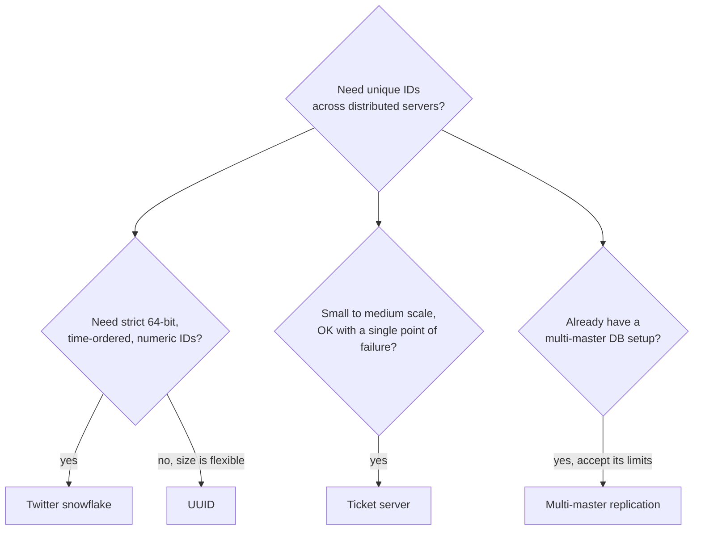

# Chapter 7: Design a Unique ID Generator in Distributed Systems

> [!cite] Book reference
> *System Design Interview: An Insider's Guide, Second Edition* by Alex Xu. Chapter 7: "Design a Unique ID Generator in Distributed Systems." Source: the user's uploaded EPUB file.

> [!summary] One-line takeaway
> A database's built-in `auto_increment` cannot generate unique, time-ordered IDs across multiple independent servers; Twitter's snowflake approach solves this by packing a timestamp, a fixed datacenter and machine identity, and a per-millisecond sequence number into one 64-bit number, with no coordination needed at request time.

## Why this chapter matters

This is a short, self-contained chapter, but it reintroduces two ideas that recur later: the risk of relying on synchronized clocks across machines (a problem the book explicitly defers rather than solves), and the general pattern of trading a small amount of structure (fixed-width bit fields) for the ability to generate unique values with zero cross-server coordination at request time.

## Direct quotes from the book

> [!quote] On why a database auto-increment does not work here
> "`auto_increment` does not work in a distributed environment because a single database server is not large enough and generating unique IDs across multiple databases with minimal delay is challenging."

> [!quote] On UUID collision odds
> "After generating 1 billion UUIDs every second for approximately 100 years would the probability of creating a single duplicate reach 50%."[^1]

> [!quote] On the chosen approach
> "Twitter's unique ID generation system called 'snowflake' is inspiring and can satisfy our requirements."[^3]

> [!quote] On the honest limitation left unsolved
> "In our design, we assume ID generation servers have the same clock. This assumption might not be true when a server is running on multiple cores. The same challenge exists in multi-machine scenarios. Solutions to clock synchronization are out of the scope of this book; however, it is important to understand the problem exists."

## The chapter in full (so you never need to re-read it)

### Why this is hard

A traditional database's `auto_increment` primary key is the obvious first instinct, but it fails in a distributed setting for two reasons: a single database server eventually runs out of room, and generating unique IDs across multiple independent databases with minimal delay is a genuinely hard coordination problem.

### Step 1: understand the problem and establish design scope

The book's interviewer exchange establishes a specific, narrow set of requirements: IDs must be unique; they increase with time but not necessarily by exactly 1, so an evening-generated ID will always be larger than a morning-generated one from the same day, without implying strict sequential incrementing; IDs are purely numeric; IDs must fit in 64 bits; and the system must generate over 10,000 unique IDs per second.

Requirements summary:

- IDs must be unique.
- IDs are numerical values only.
- IDs fit into 64 bits.
- IDs are ordered by date.
- The system can generate over 10,000 unique IDs per second.

### Step 2: propose a high-level design

The book evaluates four options against these requirements.

**Multi-master replication.** Reuses the database's own `auto_increment`, but instead of incrementing by 1, increments by k, where k is the number of database servers in use; the book's example has each server's next ID equal to its own previous ID plus 2. This lets ID capacity scale with the number of database servers, but carries three serious drawbacks: it scales poorly across multiple data centers, IDs do not reliably increase with time across different servers, and it handles adding or removing servers badly.

**UUID.** A 128-bit number with an extremely low collision probability, Wikipedia's own cited figure is that generating 1 billion UUIDs per second for about 100 years would only reach a 50% chance of a single duplicate.[^1] Example UUID: `09c93e62-50b4-468d-bf8a-c07e1040bfb2`. UUIDs can be generated independently, with each web server running its own generator and zero coordination needed between servers. Pros: simple to generate, no synchronization issues, and the system scales naturally since ID generation capacity scales directly with the number of web servers. Cons: at 128 bits, UUIDs are too large against the chapter's 64-bit requirement, they do not increase with time, and they can be non-numeric.

**Ticket server.** Uses a single, centralized database server's `auto_increment` feature as the sole source of IDs, an approach Flickr developed for distributed primary keys.[^2] Pros: produces numeric IDs, and it is simple to implement and works well at small to medium scale. Cons: a single ticket server is a single point of failure; running multiple ticket servers to avoid that reintroduces a new problem, keeping those servers' data synchronized.

**Twitter snowflake approach.** None of the first three options satisfy every requirement simultaneously, which motivates a purpose-built fourth option. Instead of generating an ID as one opaque value, snowflake divides a 64-bit ID into fixed sections:

- **Sign bit**: 1 bit, always 0, reserved for potential future use (for example distinguishing signed from unsigned numbers).
- **Timestamp**: 41 bits, milliseconds since a chosen epoch. The book uses Twitter's own default epoch of 1288834974657 ms, equivalent to November 4, 2010, 01:42:54 UTC.
- **Datacenter ID**: 5 bits, supporting 2^5 = 32 datacenters.
- **Machine ID**: 5 bits, supporting 2^5 = 32 machines per datacenter.
- **Sequence number**: 12 bits; increments by 1 for every ID generated on the same machine within the same millisecond, and resets to 0 at the start of each new millisecond.

### Step 3: design deep dive

Datacenter ID and machine ID are chosen once, at startup, and generally stay fixed afterward; changing either value later needs careful review, since an accidental change risks producing ID collisions. Timestamp and sequence number, by contrast, are generated live as the system runs.

**Timestamp.** The 41-bit timestamp field is what makes IDs sortable by time, since it grows monotonically. The book shows converting the binary timestamp representation to and from UTC directly. Its maximum representable value is `2^41 - 1 = 2,199,023,255,551` milliseconds, which works out to roughly 69 years (dividing down through seconds, days, hours). Choosing a custom epoch close to the system's actual launch date pushes this overflow as far into the future as possible; past that 69-year horizon, the system needs a new epoch or a different ID scheme entirely.

**Sequence number.** At 12 bits, this field supports 4,096 distinct values (`2^12`). It stays at 0 unless more than one ID is generated within the same millisecond on the same machine, meaning a single machine can theoretically support up to 4,096 new IDs per millisecond before needing to wait for the next millisecond tick.

### Step 4: wrap-up and further talking points

The book settles on the snowflake approach as the one meeting every stated requirement and scaling cleanly in a distributed environment. Three additional topics worth raising with extra interview time:

- **Clock synchronization.** The entire design assumes every ID-generation server shares the same clock, an assumption that can break down even within a single multi-core machine, and certainly across a multi-machine deployment. The book explicitly declines to solve this within its scope, while stressing that the problem is real and must be understood; Network Time Protocol is named as the standard real-world solution.[^4]
- **Section length tuning.** The specific bit allocation (41/5/5/12) is not sacred; for example, a long-running, low-concurrency application might reallocate bits toward more timestamp range and fewer sequence-number combinations, since it needs the long lifespan more than the extreme per-millisecond throughput.
- **High availability.** Since an ID generator sits on the critical path for nearly every write in the system, it is mission-critical, and must itself be built to stay highly available, not just correct.

## Core concepts (quick-scan version)

See the full bit-layout diagram and the four-approach comparison table in [[Chapter 7 - Snowflake ID Bit Layout]].

| Requirement | How snowflake meets it |
|---|---|
| Unique | Combination of timestamp, fixed datacenter ID, fixed machine ID, and sequence number |
| Numeric, 64-bit | A single 64-bit integer, no encoding needed |
| Ordered by date | The 41-bit timestamp occupies the highest-order bits after the sign bit, so IDs sort naturally by time |
| Over 10,000 IDs per second | 4,096 sequence values per millisecond per machine, multiplied across up to 1,024 machines (32 datacenters times 32 machines each) |

## First-principles breakdown

The snowflake approach's real insight is reframing "generate a unique ID" as "partition the ID space ahead of time so no runtime coordination is ever needed." Multi-master replication and the ticket server both still require some form of live coordination (a shared increment step, or a single centralized server) at the moment an ID is requested. UUID and snowflake both remove that coordination entirely, but they do it differently: UUID achieves uniqueness through sheer randomness and a 128-bit space large enough to make collision astronomically unlikely, while snowflake achieves uniqueness through structure, reserving disjoint bit ranges for timestamp, location (datacenter and machine), and intra-millisecond ordering, so that two different machines, or the same machine at two different milliseconds, can never produce the same value by construction, not by probability.

This also explains exactly why the chapter frames clock synchronization as the one problem it cannot sidestep: snowflake's uniqueness guarantee depends on the timestamp field actually reflecting real, monotonically advancing time on each machine. If a machine's clock jumps backward, even briefly, that machine can regenerate a timestamp (and potentially a full ID) it already used, silently breaking the uniqueness guarantee the entire design rests on. The book is correct to flag this as out of scope rather than quietly assume it away, since it is a genuine, structural dependency of the whole approach, not an edge case.

## Visual representation

See the full bit-layout diagram in [[Chapter 7 - Snowflake ID Bit Layout]].

## Worked example, built directly in your vault

Built: [[Chapter 7 - Snowflake ID Bit Layout]] in `Claude Notes/Books/System Design Interview/Examples/`, with the full 64-bit field layout diagrammed, the book's own 69-year lifespan arithmetic reproduced step by step, and a side-by-side comparison table across all four approaches the chapter considers.

## What the book doesn't tell you, community perspective (2025-2026)

- **Clock drift is the single most-cited real production failure mode for snowflake-style generators.** If a machine's system clock jumps backward, from an NTP correction, a VM migration, or a leap-second smear, a node can re-emit a timestamp it already used, colliding with previously issued sequence values. Hardened production implementations detect backward clock movement explicitly and either block new ID issuance until the clock catches up, or fall back to a persisted "last timestamp" watermark.
- **Machine ID assignment is a coordination problem the book does not dwell on.** Every generator node needs a unique machine ID for its entire process lifetime; production systems commonly lease this from a coordination service like ZooKeeper or etcd at startup, or derive it from a Kubernetes pod ordinal or IP. This reintroduces exactly the kind of dependency snowflake was meant to avoid, just at startup time rather than per-request.
- **ULID and KSUID have emerged as zero-coordination alternatives.** ULID produces a 128-bit, string-sortable identifier: 48 bits of millisecond timestamp plus 80 bits of cryptographically random data, Crockford Base32-encoded into a 26-character string. KSUID is similar in spirit, second-level timestamp granularity plus a large random space. Neither needs a machine ID at all, trading snowflake's compactness for eliminating the machine-ID coordination problem entirely.
- **UUIDv7 is a widely cited 2025-2026 middle ground.** It keeps UUID's zero-coordination simplicity while adding a leading timestamp component for sortability, without snowflake's fixed-width machine-ID and clock-monotonicity requirements; multiple sources frame UUIDv7 as the simpler default choice and snowflake as the choice specifically when the smaller 64-bit size matters, for example for compact database index keys.

## Deeper commentary, how this applies to your setup specifically

If you ever implement an ID generator for a personal project, the practical decision this chapter sets up is narrower than "snowflake versus everything else": it is "do I actually need a 64-bit identifier, or would a 128-bit ULID/UUIDv7 remove an entire class of machine-ID and clock-drift problems I would otherwise have to solve myself." For most personal-scale projects, the community research above suggests the coordination-free alternatives are the more pragmatic default, with snowflake reserved for cases where index size and raw numeric sortability genuinely matter at scale.

## Practical and actionable takeaways

- [x] Extracted all four ID-generation approaches, their pros and cons, and the full snowflake bit layout from the source EPUB.
- [x] Built a standalone worked-example note reproducing the bit-layout diagram and the 69-year lifespan arithmetic.
- [ ] If you ever build a real system needing unique IDs, explicitly decide between snowflake, UUIDv7, and ULID using the tradeoffs above, rather than defaulting to whichever is most familiar.
- [ ] Revisit this chapter's "clock synchronization is out of scope" caveat once you have more distributed-systems background; it is a good test of whether you understand why that caveat matters structurally, not just as a disclaimer.

## Questions and things to decide for your own vault

- Do you want a short, standalone note comparing snowflake, UUID, UUIDv7, ULID, and KSUID side by side, since this chapter only compares snowflake against the three alternatives the book itself considered, not the newer ones community research surfaced?
- Should "clock synchronization in distributed systems" become its own cross-chapter glossary entry, given this chapter explicitly flags it as an unresolved dependency that a reader needs to understand even though the book does not teach it?

## Sources (external, beyond the book)

- [Snowflake ID and Distributed ID Generation: Time-Ordered Unique IDs at Scale](https://codefarm.in/guides/system-design/04-core-algorithms/snowflake-distributed-id) — codefarm
- [UUIDv7 vs Snowflake ID vs ULID: Distributed IDs](https://iotdigitaltwinplm.com/distributed-id-generation-explained-snowflake-ids-vs-uuidv7-vs-ulid-vs-database-sequences-2026/)
- [Global ID Generation, Snowflake, ULID, KSUID](https://adhdecode.com/databases/real-world-incident-case-studies/global-id-generation-snowflake-ulid/) — ADHDecode

## Footnotes

[^1]: Universally unique identifier: https://en.wikipedia.org/wiki/Universally_unique_identifier
[^2]: Ticket Servers, Distributed Unique Primary Keys on the Cheap: https://code.flickr.net/2010/02/08/ticket-servers-distributed-unique-primary-keys-on-the-cheap/
[^3]: Announcing Snowflake: https://blog.twitter.com/engineering/en_us/a/2010/announcing-snowflake.html
[^4]: Network time protocol: https://en.wikipedia.org/wiki/Network_Time_Protocol

## Claude's pick, what I'd flag as most important

- The reframing from "generate a unique value" to "partition the ID space so no coordination is ever needed at request time" is the one idea from this chapter worth carrying forward; it is a general pattern, not specific to IDs.
- The book's honesty about clock synchronization being unsolved here is itself a useful lesson in scoping: naming a real, load-bearing assumption explicitly is better than silently assuming it away, even when a full solution is out of scope.
- Of the four approaches, the ticket server is the one most likely to be "good enough" for a genuinely small system; do not reach for snowflake's full complexity before confirming you actually need its specific guarantees.

## Related

- Previous: [[Chapter 6 - Design a Key-Value Store]]
- Next: [[Chapter 8 - Design a URL Shortener]]
- MOC: [[System Design Interview - MOC]]
- Worked example: [[Chapter 7 - Snowflake ID Bit Layout]]
