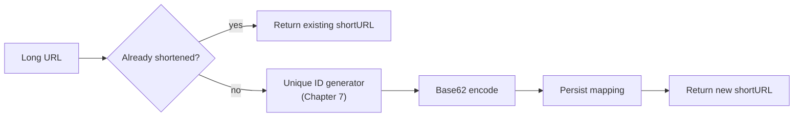

# Chapter 8: Design a URL Shortener

> [!cite] Book reference
> *System Design Interview: An Insider's Guide, Second Edition* by Alex Xu. Chapter 8: "Design a URL Shortener." Source: the user's uploaded EPUB file.

> [!summary] One-line takeaway
> A URL shortener is really Chapter 7's unique ID generator plus a base62 encoding step and a cache-backed redirect path; almost every hard decision in this chapter (hash function choice, redirect type, ID generation) traces back to a tradeoff this book already introduced somewhere earlier.

## Why this chapter matters

This chapter is the book's clearest demonstration of composition: it explicitly reuses Chapter 7's distributed unique ID generator, and it reuses the read-heavy caching pattern from Chapter 1. It is also the chapter this vault's structure is explicitly modeled after, since a URL shortener capstone project anchors the reference repo (Backend-from-First-Principles) this whole vault is inspired by.

## Direct quotes from the book

> [!quote] On the exact problem
> "Assume URL https://www.systeminterview.com/q=chatsystem&c=loggedin&v=v3&l=long is the original URL. Your service creates an alias with shorter length: https://tinyurl.com/y7keocwj. If you click the alias, it redirects you to the original URL."

> [!quote] On the hash function's two requirements
> "Each longURL must be hashed to one hashValue. Each hashValue can be mapped back to the longURL."

> [!quote] On reusing earlier chapters
> "The distributed unique ID generator is worth mentioning. Its primary function is to generate globally unique IDs, which are used for creating shortURLs. In a highly distributed environment, implementing a unique ID generator is challenging. Luckily, we have already discussed a few solutions in 'Chapter 7: Design A Unique ID Generator in Distributed Systems'."

> [!quote] On 301 versus 302 redirects
> "If the priority is to reduce the server load, using 301 redirect makes sense as only the first request of the same URL is sent to URL shortening servers. However, if analytics is important, 302 redirect is a better choice as it can track click rate and source of the click more easily."

## The chapter in full (so you never need to re-read it)

### Step 1: understand the problem and establish design scope

The interviewer grounds the problem with a concrete example: a long URL gets aliased to a short one like `https://tinyurl.com/y7keocwj`, and visiting the alias redirects to the original. Key scoping answers: 100 million URLs are generated per day; the shortened URL should be as short as possible; the allowed alphabet is numbers (0-9) and letters (a-z, A-Z); and, for simplicity, shortened URLs cannot be deleted or updated.

This yields three core use cases: URL shortening (long URL in, short URL out), URL redirecting (short URL in, redirect to the original long URL), and the usual non-functional trio of high availability, scalability, and fault tolerance.

**Back-of-the-envelope estimation**, following Chapter 2's method directly:

- Write operations: 100 million URLs per day.
- Write throughput: 100,000,000 / 24 / 3,600, about 1,160 writes per second.
- Assuming a 10:1 read-to-write ratio, read throughput: 1,160 times 10, about 11,600 reads per second.
- Over a 10-year service lifetime: 100 million times 365 times 10, about 36.5 billion records (the book's stated total).
- Assuming an average 100-byte URL, the book states a 10-year storage requirement of roughly 365 TB.

### Step 2: propose a high-level design

**API endpoints.** Two REST-style endpoints cover the whole service:[^1] `POST api/v1/data/shorten`, taking a `longUrl` parameter and returning the shortened URL, and `GET api/v1/shortUrl`, returning the long URL for an HTTP redirect.

**URL redirecting.** When a user visits a short URL, the server resolves it to the long URL and issues a redirect. The book draws out the distinction between two redirect types in detail:

- **301 (permanent) redirect.** The browser caches the result, so subsequent visits to the same short URL skip the shortening service entirely and go straight to the long URL's server.
- **302 (temporary) redirect.** The browser does not cache it, so every subsequent visit still routes back through the shortening service first.

The tradeoff is explicit: 301 reduces server load, since only the first visit to a given short URL ever reaches the shortening servers, while 302 is better for analytics, since every single click can be observed and tracked (click rate, click source, and so on).

The most intuitive implementation stores `<shortURL, longURL>` pairs in a hash table: look up `longURL = hashTable.get(shortURL)`, then redirect.

**URL shortening.** Shortening requires a hash function that maps a long URL to a short `hashValue`, satisfying two properties: every long URL maps to exactly one hash value, and every hash value maps back to its original long URL.

### Step 3: design deep dive

**Data model.** Storing everything in an in-memory hash table does not scale in practice, since memory is limited and expensive at this volume. The book's actual design stores `<shortURL, longURL>` mappings in a relational database table with three columns: `id`, `shortURL`, `longURL`.

**Hash value length.** With an alphabet of 62 characters (10 digits + 26 lowercase + 26 uppercase), the required length is the smallest n such that `62^n >= 365 billion`, the system's projected 10-year URL volume. At n=7, `62^7` is approximately 3.5 trillion, comfortably above 365 billion, so the hash value length is fixed at 7 characters.

**Two hash function strategies:**

1. **Hash plus collision resolution.** Apply a well-known hash function (CRC32, MD5, SHA-1) to the long URL, then take the first 7 characters. The book's own comparison table shows that even CRC32's output, the shortest of the three, is still too long to use directly, so truncation is unavoidable, and truncation reintroduces collisions. The fix: on a collision, recursively append a predefined string and rehash until no collision remains. This approach works, but checking the database for an existing short URL on every single write is expensive; a Bloom filter[^2] is the book's suggested optimization to speed up that check.
2. **Base62 conversion.** Convert a number between numeral systems, here specifically into base 62 (matching the 62-character alphabet). The book's own worked example converts the decimal number 11,157 into base 62: `11157 = 2*62^2 + 55*62^1 + 59*62^0`, giving digits `[2, 55, 59]`, which map to `[2, T, X]` under the scheme 0-9 to themselves, 10-35 to a-z, 36-61 to A-Z, producing the short URL `https://tinyurl.com/2TX`.

The book settles on base62 conversion as its chosen design.

**URL shortening flow, step by step:**

1. The input is a longURL.
2. The system checks whether that longURL already exists in the database.
3. If it does, the existing shortURL is fetched and returned directly, no new one is created.
4. If it is new, a globally unique ID is generated by the unique ID generator (explicitly Chapter 7's design, directly referenced back).
5. That ID is base62-encoded into a shortURL.
6. A new row is written, holding the ID, shortURL, and longURL together.

The book's own concrete trace: input longURL `https://en.wikipedia.org/wiki/Systems_design`; the ID generator returns `2009215674938`; base62 encoding converts that ID into `zn9edcu`; all three values get persisted to the database together.

**URL redirecting flow, step by step**, with the `<shortURL, longURL>` mapping cached given the read-heavy traffic pattern:

1. A user clicks a short URL, for example `https://tinyurl.com/zn9edcu`.
2. The load balancer forwards the request to a web server.
3. If the shortURL is already cached, the longURL is returned directly from cache.
4. If it is not cached, the system fetches the longURL from the database instead; if it is not in the database either, the shortURL was likely invalid or mistyped.
5. The longURL is returned to the user for the redirect.

### Step 4: wrap-up and further talking points

The book names four additional discussion points worth raising with extra interview time:

- **Rate limiting.** A malicious user could flood the service with URL shortening requests; the book points directly back to Chapter 4's rate limiter design as the fix, filtering by IP address or other rules.
- **Web server scaling.** Because the web tier is stateless (Chapter 1's pattern), scaling it is as simple as adding or removing web servers.
- **Database scaling.** Replication and sharding, both covered earlier in the book, are the standard tools here.
- **Analytics.** Business value often comes from understanding usage patterns, how many people click a given link, and when, which argues for integrating an analytics layer on top of the core redirect flow.
- **Availability, consistency, and reliability.** The book points back to Chapter 1 as the place these were discussed in depth, treating them as foundational concerns for any large system, not specific to URL shortening.

## Core concepts (quick-scan version)

See the full capacity math, base62 worked conversion, and both flow diagrams in [[Chapter 8 - URL Shortener Flow and Base62]].

| Decision | What the book chose | Why |
|---|---|---|
| Hash function strategy | Base62 conversion over a unique ID | Avoids collisions entirely, instead of detecting and resolving them after the fact |
| Where the unique ID comes from | Chapter 7's distributed ID generator | Already solves global uniqueness without added coordination |
| Redirect type | Not fixed; explicit 301-vs-302 tradeoff | Depends on whether reducing server load or getting click analytics matters more |
| Storage for the mapping | Relational database, not an in-memory hash table | In-memory does not scale to the required data volume |
| Read-path optimization | Cache in front of the database | Reads outnumber writes 10:1 in the book's own estimate |

## First-principles breakdown

The deepest idea in this chapter is that "shorten a URL" and "assign a unique, compact identifier" are the same problem wearing different clothes, and the chapter's entire design reduces to two separable concerns: guaranteeing uniqueness (solved once, in Chapter 7, and simply imported here), and representing that unique value compactly in a constrained character set (solved here, via base62 encoding). Treating these as one combined problem, as the "hash plus collision resolution" approach effectively does, forces you to detect and repair collisions after the fact. Separating them, as base62 conversion does, means collisions become structurally impossible, since two different unique IDs can never encode to the same base62 string, and two identical IDs are never generated in the first place.

This reframes the chapter's own stated preference for base62 over hash-based shortening as more than a performance optimization: it is a correctness simplification. A system that can prove uniqueness by construction needs no retry loop, no Bloom filter to pre-check existence, and no database round trip purely to detect a collision. The cost moves entirely upstream, into correctly implementing Chapter 7's ID generator, rather than being paid repeatedly on every write.

Where this stops being free: base62 conversion only avoids collisions if the underlying ID generator genuinely never repeats a value, so this design's correctness is now fully dependent on Chapter 7's open caveat about clock synchronization across machines. A subtle bug in the ID generator's uniqueness guarantee becomes a subtle, hard-to-detect bug in URL shortening, since nothing in this chapter's own design re-checks for collisions at the point of use.

## Visual representation

See the full shortening flow, redirect flow, and base62 conversion diagrams in [[Chapter 8 - URL Shortener Flow and Base62]].

## Worked example, built directly in your vault

Built: [[Chapter 8 - URL Shortener Flow and Base62]] in `Claude Notes/Books/System Design Interview/Examples/`, reproducing the book's capacity estimate, the full base62 conversion worked by hand, a side-by-side comparison of the two hash-function strategies, and both the shortening and redirect flows as diagrams, explicitly cross-linking back to Chapter 7's ID-generator worked example.

## What the book doesn't tell you, community perspective (2025-2026)

- **Predictable, sequential short codes are a real security concern the book does not raise.** If the unique ID genuinely increments sequentially before base62 encoding, codes become guessable, letting anyone scrape or enumerate the entire mapping table by walking sequential codes. A commonly reported production fix: pass the ID through a reversible, collision-free permutation (a Feistel cipher, or a library like Hashids or Sqids) before base62-encoding it, so the encoded output no longer reveals creation order.
- **A single global counter-based ID generator becomes a write hotspot at real scale.** One widely cited mitigation: a coordinator hands out ID ranges in batches (for example via Redis `INCRBY`) to each web server, which then dispenses IDs from its local batch without a network round trip per request; if a server crashes holding an unused batch, the wasted IDs cost essentially nothing given the trillions of possible 7-character combinations.
- **Hash-based collision retries are monitored as a real production signal.** Teams reportedly track retry rate as an operational metric, treating anything above roughly 0.1% of writes needing a retry as a sign the hash function or truncation length needs revisiting, turning the book's "recursively append and rehash" idea into something with a measurable production SLA.
- **Random base62 generation (not hash-based, not counter-based) is a third strategy in active use**, generating 7 random characters directly and checking uniqueness on insert; with 3.5 trillion possible combinations against roughly 30 billion stored records, the birthday-paradox collision probability stays low but non-zero, so a uniqueness check (commonly an atomic `INSERT ... ON CONFLICT DO NOTHING`) is still required on every write.
- **Viral traffic spikes are reported as the chapter's biggest real-world blind spot.** A single viral link can spike database load on the hot row (or its surrounding index pages) by 100x, reportedly pushing read latency from single-digit milliseconds into the hundreds, which argues for per-key rate limiting or additional caching layers specifically around hot short URLs, not just the aggregate caching the chapter already describes.

## Deeper commentary, how this applies to your setup specifically

This chapter is the strongest candidate in the book so far for an actual hands-on build, since a URL shortener is small enough to implement end to end in a weekend, and doing so directly tests whether you understand how this chapter's design composes with Chapter 7's ID generator rather than treating them as separate topics. The reference repo this vault is modeled after (Backend-from-First-Principles) uses exactly this project as its own capstone, which makes this chapter's content a natural one to eventually turn into a small working code example inside this vault, not just notes.

## Practical and actionable takeaways

- [x] Extracted the full API design, both hash-function strategies, the complete base62 worked example, and both flows (shortening, redirecting) from the source EPUB.
- [x] Built a standalone worked-example note reproducing the capacity math, the base62 conversion by hand, and both flow diagrams, cross-linked to Chapter 7's ID generator worked example.
- [ ] Consider building a small, real, working URL shortener (even a single-file script) in this vault's examples folder, using base62 conversion over a simple counter, as a hands-on companion to this chapter.
- [ ] If you do build it, explicitly test the predictable-ID security concern from the community research: can you enumerate other users' short URLs just by incrementing the code?

## Questions and things to decide for your own vault

- Do you want an actual runnable code example (even a minimal one, in whatever language you are most comfortable with) added under this chapter's `Examples/` folder, going beyond the diagrams built so far?
- Should "composability across chapters" (this chapter openly reusing Chapter 7, and pointing back to Chapters 1 and 4) become its own cross-chapter note, tracking every place one "design X" chapter explicitly builds on another?

## Sources (external, beyond the book)

- [URL Shortener Design, Why Auto-Increment Kills at Scale](https://thecodeforge.io/system-design/design-url-shortener/)
- [The URL Shortener System Design Lie: What Prep Guides Hand-Wave](https://dev.to/gvegacl/the-url-shortener-system-design-lie-what-prep-guides-hand-wave-and-what-production-actually-needs-1cka) — DEV Community
- [Hashing Strategies: Base62, Counters, and Collision Avoidance](https://wittycoder.in/courses/url-shortener/url-shortener-hashing) — Witty Coder

## Footnotes

[^1]: A RESTful Tutorial: https://www.restapitutorial.com/index.html
[^2]: Bloom filter: https://en.wikipedia.org/wiki/Bloom_filter

## Claude's pick, what I'd flag as most important

- The reframing of URL shortening as "uniqueness plus compact encoding," two genuinely separate concerns, is the single most transferable idea in this chapter, and it is worth noticing how cleanly it eliminates the need for collision handling entirely.
- The 301-versus-302 tradeoff is a small, concrete example of a pattern that recurs throughout system design: a seemingly minor implementation detail (which HTTP status code to return) actually encodes a real business tradeoff (server load versus analytics visibility).
- The predictable-ID security gap the community research surfaces is worth remembering specifically: this chapter's design, taken literally, would leak creation order and enable enumeration, and the book itself never flags this.

## Related

- Previous: [[Chapter 7 - Design a Unique ID Generator in Distributed Systems]]
- Next: [[Chapter 9 - Design a Web Crawler]]
- MOC: [[System Design Interview - MOC]]
- Worked example: [[Chapter 8 - URL Shortener Flow and Base62]]
