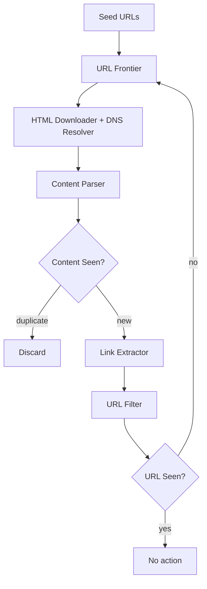

# Chapter 9: Design a Web Crawler

> [!cite] Book reference
> *System Design Interview: An Insider's Guide, Second Edition* by Alex Xu. Chapter 9: "Design a Web Crawler." Source: the user's uploaded EPUB file.

> [!summary] One-line takeaway
> A web crawler's basic algorithm (download, extract links, repeat) is trivial; nearly the entire chapter is about the URL Frontier, the component that turns that trivial loop into something polite, prioritized, and robust enough to run at billions-of-pages scale.

## Why this chapter matters

This chapter pulls together more prior material than almost any other "design X" chapter so far: it explicitly reuses Chapter 5's consistent hashing for load distribution, and it echoes Chapter 1's stateless-scaling and Chapter 4's politeness-as-rate-limiting ideas, applied to crawling instead of API traffic. The four crawler qualities it names, scalability, robustness, politeness, extensibility, are a reusable checklist for evaluating any large data-ingestion system, not just crawlers.

## Direct quotes from the book

> [!quote] On what a crawler is
> "A web crawler is known as a robot or spider. It is widely used by search engines to discover new or updated content on the web."

> [!quote] On why DFS is the wrong traversal
> "DFS is usually not a good choice because the depth of DFS can be very deep."

> [!quote] On what makes BFS alone insufficient
> "Most links from the same web page are linked back to the same host ... making the crawler busy processing URLs from the same host ... This is considered as 'impolite'."

> [!quote] On the honest scope of what is covered
> "Building a scalable web crawler is not a trivial task because the web is enormously large and full of traps. Even though we have covered many topics, we still miss many relevant talking points."

## The chapter in full (so you never need to re-read it)

### What a crawler is and what it is used for

A web crawler, also called a robot or spider, starts from a handful of web pages and follows links outward to discover new or updated content, including pages, images, videos, and PDFs. The book names four real-world use cases: search engine indexing (Googlebot is the book's own example); web archiving, preserving the web for the future (the US Library of Congress[^1] and the EU Web Archive[^2] are both cited); web mining, extracting useful knowledge at scale (the book's example: financial firms crawling shareholder meetings and annual reports); and web monitoring, for example Digimarc[^3] using crawlers to detect pirated content and copyright infringement.

### Step 1: understand the problem and establish design scope

The basic algorithm is genuinely simple: given a set of URLs, download the pages they point to, extract new URLs from those pages, add the new URLs to the download list, and repeat. The book is explicit that real-world crawler design is nowhere near this simple, and that designing a massive crawler end to end within an interview's time is not realistic.

The interviewer exchange establishes: the crawler's purpose is search engine indexing; it must collect 1 billion web pages per month; content is HTML only, not PDFs or images; both newly added and edited pages matter; crawled HTML must be stored for up to 5 years; and duplicate-content pages should be ignored.

Four characteristics define a good crawler:

- **Scalability.** The web is enormous; crawling must be heavily parallelized to keep pace.
- **Robustness.** The web is full of traps: malformed HTML, unresponsive servers, crashes, malicious links. The crawler must handle all of it gracefully.
- **Politeness.** The crawler must not hammer any single website with too many requests in a short window.
- **Extensibility.** The system should support new content types (for example, images, in the future) with minimal redesign.

**Back-of-the-envelope estimation**, again following Chapter 2's method: 1 billion pages per month gives roughly 400 pages per second (1,000,000,000 / 30 / 24 / 3,600), with peak QPS at double that, about 800. At an average 500 KB page size, monthly storage comes to 500 TB, and a 5-year retention window requires about 30 PB total.

### Step 2: propose a high-level design

The high-level design, drawing on prior published studies of web crawling,[^4][^5] breaks into these components:

- **Seed URLs.** The crawl's starting points. For a narrow target like one university's site, the domain name itself is a natural seed. For crawling the entire web, seed selection is deliberately open-ended; the book suggests dividing the URL space by locality (different countries favor different popular sites) or by topic (shopping, sports, healthcare, and so on), while being explicit that there is no single correct answer here, only a reasoned approach.
- **URL Frontier.** Splits crawl state into "to be downloaded" and "already downloaded," conceptually a FIFO queue, though its real design (covered in the deep dive) is far richer than a plain queue.
- **HTML Downloader.** Fetches the actual pages, using URLs supplied by the URL Frontier.
- **DNS Resolver.** Translates a URL into an IP address for the downloader; the book's own example: `www.wikipedia.org` resolved to `198.35.26.96` as of March 5, 2019.
- **Content Parser.** Validates and parses downloaded pages; malformed pages can cause real problems and waste storage, so parsing lives in its own dedicated component rather than inline in the crawl server, to avoid slowing down the core crawl loop.
- **Content Seen?** A deduplication check. Cited research found 29% of web pages are duplicate content;[^6] comparing documents character by character does not scale to billions of pages, so the book recommends comparing hash values instead.[^7]
- **Content Storage.** A hybrid store: most content lives on disk, since the dataset is too large for memory, while popular content stays in memory to cut latency.
- **URL Extractor.** Parses links out of HTML and converts relative paths to absolute URLs (the book's example: prefixing with `https://en.wikipedia.org`).
- **URL Filter.** Excludes unwanted content types, file extensions, broken links, and blacklisted sites.
- **URL Seen?** Tracks URLs already visited or already queued, to avoid redundant work and potential infinite loops; the book names Bloom filters and hash tables as the standard implementation techniques, without detailing their internals here.[^4][^8]
- **URL Storage.** Stores already-visited URLs.

**The full workflow, numbered exactly as the book presents it:**

1. Seed URLs are added to the URL Frontier.
2. The HTML Downloader fetches a batch of URLs from the Frontier.
3. The Downloader resolves IPs via the DNS Resolver and begins downloading.
4. The Content Parser parses each HTML page and checks for malformed content.
5. Parsed, validated content passes to the Content Seen? component.
6. If that content already exists in storage, the page is discarded (it is a duplicate under a different URL); if not, it is new, and passes to the Link Extractor.
7. The Link Extractor pulls links out of the HTML.
8. Extracted links pass through the URL Filter.
9. Filtered links pass to the URL Seen? component.
10. If a URL has already been processed, nothing further happens.
11. If it has not, it is added back into the URL Frontier.

### Step 3: design deep dive

**DFS versus BFS.** Modeling the web as a directed graph (pages as nodes, hyperlinks as edges), crawling becomes graph traversal. DFS is a poor fit, since its depth can run arbitrarily deep. BFS, implemented via a FIFO queue, is the standard choice, but a single plain FIFO queue has two real problems: most links on a page point back to the same host, so naive parallel BFS floods that host with requests (impolite, and potentially indistinguishable from a denial-of-service attack from the target's perspective); and plain BFS ignores page importance entirely, treating a forum post and a site's home page as equally worth crawling first.

**The URL Frontier**, the book's real answer to both problems, splits into two functional halves:

- **Politeness**, enforced by downloading only one page at a time per host, with a mapping table from hostname to a dedicated FIFO queue, a queue router that ensures each queue only ever holds URLs for one host, and a queue selector that maps each worker thread to exactly one queue; a delay can be inserted between a worker's successive downloads from the same host.
- **Priority**, handled by a Prioritizer component that scores URLs by usefulness (PageRank,[^10] site traffic, update frequency), feeding multiple queues (f1 through fn) tagged by priority level; a queue selector picks among these with a bias toward higher-priority queues.

The book's assembled URL Frontier design has front queues managing prioritization and back queues managing politeness, working together rather than as separate systems.

**Freshness.** Because pages get added, edited, and deleted continuously, a crawler must periodically recrawl already-downloaded pages. Recrawling everything is prohibitively expensive, so the book names two cheaper strategies: recrawl based on a page's own update history, and prioritize recrawling pages already known to be important, more frequently than low-priority ones.

**Storage for the URL Frontier.** At real-world search-engine scale, the Frontier can hold hundreds of millions of URLs.[^4] Keeping it all in memory is neither durable nor scalable; keeping it all on disk makes disk I/O the bottleneck. The book's hybrid solution: store the bulk on disk, but buffer enqueue and dequeue operations in memory, flushing the buffer to disk periodically.

**HTML Downloader and robots.txt.** Before the downloader itself, the book covers the Robots Exclusion Protocol (robots.txt), the standard websites use to tell crawlers which pages they may fetch; a crawler should always check and respect a site's robots.txt before crawling it. To avoid re-downloading this file constantly, the book recommends caching it and refreshing the cached copy periodically. It shows a real excerpt from Amazon's own robots.txt, disallowing Googlebot from paths like `/creatorhub/*` and several review-related endpoints.

**Performance optimizations for the downloader:**

- **Distributed crawl.** Crawl jobs spread across many servers, each running multiple threads, with the URL space partitioned so each downloader owns only a subset.
- **DNS cache.** DNS lookups are synchronous and slow (the book cites 10-200ms per lookup), and a thread blocks on its own request; caching domain-to-IP mappings, refreshed periodically via cron jobs, avoids constantly re-querying DNS.
- **Locality.** Placing crawl servers geographically closer to the hosts they crawl speeds up downloads; the same locality principle applies to caches, queues, and storage, not just the crawl servers themselves.
- **Short timeout.** A maximum wait time per host prevents a slow or unresponsive server from stalling the whole crawl; past that timeout, the crawler abandons that host for now and moves on.

**Robustness techniques:**

- **Consistent hashing** (explicitly pointing back to Chapter 5) distributes load evenly across downloader servers and absorbs servers being added or removed with minimal disruption.
- **Saving crawl state and data** to persistent storage, so an interrupted crawl can resume from where it left off rather than restarting from scratch.
- **Graceful exception handling**, since errors are inevitable at this scale and must never crash the whole system.
- **Data validation**, an important safeguard against systemic errors propagating through the pipeline.

**Extensibility.** The system should support new content types by plugging in new modules, not by redesigning the core pipeline. The book's examples: a PNG Downloader module added to fetch image files, and a Web Monitor module added specifically to watch for copyright and trademark infringement.

**Detecting and avoiding problematic content**, three distinct categories:

1. **Redundant content.** Roughly 29% of pages are duplicates; hashes or checksums are the practical way to detect this at scale.[^11]
2. **Spider traps.** Pages engineered (intentionally or not) to send a crawler into an infinite loop, the book's own example being an endlessly repeating directory path (`/foo/bar/foo/bar/...`). Capping maximum URL length is a partial mitigation, but the book is explicit that no universal automatic detection method exists; sites with an abnormally large discovered page count are the practical tell, and manual verification followed by exclusion or a custom filter is the real-world fix.
3. **Data noise.** Low-value content, ads, code snippets, spam URLs, that should be filtered out wherever possible, since it adds cost without adding crawl value.

### Step 4: wrap-up and further talking points

The book closes by listing topics it explicitly did not have room to cover in depth:

- **Server-side rendering.** Many sites generate links dynamically via JavaScript or AJAX; a crawler that only downloads and parses raw HTML will never see those links. The fix is performing server-side (dynamic) rendering before parsing.[^12]
- **Filtering out unwanted pages.** With finite storage and crawl budget, an anti-spam component helps filter out low-quality or spam content before it consumes resources.[^13][^14]
- **Database replication and sharding**, again for the data layer's availability, scalability, and reliability.
- **Horizontal scaling.** At real scale, hundreds or thousands of servers may be needed; the key enabler, as in Chapter 1, is keeping those servers stateless.
- **Availability, consistency, and reliability**, again pointed back to Chapter 1's foundational treatment.
- **Analytics.** Collecting and analyzing crawl data is itself valuable, feeding back into tuning the system.

## Core concepts (quick-scan version)

See the full workflow diagram, capacity math, URL Frontier internals, and problematic-content table in [[Chapter 9 - Web Crawler Pipeline]].

| Crawler quality | Primary mechanism that provides it |
|---|---|
| Scalability | Distributed crawl, partitioned URL space, consistent hashing |
| Robustness | Saved crawl state, graceful exception handling, data validation |
| Politeness | Per-host back queues, one page at a time per host, inter-download delay |
| Extensibility | Pluggable modules (for example a PNG downloader, a web monitor) added without redesigning the core pipeline |
| Freshness | Recrawl strategy based on update history and page priority |

## First-principles breakdown

Nearly every mechanism in this chapter is solving one of two conflicts: the conflict between crawling fast (parallelism) and crawling politely (not overwhelming any single host), or the conflict between crawling broadly (covering the whole web) and crawling usefully (prioritizing pages that actually matter). The URL Frontier's two-queue design is not an arbitrary architecture choice; it is the direct structural consequence of needing to solve both conflicts simultaneously without one undermining the other. If you tried to solve politeness and priority with a single mechanism, for example one global priority queue, you would lose the per-host isolation that makes politeness possible, since a few high-priority URLs from the same host could still flood it.

This reframes "Content Seen?" and "URL Seen?" as the same underlying idea applied at two different layers: both exist because identity in this system is cheap to fake and expensive to verify naively. A URL is not a reliable proxy for unique content (different URLs can serve identical pages), and raw content comparison does not scale (comparing billions of documents character by character is infeasible). Hashing solves both: it converts an expensive equality check into a cheap one, at the cost of a vanishingly small, accepted collision risk, exactly the same tradeoff Chapter 6's Bloom filters and Merkle trees already made in a different context.

Where this chapter's design is honestly incomplete, and says so itself: a crawler that only downloads and parses raw HTML cannot see JavaScript-generated links at all, which the book flags explicitly as an unresolved talking point rather than quietly ignoring it. This is a structural gap, not a tuning problem; no amount of better caching, prioritization, or politeness fixes a crawler that is architecturally blind to an entire category of modern web content.

## Visual representation

See the full 11-step pipeline diagram, the front-queue/back-queue URL Frontier design, and the performance-optimization table in [[Chapter 9 - Web Crawler Pipeline]].

## Worked example, built directly in your vault

Built: [[Chapter 9 - Web Crawler Pipeline]] in `Claude Notes/Books/System Design Interview/Examples/`, reproducing the full 11-step workflow as a diagram, the capacity estimate, the DFS-vs-BFS tradeoff, the complete front-queue/back-queue URL Frontier design, the four performance optimizations, the four robustness techniques, and the three categories of problematic content, cross-linked back to Chapter 5's consistent hashing worked example.

## What the book doesn't tell you, community perspective (2025-2026)

- **JavaScript rendering has moved from an edge case to a core requirement.** A plain crawler following raw `href` tags increasingly misses large swaths of the modern web, since many sites generate content and links dynamically. Real systems now often need a full headless browser to render pages before extraction, a far heavier and slower operation than a simple HTTP fetch, directly validating the book's own "server-side rendering" talking point as more central than the chapter's wrap-up treatment suggests.
- **Running headless browsers at scale is reported as a genuinely costly operational burden**, memory-hungry, slower than raw HTTP calls, and requiring constant babysitting as browser versions and anti-automation defenses change. A commonly reported architecture pattern minimizes this cost by routing as much traffic as possible through direct API calls or embedded-state parsing, falling back to real browser rendering only for pages that genuinely require it.
- **The politeness problem has escalated into an active anti-bot arms race.** Modern detection goes beyond IP reputation and cookie checks into TLS fingerprinting, since different HTTP client libraries (for example Python's Requests versus a real Chrome browser) produce distinguishably different TLS handshake signatures, making a crawler identifiable at the network layer regardless of how polite its request rate is.
- **AI crawler traffic has grown dramatically and triggered defensive countermeasures.** Reported figures describe GPTBot traffic rising 147% and Meta-ExternalAgent traffic rising 843% within a one-year window, with billions of daily requests across these crawlers; Cloudflare responded by blocking AI crawlers by default across its network starting mid-2025. Notably, measurements found several major AI crawlers (GPTBot, ClaudeBot, PerplexityBot, and others) do not execute JavaScript at all, meaning the rendering gap above cuts both ways.
- **Concurrency and rate capping are treated as two separate, equally necessary controls in practice**, not one combined "politeness" setting: a bounded worker pool caps how many requests run at once, while a separate delay cap limits how fast new requests are dispatched, since an uncapped crawler on either axis alone still risks overwhelming a target or getting itself blocked.

## Deeper commentary, how this applies to your setup specifically

If you ever build a small crawler as a learning project, the URL Frontier's two-queue design (priority plus politeness) is the single piece of this chapter worth implementing for real, even at toy scale, since it is the part that distinguishes a crawler from a plain "download and follow links" script. The JavaScript-rendering gap the community research surfaces is also worth testing directly: try crawling a handful of modern, JavaScript-heavy pages with a plain HTTP fetch and see exactly how much content and how many links go missing, to make the book's own wrap-up caveat concrete rather than abstract.

## Practical and actionable takeaways

- [x] Extracted the full 11-step workflow, every named component, the URL Frontier's dual-queue design, and all four performance optimizations from the source EPUB.
- [x] Built a standalone worked-example note with the full pipeline diagram and the front-queue/back-queue design, cross-linked to Chapter 5's consistent hashing note.
- [ ] If you build a small crawler project, implement the priority-plus-politeness URL Frontier design specifically, rather than a plain FIFO queue, to see the politeness problem firsthand.
- [ ] Test the JavaScript-rendering gap directly: crawl a modern, JavaScript-heavy site with a plain HTTP fetch and compare what links and content are missed versus a headless-browser-based crawl.

## Questions and things to decide for your own vault

- Do you want a dedicated note on Bloom filters, since this chapter is the second one to lean on them (after Chapter 6) without explaining their internals, making them a good candidate for a standalone cross-chapter reference?
- Should "politeness as a general distributed-systems concept" (rate limiting in Chapter 4, crawler politeness here) become its own cross-chapter note, tracking how the same underlying concern shows up under different names across the book?

## Sources (external, beyond the book)

- [JavaScript Crawling: Build One, Then Scale It](https://www.browserless.io/blog/javascript-crawling)
- [Rendering JavaScript at Scale Without a Browser Farm: An Architecture Walkthrough](https://dev.to/promptcloud_services/rendering-javascript-at-scale-without-a-browser-farm-an-architecture-walkthrough-4nn5) — DEV Community
- [Why AI Crawlers Are Breaking JavaScript SEO in 2026](https://aiinsightsnews.net/javascript-seo-ai-crawlers-2026/)

## Footnotes

[^1]: US Library of Congress: https://www.loc.gov/websites/
[^2]: EU Web Archive: http://data.europa.eu/webarchive
[^3]: Digimarc: https://www.digimarc.com/products/digimarc-services/piracy-intelligence
[^4]: Heydon A., Najork M. Mercator, A scalable, extensible web crawler, World Wide Web, 2(4) (1999), pp. 219-229
[^5]: Christopher Olston, Marc Najork, Web Crawling: http://infolab.stanford.edu/~olston/publications/crawling_survey.pdf
[^6]: 29% Of Sites Face Duplicate Content Issues: https://tinyurl.com/y6tmh55y
[^7]: Rabin M.O., et al., Fingerprinting by random polynomials, Center for Research in Computing Techn., Aiken Computation Laboratory, Univ. (1981)
[^8]: B. H. Bloom, "Space/time trade-offs in hash coding with allowable errors," Communications of the ACM, vol. 13, no. 7, pp. 422-426, 1970.
[^9]: Donald J. Patterson, Web Crawling: https://www.ics.uci.edu/~lopes/teaching/cs221W12/slides/Lecture05.pdf
[^10]: L. Page, S. Brin, R. Motwani, and T. Winograd, "The PageRank citation ranking, Bringing order to the web," Technical Report, Stanford University, 1998.
[^11]: Burton Bloom, Space/time trade-offs in hash coding with allowable errors, Communications of the ACM, 13(7), pages 422-426, July 1970.
[^12]: Google Dynamic Rendering: https://developers.google.com/search/docs/guides/dynamic-rendering
[^13]: T. Urvoy, T. Lavergne, and P. Filoche, "Tracking web spam with hidden style similarity," Proceedings of the 2nd International Workshop on Adversarial Information Retrieval on the Web, 2006.
[^14]: H.-T. Lee, D. Leonard, X. Wang, and D. Loguinov, "IRLbot, Scaling to 6 billion pages and beyond," Proceedings of the 17th International World Wide Web Conference, 2008.

## Claude's pick, what I'd flag as most important

- The URL Frontier's split into front queues (priority) and back queues (politeness) is the single most reusable architectural idea in this chapter; it is a clean example of solving two genuinely orthogonal constraints with two separate, composable mechanisms rather than one tangled one.
- Hashing for deduplication (Content Seen?, URL Seen?) is the same cheap-equality-check idea from Chapter 6's Merkle trees and Bloom filters, reapplied; noticing this pattern recur is more valuable than memorizing each instance separately.
- The book's own admission that JavaScript-rendered links are entirely invisible to this design is worth taking seriously, not glossing over; community research confirms this gap is a live, escalating problem in 2025-2026, not a minor historical footnote.

## Related

- Previous: [[Chapter 8 - Design a URL Shortener]]
- Next: [[Chapter 10 - Design a Notification System]]
- MOC: [[System Design Interview - MOC]]
- Worked example: [[Chapter 9 - Web Crawler Pipeline]]
