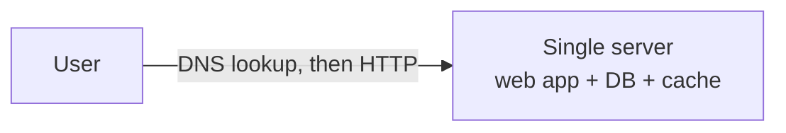
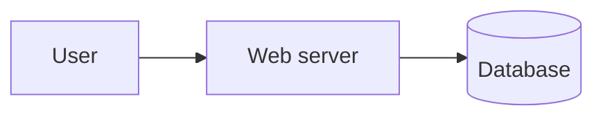
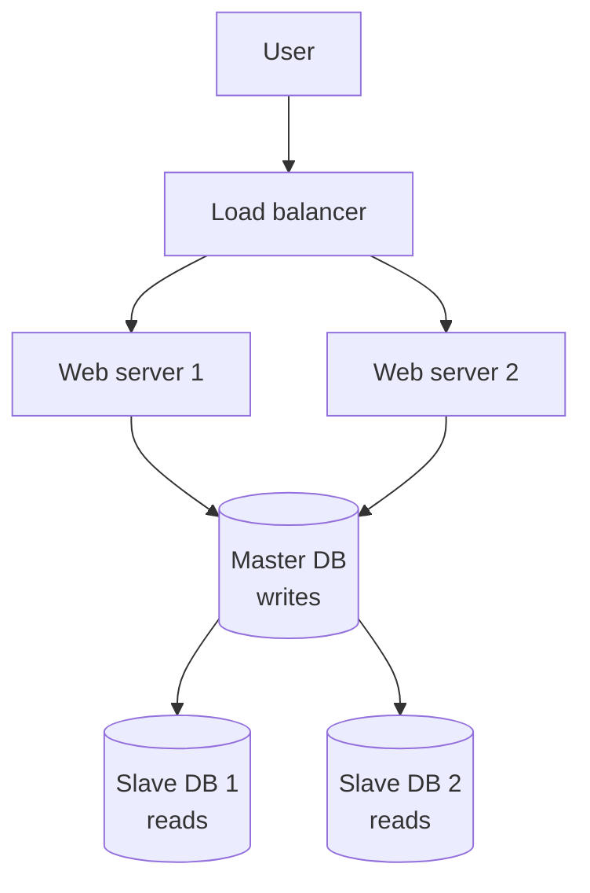
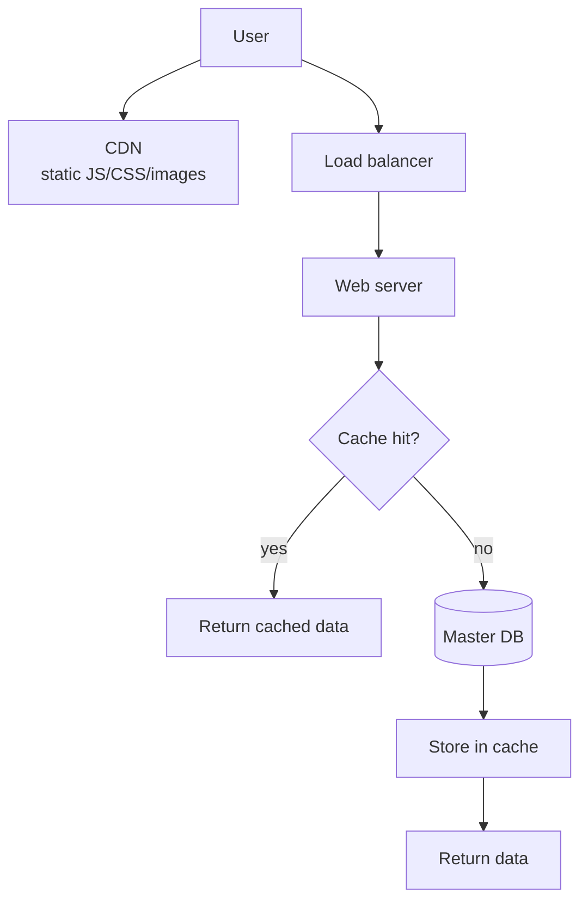
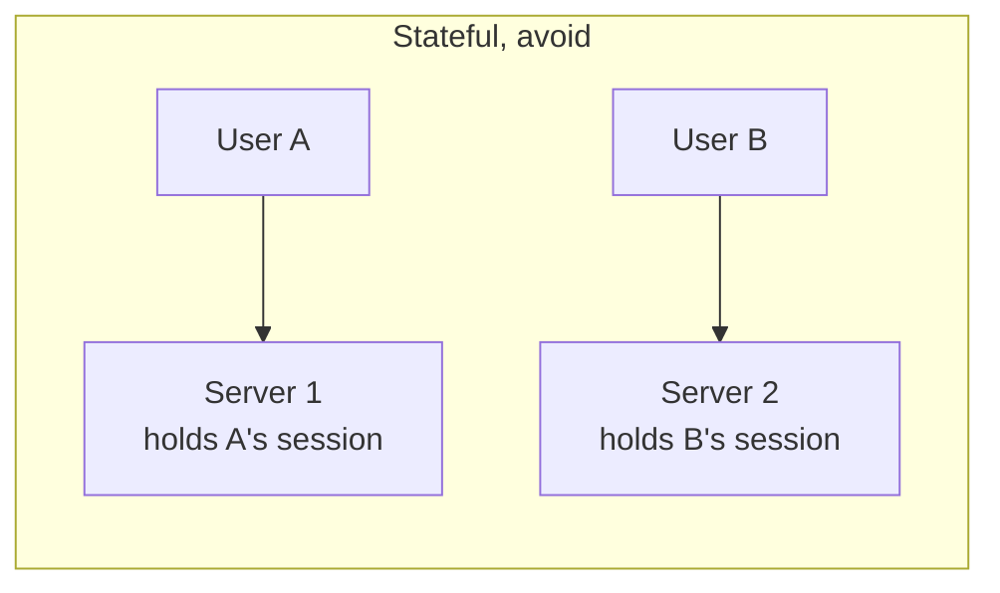
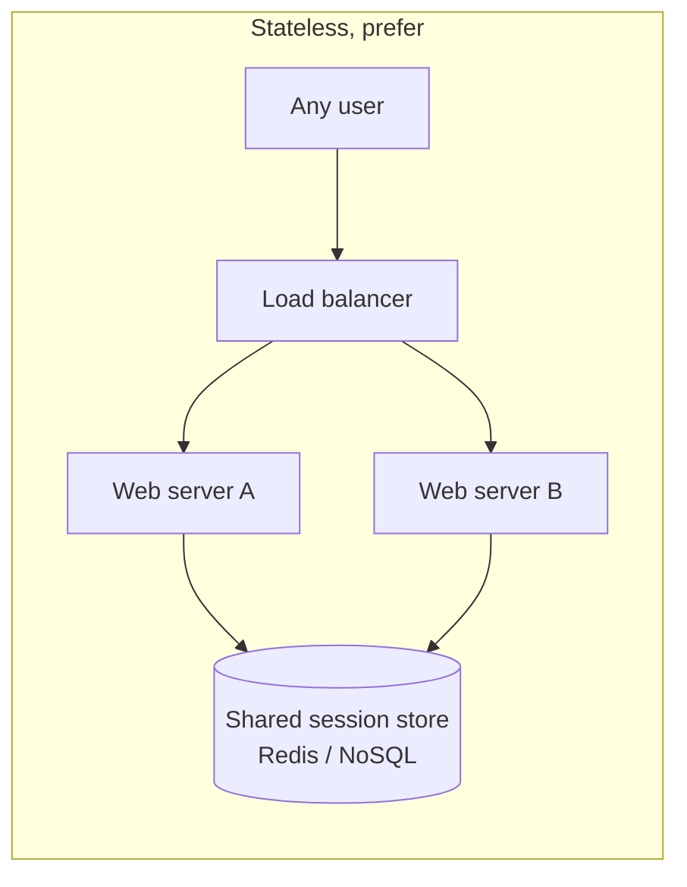
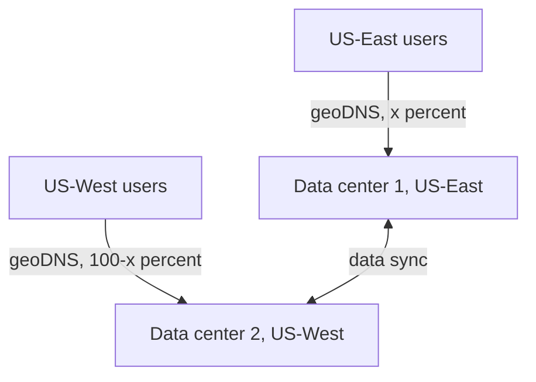
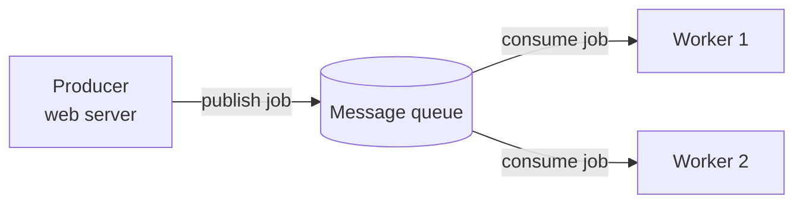
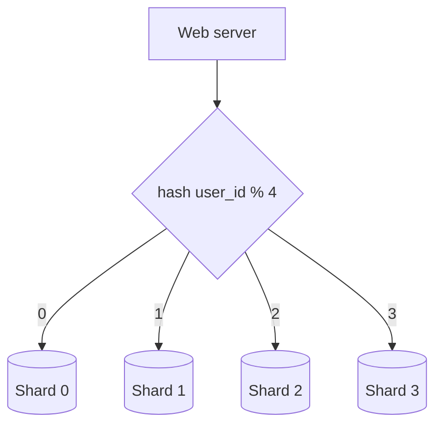
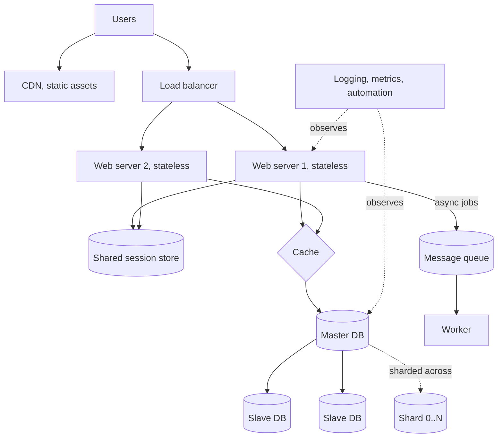

# Worked example: the scaling journey, stage by stage

This note reproduces the book's own running example. The book scales one system from a single server to a multi-data-center, sharded, queue-backed architecture. This note redraws that progression as a set of diagrams.

You can reuse this set as a template for any later "design X" chapter in this book. Chapters on consistent hashing, key-value stores, and URL shorteners all assume this baseline architecture.

Each stage adds exactly one capability to the stage before it. This follows the book's own progression, shown in its Figures 1-1 through 1-23.

## Stage 1: single server

Everything lives on one box. There is no failover. If this server goes down, the product goes down.

## Stage 2: separate web and data tiers

Splitting web and data tiers lets each tier scale independently. At this point you must choose between a relational and a non-relational database. The chapter note has a decision table for this choice.

## Stage 3: load balancer and database replication

The load balancer removes the single point of failure in the web tier. Master and slave replication removes the single point of failure in the data tier. Writes go to the master. Reads spread across the slaves. If the master fails, the system promotes a slave.

## Stage 4: cache and CDN

The cache absorbs read load before it reaches the database. This is the read-through strategy. The CDN removes static assets from the web tier entirely. It serves each asset from the location nearest the user.

## Stage 5: stateless web tier

Moving session state out of the web server into a shared store means any server can answer any request. This property makes autoscaling possible. Autoscaling adds or removes servers on demand.

## Stage 6: multi-data-center

If DC2 fails, geoDNS routes all traffic to DC1. The hard part is not the routing. The hard part is keeping data synchronized across regions, so a failover does not land users on stale data.

## Stage 7: message queue for decoupling

The producer and the consumer scale independently. They do not need to be online at the same time. Queue depth is the signal for adding or removing workers.

## Stage 8: sharded database

The sharding key decides where each row of data lands. This example uses `user_id`. A bad key choice causes the celebrity, or hotspot, problem. The chapter note's community research section explains how real systems patch around this problem.

## Full composite architecture (equivalent to the book's Figure 1-19)

## How to reuse this template

Every later "design X" chapter in this book builds on some subset of this diagram. Each of those chapters adds one component specific to its own problem. Later chapters cover:

- A rate limiter
- A key-value store
- A URL shortener
- A web crawler
- A notification system
- A news feed
- A chat system
- An autocomplete system
- YouTube
- Google Drive

When you build those chapter notes, copy the relevant stage diagram above instead of drawing a new architecture from scratch. Link back to this note.

## Related
- Chapter note: [[Chapter 1 - Scale From Zero to Millions of Users]]
- MOC, built once all chapters are done: [[System Design Interview - MOC]]
