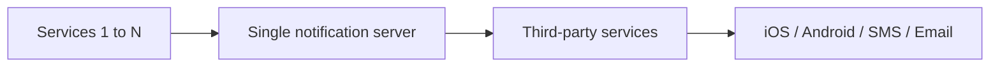
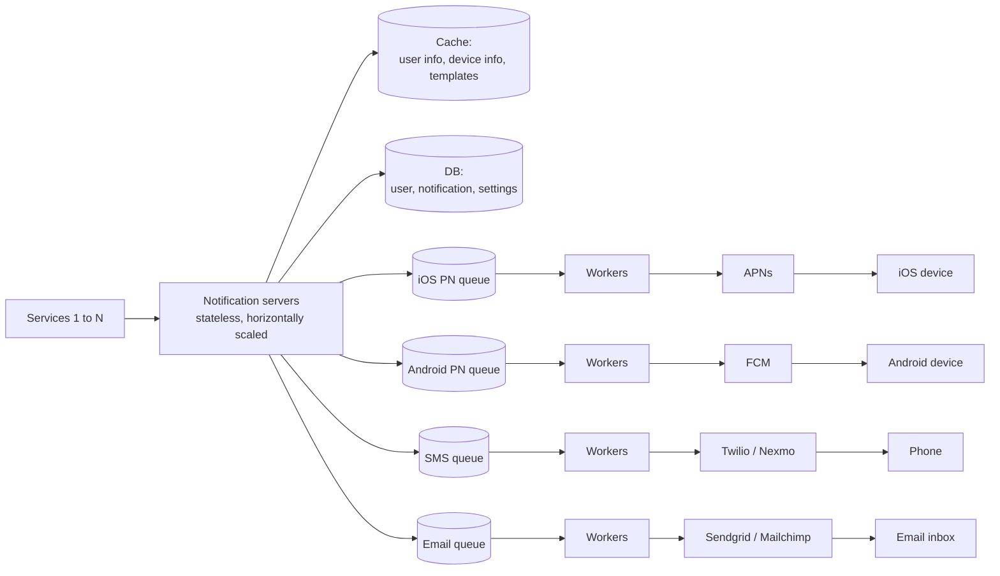
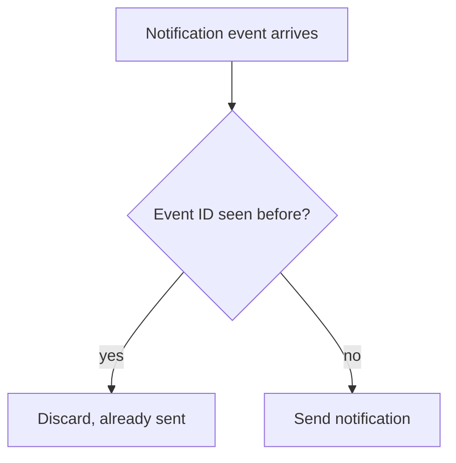
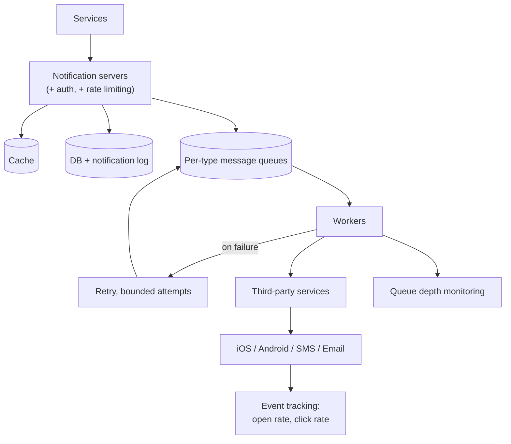

# Worked example: from trigger to delivered notification

## Initial design and its three problems

Problems: single point of failure, hard to scale database/cache/processing independently, and a performance bottleneck from handling everything in one server.

## Improved design, reproduced

A separate queue per notification type means an outage in one third-party service (for example FCM) never blocks SMS or email delivery.

## The six-step send flow, reproduced

1. A service calls the notification server's API to send a notification.
2. The notification server fetches metadata (user info, device token, settings) from cache or database.
3. A notification event is published to the matching queue (for example, an iOS push goes to the iOS PN queue).
4. Workers pull events from the queue.
5. Workers call the relevant third-party service.
6. The third-party service delivers to the user's device.

## Reliability: the dedupe check, reproduced

The book is explicit that exactly-once delivery is not achievable in a distributed system; the dedupe check reduces, but does not eliminate, the chance of a duplicate.

## Final design, with every deep-dive component added

## Notification settings table, reproduced

| Field | Type | Purpose |
|---|---|---|
| user_id | bigint | Which user this setting applies to |
| channel | varchar | push notification, email, or SMS |
| opt_in | boolean | Whether the user accepts this channel |

Checked before every send: a user who opted out of a channel should never receive a notification through it.

## Related
- Chapter note: [[Chapter 10 - Design a Notification System]]
- MOC, built once all chapters are done: [[System Design Interview - MOC]]
