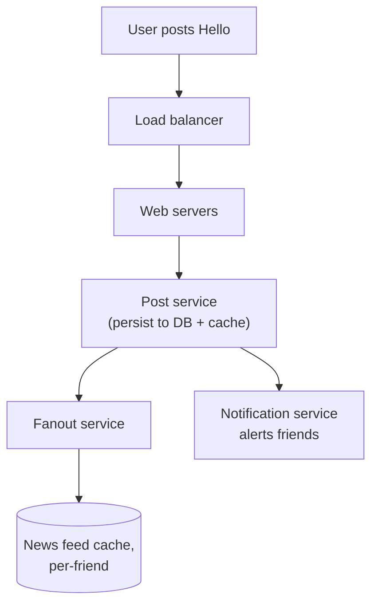
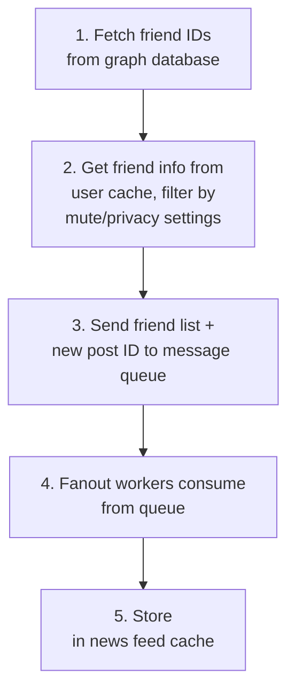
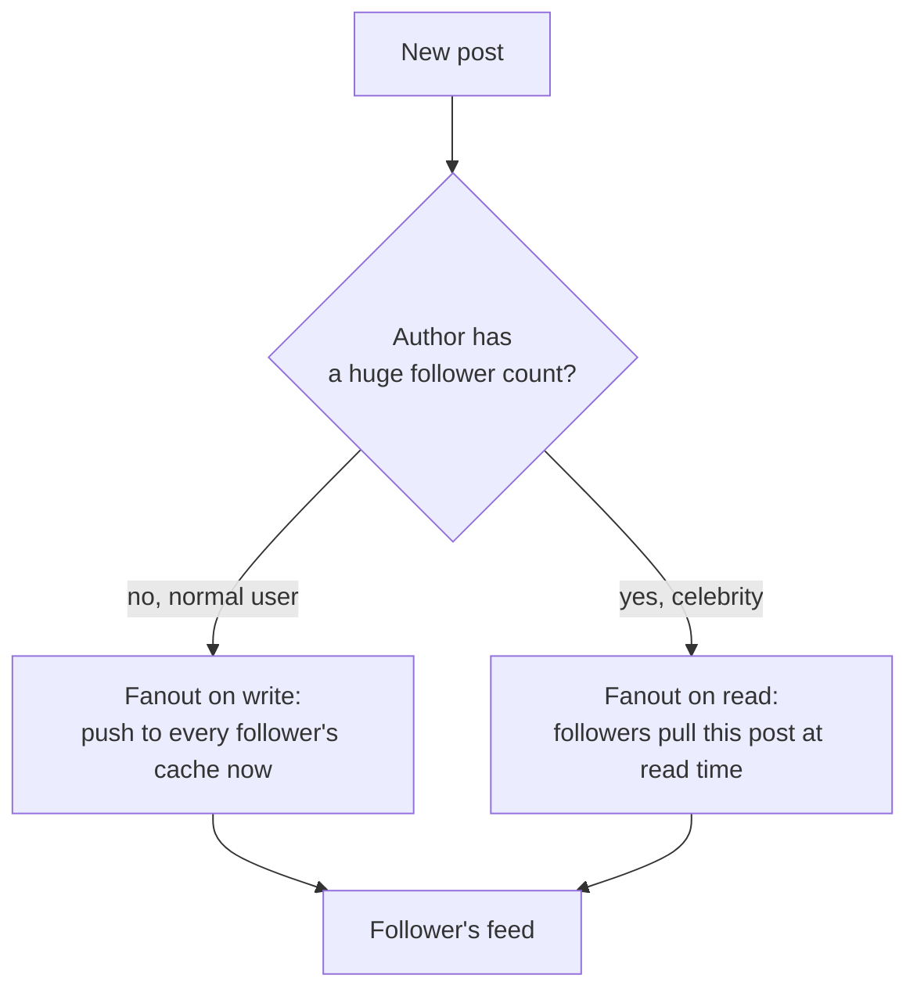
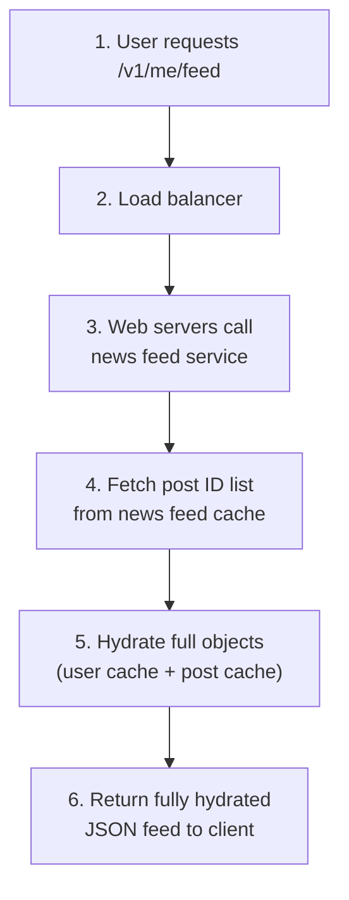

# Worked example: publishing and retrieving a feed post

## Feed publishing flow, reproduced

## Fanout service, internal steps

The news feed cache stores only IDs, never full post or user objects, specifically to keep memory consumption bounded. A configurable size limit per user further caps memory use, since most users only ever look at their most recent feed content.

## Fanout on write vs fanout on read, compared

| | Fanout on write (push) | Fanout on read (pull) |
|---|---|---|
| When work happens | At post time, pre-computed per friend | At read time, on demand |
| Read speed | Fast, feed is already assembled | Slow, feed is assembled live |
| Cost for inactive users | Wasted, pre-computes feeds nobody reads | None, nothing computed until they log in |
| Cost for a user with huge follower count | Very high, the hotkey problem: fanning out to millions of followers on every post | Low, no fanout cost regardless of follower count |
| Book's verdict | Use for the majority of users | Use specifically for celebrities / huge-follower accounts |

## The hybrid model, reproduced

Consistent hashing (Chapter 5) helps distribute the resulting read/write load more evenly once this split is in place.

## News feed retrieval flow, reproduced

Media content (images, video) is served from a CDN, not rebuilt on every request, consistent with Chapter 1's CDN pattern.

## The five-layer cache architecture, reproduced

| Cache layer | What it stores |
|---|---|
| News Feed | IDs of posts in each user's feed |
| Content | Full post data; popular content promoted to a hot cache |
| Social Graph | User relationship (friend/follow) data |
| Action | Whether a user liked, replied to, or otherwise acted on a post |
| Counters | Like counts, reply counts, follower/following counts |

## Related
- Chapter note: [[Chapter 11 - Design a News Feed System]]
- Reuses: [[Chapter 5 - Consistent Hashing Ring Walkthrough]] (distributing fanout load), [[Chapter 10 - Notification System Flow]] (notifying friends of new posts)
- MOC, built once all chapters are done: [[System Design Interview - MOC]]
