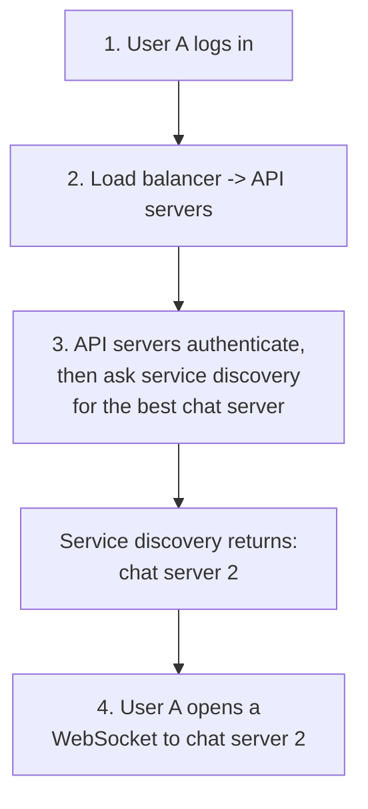
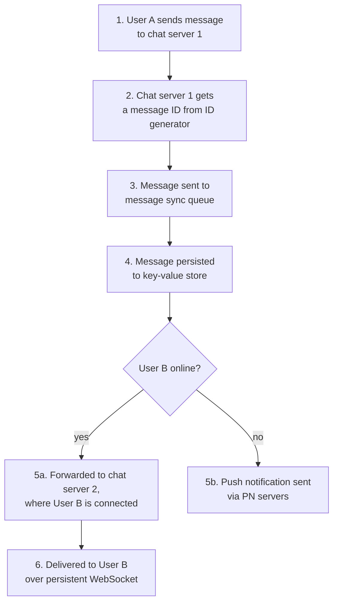
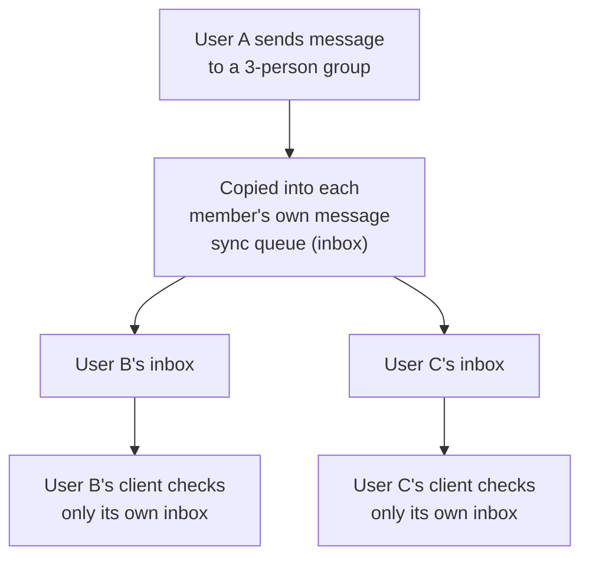
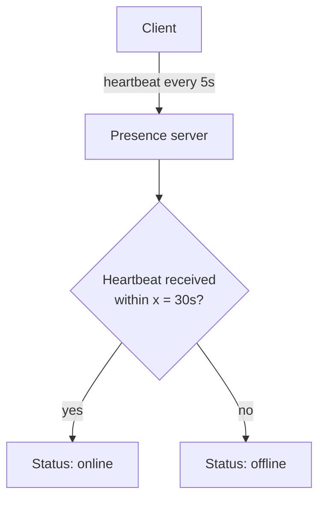
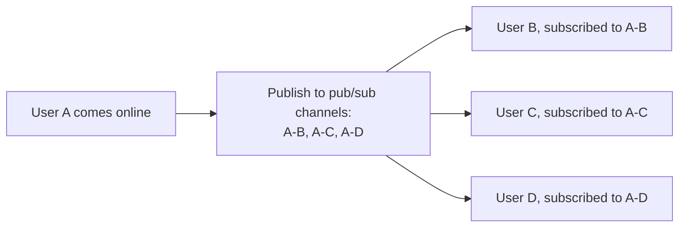

# Worked example: connecting, messaging, and presence

## Why WebSocket wins over polling and long polling

| Technique | How it works | Main weakness |
|---|---|---|
| Polling | Client asks the server "anything new?" on a fixed interval | Wastes server resources; most polls return nothing |
| Long polling | Client holds a request open until a message arrives or it times out | Sender/receiver may land on different stateless servers; server cannot reliably detect disconnects; still inefficient for quiet users |
| WebSocket | One persistent, bidirectional connection, upgraded from an initial HTTP handshake | Requires careful persistent-connection management server-side, but solves every problem above at once |

WebSocket works through most firewalls because it reuses ports 80/443, the same ports HTTP/HTTPS already use.

## Service discovery (login), reproduced

Service discovery (Zookeeper in the book's example) picks a server based on criteria like geographic location and current server capacity, and coordinates with the chat service to avoid overloading any one server.

## One-on-one message flow, reproduced

## Multi-device sync, reproduced

Each device tracks its own `cur_max_message_id`. A message counts as new for a given device if:

1. Its recipient ID matches the currently logged-in user.
2. Its message ID (from the key-value store) is greater than that device's `cur_max_message_id`.

Because each device keeps its own counter, a phone and a laptop can be at different points in the same conversation and each independently catches up by querying the key-value store for anything newer than its own counter.

## Small group chat flow, reproduced

This "one copy per recipient's inbox" design is deliberately simple and only works because group size is capped (100 in this chapter's scope, WeChat caps at 500). At much larger group sizes, copying a message into every member's inbox becomes prohibitively expensive.

## Message ID generation strategies, compared

| Strategy | Uniqueness scope | Pros | Cons |
|---|---|---|---|
| Database auto_increment | Global | Simple, built into relational DBs | Not available in most NoSQL stores |
| Global 64-bit sequence (snowflake) | Global | Strong ordering guarantee across the whole system | More complex to implement and operate |
| Local sequence number | Per-conversation (1-on-1 or group) | Simple; ordering within a conversation is all that is actually required | Does not provide a global total ordering across unrelated conversations |

The book notes local IDs are sufficient, since the only ordering guarantee a user actually needs is "within this conversation," not "across the entire system."

## Online presence: heartbeat mechanism, reproduced

Why not just mark a user offline the instant their connection drops: real connections flap (for example, a phone losing signal briefly in a tunnel), and naive instant status flips would make the presence indicator flicker constantly, a poor experience. The heartbeat's timeout window absorbs brief, harmless disconnects.

## Online status fanout, reproduced

This per-friend-pair channel design works at small scale (WeChat caps groups at 500 for this reason). At real scale, for example a 100,000-member group, broadcasting every status change to every member would generate 100,000 events per change; the practical fix is fetching presence only on demand (when a user opens a group or manually refreshes), not proactively.

## Related
- Chapter note: [[Chapter 12 - Design a Chat System]]
- Reuses: [[Chapter 7 - Snowflake ID Bit Layout]] (message ID generation), [[Chapter 10 - Notification System Flow]] (offline push notifications)
- MOC, built once all chapters are done: [[System Design Interview - MOC]]
