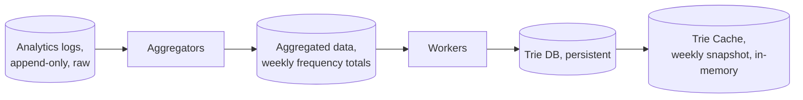
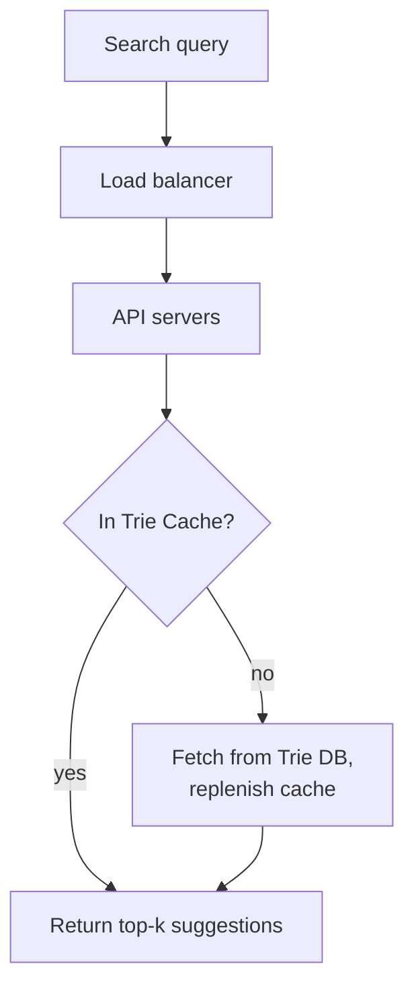

# Worked example: finding the top-k queries for a prefix

## Capacity math, reproduced

- 10 million DAU, 10 searches per day each.
- A query averages 20 bytes (4 words, 5 characters each, 1 byte per ASCII character).
- Roughly 20 backend requests per completed query, one per character typed. Typing "dinner" sends: `search?q=d`, `search?q=di`, `search?q=din`, `search?q=dinn`, `search?q=dinne`, `search?q=dinner`.
- QPS: 10,000,000 * 10 * 20 / 24 / 3600 = about 24,000.
- Peak QPS: 2 * 24,000 = about 48,000.
- New data per day: assuming 20% of daily queries are new, 10,000,000 * 10 * 20 bytes * 20% = about 0.4 GB added daily.

## Basic trie, without optimization

```mermaid
flowchart TD
    Root((root)) --> T[t]
    T --> TR[tr]
    TR --> TRE[tre -> "tree": 10]
    TR --> TRU[tru -> "true": 35]
    TR --> TRY[try -> "try": 29]
    T --> TO[to]
    TO --> TOY[toy -> "toy"]
    Root --> W[w]
    W --> WI[wi]
    WI --> WISH[wish -> "wish"]
    WI --> WIN[win -> "win"]
```

Basic algorithm for top-k, given prefix length p, n total nodes, c children of the prefix node:

1. Find the prefix node: O(p)
2. Traverse the subtree for all valid children: O(c)
3. Sort children, take top k: O(c log c)

Total: O(p) + O(c) + O(c log c). Worked example (k=2, prefix "tr"): find node "tr"; valid children are tree:10, true:35, try:29; sorted, the top 2 are true:35 and try:29.

## The two optimizations, and why they work

| Optimization | What it changes | Resulting complexity |
|---|---|---|
| Cap prefix length at a small constant (the book uses 50) | O(p) becomes O(1), since p is now bounded | Find-prefix step: O(1) |
| Cache the top-k queries at every node | No subtree traversal or sort needed at query time; the answer is already sitting at the node | Return-top-k step: O(1) |

Combined: fetching the top k queries for any prefix becomes O(1) total, at the cost of extra memory to store k cached results at every single node (a deliberate space-for-time trade the book considers well worth it).

## Data gathering pipeline, reproduced



Two storage options for Trie DB:

- **Document store** (for example MongoDB): serialize the whole trie as a snapshot, store the serialized blob.
- **Key-value store**: every trie prefix becomes a key; the node's data (including its cached top-k) becomes the value, directly reusing Chapter 6's key-value store design.

## Query service, improved design



Additional client-side optimizations: AJAX requests (so the whole page never reloads per keystroke), browser caching of results (Google itself caches autocomplete responses for 1 hour, marked `private, max-age=3600`), and data sampling (logging only 1 in N search requests to control log volume at scale).

## Trie operations, reproduced

| Operation | How it works |
|---|---|
| Create | Workers build a fresh trie from aggregated analytics data |
| Update (option 1, preferred) | Rebuild the whole trie on a schedule (weekly), swap the new trie in wholesale |
| Update (option 2, rarely used) | Update a single node directly; requires updating every ancestor up to the root too, since ancestors cache their descendants' top queries. Only acceptable for a small trie |
| Delete | A filter layer sits in front of the Trie Cache to block unwanted (hateful, violent, dangerous) suggestions immediately; the underlying bad data is removed from the database asynchronously so the next scheduled rebuild excludes it permanently |

## Sharding the trie, and its pitfall

Naive first-letter sharding: 2 servers could split 'a'-'m' and 'n'-'z'; 3 servers could split 'a'-'i', 'j'-'r', 's'-'z'; up to 26 servers, one per letter. This breaks down because letter frequency in real queries is wildly uneven (far more queries start with 'c' than with 'x'), producing lopsided shard sizes.

Fix: a shard map manager that looks up actual historical query-volume distribution and groups letters into shards with genuinely comparable volume (for example, pairing a high-volume single letter like 's' against several much lower-volume letters like 'u' through 'z' combined), rather than assuming every letter carries equal weight.

## Related
- Chapter note: [[Chapter 13 - Design a Search Autocomplete System]]
- Reuses: [[Chapter 6 - Key-Value Store Internals]] (trie-as-hash-table storage option)
- MOC, built once all chapters are done: [[System Design Interview - MOC]]
