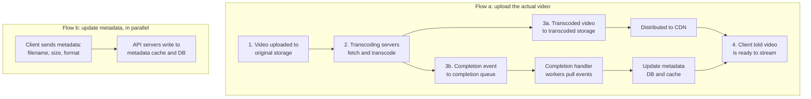
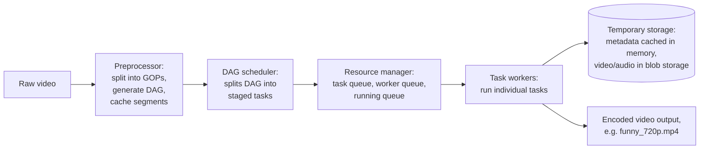
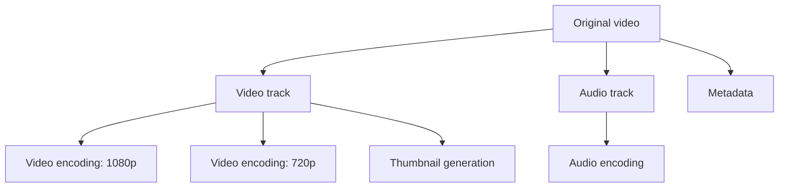

# Worked example: from upload to playable stream

## Capacity and cost math, reproduced

- 5 million DAU, 5 videos watched per day each, 10% of users upload 1 video per day.
- Average video size: 300 MB.
- Daily upload storage: 5,000,000 * 10% * 300 MB = 150 TB per day.
- CDN egress cost, assuming all US traffic at $0.02/GB (AWS CloudFront pricing): 5,000,000 * 5 videos * 0.3 GB * $0.02 = $150,000 per day, for streaming alone.

## The two parallel upload flows, reproduced

Both flows run concurrently, not sequentially, since the metadata write does not depend on transcoding finishing.

## Video transcoding architecture, six components

## Example DAG for one video, reproduced

A content creator's own configuration determines which of these stages actually run (for example, whether a watermark stage is included, or whether thumbnails are user-supplied or auto-generated).

## Container versus codec, the distinction

| Term | What it means | Examples |
|---|---|---|
| Container | The "basket" holding video, audio, and metadata together | .avi, .mov, .mp4 |
| Codec | The compression/decompression algorithm that shrinks video size while preserving quality | H.264, VP9, HEVC |

## Resource manager's four parts, reproduced

| Component | Role |
|---|---|
| Task queue | Priority queue of tasks waiting to run |
| Worker queue | Priority queue tracking worker utilization |
| Running queue | Tracks which task is bound to which worker, currently in flight |
| Task scheduler | Pulls the highest-priority task, finds the best available worker, binds them, and removes the pairing from the running queue once complete |

## Speed optimizations, reproduced

| Optimization | How it works |
|---|---|
| Parallelize upload | Split the video into GOP-aligned chunks client-side; upload chunks in parallel, and resume only the failed chunk if an upload fails, instead of restarting the whole file |
| Geographically distributed upload centers | Route a user to the nearest upload center (implemented via CDN), for example North America vs. Asia, cutting upload latency |
| Message queues between pipeline stages | Decouples each stage so the encoding module no longer has to wait synchronously on the download module's output; it can process any events already sitting in the queue in parallel |

## Safety optimizations, reproduced

| Mechanism | Purpose |
|---|---|
| Pre-signed upload URL | Client requests a scoped, temporary upload URL from API servers first, then uploads directly to blob storage using that URL, so only authorized clients can write to the right location (AWS calls this a pre-signed URL; Azure calls the equivalent a Shared Access Signature) |
| DRM (Apple FairPlay, Google Widevine, Microsoft PlayReady) | Industry-standard systems restricting who can decrypt and play protected content |
| AES encryption with an authorization policy | Video is encrypted; only authorized users' clients can decrypt it on playback |
| Visual watermarking | An image overlay (for example a logo) identifying the content's origin |

## Cost-saving optimizations, reproduced

Grounded in the long-tail distribution of video popularity (a few videos get most views, most get very few):

1. Serve only the most popular videos from CDN; serve everything else from cheaper, high-capacity storage servers.
2. Skip pre-encoding every resolution for unpopular content; encode short, rarely watched videos on demand instead.
3. Skip global distribution for videos popular only in one region.
4. At large scale, build an owned CDN and partner directly with ISPs (Netflix's own approach), trading a very large upfront build cost for lower long-run bandwidth costs.

## Error-handling playbook, reproduced

| Component failure | Response |
|---|---|
| Upload error | Retry a few times |
| Old client cannot split by GOP | Server performs the split instead |
| Transcoding error | Retry |
| Preprocessor error | Regenerate the DAG diagram |
| DAG scheduler error | Reschedule the task |
| Resource manager queue down | Fail over to a replica |
| Task worker down | Retry the task on a different worker |
| API server down | Stateless, so traffic simply routes to another instance |
| Metadata cache node down | Data is replicated; read from a surviving replica, bring up a replacement |
| Metadata DB master down | Promote a slave to master |
| Metadata DB slave down | Read from another slave; bring up a replacement |

## Related
- Chapter note: [[Chapter 14 - Design YouTube]]
- MOC, built once all chapters are done: [[System Design Interview - MOC]]
