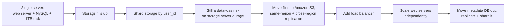
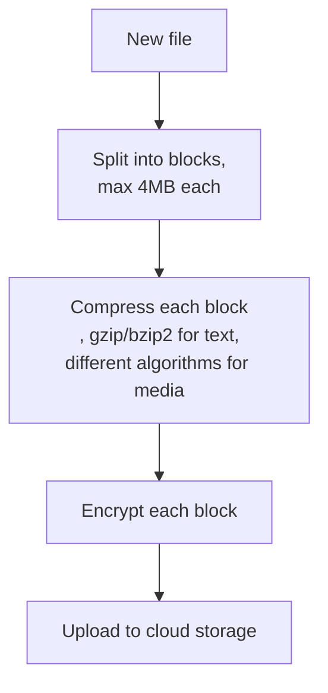
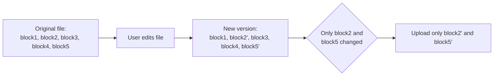
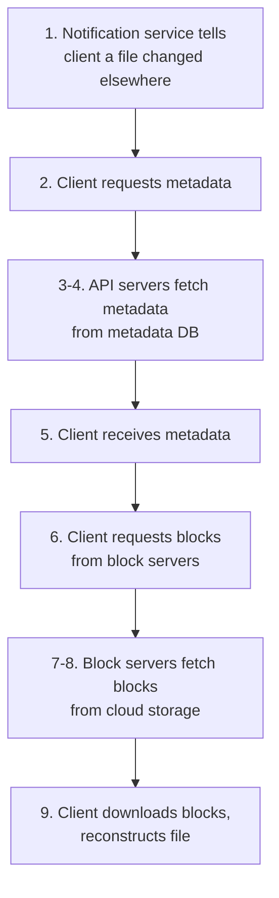
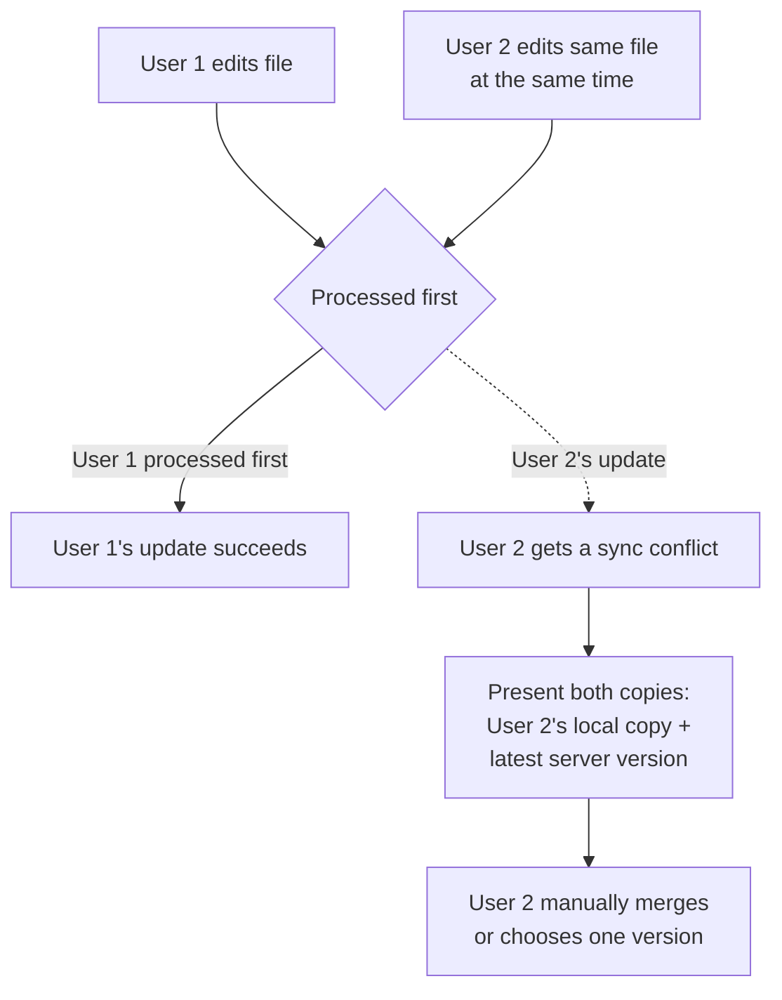

# Worked example: block servers, upload flow, and sync conflict resolution

## Capacity math, reproduced

- 50 million signed-up users, 10 million DAU, each with 10 GB free space.
- Total space allocated: 50,000,000 * 10 GB = 500 petabytes.
- Users upload 2 files per day, average 500 KB each; 1:1 read:write ratio.
- Upload QPS: 10,000,000 * 2 / 24 / 3600 = about 240.
- Peak QPS: 2 * 240 = about 480.

## The single-server-to-scaled-out journey, reproduced

Each step solves exactly one concrete failure the previous step exposed, not a hypothetical one: this is the book's own "pull an all-nighter, fix the fire, worry about the next fire" narrative compressed into a diagram.

## Block servers: splitting, compressing, encrypting, reproduced

## Delta sync, reproduced

Only modified blocks transfer, not the whole file, directly cutting bandwidth for large, frequently edited files.

## Upload flow, both parallel requests reproduced

```mermaid
flowchart TD
    subgraph Meta [Add file metadata]
        M1[1. Client sends new-file metadata] --> M2[2. Store metadata,<br/>status = pending]
        M2 --> M3[3. Notify notification service]
        M3 --> M4[4. Notification service<br/>tells other clients]
    end
    subgraph Blocks [Upload file to cloud storage]
        B1[2.1 Client uploads content<br/>to block servers] --> B2[2.2 Split, compress,<br/>encrypt, upload blocks]
        B2 --> B3[2.3 Cloud storage triggers<br/>completion callback]
        B3 --> B4[2.4 Status changed<br/>to uploaded]
        B4 --> B5[2.5-2.6 Notification service<br/>tells other clients: fully uploaded]
    end
```

## Download flow, reproduced

## Sync conflict resolution, reproduced

First-processed-wins is the rule; the loser never gets silently overwritten, they get a choice instead.

## Why long polling, not WebSocket, for notifications

| Factor | Long polling | WebSocket |
|---|---|---|
| Direction needed | Server to client only (file changed, go pull it) | Bidirectional |
| Frequency and burstiness | Infrequent, no bursts | Suited to frequent, bidirectional traffic (for example chat) |
| Book's choice | Chosen | Not chosen, deemed unnecessary complexity for this use case |

## Storage-saving techniques, reproduced

| Technique | How it saves space |
|---|---|
| De-duplicate blocks | Two blocks with the same hash are stored once, referenced by multiple files/versions |
| Cap version history | Keep only N most recent versions; oldest is evicted on overflow |
| Weight recent versions more | For heavily-edited files, skip saving every single edit; favor recent versions over an exhaustive history |
| Move cold data to cheaper storage | Infrequently accessed files move to a cold tier (for example Amazon S3 Glacier), far cheaper than active storage |

## Related
- Chapter note: [[Chapter 15 - Design Google Drive]]
- MOC, built once all chapters are done: [[System Design Interview - MOC]]
