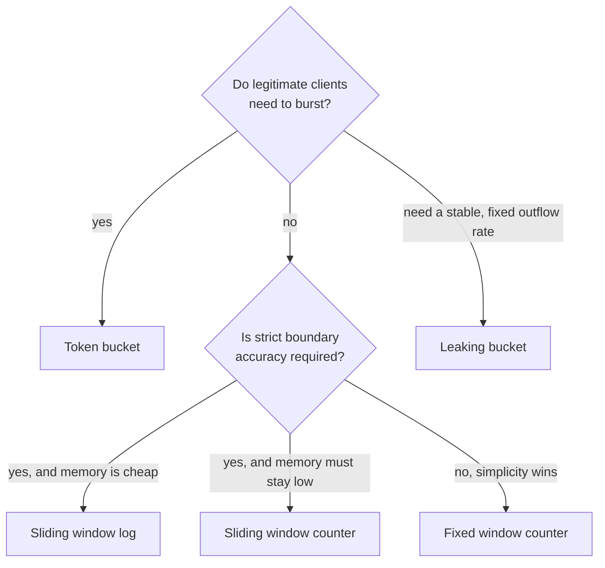
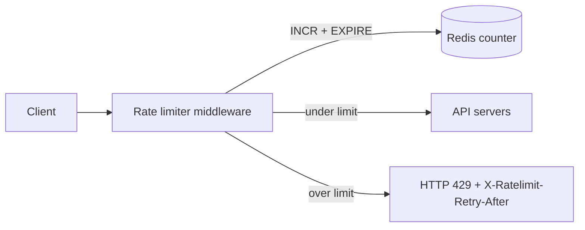

# Worked example: choosing and implementing a rate-limiting algorithm

A reusable decision reference for the five algorithms the chapter covers, reproducing its worked numeric examples and adding the Redis implementation pattern it points to.

## Decision tree: which algorithm fits your case



## Algorithm comparison

| Algorithm | Parameters | Pros | Cons | Real users cited |
|---|---|---|---|---|
| Token bucket | Bucket size, refill rate | Simple, memory efficient, allows bursts | Two parameters can be hard to tune | Amazon, Stripe |
| Leaking bucket | Bucket (queue) size, outflow rate | Memory efficient, stable fixed outflow | Old queued requests can starve new ones; two parameters to tune | Shopify |
| Fixed window counter | Window size, threshold | Memory efficient, easy to understand | Edge-of-window traffic spikes can double the effective quota | - |
| Sliding window log | Threshold, log of timestamps | Very accurate, no edge-of-window problem | Memory-heavy, stores a timestamp per request | - |
| Sliding window counter | Threshold, weighted window overlap | Smooths spikes, memory efficient | An approximation, assumes even distribution within the window | Cloudflare (0.003% error at 400M requests) |

## Worked example: the fixed-window edge problem, reproduced

System allows 5 requests per minute, quota resets on the round minute.

- Between 2:00:00 and 2:01:00: 5 requests arrive, all allowed.
- Between 2:01:00 and 2:02:00: 5 more requests arrive, all allowed.
- Looking at the 1-minute window from 2:00:30 to 2:01:30 instead: 10 requests went through, twice the allowed quota.

This is why the sliding window counter and sliding window log algorithms exist: both remove this edge-of-window loophole, at different memory costs.

## Worked example: the sliding window counter formula, reproduced

Rate limiter allows 7 requests per minute. 5 requests occurred in the previous minute, 3 in the current minute so far. A new request arrives 30% of the way into the current window (so the rolling window overlaps 70% of the previous minute).

```
requests in rolling window = requests in current window + requests in previous window * overlap percentage
                            = 3 + 5 * 0.7
                            = 6.5, rounded down to 6
```

6 is under the limit of 7, so the request is allowed. One more request in the current window would hit the limit.

## Redis implementation pattern (from the book's high-level architecture)



- `INCR`: increases the stored counter by 1.
- `EXPIRE`: sets a timeout on the counter; once it expires, the counter is deleted automatically.
- Response headers to return on every request: `X-Ratelimit-Remaining`, `X-Ratelimit-Limit`, `X-Ratelimit-Retry-After` (the last one only on a 429).

## Distributed deployment checklist

- [ ] Use a centralized store (Redis), not sticky sessions, so every rate limiter instance sees the same counters.
- [ ] Guard counter increments against race conditions with a Lua script or Redis sorted sets, not application-level locks.
- [ ] Deploy multiple edge locations if users are geographically spread, to keep rate-limiter latency low.
- [ ] Accept eventual consistency between rate limiter nodes rather than paying for strong consistency on every check.
- [ ] Store rate-limiting rules on disk, cache them in memory, and have workers refresh the cache periodically rather than reading disk per request.

## Related
- Chapter note: [[Chapter 4 - Design a Rate Limiter]]
- MOC, built once all chapters are done: [[System Design Interview - MOC]]
