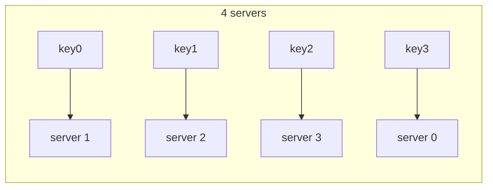
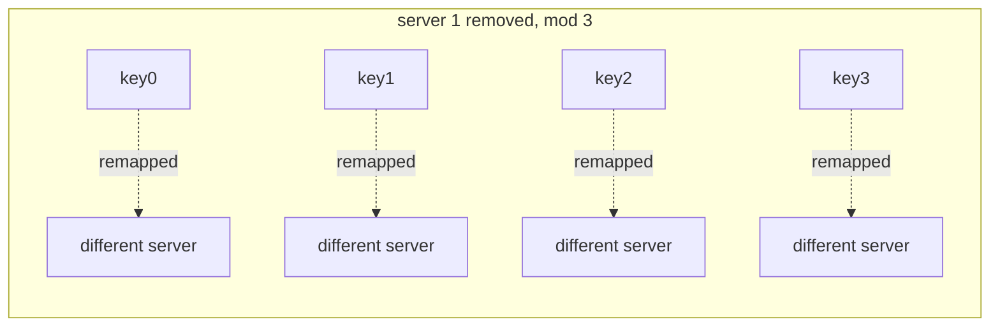
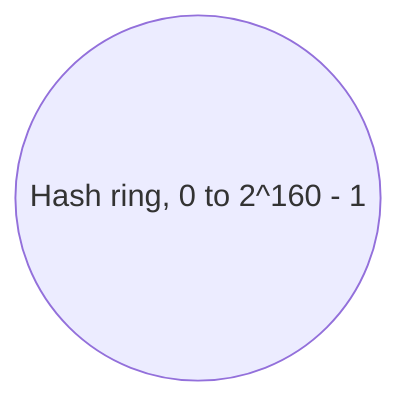
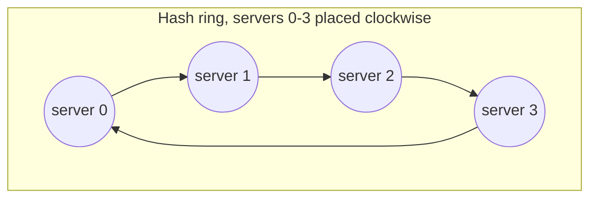
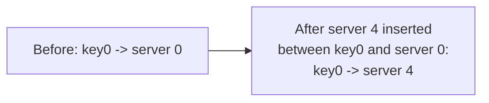
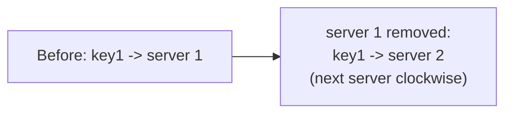

# Worked example: tracing the hash ring step by step

Reproduces the book's own ring walkthrough as diagrams, plus the virtual-node tuning tradeoff and a comparison against the modern alternatives community research surfaced.

## The problem: plain modulo hashing breaks on resize

With 4 servers, `serverIndex = hash(key) % 4`. If server 1 goes offline, the pool size drops to 3, and `hash(key) % 3` reshuffles almost every key, not just the ones that lived on server 1.

Nearly every key moves. Every cache misses at once. This is the rehashing storm consistent hashing exists to prevent.

## The hash ring

Servers and keys both hash onto the same ring (SHA-1 in the book's example). To find a key's server, walk clockwise from the key's position until you hit the first server.

key0 lands just before server 0, so it belongs to server 0. key1 belongs to server 1. key2 belongs to server 2. key3 belongs to server 3.

## Add a server: only one key moves

key1, key2, and key3 stay exactly where they were. Only the keys sitting between the new server and the next server clockwise get redistributed.

## Remove a server: only its keys move

## The two problems with the basic ring, and the virtual-node fix

| Problem | What goes wrong | Fix |
|---|---|---|
| Uneven partition sizes | One server's share of the ring can be far larger or smaller than another's, purely from where servers happened to land | Virtual nodes: each physical server gets many points on the ring, not one |
| Non-uniform key distribution | Most keys can land near one server by chance, leaving others nearly empty | Same fix: more points per server smooths out the unlucky clustering |

## Virtual node count versus balance (reproduced from the book's cited research)

| Virtual nodes per server | Standard deviation from the mean load |
|---|---|
| 100 | about 10% |
| 200 | about 5% |

More virtual nodes mean better balance, at the cost of more memory to store virtual-node metadata. This is a direct, tunable tradeoff, not a fixed setting.

## Finding the affected range on a membership change

- **Adding server 4**: the affected range runs anticlockwise from server 4 back to the previous server (server 3). Only keys in that arc move to server 4.
- **Removing server 1**: the affected range runs anticlockwise from server 1 back to the previous server (server 0). Only keys in that arc move, to server 2 (the next server clockwise from server 1).

## Consistent hashing versus its modern alternatives (community research, not in the book)

| Algorithm | Lookup cost at 5,000 nodes | Handles arbitrary removal | Needs stored state | Typical use |
|---|---|---|---|---|
| Ring hash + virtual nodes | about 3.4 microseconds | yes | yes (the ring) | General default; Cassandra, Dynamo, Discord |
| Jump consistent hash | about 6.0 microseconds | no, append/remove only from the end | no | Shard counts that only grow, no mid-list removal |
| Rendezvous (HRW) hashing | about 7,302 microseconds | yes | no | Small clusters (a few dozen nodes), exact weights |
| Maglev | O(1) via precomputed table | yes, rebuild table on change | yes (permutation table) | Extreme-scale network load balancing, Google's own load balancer |

## Related
- Chapter note: [[Chapter 5 - Design Consistent Hashing]]
- MOC, built once all chapters are done: [[System Design Interview - MOC]]
