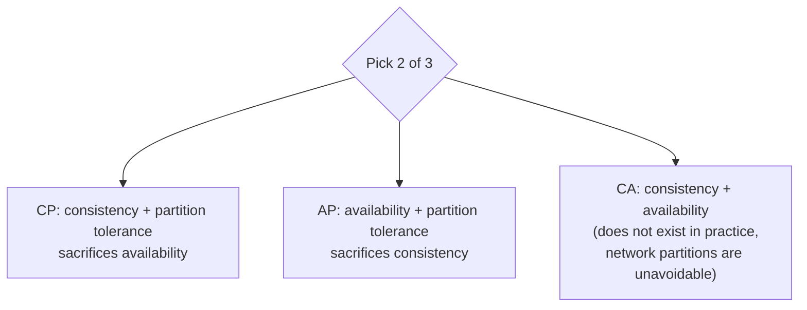
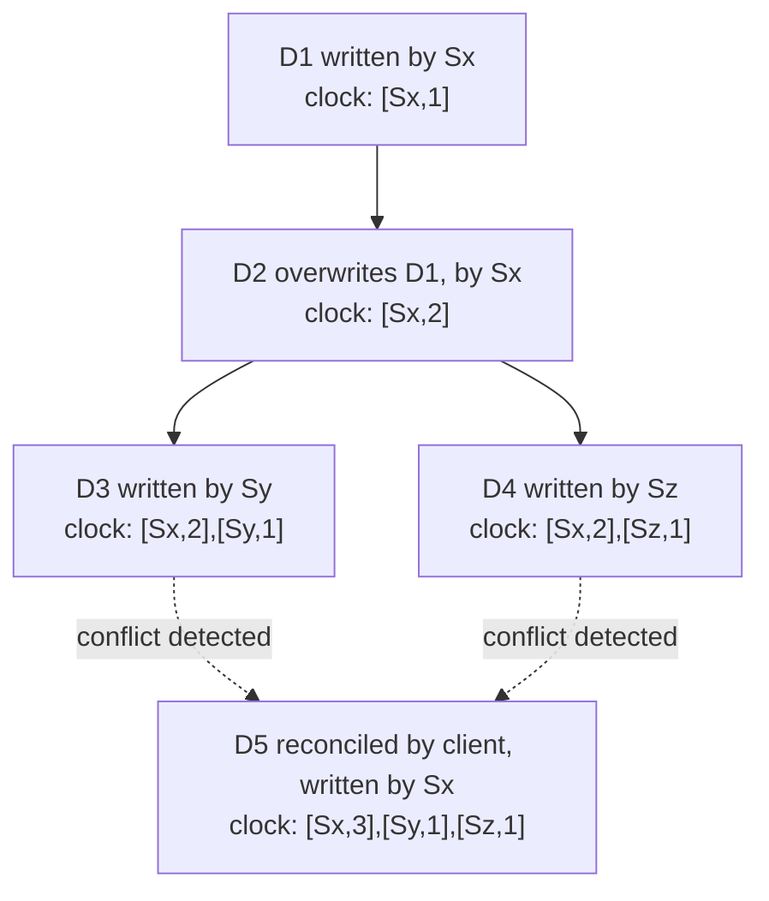
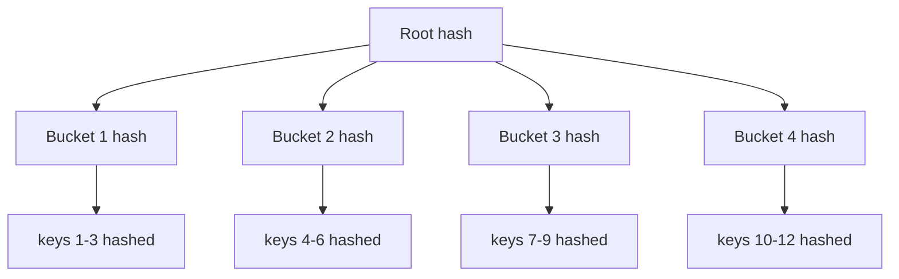
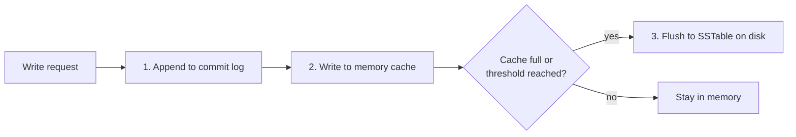
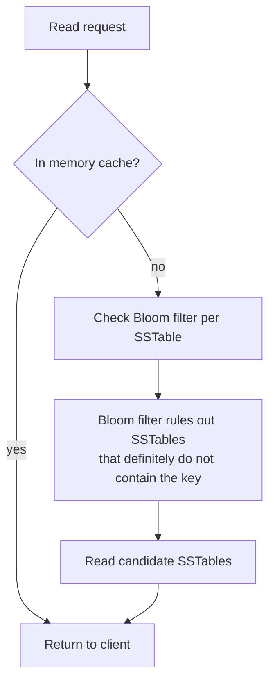

# Worked example: tracing writes and reads through a Dynamo-style store

Reproduces the book's own quorum math, vector-clock trace, Merkle tree build, and write/read paths as diagrams and tables you can reuse.

## CAP theorem, the three systems

## Quorum math: N, W, R

With N replicas, W = write quorum size, R = read quorum size.

| Configuration | Optimized for | Strong consistency? |
|---|---|---|
| R = 1, W = N | Fast reads | No |
| W = 1, R = N | Fast writes | No |
| W + R > N (commonly N=3, W=R=2) | Balanced, strongly consistent | Yes |
| W + R <= N | Low latency both ways | No |

`W = 1` does not mean data lives on one server. It means the coordinator waits for only one acknowledgment before declaring the write successful, even though the write is still sent to all N replicas.

## Vector clock trace, reproduced from the book

**Ancestor rule (no conflict)**: version Y is a descendant of X if every counter in Y's clock is greater than or equal to the corresponding counter in X's clock. Example: `D([s0,1],[s1,1])` is an ancestor of `D([s0,1],[s1,2])`.

**Sibling rule (conflict)**: X and Y conflict if any participant's counter in Y is less than its counter in X, while another participant's counter in Y is greater. Example: `D([s0,1],[s1,2])` and `D([s0,2],[s1,1])` conflict, since neither dominates the other.

## Failure handling, three mechanisms

| Mechanism | Handles | How it works |
|---|---|---|
| Gossip protocol | Detecting a server is actually down | Nodes exchange heartbeat counters with random peers; a stalled counter past a threshold marks that node offline |
| Sloppy quorum + hinted handoff | Temporary failure | Writes and reads use the first W/R healthy nodes on the ring, skipping the down node; a healthy neighbor holds the data and hands it back once the original node recovers |
| Anti-entropy with Merkle trees | Permanent failure, long-running drift | Compare replicas' Merkle tree root hashes; only descend into subtrees whose hashes differ, and only resync the buckets that actually diverge |

## Merkle tree build, reproduced from the book

Compare root hashes first. If they match, the replicas are identical, stop. If they differ, descend only into the mismatched subtree, repeating until the specific divergent buckets are found. Only those buckets get resynced, not the whole dataset. Real systems use far bigger buckets than this toy example, for example roughly 1,000 keys per bucket at a scale of one million buckets per one billion keys.

## Write path (Cassandra-style, as the book presents it)

## Read path (with a Bloom filter to skip SSTables that cannot have the key)

A Bloom filter can have false positives (says "maybe present" when it is not) but never false negatives (never says "definitely absent" when it is actually present), which is exactly the property needed to safely skip SSTables without missing data.

## Related
- Chapter note: [[Chapter 6 - Design a Key-Value Store]]
- MOC, built once all chapters are done: [[System Design Interview - MOC]]
