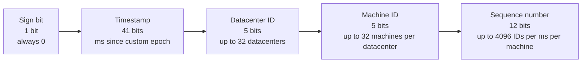

# Worked example: the 64-bit snowflake ID, bit by bit

## Bit layout



| Section | Bits | Capacity | Notes |
|---|---|---|---|
| Sign bit | 1 | Always 0 | Reserved; keeps IDs non-negative |
| Timestamp | 41 | 2^41 - 1 ms, about 69 years from the chosen epoch | Twitter's default epoch: 1288834974657 ms (Nov 4 2010, 01:42:54 UTC) |
| Datacenter ID | 5 | 32 datacenters | Fixed at startup, rarely changed |
| Machine ID | 5 | 32 machines per datacenter | Fixed at startup, rarely changed |
| Sequence number | 12 | 4096 IDs per millisecond per machine | Resets to 0 every millisecond |

## Why the 69-year lifespan number, reproduced

```
2^41 - 1 = 2,199,023,255,551 milliseconds
         / 1000 (seconds)
         / 365 (days)
         / 24 (hours)
         / 3600 (seconds per hour, already divided once above; book's own division chain)
         ~= 69 years
```

A custom epoch set close to the system's actual launch date pushes this overflow date as far out as possible. After 69 years from the epoch, the system needs a new epoch or a different ID scheme entirely.

## Four approaches, compared

| Approach | Coordination needed | ID size | Sortable by time | Numeric only | Main weakness |
|---|---|---|---|---|---|
| Multi-master replication (auto_increment by k) | Database servers must agree on k | Database-native | No, diverges across servers | Yes | Breaks across data centers, breaks when servers are added/removed |
| UUID | None, fully independent | 128 bits | No | No, can include letters | Too large for a 64-bit requirement, not time-ordered |
| Ticket server | Centralized server, single point of failure | Database-native | Yes | Yes | Single point of failure; multiple ticket servers reintroduce sync problems |
| Twitter snowflake | Datacenter ID and machine ID fixed at startup; otherwise none | 64 bits | Yes | Yes | Depends on clock synchronization across machines |

## Related
- Chapter note: [[Chapter 7 - Design a Unique ID Generator in Distributed Systems]]
- MOC, built once all chapters are done: [[System Design Interview - MOC]]
