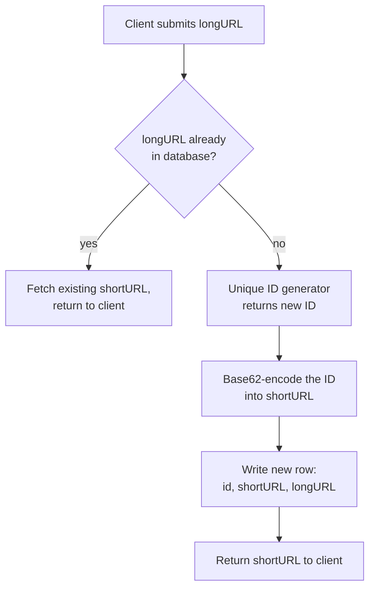
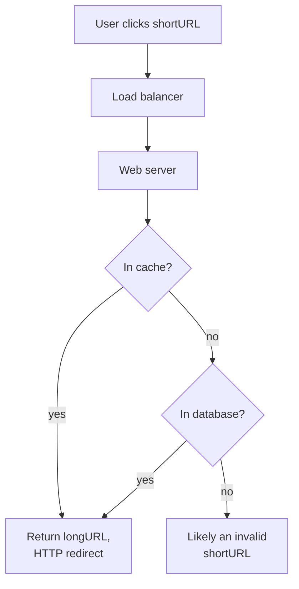

# Worked example: shortening and redirecting a URL, step by step

## Capacity math, reproduced

- 100 million URLs created per day.
- Write throughput: 100,000,000 / 24 / 3600 = about 1,160 writes per second.
- Read:write ratio assumed 10:1, so reads: 1,160 * 10 = about 11,600 reads per second.
- Over 10 years: 100 million * 365 * 10 = 365 billion records.
- At an average 100 bytes per URL: 365 billion * 100 bytes = 36.5 TB... the book's own arithmetic states 365 TB over 10 years; reproduced here exactly as written, treating "365 billion * 100 bytes * 10 years" as the book's stated formula.

## Why the hashValue is 7 characters

Alphabet: digits 0-9, lowercase a-z, uppercase A-Z = 10 + 26 + 26 = 62 characters.

Find the smallest n such that `62^n >= 365 billion`.

| n | 62^n | Enough for 365 billion? |
|---|---|---|
| 6 | about 56.8 billion | No |
| 7 | about 3.5 trillion | Yes, comfortably |

So the hashValue is 7 characters long.

## Base62 conversion, worked example reproduced

Convert 11157 (base 10) to base 62.

```
11157 = 2 x 62^2 + 55 x 62^1 + 59 x 62^0
      = [2, 55, 59] in base 62 digits
```

Mapping: 0-9 to themselves, 10-35 to a-z, 36-61 to A-Z. So 55 maps to 'T' and 59 maps to 'X'.

Result: `[2, T, X]` to `2TX`, so the short URL is `https://tinyurl.com/2TX`.

## Two hash-function strategies, compared

| Approach | How it works | Pros | Cons |
|---|---|---|---|
| Hash + collision resolution | Hash the long URL (CRC32/MD5/SHA-1), take the first 7 characters, append a fixed string and rehash on collision | No separate ID generator needed; same URL can hash deterministically | Checking for an existing shortURL on every write is expensive; needs a Bloom filter to stay fast |
| Base62 conversion | Generate a globally unique numeric ID (Chapter 7's ID generator), then encode that ID in base62 | Zero collisions by construction; no retry loop | Depends on a working distributed unique ID generator |

The book settles on base62 conversion for its own design.

## URL shortening flow, reproduced



Worked trace from the book: longURL `https://en.wikipedia.org/wiki/Systems_design` gets ID `2009215674938` from the ID generator, which base62-encodes to `zn9edcu`.

## URL redirecting flow, reproduced



## 301 versus 302 redirect, the tradeoff

| Redirect | Meaning | Browser caches it? | Best for |
|---|---|---|---|
| 301 | Permanent | Yes, subsequent requests skip the shortener entirely | Minimizing server load |
| 302 | Temporary | No, every request still passes through the shortener | Click analytics (every click is observable) |

## Related
- Chapter note: [[Chapter 8 - Design a URL Shortener]]
- Reuses: [[Chapter 7 - Snowflake ID Bit Layout]] (the unique ID generator feeding base62 encoding)
- MOC, built once all chapters are done: [[System Design Interview - MOC]]
