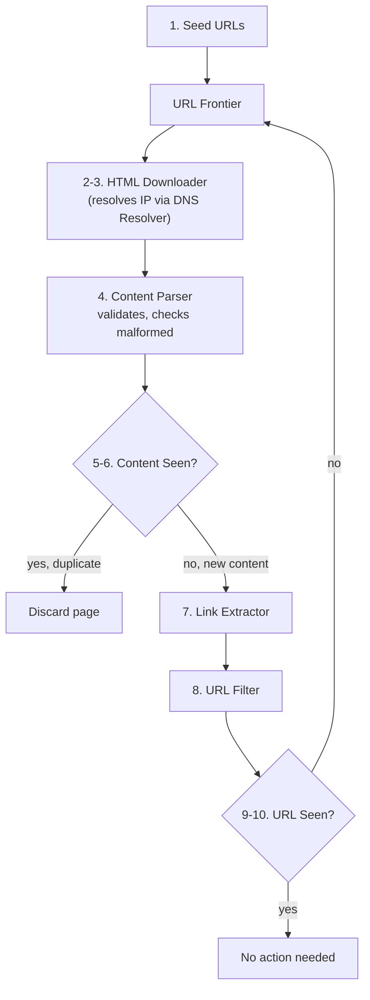
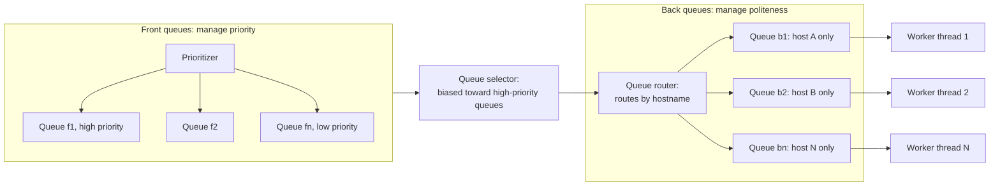

# Worked example: tracing a page through the crawler pipeline

## The full 11-step workflow, reproduced as a diagram

## Capacity math, reproduced

- 1 billion pages downloaded per month.
- QPS: 1,000,000,000 / 30 / 24 / 3,600 = about 400 pages per second.
- Peak QPS: 2 * 400 = 800 pages per second.
- Average page size: 500 KB.
- Monthly storage: 1 billion * 500 KB = 500 TB.
- 5-year storage: 500 TB * 12 months * 5 years = 30 PB.

## DFS versus BFS, and why BFS alone is not enough

| Approach | Problem |
|---|---|
| DFS | Depth can run arbitrarily deep; a poor traversal order for the web's graph shape |
| Plain BFS (single FIFO queue) | Impolite: most links from a page point back to the same host, flooding that host with parallel requests; ignores page importance entirely |

## The URL Frontier's two halves

Front queues solve priority (which URLs matter most). Back queues solve politeness (never flood one host), by guaranteeing each queue holds URLs from exactly one host, and each worker thread only ever drains one queue at a time, with a delay enforced between its downloads.

## Performance optimizations, reproduced

| Technique | What it fixes |
|---|---|
| Distributed crawl | Partition the URL space across many servers, each running multiple threads |
| DNS cache | Avoids synchronous DNS lookups (10-200ms each) blocking every thread; cache refreshed periodically by cron |
| Locality | Place crawl servers, caches, queues, and storage near the hosts being crawled |
| Short timeout | Cap wait time per host so one slow or dead server never stalls the whole crawl |

## Robustness techniques, reproduced

- **Consistent hashing** (Chapter 5) distributes load across downloader servers and absorbs servers being added or removed.
- **Persisted crawl state** lets a disrupted crawl resume from where it left off, instead of restarting from scratch.
- **Graceful exception handling** so individual page failures never crash the whole system.
- **Data validation** to catch malformed content before it corrupts storage.

## Problematic content, three categories

| Category | Example | Mitigation |
|---|---|---|
| Redundant content | About 29% of web pages are duplicates | Compare hash/checksum values, not raw content, to detect duplicates cheaply |
| Spider traps | `www.spidertrapexample.com/foo/bar/foo/bar/...` forever | Cap maximum URL length; manually identify and exclude sites with abnormally high page counts |
| Data noise | Ads, code snippets, spam URLs | Filter out during content parsing; little to no value for the crawl's purpose |

## Related
- Chapter note: [[Chapter 9 - Design a Web Crawler]]
- Reuses: [[Chapter 5 - Consistent Hashing Ring Walkthrough]] (load distribution across downloaders)
- MOC, built once all chapters are done: [[System Design Interview - MOC]]
