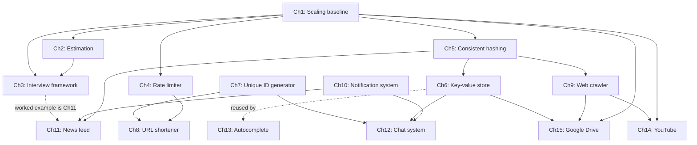

# System Design Interview - Map of Content

*System Design Interview: An Insider's Guide, Second Edition* by Alex Xu. Complete: Chapters 1-16.

## Chapters

1. [[Chapter 1 - Scale From Zero to Millions of Users]] — the baseline architecture (load balancer, replication, cache, CDN, stateless tier, multi-data-center, queue, sharding) every later chapter assumes.
2. [[Chapter 2 - Back-of-the-Envelope Estimation]] — powers of two, latency numbers, availability nines, and a reusable QPS/storage estimation method.
3. [[Chapter 3 - A Framework for System Design Interviews]] — the 4-step process (scope, high-level design, deep dive, wrap-up) every later "design X" chapter follows.
4. [[Chapter 4 - Design a Rate Limiter]] — token bucket, leaking bucket, fixed window, sliding window log, sliding window counter, and a Redis-backed implementation.
5. [[Chapter 5 - Design Consistent Hashing]] — the hash ring, virtual nodes, and the fix for modulo hashing's full-reshuffle problem.
6. [[Chapter 6 - Design a Key-Value Store]] — CAP theorem, quorum consensus, vector clocks, gossip protocol, Merkle trees; builds directly on Chapter 5's ring.
7. [[Chapter 7 - Design a Unique ID Generator in Distributed Systems]] — the Twitter snowflake 64-bit ID, and why no coordination is needed at request time.
8. [[Chapter 8 - Design a URL Shortener]] — base62 encoding over Chapter 7's unique IDs, and the 301-vs-302 redirect tradeoff.
9. [[Chapter 9 - Design a Web Crawler]] — the URL Frontier's politeness-plus-priority design, reusing Chapter 5's consistent hashing for load distribution.
10. [[Chapter 10 - Design a Notification System]] — per-channel message queues isolating APNs/FCM/SMS/email failures from each other; why exactly-once delivery is unachievable.
11. [[Chapter 11 - Design a News Feed System]] — the fanout-on-write vs. fanout-on-read hybrid, the exact example Chapter 3 introduced.
12. [[Chapter 12 - Design a Chat System]] — the book's first deliberately stateful service; WebSocket, service discovery, and heartbeat-based presence.
13. [[Chapter 13 - Design a Search Autocomplete System]] — the trie, and the two optimizations (capped prefix length, per-node top-k caching) that reduce lookup to O(1).
14. [[Chapter 14 - Design YouTube]] — the DAG-based video transcoding pipeline, and CDN cost optimization driven by the long-tail popularity distribution.
15. [[Chapter 15 - Design Google Drive]] — block-level storage enabling delta sync and deduplication; the one chapter that picks relational over NoSQL, for ACID.
16. [[Chapter 16 - The Learning Continues]] — a curated bibliography of real-system writeups, engineering blogs, and further reading, not a design chapter.

## How the chapters build on each other



The real dependency graph is not a straight line. Chapter 5's consistent hashing feeds three later chapters directly (6, 9, 11). Chapter 7's unique ID generator feeds two (8, 12). Chapter 1's baseline architecture (stateless tiers, caching, CDN, sharding) is assumed everywhere from Chapter 4 onward.

## Vault structure built for this book

```
Claude Notes/Books/System Design Interview/
  Chapter 1 - Scale From Zero to Millions of Users.md
  Chapter 2 - Back-of-the-Envelope Estimation.md
  Chapter 3 - A Framework for System Design Interviews.md
  Chapter 4 - Design a Rate Limiter.md
  Chapter 5 - Design Consistent Hashing.md
  Chapter 6 - Design a Key-Value Store.md
  Chapter 7 - Design a Unique ID Generator in Distributed Systems.md
  Chapter 8 - Design a URL Shortener.md
  Chapter 9 - Design a Web Crawler.md
  Chapter 10 - Design a Notification System.md
  Chapter 11 - Design a News Feed System.md
  Chapter 12 - Design a Chat System.md
  Chapter 13 - Design a Search Autocomplete System.md
  Chapter 14 - Design YouTube.md
  Chapter 15 - Design Google Drive.md
  Chapter 16 - The Learning Continues.md
  System Design Interview - MOC.md          (this file)
  Where Does This Go - Quick Reference.md   (Chapter 3's interview decision tree)
  Examples/
    Chapter 1 - Scaling Journey Architecture.md
    Chapter 2 - Estimation Cheat Sheet.md
    Chapter 4 - Rate Limiter Algorithms Reference.md
    Chapter 5 - Consistent Hashing Ring Walkthrough.md
    Chapter 6 - Key-Value Store Internals.md
    Chapter 7 - Snowflake ID Bit Layout.md
    Chapter 8 - URL Shortener Flow and Base62.md
    Chapter 9 - Web Crawler Pipeline.md
    Chapter 10 - Notification System Flow.md
    Chapter 11 - News Feed Fanout Flows.md
    Chapter 12 - Chat System Message Flows.md
    Chapter 13 - Autocomplete Trie Walkthrough.md
    Chapter 14 - Video Upload and Transcoding Pipeline.md
    Chapter 15 - Google Drive Upload and Sync Flows.md
```

Each `Examples/` note is a standalone, reusable worked example (diagrams, worked math, comparison tables), built so later notes can link back to it instead of re-deriving a diagram from scratch. Chapter 3's worked example is instead a standalone decision-aid note (`Where Does This Go - Quick Reference.md`), since that chapter's subject is an interview process, not an architecture.

## Open decisions, consolidated across all chapters

- Whether to keep a single running cross-book glossary (load balancer, SPOF, sharding key, CAP theorem, quorum, vector clock, Merkle tree, Bloom filter, long-tail distribution, and so on) versus leaving each term defined locally where it first appears (raised in Chapters 1, 6, and 13).
- Whether to build small, real, runnable code examples (a URL shortener, a toy chat server) under `Examples/`, beyond the diagrams and tables already built (raised in Chapters 8 and 12).
- Whether to track "space-for-time tradeoffs" as a standalone cross-chapter note, since Chapters 6, 9, and 13 each make this trade explicitly under a different name (Merkle trees, Bloom filters, per-node trie caching).
- Whether to track "block-level deduplication via content hashing" as a standalone cross-chapter note, since Chapters 6, 9, and 15 all lean on the same hash-based identity technique.
- Whether *Designing Data-Intensive Applications* (recommended directly in Chapter 16) becomes the next book processed into this vault, given its direct thematic overlap with this one.

## The single theme that kept recurring

Nearly every chapter in this book, regardless of topic, is some version of the same move: isolate failure domains and decouple components so one part's load or failure cannot propagate into another's. Load balancers isolate the web tier from backend failures (Ch1). Per-channel queues isolate one notification provider's outage from every other channel (Ch10). Per-host crawl queues isolate one slow website from the rest of the crawl (Ch9). The fanout hybrid isolates a celebrity's write cost from normal users' read speed (Ch11). Block-level storage isolates what changed from what did not (Ch15). The specific mechanism changes every chapter; the underlying move does not.

## Claude's pick: the single most important first-principles insight across the book

The most load-bearing idea introduced once and then reused silently everywhere after is from Chapter 6: **a guarantee is only worth paying for if something downstream actually depends on its exact strength.** Chapter 7 picks a 64-bit structured ID over a 128-bit UUID specifically because 64 bits plus structure is enough. Chapter 12 picks a local, per-conversation message ID over Chapter 7's own global snowflake ID, specifically because no feature in that chapter ever compares order across unrelated conversations. Chapter 13 caps prefix length at a small constant specifically because no real user types a 200-character query. In every case, the "smarter" design is not the one with the strongest guarantee, it is the one whose guarantee exactly matches what the system actually needs, no more and no less.

## Related
- Index of every book in this vault: [[Books - Index|Book Notes Index]]
