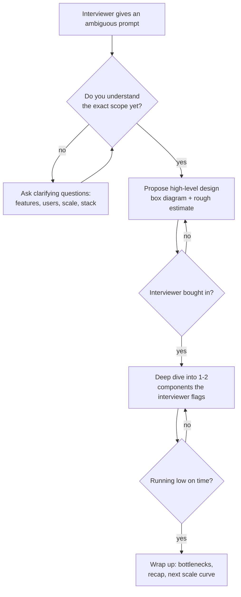

# Quick reference: what to do at each point in the interview

A standalone decision aid for Chapter 3's 4-step framework. Open this during practice, or glance at it before a real interview, instead of re-reading the chapter.

## The decision tree

## Time-allocation tie-breakers (45-minute interview)

| Step | Time budget | Signal you are done with this step |
|---|---|---|
| 1. Understand the problem and establish scope | 3-10 minutes | You and the interviewer agree on features, scale, and constraints in one sentence each |
| 2. Propose high-level design and get buy-in | 10-15 minutes | A box diagram exists, a rough estimate has been sanity-checked, the interviewer nods along |
| 3. Design deep dive | 10-25 minutes | You have gone deep on the 1-2 components the interviewer actually cares about, not every component equally |
| 4. Wrap up | 3-5 minutes | You have named a bottleneck, a next-scale-curve change, and have not declared the design perfect |

## Worked tie-breaker: when do you stop clarifying and start designing?

Ambiguous cases pulled from the chapter's own example (designing a news feed system):

- If the interviewer answers your question directly (for example, "both mobile and web"), treat it as a fact and move on immediately. Do not ask a follow-up on something already answered.
- If the interviewer asks you to make your own assumption instead of answering, write the assumption down visibly and keep moving. Do not block on it.
- Stop asking clarifying questions once you can state, in one or two sentences, the exact feature set, approximate user count, and approximate scale target. If you cannot state that sentence yet, you are not done with step 1.

## Worked tie-breaker: how much should you say in the deep dive?

- Prioritize the component the interviewer's body language or direct hints point to, not the component you personally find most interesting.
- For a URL shortener-style problem, the hash function design is the right level of depth. For a chat system, latency reduction and online/offline status are the right level of depth. For "design Google search," a database schema is too low-level; stay at the architecture level.
- A hard stop signal: if you are explaining an algorithm's internal mechanics (the book's own example is Facebook's EdgeRank) in detail, you have gone too deep. That detail does not demonstrate system-design ability, and it burns time you need elsewhere.

## Related
- Chapter note: [[Chapter 3 - A Framework for System Design Interviews]]
- MOC, built once all chapters are done: [[System Design Interview - MOC]]
