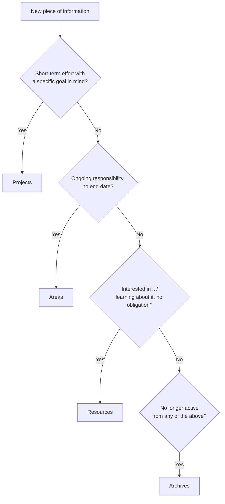

# Chapter 1 — Introducing PARA

> [!cite] Book reference
> *The PARA Method: Simplify, Organize, and Master Your Digital Life* — Tiago Forte. Part I: "The Fundamentals of PARA," Chapter 1: "Introducing PARA." Source: your uploaded EPUB; no public URL exists for this title beyond the publisher page.

> [!summary] One-line takeaway
> PARA sorts everything in your digital life into exactly four categories — Projects, Areas, Resources, Archives — organized not by *what a thing is about* but by *how actionable it is to you right now*.

## Why this chapter matters
This is the book's thesis chapter: Forte originally introduced PARA as one chapter inside *Building a Second Brain* (2022), and this entire book is the long-form, standalone treatment of that single idea — practically everything from here on (Part II's playbook on Projects vs. Areas vs. Resources, Part III's deep dives on maintenance and habits) is unpacking the four-category claim made here. If you've already read *Building a Second Brain*, this chapter will feel familiar; the payoff of this book is depth, not a new idea.

## Direct quotes from the book
> [!quote] The core observation
> "PARA is based on a simple observation: there are only four categories that encompass all the information in your life."

> [!quote] On what makes the system work
> "if your organizational system is as complex as your life, then the demands of maintaining it will end up robbing you of the time and energy you need to live that life... Your system must give you time, not take time."

> [!quote] The reframe from school-taught organization
> "Most of us first learned how to organize information in school... Without realizing it, we took that same approach into adulthood... This makes zero sense in your postacademic career... What you do have, both at work and in life, are outcomes you are trying to achieve."

> [!quote] The mantra
> "Instead of organizing information according to broad subjects like in school, I advise you to organize it according to the projects and goals you are committed to right now. This is what it means to 'organize for action.'"

## Core concepts

### The four categories, as defined in this chapter
| Letter | Category | Forte's test | Examples from the text |
|---|---|---|---|
| P | **Projects** | Short-term effort, taken on with a specific goal in mind | Complete webpage design, buy a new computer, renovate the bathroom, finish Spanish course |
| A | **Areas** | Important part of work/life requiring ongoing attention, no end date | Marketing, HR, Direct Reports (work); Health, Finances, Kids, Car (personal) |
| R | **Resources** | Topic you're interested in or learning about, no obligation attached | Graphic design, organic gardening, Japanese cuisine, photography |
| A | **Archives** | Anything from the other three that's no longer active | Completed/on-hold projects, inactive areas, resources you've lost interest in |

> [!tip] Where the word "PARA" comes from
> Forte notes in an endnote that *para* is Greek for "side by side" (as in "parallel") — meant to evoke the system working *alongside* your brain rather than replacing it.

### "Organize for action," not by subject
The chapter's sharpest reframe: school taught us to file information by **topic** (math, history, chemistry) and most adults carry that habit into adulthood without questioning it — folders named "Marketing," "Psychology," "Ideas." Forte argues this fails outside school because there's no final exam to study for; instead you have **outcomes you're trying to achieve**. The fix is to file by **your current relationship to the information**, not what it's nominally about — the same "Marketing" article could belong in a Project, an Area, or a Resource depending on why you saved it and what you're doing right now.

### Why four, and only four
The chapter leans hard on simplicity as a design constraint, not a limitation: a system only works long-term if it's easier to maintain than to abandon. Forte's claim is that four categories are both *exhaustive* (everything fits) and *minimal* (nothing is wasted ceremony) — the test for the rest of the book is whether that claim survives contact with messy real life, which is exactly what Part II (Chapters 6–7, distinguishing Projects/Areas/Resources) exists to stress-test.

## Visual representation

A full decision tree with tie-breakers for the genuinely ambiguous cases already exists in this vault at [[Where Does This Go - Quick Reference]] (built while working through *Obsidian Second Brain*'s PARA chapter) — this book is the primary source that note's decision tree is based on, one layer removed.

## Worked example — built directly in your vault
Nothing new needed building here: your vault **already runs live PARA**, built out while working through *Obsidian Second Brain*'s Chapter 2 — `00-Inbox/`, `01-Projects/`, `02-Areas/`, `03-Resources/`, `04-Archive/` all exist at the vault root with real content in them (Gloss Local and Second Brain Build-Out as Projects, Knowledge Management as an Area, Obsidian and PKM as a Resource). Reading this book's Chapter 1 against your own vault as a sanity check:

- **Gloss Local** → `01-Projects/` — correctly a Project by this chapter's own test: "a short-term effort you take on with a certain goal in mind." It has a finish line (stable local fork running across Mac/Windows/phone), which matches the book's framing exactly.
- **Knowledge Management** → `02-Areas/` — correctly an Area: "important parts of your life that require ongoing attention more broadly," with no completion date, matching the book's own example categories like "Software Development."
- **Obsidian and PKM** → `03-Resources/` — correctly a Resource: a topic you're interested in and building expertise in, with no obligation attached, matching the book's "graphic design" / "photography" examples.
- `04-Archive/` is still empty, which is fine per this chapter — archiving happens as things finish, not up front.

The one thing this chapter's framing does add, that the shorter *Obsidian Second Brain* treatment didn't spell out as explicitly: Forte's test for Projects is "a *certain goal* in mind," not just "an active task" — worth re-checking **Second Brain Build-Out** against that specific wording. It qualifies (goal: all chapter notes + guides for the book finished), but it's a project *about learning a system*, which is exactly the ambiguous shape the community criticism below calls out.

## What the book doesn't tell you — community perspective (blogs, Medium, Hacker News, 2024–2025)
PARA has a large, enthusiastic following, but the Projects-vs-Areas line is the single most repeated complaint across the productivity and PKM internet:

- **The Projects/Areas line is widely called "mushy."** Forte defines Projects as having a specific outcome and deadline and Areas as ongoing responsibilities — but in practice many Areas have implicit outcomes and many Projects drift without a clear end date, and multiple writers report burning real time debating which bucket something belongs in rather than doing the actual work ([Sunrise Digest](https://www.thesunrisedigest.com/focus/para-method-notes/)).
- **A concrete diagnostic some communities converged on**: if your Projects list never gets shorter, you're probably confusing Projects with Areas — a healthy, rotating Projects list should land around 5–12 live items. The most commonly cited version of this mistake is putting "Health" or "Finances" in Projects when they're actually Areas you maintain indefinitely, never "complete."
- **"One folder only" is a structural complaint.** Several critiques note that PARA's folder model forces a note into exactly one bucket, so a note can't simultaneously be a Project asset *and* a Resource for other projects — a real limitation once your vault is large enough that the same material legitimately serves two purposes at once ([Hacker News discussion](https://news.ycombinator.com/item?id=30916260)).
- **Doesn't fit atomic note-taking / Zettelkasten-style PKM.** This is the critique most relevant to an Obsidian vault specifically: atomic, linked notes are deliberately meant to cut *across* projects and topics, not live inside one folder — so PARA is a good fit for files and project assets but a worse fit for a permanent-note knowledge base, where tags and backlinks do more work than folder placement ([Sunrise Digest](https://www.thesunrisedigest.com/focus/para-method-notes/)). This echoes the exact critique already logged in [[Chapter 2 - PARA Folder System|Obsidian Second Brain's Chapter 2 notes]] almost verbatim — it's clearly a converged, not isolated, opinion.
- **A documented failure pattern**: one widely-shared account describes adopting PARA in Notion twice, getting excited, over-building the structure, and abandoning it within two weeks both times — ending up with a 47-page untagged "Resources" dump and a stale Projects list ([grizzlytemplates.com](https://www.grizzlytemplates.com/blog/para-method-notion)). The pattern suggests the failure mode isn't the four categories themselves, but skipping the maintenance habit (covered later in this book's Chapter 5, "How to Maintain Your PARA System") in favor of an upfront big-bang reorganization.
- **Overclaiming as "the" universal system.** Some reviewers (including on Goodreads) feel the book repeats material already public in *Building a Second Brain* and Forte's blog without enough new substance to justify a standalone book — worth knowing going in if you've already read the earlier book closely.

## Deeper commentary — how this applies to your setup specifically
Your vault is a useful live test case for the community's biggest complaint (Projects/Areas mushiness), because you already have one genuinely ambiguous case on record: **Second Brain Build-Out** was flagged as debatable between Project and Resource back in the *Obsidian Second Brain* chapter notes. This book's Chapter 1 doesn't resolve that ambiguity any more cleanly than the shorter treatment did — which is itself informative: even the author's full-length treatment of his own system doesn't make the edge cases disappear, it just gives you more vocabulary for naming them. The "5–12 rotating Projects" diagnostic from the community research above is worth applying concretely: check your `01-Projects/` folder at your next weekly review and see if it's actually rotating, or quietly turning into a permanent list (a warning sign per the research above).

Given [[Gloss Local]] is explicitly built to be local-first, no-subscription, and long-running once stable, it's worth pre-deciding now (rather than later, under the "will I remember to re-sort this" pressure the community failure story illustrates): the project moves to `02-Areas/` the moment it's "stable and just running" rather than "actively being built," per the plan already noted in the *Obsidian Second Brain* Chapter 2 notes. This chapter's "short-term effort with a specific goal" language for Projects makes that transition point even more explicit than before — once there's no more specific goal left to achieve, by definition it's not a Project anymore.

## Practical / actionable takeaways
- [x] PARA folder structure already live in this vault — nothing to build for this chapter specifically
- [ ] At your next weekly review, count the live items in `01-Projects/` — if the list hasn't gotten shorter in a while, apply the community diagnostic above and check whether something there is actually an Area
- [ ] Revisit whether **Second Brain Build-Out** has a "certain goal" per this chapter's exact test, now that you're deeper into both book-notes projects simultaneously
- [ ] Pre-decide the Gloss Local Project → Area transition trigger (stable + running, not "actively being built") so it doesn't need a judgment call under time pressure later

## Questions / things to decide for your own vault
- Do you want a hard numeric cap (e.g. 12) on live items in `01-Projects/` as a forcing function, or is that too rigid for how you actually work?
- Should "Second Brain Build-Out" and this new "PARA Method" book-notes effort be tracked as one Project or two, given they're both book-notes work feeding the same vault?

## Sources (external, beyond the book)
- [The PARA Method for Notes: Tiago Forte's System, Pros and Cons — The Sunrise Digest](https://www.thesunrisedigest.com/focus/para-method-notes/)
- [The PARA Method: A Universal System for Organizing Digital Information — Hacker News discussion](https://news.ycombinator.com/item?id=30916260)
- [PARA Method in Notion: Organize Your Life with Ease — Grizzly Templates](https://www.grizzlytemplates.com/blog/para-method-notion)
- [PARA Method Review: Does Everyone Really Love the Organizing Method? — Carole, Bootcamp (Medium)](https://medium.com/design-bootcamp/para-method-review-does-everyone-really-love-the-organizing-method-c7d1b1bb5ed7)
- [What Are The Best PARA Method Alternatives? — Matt Giaro](https://mattgiaro.com/para-method-alternatives/)
- [The PARA Method: The Simple System for Organizing Your Digital Life in Seconds — Forte Labs (original blog source)](https://fortelabs.com/blog/para/)

## Claude's pick — what I'd flag as most important
1. **"Organize for action, not by subject"** is the one sentence worth remembering from this entire chapter — it's the test that resolves most PARA confusion if you apply it honestly, instead of asking "what is this about."
2. The community research is unusually consistent across unrelated sources on exactly one failure mode: Projects/Areas confusion, specifically "Health"/"Finances" style Areas mistakenly started as Projects. That's worth remembering as the single highest-value thing to watch for in your own vault, more than any other PARA mistake.
3. The "doesn't fit atomic note-taking" critique matters specifically for you, since this is an Obsidian vault — PARA is doing real, useful work for your Projects/Areas/Resources/Archive top level, but don't expect it to also solve how your permanent notes and ideas link to each other; that's a separate job already being handled by MOCs and backlinks per [[Obsidian Second Brain - MOC]].

## Related
- Previous: [[Introduction - How to Read This Book]]
- Next: [[Chapter 2 - The Power of Organizing by Project]]
- MOC: [[The PARA Method - MOC]]
- Cross-reference (same system, shorter treatment): [[Chapter 2 - PARA Folder System]] (*Obsidian Second Brain*)
- Cross-reference (origin book): [[Chapter 1 - Where It All Started]] (*Building a Second Brain*)
- Decision tree: [[Where Does This Go - Quick Reference]]
